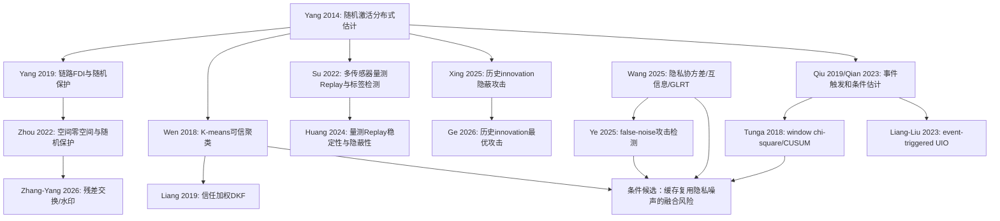

# 05 文献关系图与技术演化

## 1. 关系图

## 2. 三条技术线的交汇

主动攻击线从“攻击是否可检测”发展到“攻击方向/历史策略/检测—性能权衡”；被动隐私线从“隐藏通信内容”发展到“噪声协方差、互信息和通信代价”；事件触发线揭示了采样/发送机制改变残差分布。当前项目的潜在交汇只剩下一个非常窄的组合：发送包中有合法隐私扰动，缓存/外推使同一次扰动跨多拍复用，检测与融合必须处理这一低秩相关噪声。

## 3. 不能作为新颖性的操作

1. 单步 innovation/残差检测：Yang 2019、Zhou 2022、Tunga 2018已有。
2. windowed chi-square、CUSUM、episode 最大值：Tunga 2018和项目 G1 已排除独立创新。
3. K-means/信任加权/空间一致性：Wen 2018、Liang 2019、Peng 2025已有。
4. 事件触发邻居残差/UIO：Qiu 2019、Liang-Liu 2023已有相近结构。
5. 历史数据攻击：Huang 2024、Xing 2025、Ge 2026已有；历史污染传播恒等式属于标准线性系统理论。
6. 协方差交集、膨胀和标准 Kalman correlated-noise 更新：属于成熟工具，不能单独包装。

## 4. 目前空白的证据状态

“无可信序号的一跳邻居 estimate Replay + fixed external intermittent schedule”尚未在本次全文集合中找到完全相同的攻击权限；这是模型空白，尚不是方法空白。只有当现有方法在同一信息权限下不能给出可计算保证，且新增操作改善 MSE/误报—通信权衡时，才可能成为论文问题。
