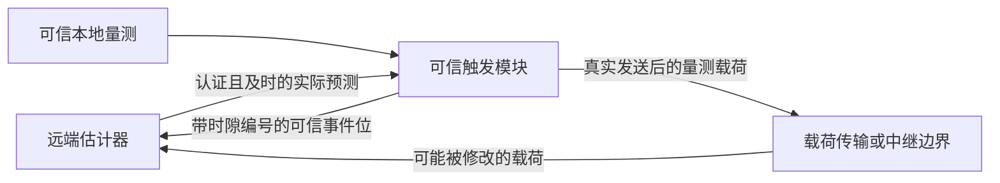

# 未来可信事件上界：全策略审查与结构必要性边界

本报告DERIVED为独立推导。继承原稿 `theory.tex` 的信息域和策略类，不增加未来信息、不删除协方差项；不进行新仿真。

## 裁决

**ACCEPT WITH CONDITIONS：原稿全策略上界在声明模型下成立，未发现推翻它的反例。** 它依赖实际预测反馈进入触发中心、事件位可信、全状态含噪量测、可逆A、固定有限时刻和有界载荷策略。不能只凭“TV小＋分布平滑”推出；但所用Gaussian积分、谱界和TV对偶均为标准工具，数学有效不等于独立新颖性通过。

## 1. 条件高斯与全部因果策略

令攻击种子S独立于物理初值、噪声及触发随机数；\(\mathcal G_t^+\) 包含S、真实已发送量测和事件历史。攻击动作及实际接收预测对该信息可测，但防御者并没有真实量测副本。

归纳假设 \(x_t\mid\mathcal G_t^-\sim N(\mu_t^-,P_t^-)\)。给定真实发送量测后，发送事件因子仅依已知量测和实际预测，后验归一化时约去；静默时对量测噪声积分得到以实际预测为中心、协方差 \(R+Z^{-1}\) 的Gaussian似然。与先验相乘，两个分支后验仍Gaussian，协方差为名义 \(P_t^+\)。独立过程噪声完成归纳。

这里攻击可以是量测相关的非线性函数：它对扩充信息可测，不改变上述条件后验。不能把结论移到仅含受篡改接收日志的更小信息域。

令 \(d_t=\mu_t^- -m_t^-\)、\(D_t=\mu_t^+-m_t^+\)，则
\[
D_t=(I-K_{\gamma_t})d_t-\gamma_tK_1a_t,\quad d_{t+1}=AD_t,
\]
\[
J_k=E_\pi\|D_k\|^2+E_\pi\operatorname{tr}P_k^+-E_0\operatorname{tr}P_k^+.
\tag{1}
\]
第二式用条件零均值残差的正交性。P是扩充信息下的真条件协方差，也等于算法递推的标签；不是任意受攻接收日志下的真实条件协方差。

## 2. 对全策略成立的偏差半径及峰值界

在固定有限事件前缀上，P和K取有限集合。令 \(\alpha_t=\max\|I-K_i\|\)、\(\beta_t=\max\|K_1\|\)，递推 \(r_0=\beta_0\)、\(r_t=\alpha_t\|A\|r_{t-1}+\beta_t\)。从d0=0归纳得 \(\|D_t\|\le r_tb\)。非对称增益不被误当范数≤1。

同一事件前缀h下，下一静默概率为健康静默概率乘以 \(E_\pi[e^{-d_t^\top W_hd_t/2}\mid h]\)。由 \(1-e^{-u}\le u\) 得单步事件概率差为O(b²)；对共同前缀逐步耦合，有限k的事件串TV为O(b²)。协方差迹在有限标签集中有有限振幅，故式(1)的协方差期望差也是O(b²)。因此J≤C_peak b²。仅估计D的半径而不处理第二项，不足以完成这一步。

## 3. 未来事件的统一偏差敏感性

目标后量测相对实际预测在扩充信息下服从
\[
y_{k+1}-m_{k+1}^-\mid\mathcal G_k^+\sim N(AD,\Sigma(P)),
\quad\Sigma(P)=APA^\top+Q+R.
\]
由于未来载荷修改晚于该拍事件，任意允许后续动作不能改变此事件概率。Gaussian积分给
\[
E_\pi[Y\mid\mathcal G_k^+]=s(P)e^{-D^\top H(P)D},\quad
s(P)=\det(I+Z^{1/2}\Sigma(P)Z^{1/2})^{-1/2},
\]
\[
H(P)=\tfrac12 A^\top[Z^{-1}+\Sigma(P)]^{-1}A.
\tag{2}
\]

可逆A使H正定；有限标签集使 \(h_*=\min_P\lambda_{min}(H(P))>0\)、\(M=\max_P1/s(P)<\infty\)。用固定 \(b_{ref}\) 和半径 \(B_*=r_kb_{ref}\) 定义
\[
q=(1-e^{-h_*B_*^2})/B_*^2>0.
\]
割线界对 \(\|D\|\le B_*\) 给出 \(1-e^{-D^\top H(P)D}\ge q\|D\|^2\)。令W=Y/s(P)，则
\[
qE_\pi\|D\|^2\le1-E_\pi W=E_0W-E_\pi W\le M\Delta_{marked}.
\tag{3}
\]
最后的不等式用W的振幅[0,M]，因TV定义为sup事件差，系数为M而非2M。marked本身含P，故协方差迹期望差至多 \(\Omega_k\Delta_{marked}\)。代回式(1)：
\[
J_k\le(M/q+\Omega_k)\Delta_{marked}.
\tag{4}
\]
该证明对所有原允许策略统一，常数只依固定模型、k和b_ref。零TV时式(3)强制D=0且P标签同律，故J=0。一般策略J可为负；最坏值V≥0来自零动作可行，不能把两者混淆。

## 4. 为什么一般平滑分布并不足够

标准统计反例：\(P=N(0,1)\)、\(Q_p=(1-p)P+pN(p^{-1},1)\)，TV≤p而二阶矩增量为1/p。它说明TV本身不控制无界平方损失；这不是本协议允许策略的反例。

即使偏差有界，若可见记录与偏差独立或处处不受影响，TV也可为0而平方损伤为正。要得到式(4)，不可省略的接口是：**记录中的可计算W对所有允许隐藏偏差具有统一的二次敏感性，并且P标签能处理真实损伤的协方差项。** 式(2)、正定性、有限标签和峰值把该条件在本协议中落实。

这是协议相关的充分条件，而非证明了所有通信协议的必要充分刻画。把其抽象成“存在一个敏感得分就有风险界”本身仍是标准期望不等式；是否足够作为学报增量取决于该敏感得分在真实协议中的新增含义及既有定理排重。

## 5. 源端独立触发对照：解析上可直接区分

定义一个明确的对照协议：源端单独运行健康递推，用自己的可信本地数据和源端预测形成事件；远端遭受载荷攻击的估计**不反馈进入源端触发**。保持物理过程外生、触发私有随机数耦合，且攻击只改远端接收载荷。于是任意远端载荷修改都不能改变源端整个事件串，逐路径 \(\gamma^a_{0:T}=\gamma^0_{0:T}\)，故事件串TV=0，按事件递推的P标签也同律。

取首次攻击为t=0，初始预测一致；仅在发送时施加独立等概率±ηv。远端目标估计差为 \(\gamma_0\sigma\eta K_0v\)。对私有符号取期望消去与健康误差的交叉项，得到
\[
J_0=\Pr(\gamma_0=1)\eta^2\|K_0v\|^2>0.
\tag{5}
\]
故在该源端独立触发对照中，不存在有限C使所有允许攻击满足 \(J_0\le C\Delta_{bits}\) 或 \(C\Delta_{marked}\)。这不是推翻原主定理，因为反馈架构已改变；也不声称完整载荷日志同律。

**裁决：** 反馈闭环对原事件证书确实有结构作用，不能由一般事件触发直接代替。但本反例只证明这一明确删改会失去保证；其他可信传感器、验证通道或完整载荷统计仍可能提供别的损伤证书，不能称实际反馈是所有安全协议唯一必要资源。

## 6. 可信协议的解释与不能越过的界

这是**假设性架构说明**，不是已部署系统。可信意味着反馈内容与来源、事件存在与时序不被改；不意味着反馈估计准确。静默也需可靠时钟和无自然丢包假设才能与丢包区分。若发生认证失败/报文缺失，应另定协议，不能默认为本模型已覆盖。

可用于分析“部分可信边界还能提供何种剩余保证”；不能未经成本证据说小元数据认证比载荷完整性认证必然便宜。消息认证标签常为固定开销，认证预测本身也是向量；必须面对“为何不直接认证全部载荷”的替代方案。源端本地量测在进入可信模块前已被污染、估计驱动物理反馈、反馈内容被攻击等情形均在本轮保证之外。

## 7. 记录删减和量纲

H_k同律正损伤反例仅针对截至目标拍记录；last-only反例仅证明存在模型中不保留历史校准会失效。它们不推出所有记录中的最小性，亦不推出历史P必须是唯一合适标签。

b有量纲而ε无量纲；Θ式中的常数携带相应模型尺度，不能把ε=b²称普适交点。实际证书的交点是 \(\varepsilon=(C_{peak}/C_{record})b^2\)；若用归一化幅值 \(\bar b=b/b_{ref}\)，则必须相应重定义两侧常数。原代码以固定单位数值运算，不构成量纲消失的物理理由。
