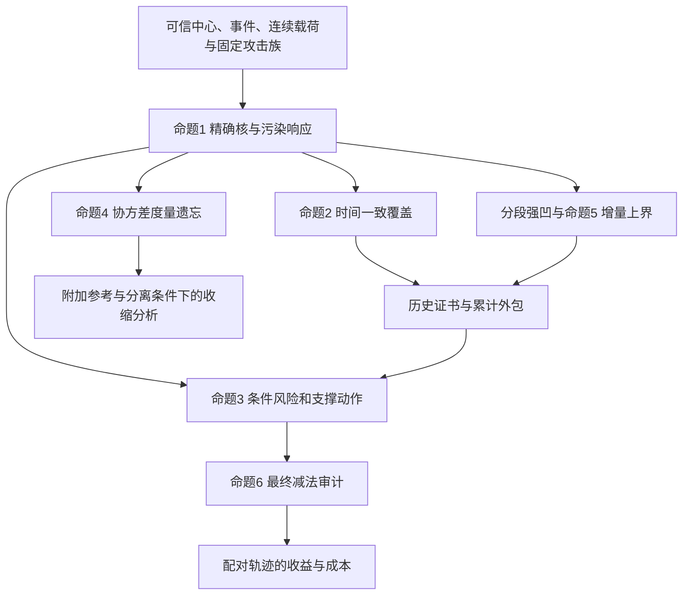

# 量化预测反馈下基于历史证据累积的多维状态估计安全恢复

## 摘要

考虑多维线性高斯系统的远程估计。传感器根据可信量化预测中心产生随机发送事件，发送后载荷受到未知起点、未知非负常幅值的持续加性污染。利用可信事件、可见重构中心和连续接收载荷，建立精确参数似然，将全时域参数置信集合映射为当前向量污染集合。通过累积历史似然排除与成功方向证书，维护按攻击起点分组的多区间幅值外包，并以逐拍似然上界和伴随方向缓存实现后续认证与输出校正。在正确模型和数值外包可靠的前提下，同一置信覆盖事件同时支持多次查询、历史约束传播及条件风险改善下界。V2 二维系统的冻结回放与独立配对试验观察到计算成本下降，强污染组观察到有限样本降损。弱幅值的证书启动、总体期望收益、有限字长通信和 monitor 全递推数值误差仍需补充验证。

本说明以阶段九 `7a2bca78` 为研究快照。文中的解析命题附证明要点与来源，数值表由本轮脚本重算。全球新颖性的判断沿用已取得的全文审查范围和明确待核文献。[阶段九研究包](../paper2_stage9_cumulative_evidence_20261123/README.md)

## 一、统一问题与通信接口

### 1.1 动力学与估计目标

设
\[
x_{t+1}=Ax_t+w_t,\qquad y_t=Cx_t+v_t\in\mathbb R,
\]
其中初值高斯，过程噪声和量测噪声相互独立，\(Q\succ0,R>0\)。状态维数为 \(n\)，已验证主算例取 \(n=2\)。monitor 的先验和后验均值分别为 \(m_t^-,m_t^a\)，协方差标签为 \(P_t^-,P_t^+\)。论文的校正输出记为 \(m_t^r\)，动作记为 \(a_t\)，从而避免与反馈中心 \(c_t\) 混用。

在每拍事件前，接收端生成量测空间中的反馈中心
\[
c_t=Q_{\delta,\phi_t}(Cm_t^-),\qquad
Q_{\delta,\phi}(z)=\phi+2\delta
\left\lfloor\frac{z-\phi+\delta}{2\delta}\right\rfloor.
\tag{1}
\]
后续连续完整周期随机相位满足 \(\phi_t\sim\mathrm{Unif}[-\delta,\delta)\)，在上一拍载荷提交后独立新抽。初始中心按给定先验约定，阶段九零均值初始化取 \(r_0=0\)。令 \(r_t=c_t-Cm_t^-\)。理想模型中，后续事件前相位尚未揭示时，\(r_t\) 条件均匀于一个完整量化周期。

可信事件按真实量测产生
\[
\Pr(\gamma_t=0\mid y_t,c_t)=
\exp\{-Z(y_t-c_t)^2/2\},\quad Z>0.
\tag{2}
\]
固定攻击参数 \(\vartheta=(k,b)\) 满足 \(k\in\mathbb N_0\)、\(b\in[0,b_{\max}]\)。仅在 \(\gamma_t=1,t\ge k\) 时，将发送载荷改为 \(\widetilde y_t=y_t+b\)。永久健康为单独的零污染解释。固定参数在整个观测期间保持一致。校正 \(m_t^r=m_t^a-a_t\) 用于发布状态，反馈中心和后续原始估计由 monitor 生成。[向量核与污染递推](../paper2_stage6_vector_correction_20261122/01_vector_kernel_and_pollution.md)

### 1.2 当前保证使用的信息

每拍合法接收历史包括可信事件位、实际重构中心，以及发送拍的连续载荷。已知本地预测时，它们可等价表示成 \(r_t\) 和接收创新 \(u_t=\widetilde y_t-Cm_t^-\)。当前精确中心分支可恢复相位的周期代表。相位与中心生成机制在不同参数假设下使用同一已见历史，因而其共同条件概率因子在似然比中抵消。

| 物理字段或过程 | 当前处理 | 论文适用条件 |
| --- | --- | --- |
| 反馈量化 | 标量预测量测 \(Cm_t^-\) 的随机相位量化 | 接收端与传感器使用同一实际中心 |
| 上行载荷 | 发送时的实数数值 | 连续密度核与高斯候选滤波 |
| 事件位与中心 | 可信 | 篡改入口限定于发送后的载荷 |
| 相位 | 下一拍使用前独立生成并体现在中心中 | 连续均匀理论与 binary64 模拟近似 |
| 整数码字索引 | 已有单步相位区间积分分析 | 多拍序贯恢复需要隐藏中心滤波闭合 |
| 有限字长传输 | 尚待建立逐报文编码与观测核 | 精度、范围、溢出、饱和和同步均需声明 |
| 物理系统 | 外生线性动力学 | 控制输入、网络共识和多传感器融合需要对应模型 |

论文标题宜明确“量化预测反馈”。有限比特纯码字恢复的表述需要补齐上行数值编码及隐藏中心处理。阶段九直接抽取均匀 \(r_t\) 是理想全周期相位在误差坐标中的等价模拟，报文编码、索引范围和通信位数尚待实现。[中心与索引的条件核](../paper2_stage3_joint_detection_20261121/10_center_vs_codeword_likelihood.md)

### 1.3 全文保证的量词

固定一个真实参数 \(\vartheta_\star\)，在该参数诱导的完整记录概率空间中讨论时间一致覆盖。模型与噪声参数正确、真实初始污染为零、事件和中心可信、候选幅值族包含真值，是后续主命题的共同条件。一般向量公式使用 \(W\succ0\)，阶段九性能试验取 \(W=I_2\)。可逆伴随缓存另要求相应 \(F_t\) 可逆。数值保证依赖精确有理数线性代数及 CPython Decimal 的外向舍入契约。[阶段四覆盖条件](../paper2_stage4_certified_correction_20261122/02_confidence_sequence_and_risk.md)

## 二、精确联合核与向量污染

### 命题 1　共同历史下的高斯候选和污染表示

令 \(\mathcal G_t\) 为当前中心已揭示、事件与载荷尚待观察的历史，\(\mathcal I_t\) 为处理本拍记录后的历史。对固定候选参数，定义
\[
\mu_t^-=\mathbb E_\vartheta[x_t\mid\mathcal G_t],\quad
\theta_t^-=m_t^--\mu_t^-,\quad d_t=-C\theta_t^-,
\]
\[
S_t=CP_t^-C^\top+R,\qquad V_t=S_t+Z^{-1},\qquad
h(z)=1-e^{-Zz^2/2}.
\]
记当前候选幅值为 \(b_t=b\mathbf1_{\{t\ge k\}}\)。在“静默原子＋发送载荷 Lebesgue 测度”上，观测核为
\[
G_t(d_t)=\frac{\exp[-(d_t-r_t)^2/(2V_t)]}{\sqrt{1+ZS_t}},
\qquad
f_t(u)=\varphi_{S_t}(u-b_t-d_t)h(u-b_t-r_t).
\tag{3}
\]
它满足 \(G_t+\int f_t(u)du=1\)。发送且给定载荷后，候选真实量测可还原，选择因子在状态后验归一化中抵消。静默是以 \(c_t\) 为中心、噪声方差 \(R+Z^{-1}\) 的虚拟量测。因此
\[
R_1=R,\quad R_0=R+Z^{-1},\quad
K_{\gamma,t}=P_t^-C^\top(CP_t^-C^\top+R_\gamma)^{-1},
\]
\[
P_t^+=(I-K_{\gamma_t,t}C)P_t^-,\qquad
P_{t+1}^-=AP_t^+A^\top+Q.
\tag{4}
\]
给定正确参数时，候选条件协方差与该标签一致。各候选均值对应同一记录中的潜在真实状态。令 \(F_t=(I-K_{\gamma_t,t}C)A\)，则
\[
H_{k,t}^+=F_tH_{k,t-1}^+
+\gamma_tK_{1,t}\mathbf1_{\{t\ge k\}},\qquad
\theta_t^+(k,b)=m_t^a-\mathbb E_\vartheta[x_t\mid\mathcal I_t]=bH_{k,t}^+.
\tag{5}
\]
初始响应取零，首次递推前的零向量作一致约定。将式(3)的发送项换元为真实量测创新即可证明归一化。对两种后验均值相减可证明式(5)。载荷选择因子继续保留在边缘似然中。[联合核证明](../paper2_stage3_joint_detection_20261121/01_joint_observation_theory.md) · [向量化证明](../paper2_stage6_vector_correction_20261122/01_vector_kernel_and_pollution.md)

### 2.1 似然的一维结构

固定起点 \(k\) 和接收历史，令 \(\eta_{k,i}=CAH_{k,i-1}^+\)、\(v_i=u_i-r_i\)，并用 \(p_{0,t}\) 表示健康历史密度。精确对数似然比为
\[
\ell_{k,t}(b)=\log\frac{p_{k,b,t}}{p_{0,t}}
=\mathsf A_{k,t}b-\frac12\mathsf B_{k,t}b^2
+\sum_{\substack{i=k\\\gamma_i=1}}^t
\{\log h(v_i-b)-\log h(v_i)\},
\tag{6}
\]
\[
\mathsf A_{k,t}=\sum_{\gamma_i=1}\frac{(1-\eta_{k,i})u_i}{S_i}
-\sum_{\gamma_i=0}\frac{r_i\eta_{k,i}}{V_i},\qquad
\mathsf B_{k,t}=\sum_{\gamma_i=1}\frac{(1-\eta_{k,i})^2}{S_i}
+\sum_{\gamma_i=0}\frac{\eta_{k,i}^2}{V_i}.
\]
求和区间均为 \([k,t]\)。在移动零点 \(b=v_i\) 之间，\(\log h\) 严格凹。起点后的第一次发送前响应为零，故该拍向 \(\mathsf B\) 贡献 \(1/S_i\)。若 \(S_i\le S_{\max}\)，则 \(\ell''\le-1/S_{\max}\)。这项强凹性保留于多维状态、单标量攻击幅值的模型。[强凹证明](../paper2_stage5_certification_acceleration_20261122/01_piecewise_strong_concavity.md)

## 三、全时域参数覆盖与历史约束

### 命题 2　覆盖与累计外包保持

选取初始质量为一、序贯一致的参考概率过程 \(\mathbb Q\)，其历史密度为 \(q_t\)。假设在每个被覆盖的固定真参数下，参考过程有限历史测度绝对连续于真实测度。定义
\[
C_t^\varepsilon=\{\vartheta:p_{\vartheta,t}>\varepsilon q_t\}.
\tag{7}
\]
似然比 \(q_t/p_{\vartheta_\star,t}\) 是非负密度鞅，Ville 不等式给
\[
\Pr_{\vartheta_\star}(E)\ge1-\varepsilon,\qquad
E=\{\forall t\ge0:\vartheta_\star\in C_t^\varepsilon\}.
\tag{8}
\]
这里的概率语句对每个固定真参数成立。真值可在参考幅值网格之外，只要分母使用该参数的精确物理似然。[参数反演与证明](../paper2_stage4_certified_correction_20261122/02_confidence_sequence_and_risk.md)

阶段九参考分子沿用三档 warm 联合过程，其各拍评分核归一化，跨起点重启乘积的质量作混合。用于反演的分母逐起点维护精确 \(H_{k,t}\)。参考的合法性支持式(8)。稠密精确物理参考、近真原子和逐渐收紧的全局求解误差，则是既有连续功能收缩定理的额外前提。[参考实现](../paper2_stage6_vector_correction_20261122/vector_record.py) · [连续功能收缩](../paper2_stage4_certified_correction_20261122/08_continuous_functional_contraction.md)

在首次正方向证书之前，完整候选包含健康和未来起点等价类，其当前污染为零。首次全域证书在 \(\tau\) 签发后，在 \(E\) 上真起点属于 \(\{0,\ldots,\tau\}\)。此后令 \(\overline C_t\supseteq C_t^\varepsilon\) 表示可靠似然外包，定义本拍查询前集合 \(S_t^-\) 和查询后集合 \(S_t\)
\[
S_t^-=S_{t-1}\cap\overline C_t,\qquad
S_t=S_t^-\cap\bigcap_{j\in J_t}\overline D_{j,t},
\tag{9}
\]
其中 \(\overline D_{j,t}\) 是成功方向约束的外向外包，覆盖
\(D_{j,t}=\{(k,b):b\,d_{j,t}^\top WH_{k,t}^+\ge z_{j,t}\}\)。所有量都作用于同一个固定参数 \((k,b)\)。\(S_t\) 以每起点的多个闭幅值区间表示。

归纳时，真参数在 \(E\) 上属于 \(C_t^\varepsilon\)，故似然删除保留它。成功证书验证了所有仍相容的参数均满足方向约束，外向交集继续保留它。因此
\[
\Pr_{\vartheta_\star}\{\forall t\ge\tau:\vartheta_\star\in S_t\}\ge1-\varepsilon.
\tag{10}
\]
历史置信集合可非单调，累计外包保持跨时刻已证明的排除。式(9)的计算外包允许保留预算内尚未排除的整段区间。其集合包含关系是覆盖证明的依据。[阶段九归纳](../paper2_stage9_cumulative_evidence_20261123/01_theory.md)

阶段七、八已通过历次方向约束所给幅值下界的最大值累积证书。阶段九把历史似然排除也加入外包，发送零点两侧的相容分量由此可分别保留。[固定参数历史约束](../paper2_stage7_fixed_amplitude_20261122/01_fixed_parameter_theory.md)

### 3.1 来源与时间依赖

阶段九在同一查询拍冻结 \(S_t^-\)，每个受限证书保存模型、参考过程、风险预算、幅值上限、实现、观测前缀、外包快照及父证书标识。父证书时间严格小于查询拍，当前批次成功证书统一在查询结束后应用。这是当前实现采用的来源约定，落实签发只依赖已见历史的要求。方向可以用当前记录生成，因为对全部方向的支撑判断受同一个参数覆盖事件约束。[证书接口](../paper2_stage9_cumulative_evidence_20261123/cumulative_envelope.py)

来源哈希用于进程内记录一致性和研究复现。该接口以本地证书签发、存储状态与计算过程可信为前提。统计证书的有效性继续依赖模型、似然、集合包含和数值上界的证明。

## 四、多维污染、风险校正与失效预算

### 命题 3　向量污染的条件风险与投影

在真参数固定时，令 \(\mu_t=\mathbb E_{\vartheta_\star}[x_t\mid\mathcal I_t]\)、\(\theta_t=m_t^a-\mu_t\)。对 \(\mathcal I_t\) 可测动作 \(a_t\)，定义
\[
R_t(\widehat m)=\mathbb E_{\vartheta_\star}
[\|x_t-\widehat m\|_W^2\mid\mathcal I_t].
\]
由条件均值正交性，
\[
\Delta R_t=R_t(m_t^a)-R_t(m_t^a-a_t)
=2\theta_t^\top Wa_t-a_t^\top Wa_t.
\tag{11}
\]
令 \(\Theta_t=\{bH_{k,t}^+:(k,b)\in S_t\}\)，非空时定义 \(K_t=\overline{\mathrm{conv}}\Theta_t\)。其加权最近点
\[
p_t=\arg\min_{z\in K_t}\|z\|_W^2
\]
满足投影变分不等式，因而
\[
\max_a\inf_{\theta\in\Theta_t}
\{2\theta^\top Wa-\|a\|_W^2\}
=\|p_t\|_W^2.
\tag{12}
\]
证明上界时，将线性泛函在 \(\Theta_t\) 上的下确界延拓到闭凸包，再在 \(p_t\) 处取值，得到 \(\|p_t\|_W^2-\|a-p_t\|_W^2\)。下界取 \(a=p_t\)，由 \((\theta-p_t)^\top Wp_t\ge0\) 得证。共同安全非零方向存在的充要条件是原点与 \(K_t\) 分离。[风险与投影证明](../paper2_stage6_vector_correction_20261122/03_projection_and_directional_certificate.md)

阶段九采用有限个方向的可靠支撑计算。若 \(s_t(d)\le\inf_{\theta\in\Theta_t}d^\top W\theta\) 且 \(s_t(d)>0\)，取
\[
a_t=\alpha d,\qquad
0\le\alpha\le\frac{s_t(d)}{d^\top Wd}.
\]
则在 \(E\) 上 \(\Delta R_t\ge2\alpha s_t(d)-\alpha^2d^\top Wd\ge\|a_t\|_W^2\)。动作幅度限制通过沿方向缩小实现。精确凸投影是理论参照，当前方向库给可实现支撑下界。[固定幅值传播与方向缓存](../paper2_stage7_fixed_amplitude_20261122/01_fixed_parameter_theory.md)

### 4.1 概率保证的评价对象

式(11)先在原真实概率测度下条件于 \(\mathcal I_t\) 定义。随后在公共覆盖事件 \(E\) 的记录上判断该条件风险函数是否满足下界。实际单次状态实现的损失差为
\[
\|x_t-m_t^a\|_W^2-\|x_t-m_t^a+a_t\|_W^2
=\Delta R_t-2(x_t-\mu_t)^\top Wa_t.
\tag{13}
\]
有限轨迹的累计损失包含这个随机交叉项。全时域覆盖事件还可能依赖后续记录，对式(13)作总体期望时仍使用原测度下的条件均值性质。[条件风险定义](../paper2_stage6_vector_correction_20261122/03_projection_and_directional_certificate.md)

### 4.2 总体期望改善需要额外的数值条件

假设对全部路径有 \(\|\theta_t\|_W\le B_\theta\)、\(\|a_t\|_W\le B_a\)，评价拍数 \(T\) 为确定值。对上述精确算术方向动作，分覆盖事件可得
\[
\mathbb E\sum_t\Delta R_t
\ge\mathbb E\sum_t\|a_t\|_W^2
-2\varepsilon T(B_\theta B_a+B_a^2).
\tag{14}
\]
健康真参数下，在 \(E\) 上动作全为零，故存在任何误校正的全时域概率至多 \(\varepsilon\)，健康期望代价至多 \(\varepsilon T B_a^2\)。式(14)的正下界需要动作能量的总体期望下界。随机无界评价长度需要额外可积性论证。

V2 可用 \(\rho=\sqrt{19/20}<39/40\)、\(R=1/5\)、\(b_{\max}=1/4\) 得 \(B_\theta\le250/11\)。\(W=I\)、动作 \(\ell_1\) 上限为 1 时可取 \(B_a=1\)。代入 \(\varepsilon=0.001,T=512\)，式(14)的确定惩罚为 \(33408/1375\approx24.2967\)。阶段九强污染早起点组的描述性平均累计审计下界约为 0.3447，现有样本和上述充分界仍未建立正的总体期望改善下界。[向量风险预算](../paper2_stage6_vector_correction_20261122/03_projection_and_directional_certificate.md)

## 五、历史遗忘与统计收缩的依赖

### 命题 4　协方差度量下的任意事件历史遗忘

定义 \(\Psi_\gamma(P)=(P^{-1}+C^\top R_\gamma^{-1}C)^{-1}\)。若存在 \(\overline P\succ0\) 满足
\[
Q\preceq P_0^-\preceq\overline P,\qquad
A\Psi_0(\overline P)A^\top+Q\preceq\overline P,
\tag{15}
\]
则所有事件历史的先验协方差均位于该共同包络。再取 \(Q\succeq qI\)、\(\overline P\preceq pI\) 和后验包络 \(\underline\Lambda\preceq P_t^+\preceq\overline\Lambda\)，有
\[
F_t^\top(P_t^+)^{-1}F_t
\preceq(1-q/p)(P_{t-1}^+)^{-1}.
\]
迭代后比较欧氏范数，得
\[
\|F_t\cdots F_s\|_2\le M\rho^{t-s+1},\quad
M=\sqrt{\lambda_{\max}(\overline\Lambda)/\lambda_{\min}(\underline\Lambda)},
\quad \rho=\sqrt{1-q/p}<1,\ s\ge1.
\tag{16}
\]
这个证明使用随实际协方差变化的度量。V2 取
\[
A=\begin{pmatrix}1.02&0.10\\0&0.97\end{pmatrix},\ C=(1,0),\quad
Q=.05I,\ R=.20,\ Z=2,\ P_0^-=.8I,
\]
\[
\overline P=\begin{pmatrix}.9&.1\\.1&.9\end{pmatrix},\quad
\underline\Lambda=\operatorname{diag}(1/25,1/20),\quad
M=5,\quad\rho=\sqrt{19/20}.
\]
量化半步长取 \(\delta=0.011628232298833967\)，\(b_{\max}=.25\)，实验权重为 \(W=I_2\)。本轮复算式(15)的有理数矩阵主子式和式(16)的常数。相同幅值的两个起点都启动后，其污染差仅作齐次传播，故指数遗忘。[矩阵证书与证明](../paper2_stage6_vector_correction_20261122/02_uniform_forgetting.md) · [完整V2参数](../paper2_stage6_vector_correction_20261122/model.json)

### 5.1 当前保证与速度保证

| 结论 | 所需条件 | 在论文中的作用 |
| --- | --- | --- |
| 时间一致参数覆盖 | 精确参数分母、合法参考过程 | 主安全定理 |
| 累计参数外包保留真值 | 同一覆盖事件、可靠上界与交集 | 主算法不变量 |
| 条件风险改善 | 真污染留在外包、支撑下界可靠 | 主恢复结论 |
| 不同旧起点的当前影响遗忘 | 矩阵乘积收缩与相同后续输入 | 结构解释与附录 |
| 连续幅值的功能渐近收缩 | 稠密精确参考、交叉分数矩、区间包络与优化误差控制 | 附加理论分支 |
| 有限字典的充分认证时间 | 真参数参考原子、标量参数域、统一亲和度与风险合同 | 标量辅助结果 |
| 阶段九的短窗口实用证书 | 当前三档参考及固定计算预算 | 由指定实验评价 |

覆盖、历史遗忘和统计收缩各有前提。式(8)及命题 3 的安全性可在尚无收缩速度证明时成立。连续功能收缩需要稠密精确参考，阶段九使用的三档 warm 过程具有其自身的覆盖和实测效率。[连续参考计算合同](../paper2_stage4_certified_correction_20261122/10_finite_reference_outer_approximation.md)

阶段五的逐历史信息时钟在当前中心已揭示的事件前滤过下成立。若参考满足 \(q_t\ge\pi_\star p_{\vartheta_\star,t}\)、\(\pi_\star>0\)，则固定错误候选的保留与信息时钟过阈值的联合事件有 Ville 上界。其精确时钟含真实参数，部署需要合法参数包络。阶段五的 255,199 和 252,346 拍是 S1/U1 在指定有限幅值字典和风险合同下的充分年龄。对应亲和度认证涵盖幅值间隔 .15、.20、.25 的六类标量参数域。[信息时钟](../paper2_stage5_certification_acceleration_20261122/02_information_clock.md) · [常数与时间合同](../paper2_stage5_certification_acceleration_20261122/04_results_and_limits.md)

## 六、增量认证与实际输出

### 命题 5　可靠增量上界与预算内保守保留

对节点 \((k,I)\) 缓存 \(U_{k,t-1}(I)\ge\sup_{b\in I}\ell_{k,t-1}(b)\)。对任何子段 \(I'\subseteq I\)，计算
\[
U^{\mathrm{inc}}_{k,t}(I')=
\operatorname{round}_{\uparrow}
\{U_{k,t-1}(I)+\overline\Delta_{k,t}(I')\},\qquad
\overline\Delta_{k,t}(I')\ge\sup_{b\in I'}\Delta_{k,t}(b).
\tag{17}
\]
则 \(U^{\mathrm{inc}}\) 仍包住当前整段似然。对零点分段后的切线上界 \(U^{\mathrm{tan}}\) 可取较小值。只有当上界严格低于可靠门槛下界时才删除。单点、零点邻域和预算耗尽的区域按其数学条件检验，未决区域整体保留。

式(17)给缓存赋值和可靠上界方向。多区间可由不同发送零点两侧的高似然区域产生。查询时用支撑系数的下界保守截取低支撑半线，用系数上界向下计算已签发证书给出的幅值下端点。两种系数端点承担不同的包含关系。[增量实现](../paper2_stage9_cumulative_evidence_20261123/cumulative_envelope.py)

### 6.1 逐拍算法流程

1. 读取本拍中心、可信事件与发送载荷，将规范化记录加入观测前缀哈希链。
2. 递推共同 Riccati 状态、各起点单位响应、似然二次系数及参考质量。
3. 首张证书后，以本拍似然增量更新既有外包节点上界，删除严格排除区间，更新输出方向缓存的保留起点。
4. 在预定查询拍，由点评分提出方向。首次认证使用全域搜索，后续查询使用冻结的先前证书外包。
5. 本批查询结束后，统一应用成功证书，收紧起点对应的幅值区间。按当前参数集合映射求方向支撑，比较可靠候选动作并执行幅度约束。
6. 对实际状态减法诱导的校正量重新计算数值风险下界，满足下界与动作约束时发布校正状态。随后 monitor 推进下一拍反馈。

阶段九查询日程为绝对时刻 127、255、383、511，原点估计网格只用于提出方向。置信排除覆盖连续幅值。当前恢复程序按日程直接申请证书，检测报警分数另有其评价指标。晚起点试验同样沿用这一绝对日程。[冻结协议与集成程序](../paper2_stage9_cumulative_evidence_20261123/paired_recovery.py)

### 6.2 计算复杂度

当前精确似然记录逐拍维护全部已出现起点，维护量随 \(t\) 线性增长，全程候选更新通常为 \(O(T^2)\)。外包逐拍更新约为 \(O(N_t)\)，其中 \(N_t\) 是保留节点数。每个旧节点只加入当前观测项，同拍同幅值端点可复用触发项。带 \(D_t\) 个方向的伴随支撑缓存约需 \(O(D_tK_t)\) 起点系数工作量。查询仍可能调用全历史似然，并按发送零点细分区间。

阶段三 warm 检测的 \(O(J)\) 持久状态与当前完整起点置信库分别对应各自任务。阶段九实测的端到端耗时包含共享模型更新、记录、点评分、查询、外包、缓存和输出审计，各轨迹时间在本机并行负载下按方法汇总。实时硬件时限、最坏执行时间与内存上界需要独立测量。[阶段三运行范围](../paper2_stage3_joint_detection_20261121/07_results_and_decision.md) · [阶段九成本记录](../paper2_stage9_cumulative_evidence_20261123/02_results.md)

### 命题 6　最终状态减法的局部数值审计

对有理数计划动作 \(a=\alpha d\)，在已表示的 binary64 monitor 状态 \(\widehat m\) 上形成 \(\widehat m^r=\mathrm{fl}(\widehat m-\mathrm{fl}(a))\)。将两状态的位模式解释为精确有理数，定义
\[
\widehat a=\widehat m-\widehat m^r,\quad e=\widehat a-a,\quad
|\theta_j|\le\rho_j.
\]
已有 \(s\le\inf d^\top W\theta\) 时，理想污染相对于该实际动作满足
\[
2\theta^\top W\widehat a-\|\widehat a\|_W^2
\ge 2\alpha s-2\sum_j\rho_j|(We)_j|-\|\widehat a\|_W^2.
\tag{18}
\]
程序按有理数计算右端并核对实际动作上限。式(18)把最终相减带来的动作误差计入局部审计。[阶段七数值审计](../paper2_stage7_output_audit_20261123/README.md) · [阶段九输出代码](../paper2_stage9_cumulative_evidence_20261123/paired_recovery.py)

#### monitor 全递推的数值条件

阶段九代码同时用 binary64 递推 monitor，并以理想响应区间 \(bH_{k,t}\) 审计污染。设精确实数 monitor 为 \(m\)，已表示 monitor 为 \(\widehat m=m+\xi\)，则真实的已表示输出污染是 \(\theta+\xi\)。因此相对于已表示 monitor 的风险改善应再包含
\[
\Delta\widehat R_t=\Delta R_t(\widehat a)+2\xi_t^\top W\widehat a.
\tag{19}
\]
若取得 \(|\xi_{t,j}|\le\zeta_{t,j}\)，可在式(18)中再减
\(2\sum_j\zeta_{t,j}|(W\widehat a)_j|\)。当前归档代码对这一累计误差项的包围仍待实现。完整数值保证还需要把预测递推误差对创新、中心残差与候选均值的影响纳入观测核或可靠似然包络。程序通过浮点误差坐标模拟物理轨迹，将接收数值的十进制文本解释为精确输入。有限字长量测的概率质量和全递推舍入，分别需要统计模型和算术层面的验证。当前“实际输出审计”的严格范围应写为式(18)，并随附式(19)的条件。

## 七、定理依赖与阶段归属

| 研究阶段 | 可保留的研究内容 | 在统一论文中的位置 |
| --- | --- | --- |
| 一 | 后置完整周期相位、事件统计响应与隐蔽损伤可见性 | 量化反馈动机与协议背景 |
| 二 | 相位平均事件记录的四阶小幅值信息限制、检测低功效 | 引言中的信息约束动机 |
| 三 | 精确事件—载荷核、合法检测参考、强幅值检测确认 | 观测模型和参考过程 |
| 四 | 似然置信反演、当前污染功能及风险预算 | 主体覆盖定理，收缩分支放附录 |
| 五 | 分段强凹、亲和度常数与信息时钟 | 数值认证基础及标量辅助分析 |
| 六 | 向量污染、任意历史收缩、凸投影风险判据 | 主模型与恢复定理 |
| 七 | 保留起点与恒定幅值关联、伴随方向传播 | 主恢复算法与独立收益证据 |
| 八 | 先前证书约束的受限再认证、单点处理 | 查询算法与计算消融 |
| 九 | 来源绑定、累计多区间、逐拍上界、集成输出审计 | 主实现和配对计算实验 |

阶段一材料位于后置相位研究目录，后续明确编号从阶段二目录延续。论文叙事可依次采用“协议—覆盖—外包—校正—实现—实验”。辅助时间界、检测历史和渐近存在性命题按各自前提引用。[阶段一范围](../paper1_postcommit_phase_defense_20261121/00_scope.md) · [阶段二结论](../paper2_stage2_detection_20261121/05_results_and_decision.md)

## 八、实验对结论的支撑

### 8.1 已归档证据及统计单位

| 证据 | 轨迹与模型 | 已支持的结论 | 适用边界 |
| --- | --- | --- | --- |
| 阶段二事件检测 | S1/U1 标量，最终24设置各50,000条 | 规定事件日志中的功效限制与 D3 工程门失败 | 相位平均事件串及事件协方差标签 |
| 阶段三联合检测 | 标量，最终24设置各50,000条及独立健康/压力组 | 强幅值在512拍内通过检测工程门 | 检测输出和既定比较器 |
| 阶段五亲和度 | 六类标量参数域，27,568叶箱 | 对所列幅值间隔给 \(10^{-4}\) 缺口 | 归档外向认证及有限字典时间合同 |
| 阶段七恢复确认 | V2 健康、.10、.25各12条 | 强组固定参数传播相对半空间传播改善 | 36条独立种子确认，幅值族固定 |
| 阶段八搜索消融 | 阶段七的9次后续成功查询 | 受限查询的同判定与成本下降 | 同一批旧轨迹再计算 |
| 阶段九冻结回放 | 从阶段七挑定的9条强组轨迹、69次查询 | 集成等价检查与查询加速 | 按旧成功证书选择的固定测试集 |
| 阶段九独立配对 | V2 五组各3条、69次共同查询 | 新样本上的成本和收益分布诊断 | 每组3条，配对区间较宽 |

每条独立物理轨迹是统计单位，同轨迹方法是配对结果，嵌套时域共同使用同一个样本。阶段八与阶段九回放复用阶段七，论文样本量按其来源去重。本轮重算证据，复验已有冻结哈希与证书链。[联合检测结果](../paper2_stage3_joint_detection_20261121/07_results_and_decision.md) · [阶段七独立恢复](../paper2_stage7_fixed_amplitude_20261122/08_fresh_confirmation_results.md)

### 8.2 检测与信息增量的归属

阶段二在 \(b=.25,k=200,H=2048\) 的事件日志上，结合已有样本与经验 Bernstein 给出 S1 5.35%、U1 31.06% 的功效上界，族置信度为95%。该信息集按完整周期边缘化相位，仅读取事件与其确定协方差标签。读取中心的条件事件核已有不同的一阶信息。

阶段三在 \(b=.25,k=200,H=512\) 的联合记录上，J1 条件检出率约99.91%和99.90%。其条件载荷比较器 P1 在该强组已约99.91%，实际主要信息来自发送载荷的选择分布。联合核提供正确且可分解的记录模型，事件项的单独工程增量需按 P1 的配对消融评价。检测工程门的通过对应标量系统与报警指标。[事件信息界](../paper2_stage2_detection_20261121/04_information_upper_bound.md) · [联合检测消融](../paper2_stage3_joint_detection_20261121/07_results_and_decision.md)

### 8.3 恢复收益与阶段归属

阶段七强组12条独立确认中，固定参数传播相对旧半空间的平均512拍累计降损增量为2.0869，描述性配对95% t 区间为 [0.9417,3.2322]。新方法相对 monitor 的平均累计降损为2.1496。阶段九回放选用了其中9条，单张证书阈值和校正公式相同，累计外包对后续支撑进一步收紧。阶段九独立种子另为202611239901。[阶段七数据来源](../paper2_stage7_fixed_amplitude_20261122/08_fresh_confirmation_results.md)

| 阶段九组别 | 每组轨迹数 | 阶段八相对 monitor 平均累计降损 | 阶段九相对 monitor 平均累计降损 | 阶段九达到有用证书 |
| --- | ---: | ---: | ---: | ---: |
| 健康，评价起点50 | 3 | 0 | 0 | 0/3 |
| \(b=.10,k=50\) | 3 | 0 | 0 | 0/3 |
| \(b=.25,k=50\) | 3 | 2.2306 | 2.2472 | 3/3 |
| \(b=.20,k=96\) | 3 | 0 | 0 | 0/3 |
| \(b=.25,k=96\) | 3 | 0.2585 | 0.2799 | 1/3 |

有用证书阈值为审计后单拍风险下界0.000625。早起点强组的阶段九相对 monitor 配对区间为 [−1.1940,5.6885]，相对阶段八增量0.0167的区间为 [−0.0274,0.0607]。三条健康轨迹均未误校正，描述其观测计数为0/3。总体误校正概率的控制来自式(8)及命题3。[独立结果与区间](../paper2_stage9_cumulative_evidence_20261123/fresh_summary.json)

### 8.4 查询、完整恢复成本与数值核对

| 证据组 | 阶段八查询总秒数 | 阶段九查询总秒数 | 查询下降 | 端到端下降 | 共同判定一致 |
| --- | ---: | ---: | ---: | ---: | ---: |
| 阶段九旧轨迹回放 | 1598.68 | 1044.31 | 34.68% | 22.32% | 69/69 |
| 阶段九独立15条 | 919.68 | 748.28 | 18.64% | 8.26% | 69/69 |

回放和独立组分别有34、10次共同成功，其阈值公式保证增益一致。阶段九回放的平均单次查询约15.13秒，独立组约10.84秒，两者含首次全域和快速返回查询。回放的最大单次查询约57.79秒，独立组约60.38秒。阶段八9次旧目标查询的2.11倍加速，比较对象为全域搜索及单次后续再认证，与本表的完整恢复成本口径各有来源。[阶段八消融](../paper2_stage8_restricted_certification_20261123/02_results.md) · [阶段九成本](../paper2_stage9_cumulative_evidence_20261123/02_results.md)

本轮执行阶段九冻结结果验证，复核1,712项已有确定性检查的记录、9条回放和15条独立样本的来源、查询、指标与父证书时间。确定性夹具验证多区间、来源错配拒绝和端点保留。覆盖及风险违反计数使用归档浮点污染递推与指定容差。第六节的数值边界随这些计数共同保留。[本轮证据复算](evidence_audit.json)

## 九、贡献表述与直接近邻

### 9.1 可用于论文引言的贡献段落

本文研究量化预测反馈驱动的随机事件远程估计，在可信事件与反馈中心、连续发送载荷和固定参数持续污染条件下，构造相对于真实参数条件均值的向量污染表示，利用精确联合似然反演建立时间一致参数覆盖。基于同一个覆盖事件，累积历史似然约束和方向证书，保持起点与常幅值之间的关联，并以连续区间外包实现安全输出校正。通过逐拍似然上界、来源快照及伴随支撑缓存降低重复认证成本，在二维耦合算例上联合报告条件风险下界、实际累计损失和完整计算耗时。

该贡献表述的原创性仍需与直接近邻逐式对照。随机事件保持高斯、似然比鞅与置信序列、凸投影和二次风险恒等式均采用既有理论。可检验的模型特化增量集中于可信动态记录中的污染功能、累计参数约束、可靠计算及恢复收益的衔接。[既有创新边界](../paper2_stage6_vector_correction_20261122/06_novelty_and_claim_boundary.md)

| 直接近邻 | 已有材料及对应内容 | 本文需要定位的具体关系 |
| --- | --- | --- |
| Han等2015随机事件调度 | 已有作者稿与公式审查，指数触发、高斯后验 | 作为估计基础引用 |
| Shang等2022随机事件攻击 | 已有全文与发送选择密度核对 | 比较可信事件权限及被污染预测反馈 |
| Gupta等2026 QUICKDET | 已有正文审查，未知起点候选滤波与序贯检测 | 比较观测核、误报口径和恢复目标 |
| Howard等置信序列及似然比置信集文献 | 已有置信序列基础审查，另有直接统计近邻待补 | 覆盖定理引用与工具归属 |
| Li–Hu–Guo量化攻击与调度 | 已有2025/2026相关论文公式审查 | 比较量化位置、辨识目标和补偿保证 |
| 2026 binary-switching识别补偿论文 | 已归档题名、PII S1570870526001356与用户提供DOI线索 | 识别、数据量、补偿和有限通信的全文对照待完成 |
| 项目内部G1-R影响集合恢复 | 已有影响集合、几何校正和风险预算 | 明确当前真参数条件均值、事件反馈与持续固定幅值的对象 |

上述材料状态来自当前仓库的既有全文审查与检索记录，本轮逐项读取相关报告。新获全文和完整领域排重可补充更新来源状态。[联合检测近邻](../paper2_stage3_joint_detection_20261121/08_novelty_boundary.md) · [恢复近邻及文献需求](../paper2_stage4_certified_correction_20261122/05_literature_and_scope.md)

### 9.2 论文结构

| 章节 | 主体内容 | 证明或数据依赖 |
| --- | --- | --- |
| 引言 | 量化预测反馈、可信记录和持续污染恢复问题 | 信息界动机与直接近邻 |
| 模型与精确观测 | 式(1)–(6)、接口和攻击权限 | 命题1 |
| 时间一致污染认证 | 参考过程、累计多区间和来源约束 | 命题2 |
| 安全校正与实现 | 风险身份、方向证书、增量上界、输出审计条件 | 命题3、5、6 |
| 二维实验 | 同轨迹四种输出、强弱及晚起点、完整成本 | 阶段七确认与阶段九独立配对 |
| 讨论与结论 | 可达到的保证、证书启动和有限通信条件 | 已证明命题与开放条件 |
| 附录 | 矩阵遗忘、分段强凹、统计收缩分支与标量时间界 | 命题4及阶段四、五 |

## 十、本轮审查落实的边界

| 项目 | 统一技术表述 | 当前证据位置 |
| --- | --- | --- |
| 累计集合 | 用可靠外包作交集，保留未决分量 | 命题2、5 |
| 历次证书 | 阶段七、八已有方向约束累积，阶段九加入历史似然和多区间 | 第三节 |
| 增量上界 | \(\sup\ell_t\le U^{\mathrm{inc}}_t\)，式(17)给赋值 | 命题5 |
| 反馈与输出 | monitor驱动反馈，校正用于发布输出 | 第一、六节 |
| 全时域安全 | 正确模型和可靠算术下的同时覆盖与条件风险 | 命题2、3 |
| 全体期望MSE | 失效路径风险预算与动作能量仍需闭合 | 式(14) |
| 渐近收缩 | 依赖稠密参考和求解误差条件 | 第五节 |
| 数值端到端保证 | 最终减法审计已实现，全monitor递推误差包围待补 | 式(18)、(19) |
| 性能证据 | 回放复用与独立样本按轨迹来源注明 | 第八节 |
| 量化贡献 | 量化预测反馈接口，连续上行载荷 | 第一节 |
| 全球创新性 | 直接近邻的已核范围与全文待核状态 | 第九节 |

按这一合同，论文主体可围绕“时间一致污染认证—固定参数历史约束—可靠方向校正—增量计算与独立评价”组织。首张证书与弱污染样本提供了明确的工程限制，完整数值和通信条件决定未来可扩大的保证范围。
