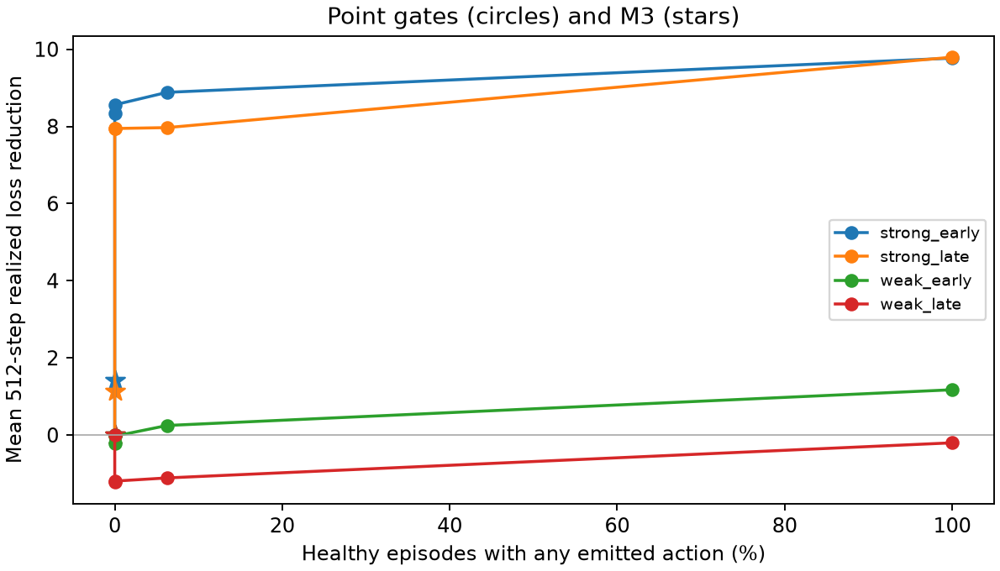
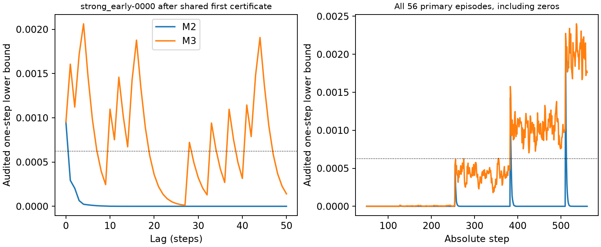

# 第二篇论文确认实验验收报告

**裁决为「支持限定工况下的机理与可校正性分析」。**

按预注册完成 130 条独立轨迹，共 520 个计划查询时刻。主工况为持续偏置 0.25、起点 50。M3 相对 M2 的 512 拍实际累计降损差为 1.351 [0.975, 1.726]，相对预校准 M1 的差为 -6.932 [-7.859, -6.005]。正值表示 M3 降损更多。方括号为按轨迹配对的双侧 95% t 区间。

主工况 M2、M3 平均有用时长分别为 3.9、97.1 拍，攻击窗口期末仍有用分别为 0/56、33/56。两法使用同一记录、方向、等级尝试和成败。每拍有效门限为实际发布位移的认证风险下界 0.000625。

## 独立确认的两个配对问题

| 工况（b，k） | 独立条数 | M2 损失减 M3 损失 [95%] | 主门限 M1 损失减 M3 损失 [95%] | M3 相对 M2 的差占 Monitor 损失 |
|---|---:|---:|---:|---:|
| 0.25，50 | 56 | 1.351 [0.975, 1.726] | -6.932 [-7.859, -6.005] | 0.41% |
| 0.25，96 | 10 | 1.078 [0.480, 1.675] | -6.819 [-9.232, -4.406] | 0.33% |
| 0.10，50 | 8 | 0.000 [0.000, 0.000] | 0.218 [-0.998, 1.435] | 0.00% |
| 0.10，96 | 8 | 0.000 [0.000, 0.000] | 1.224 [-1.678, 4.127] | 0.00% |
| 健康 | 48 | 0.000 [0.000, 0.000] | 0.000 [0.000, 0.000] | 0.00% |

主工况以整条轨迹重采样 10,000 次，两个配对差的百分位区间依次为 [0.993, 1.718]、[-7.844, -6.019]。第一个 t 区间下限大于零，按预注册第二个比较可作确认性检验。

四个攻击工况各占四分之一。次要汇总见下表，区间在各工况内按整条轨迹重采样后等权合并。

| 比较 | 等权平均差 | 描述性 bootstrap 95% 区间 |
|---|---:|---:|
| M3_vs_M2 | 0.607 | [0.454, 0.757] |
| M3_vs_M1 | -3.077 | [-3.902, -2.245] |

## 实际损失、条件改善、认证下界与机会量

各列采用同一 512 拍窗口。实际降损为 Monitor 损失减该方法损失。离线改善使用真参数污染，认证下界只使用发布时可见证据。恢复份额用组内条件改善总和除以组内未限幅 Oracle 机会量总和。M1、M2、M3 的平均延迟只在窗内成功轨迹中取中位数；M1 计首次非零出手，M2、M3 计首次有用证书动作。分母始终列全部轨迹。完整逐门限、M0、Oracle、期末及机会量分子分母见 [方法与工况表](method_by_case.csv)。

| 工况 | 方法 | 实际降损 | 离线改善 | 认证下界 | 恢复份额 | 窗内成功/全体 | 成功者中位延迟 |
|---|---|---:|---:|---:|---:|---:|---:|
| 0.25，50 | M1 | 8.340 | 7.908 | — | 0.724 | 56/56 | 77.0 |
| 0.25，50 | M2 | 0.058 | 0.068 | 0.009 | 0.006 | 43/56 | 333.0 |
| 0.25，50 | M3 | 1.408 | 1.442 | 0.288 | 0.132 | 43/56 | 333.0 |
| 0.25，96 | M1 | 7.945 | 7.969 | — | 0.708 | 10/10 | 159.0 |
| 0.25，96 | M2 | 0.049 | 0.053 | 0.007 | 0.005 | 7/10 | 287.0 |
| 0.25，96 | M3 | 1.127 | 1.422 | 0.258 | 0.126 | 7/10 | 287.0 |
| 0.10，50 | M1 | -0.218 | -0.066 | — | -0.040 | 4/8 | 333.0 |
| 0.10，50 | M2 | 0.000 | 0.000 | 0.000 | 0.000 | 0/8 | — |
| 0.10，50 | M3 | 0.000 | 0.000 | 0.000 | 0.000 | 0/8 | — |
| 0.10，96 | M1 | -1.224 | 0.000 | — | 0.000 | 6/8 | 223.0 |
| 0.10，96 | M2 | 0.000 | 0.000 | 0.000 | 0.000 | 0/8 | — |
| 0.10，96 | M3 | 0.000 | 0.000 | 0.000 | 0.000 | 0/8 | — |
| 健康 | M1 | 0.000 | 0.000 | — | — | 0/48 | — |
| 健康 | M2 | 0.000 | 0.000 | 0.000 | — | 0/48 | — |
| 健康 | M3 | 0.000 | 0.000 | 0.000 | — | 0/48 | — |

在早起点强档，M3 恢复了未限幅 Oracle 条件机会量的 13.2%，M1 为 72.4%。M3 的首次有证动作只在 43/56 条上出现，成功者中位延迟 333 拍；M1 首次非零出手为 56/56 条，中位延迟 77 拍。两种弱档中，M3 各有 0/8 和 0/8 条达到有用门限。这些未启动轨迹都计入均值。

## 健康轨迹与计算代价

主门限 M1 在 608 拍内至少误动一次的轨迹为 0/48，M3 为 0/48。各自双侧 95% 精确区间为 [0.00%, 7.40%]、[0.00%, 7.40%]。仅 M1 出手 0 条，仅 M3 出手 0 条。M1 减 M3 的误动率差为 0.00 个百分点，保守配对区间 [-8.72, 8.72] 个百分点。±1 个百分点等效未确定。健康损失仍按绝对 50–561 拍量计。

预注册代表轨迹为 strong_early-0000。左图从第一次共同正证开始，到下次查询之前或窗口终点；右图按绝对时钟将主工况全部轨迹计入，包括始终未取得证书者。[有首证轨迹的衰减数据](first_certificate_curves.csv)

| 工况 | 全流程平均秒/轨迹 | 4 次查询合并 P50 / P95 / 最大秒 | 首次计划查询 P50 | 后续计划查询 P50 | 正证 / 零相容 / 未决（查询数） |
|---|---:|---:|---:|---:|---:|
| 0.25，50 | 153.77 | 12.85 / 68.12 / 96.70 | 0.08 | 18.62 | 90 / 60 / 74（共 224） |
| 0.25，96 | 136.87 | 8.55 / 56.24 / 112.40 | 0.07 | 17.90 | 13 / 16 / 11（共 40） |
| 0.10，50 | 70.04 | 0.14 / 15.58 / 23.08 | 0.09 | 0.16 | 0 / 28 / 4（共 32） |
| 0.10，96 | 63.02 | 0.12 / 0.26 / 23.90 | 0.05 | 0.15 | 0 / 31 / 1（共 32） |
| 健康 | 59.89 | 0.13 / 0.25 / 0.28 | 0.06 | 0.15 | 0 / 192 / 0（共 192） |

确认集配对全流程消耗 3.832 核时。为量出实际在线成本，另回放主工况固定编号 0–3，各方法单独读取相同公开记录，四工作进程，次序按编号奇偶交替。M1 平均 42.75 秒/轨迹，带旧方法回退的 M3 平均 153.79 秒/轨迹，包含在线状态建立、维护、查询和发布，排除轨迹生成及离线评分。每个输出的累计损失与相应确认行复核通过。这四条未增加样本数。联合全流程时间包含模拟和离线核验，两种时间口径单列。[独立方法计时](../results/engineering_replay.json) · [逐轨迹耗时](cost_per_trajectory.csv) · [查询时延及分母](query_cost.csv)

## 核验与局限

四个计划时点外每轨迹有 604 拍未查。查询时若一档已成而下一档未决，时点按取得正证计，逐等级原因为独立列。未决保留在主表。真参数未保留累计 0 拍；在真参数保留时离线条件改善低于发布下界超过容限共 0 次。旧传播优于新区间提议的回退累计 259 拍；局部数值或保守发布回退 M2、M3 分别为 8628、0 拍。最大直接滤波差 3.52e-10。确认错误日志 0 份，期末缺失轨迹 0 条。覆盖违反按拍统计，仅为实现诊断。[查询及失败原因](query_log.csv) · [查询数与轨迹数](query_outcomes.csv)

开发集试算使用 6 条主要工况配对差，标准差分别为 0.896 和 2.664。希望分辨的累计差 1 相当于开发组 Monitor 损失的 0.300%；双侧 95%、80% 功效公式给出 7 和 56 条。取较大者，其他工况作描述。200 条独立健康开发路径的每条四查询最大分数按秩 190、198、199 冻结，临界轨迹用原区间搜索重新打分。仅 1 个顺序统计量位于主门限之上，尾部分位数本身仍有抽样误差。[预注册](../registration.json)

认证所用的条件风险对应持续固定偏置、共同历史和正确连续观测核。逐点全时间覆盖须在每个固定真实参数自己的概率测度下理解。单条轨迹会因物理噪声出现负降损，成功子集也不代表全部攻击。本实验没有测量密码学认证、有限码字信道或硬实时最坏时限。[工程接口与文献对照](../design.md)

## 建议写入摘要的表述

“在单节点 V2 的持续偏置模型下，我们在相同可信事件和接收历史上比较两种证据传播机制。对偏置 0.25、起点 50 的 56 条独立轨迹，保留起点对应幅值区间后，有用校正持续时间由平均 3.9 拍变为 97.1 拍，累计降损的配对增量为 1.351 [0.975, 1.726]。相对于预校准、可拒绝的点补偿，增量为 -6.932 [-7.859, -6.005]。健康误动率的 ±1 个百分点等效性尚未确认。”

复算入口、执行命令及源码身份见 [任务首页](../README.md)。
