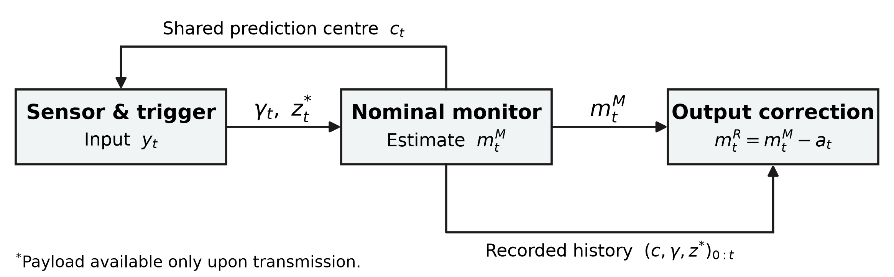
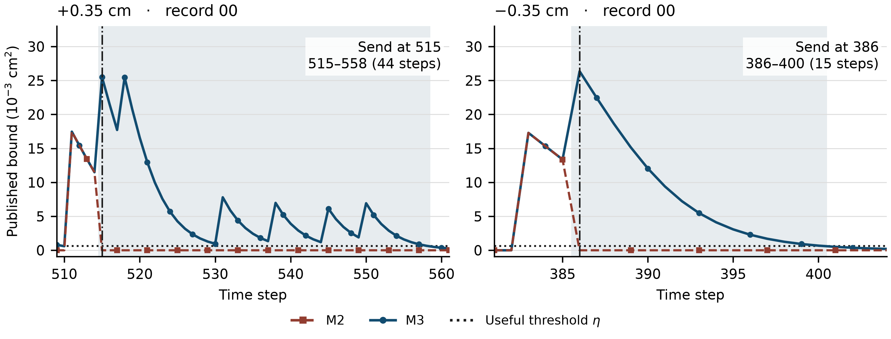
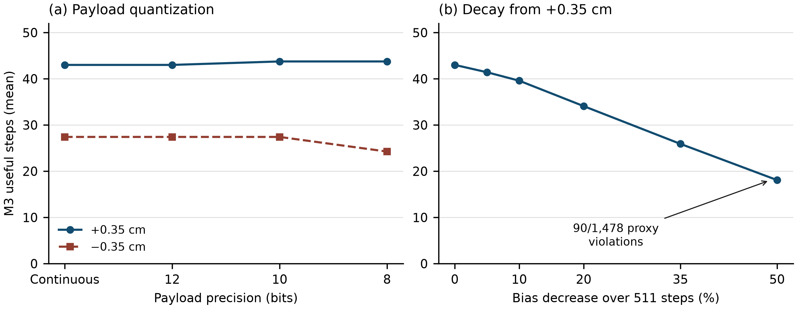

# 随机事件触发远程估计中持续载荷偏置的条件风险校正

**摘　要**　针对随机发送后的量测载荷出现持续偏置、偏置起点与幅值均未知的问题，给出基于可信事件历史的条件风险校正方法。对各可能起点保留恒定幅值区间，导出新发包使半空间下界失效后区间下界仍有效的充分条件。在双容液位92条主确认和24条补充轨迹中，强正、强负偏置下的平均有用校正时长分别由9.2、7.3拍增至34.9、28.4拍，20对轨迹中增加／持平／减少分别为15／5／0和14／6／0，中位增量为21、22拍，累计降损配对增量为0.326、0.362 cm²。另130条独立轨迹中的强早起点工况下，该时长由3.9拍增至97.1拍。区间法无需健康轨迹标定，双容两强档平均累计降损为0.38、0.51 cm²，健康标定点补偿为5.30、7.12 cm²。强及过渡档64条中，两法累计条件改善为负的轨迹分别为0、4条。快速实现每608拍平均耗时69.1 ms；偏置逐渐衰减时有用时长缩短。

**关键词**　随机事件触发；远程状态估计；持续偏置；条件风险；区间传播；载荷校正

**中图分类号**　TP273　　　　　　　　　**文献标志码**　A

## 1　引言

事件触发的远程状态估计以减少传输次数为目标，但一次静默也提供了量测相对于预测中心的信息。Han等[1]设计的随机触发规则保留了条件分布的高斯性，使远端能够根据发送与静默采用不同的滤波增益。吴寒等[2]从通信精度出发，分别研究了新息量化编码与基于重构误差的反馈量化，给出了误差协方差和重构误差结果，并在实车平台上验证了精度与带宽的关系。另一类问题出现在发送决定形成以后。例如，采集端按本地量测决定是否上报，而转发端封装载荷时引入持续偏移。此时发送事实仍可信，偏移只作用于实际发出的量测。若接收端已积累足以排除健康解释的证据，多个偏置起点与幅值仍可能与同一段记录相容。对于依赖实时状态的使用者，此时需要判断当前估计可以朝哪个方向移动、移动多少，以及下一次发包后该判断能否继续使用。

现有研究从检测、辨识和补偿等方面处理量测失真。王彩云等[3]区分攻击者的信息权限，将给定隐蔽约束下的最大估计损伤化为相应的优化问题，并给出标量结果。陈佳玲等[4]分析模型参数偏差对水印检测的影响，通过辨识提高检测性能。对于持续偏置，Friedland[5]给出了无偏置滤波与未知恒定偏置估计之间的递推分解。Li等[6–8]研究了二值量化新息篡改的识别、状态补偿与通信调度，后续工作将篡改过程扩展至马尔可夫模型[9]以及切换传感器[10]。在多节点融合问题中，Chen等[11]的摘要给出了融合估计误差的概率椭球约束，Zhang等[12]通过邻居残差验证和融合获得均方有界性。这些研究所用信息与保证对象见表1。单节点接收端只有一份受影响的连续载荷历史，难以用其他节点或独立真值验证点估计。即使已有一个最可能的偏置解释，按该解释补偿时，仍需考虑其他相容解释下校正动作的后果。

为此，本文在同一条可信通信历史上比较校正前、后的条件平方风险。借鉴序贯置信集合在多个观察时刻共同保留真实参数的思想[13]，先以发送、静默及连续载荷的联合概率排除与历史不相容的参数，再沿选定方向计算所有保留参数均能支持的校正量。研究的重点是同一偏置在多次发送之间的依赖关系。若只保留一个方向不等式，M2在后续传播中对每次发送分别计入最不利幅值。按起点保留此前推得的幅值区间，则新旧发送共用一个未知量。下文给出两种传播产生严格分离的条件，并分别用双容液位的正负偏置和另一弱不稳定对象检验该条件的实际意义。随机事件估计中的最坏损伤与最优扰动策略已有专门研究[14–15]。这里固定上行偏置的作用位置和持续方式，比较接收端对同一组候选解释可采取的校正。通过健康数据校准的点补偿作为同信息基准，用于评价获得上述风险下界所付出的恢复幅度和计算代价。

**表1　相关研究的可用信息、评价对象与本文的比较维度**\
**Table 1　Available information and performance criteria in related studies**

| Study | Available information | Quantity evaluated |
|:---|:---|:---|
| Han et al. [1]; Wu et al. [2] | Random events or quantized innovations | Estimation covariance or reconstruction error |
| Wang and Li [3]; Chen and Yang [4] | Detector output, side information or watermark | Estimation loss under a stealth constraint or detection performance |
| Friedland [5] | Measurements with an unknown constant bias | Recursive state and bias estimates |
| Li et al. [6–9]; Liu et al. [10] | Received quantized symbols | Tampering identification, compensation or scheduling |
| Chen et al. [11]; Zhang and Yang [12] | Distributed observations or exchanged residuals | Error containment or mean-square boundedness |
| Howard et al. [13] | Sequential observations | Simultaneous coverage over time |
| Proposed method | Trusted events and received scalar payloads | Common conditional risk reduction after a correction |

## 2　问题描述与输出校正结构

考虑单传感器离散线性系统
$$
x_{t+1}=Ax_t+Bu_t+w_t,\qquad y_t=Cx_t+v_t . \tag{1}
$$
其中，$x_t\in\mathbb R^n$，$y_t\in\mathbb R$，$u_t$ 为两端已知的控制输入。初态 $x_0\sim\mathcal N(m_0,P_0)$，过程噪声 $w_t\sim\mathcal N(0,Q)$ 与量测噪声 $v_t\sim\mathcal N(0,R)$ 时间上独立，相互独立，并与初态、触发随机数独立。取 $P_0\succeq0$、$Q\succeq0$、$R>0$，正定权矩阵为 $W$。数值算例的 $(A,C)$ 均可观，因而可检测。以下给定有限记录的条件均值与风险计算只用到高斯条件更新及创新方差为正。方向的逆向传递另要求相应区间内的状态转移可逆，见第4.3节。

接收端运行按健康模型配置的监视器，记其先验、后验均值为 $m_t^-$、$m_t^M$。发送端在触发前取得共享中心 $c_t$。实验采用 $c_t=Cm_t^-+r_t$，其中 $r_t$ 为已知于当次触发前的中心偏移。给定干净量测和中心，发送概率为
$$
g(y_t-c_t)=1-\exp[-Z(y_t-c_t)^2/2],\qquad Z>0. \tag{2}
$$
记发送位为 $\gamma_t$。当 $\gamma_t=1$ 时，接收端读到 $z_t=y_t+b\,\mathbf1_{\{t\ge k\}}$，当 $\gamma_t=0$ 时只有静默记录。$k$ 和 $b$ 为固定的未知起点和幅值，$|b|\le b_{\max}$，$b=0$ 包含健康情形。符号及起点都由数据推断。载荷传输可受影响的范围限于式（2）作出发送决定之后。时钟、事件位、中心和记录顺序的真实性由通信接口提供。记 $\mathcal H_t$ 为截至 $t$ 的上述记录，计算当前观测概率时也条件于已知的 $c_t$。

图1给出双方的数据流。监视器照常参与下行预测，校正模块读取同一历史，为使用者单独发布 $m_t^R=m_t^M-a_t$。采用这种输出结构有三个原因。首先，已部署的发送端可以继续按既定中心触发。其次，所有候选模型都能在实际收到的同一条历史上计算条件均值和似然，先前采用的校正动作不会改变下次查询的样本。最后，上游数据一时不足以支持新动作时，接收端仍有连续可用的监视输出。该结构适用于独立的显示、诊断或监督估计接口。若发布值直接参与闭环控制并改变物理输入，应将该控制通道和相应的比较基准纳入模型。

**图1　可信事件生成、预测反馈与输出端校正结构**\
**Fig. 1　Trusted event generation, prediction feedback and output correction**

## 3　事件条件估计与单位偏置响应

### 3.1　发送与静默的联合概率

设固定候选参数为 $\theta=(k,b)$，以 $\mu_t^{\theta,-}$ 表示该候选在同一历史上的先验均值。令 $\xi_t^\theta=C(\mu_t^{\theta,-}-m_t^-)$，$\beta_{k,t}=b\mathbf1_{\{t\ge k\}}$，$\nu_t=z_t-Cm_t^-$ 仅在发送时定义。给定历史的先验协方差为 $P_t^-$，量测创新方差为 $S_t=CP_t^-C^\mathsf T+R$。以 $\phi_S$ 表示方差为 $S$ 的零均值高斯密度，发送载荷的联合次密度和静默概率分别为
$$
\begin{aligned}
p_{\theta,t}(1,\nu_t)&=\phi_{S_t}(\nu_t-\beta_{k,t}-\xi_t^\theta)
                       g(\nu_t-\beta_{k,t}-r_t),\\
p_{\theta,t}(0)&=(1+ZS_t)^{-1/2}
  \exp\!\left[-\frac{(\xi_t^\theta-r_t)^2}{2(S_t+Z^{-1})}\right].
\end{aligned} \tag{3}
$$
第一式中的发送选择作用于扣除候选偏置后的量测。第二式为高斯创新密度与静默权重 $\exp[-Z(e-r_t)^2/2]$ 的乘积在创新 $e$ 上的积分。配方后方差项给出 $(1+ZS_t)^{-1/2}$，中心之间的差给出指数项。对第一式沿连续载荷积分，再加第二式，所得总概率为1。稀疏发送时，长串静默由此可以连续更新候选的相对似然。单独统计接收载荷、忽略未发送时刻，会改变所用的观测模型。

在给定接收载荷时，改变候选幅值将同时改变式（3）第一行中的高斯位置和发送选择项。如果只平移高斯密度而沿用原发送概率，接收端就会把本应对应不同触发可能性的两种解释赋予相同的选择权重。相反，静默拍没有可供扣除的载荷，此时不同候选的差别全部来自已有均值偏移。由此可以在实现中采用统一的协方差递推，并为各候选分别保留均值响应和似然。

### 3.2　条件均值之差

发送时，在给定候选和载荷后，干净量测可由扣除偏置得到。静默时，式（3）中的指数权重等价于中心在 $c_t$、量测噪声方差为 $R+Z^{-1}$ 的一次更新[1]。令 $R_1=R$、$R_0=R+Z^{-1}$。两种更新对应的增益和后验到后验转移为
$$
K_{\gamma,t}=P_t^-C^\mathsf T(CP_t^-C^\mathsf T+R_\gamma)^{-1},
\qquad F_t=(I-K_{\gamma_t,t}C)A. \tag{4}
$$
因此对同一事件前缀，各候选和监视器共用协方差 $P_t^+=(I-K_{\gamma_t,t} C)P_t^-$，下一先验为 $AP_t^+A^\mathsf T+Q$。已知输入在两均值相减时抵消。以 $\mu_t^\theta$ 为候选的后验均值，令 $\delta_t^+=m_t^M-\mu_t^\theta$。逐拍相减可得
$$
H_{k,t}=F_t H_{k,t-1}+\gamma_t K_{1,t}\mathbf1_{\{t\ge k\}},\qquad
H_{k,-1}=0,\qquad \delta_t^+=bH_{k,t}. \tag{5}
$$
式（5）把未知的标量幅值与起点引起的方向变化分开。在当前记录上，两个起点若在其间没有发送，则到首次共同发送时响应相同，可以合并为一个起点类别。尚未发生的起点和零幅值产生零污染，在形成首个严格正方向下界前均应保留。相同记录上的这些等价关系使接收端可以按发送起点维护响应，而状态本身仍可为多维量。

## 4　方向认证与固定幅值区间传播

### 4.1　同一段记录上的方向认证

设第 $t$ 拍根据公开前缀选取方向 $d_t\ne0$。称 $(d_t,\zeta_t)$ 为一张方向证书，指在真实参数受到覆盖的事件上，$d_t^\mathsf TW\delta_t^+\ge\zeta_t>0$。该不等式同时约束所有尚可解释这段记录的参数。取相对于健康记录的候选似然比 $L_t^\theta$。为确定删除候选的门限，取一个定义在完整记录上的参考分布，其前缀似然比记为 $E_t$。计算 $E_t$ 时，对未知起点和若干参考幅值的预测概率加权。尚未启动的尾部权重取 $\alpha_t=1/(t+2)$，第 $t$ 拍新启动的权重取 $w_t=1/[(t+1)(t+2)]$。各参考分量采用归一化预测核，其具体幅值只决定参考分布对不同幅值的灵敏度。

给定容许遗漏概率 $\varepsilon$，保留 $L_t^\theta\ge\varepsilon E_t$ 的候选。对每个固定真实 $\theta$，在查询集合 $\mathcal Q$ 上同时保留该参数的概率至少为 $1-\varepsilon$。证明可直接从密度得到。将首次发生 $L_t^\theta<\varepsilon E_t$ 的查询前缀记为 $B_t$。在 $B_t$ 上，真实记录密度至多为参考记录密度的 $\varepsilon$ 倍。将各 $B_t$ 延拓到同一终点后，首次遗漏发生在不同时刻的事件互斥，其参考概率之和至多为1。故真实模型下至少一次遗漏的概率至多为 $\varepsilon$。取任意有限查询窗均可作此推导，取全部时刻时由有限窗递增取极限。保证的量词为每个固定参数在自身模型下享有共同覆盖；数据决定的方向和同次查询的多个门限均可使用同一覆盖事件。

方向认证接口 $\operatorname{CertifyDirection}(d_t,\zeta_t)$ 接收候选方向和要求的支撑值。若至少一个相容参数得到核实，且所有满足 $d_t^\mathsf TWbH_{k,t}<\zeta_t$ 的解释均已排除，则签发证书。低支撑解释中也包括健康和未来起点。数值上可把等号一并放入待排除集合，得到较保守的充分检验。幅值网格用于寻找方向和相容点，删去两个网格点之间的整段连续幅值则需要该段似然的上界。计算预算用尽的查询记为未决；此前已取得的证书仍按相应规则向后传播。概率保证依赖可靠的候选排除，第6.3节分别评价区间实现和浮点近似。

具体计算时，设第 $j$ 个参考分量的单拍预测密度相对健康密度的比值为 $f_{j,t}$，其已启动质量递推为 $M_{j,t}=(M_{j,t-1}+w_t)f_{j,t}$。取 $M_{j,-1}=0$，参考比值为 $E_t=\alpha_t+\sum_j\omega_jM_{j,t}$，其中非负权重之和为1。由于各参考预测核归一化，且 $\alpha_{t-1}-\alpha_t=w_t$（初始尾部质量为1），对当前观测积分便回到上一拍的参考质量。上述首次遗漏求和因而可以直接使用这一参考分布。双侧算例对三个正参考幅值及其相反数等权；待检验的真实幅值仍遍历连续区间。

### 4.2　由方向约束得到幅值区间

若第 $\tau$ 拍得到正方向证书，对每个保留起点定义
$$
s_{k,\tau}=d_\tau^\mathsf TWH_{k,\tau},\qquad
I_{k,\tau}=\{b\in I_{k,\tau^-}: b\,s_{k,\tau}\ge\zeta_\tau\}. \tag{6}
$$
初始区间取 $[-b_{\max},b_{\max}]$。若 $s_{k,\tau}>0$，则提高幅值下端点；若 $s_{k,\tau}<0$，则降低上端点；若 $s_{k,\tau}=0$，该起点与正证书不相容。只保留非空区间的起点，记其集合为 $\mathcal K_\tau$。当计算出的系数本身为区间时，保留其中任何系数可能支持的幅值，再取包含这些幅值的区间。这样的外包允许更多候选，对真实幅值仍有效。新的正证书可继续收紧相应区间。初次正证书已排除尚未产生污染的解释，其后只需传播已保留的起点。

设当前区间端点为 $\underline b_{k,t}$、$\overline b_{k,t}$。在方向 $d$ 上令 $q_{k,t}=d^\mathsf TWH_{k,t}$。未知幅值只通过乘积 $bq_{k,t}$ 进入式（5），故区间上最不利的方向分量由下式给出。
$$
\underline s_t(d)=\min_{k\in\mathcal K_t}
  \min\{\underline b_{k,t}q_{k,t},\,\overline b_{k,t}q_{k,t}\}. \tag{7}
$$
若 $q_{k,t}$ 由上下界表示，取两个幅值端点与两个系数端点所成的四个乘积的最小值。式（7）说明取得证书后，可以用此前的单位响应和区间端点继续计算风险下界。查询连续参数似然的工作集中在取得新证书的时刻。

### 4.3　两种传播方法的严格分离条件

考虑一张在 $\tau$ 拍签发的证书，以下比较固定同一历史、同一证书和同一方向的后续传播。记 $\Phi_{j,i}=F_j\cdots F_{i+1}$，$\Phi_{i,i}=I$。假设比较区间的 $F_j$ 可逆，选取未归一化伴随方向 $d_j=W^{-1}\Phi_{j,\tau}^{-\mathsf T}Wd_\tau$，则 $d_j^\mathsf TW\Phi_{j,i}=d_i^\mathsf TW$。实现可逐拍将方向除以正数归一化，但须同步缩放支撑下界。对 $\tau<i\le t$ 定义
$$
h_i=\gamma_i d_i^\mathsf TWK_{1,i},\qquad
A_{\tau,t}=\sum_{i=\tau+1}^{t}|h_i|,\qquad
G_{\tau,t}=\sum_{i=\tau+1}^{t}h_i. \tag{8}
$$
$A_{\tau,t}$ 表示各次发送取最不利符号时的累计影响，$G_{\tau,t}$ 表示所有发送共用一个幅值时的有符号和。这里 $A_{\tau,t}$ 是标量，系统矩阵 $A$ 见式（1）。

**命题1**　在上述条件下，设偏置先验关于零对称，$\mathcal K_\tau$ 非空，各保留区间满足式（6），且比较期间只传播该张证书。若
$$
 b_{\max}A_{\tau,t}\ge\zeta_\tau,\qquad
 \rho_{\tau,t}:=\min_{k\in\mathcal K_\tau}
     \left(1+\frac{G_{\tau,t}}{s_{k,\tau}}\right)>0, \tag{9}
$$
则逐次发送放宽幅值的半空间传播（M2）已失去该方向的正下界；固定幅值区间传播（M3）的理想方向支撑仍至少为 $\zeta_\tau\rho_{\tau,t}$。若用可信数值下界构造的限幅动作，其实际发布风险下界还达到预定门限 $\eta$，则在该拍出现严格的有用校正分离。该结论针对同一张证书；新查询另行取得的证书可为任一方法恢复正下界。

**证明**　式（5）在伴随方向上递推，首次证书以后各保留起点均已启动。M2 只使用初始投影至少为 $\zeta_\tau$ 的约束，允许每次发送独立选择幅值 $b_i\in[-b_{\max},b_{\max}]$。在这一放宽集合上，其传播下界为 $\zeta_\tau+\min\sum_i b_i h_i=\zeta_\tau-b_{\max}A_{\tau,t}$。第一项条件使该下界非正，M2 按规则停止发布由此证书产生的动作。若保留同一 $b$，则位于该起点区间内的每个参数均有
$$
 d_t^\mathsf TW(bH_{k,t})
 =b(s_{k,\tau}+G_{\tau,t})
 =(bs_{k,\tau})\left(1+G_{\tau,t}/s_{k,\tau}\right)
 \ge\zeta_\tau\rho_{\tau,t}. \tag{10}
$$
这里由正证书和非空区间知 $s_{k,\tau}\ne0$。对所有起点与区间取最小值即得结论。当 $G_{\tau,t}$ 与每个保留的 $s_{k,\tau}$ 严格同号时，未归一化伴随方向上的这一倍数严格大于1。方向归一化、状态转移和限幅仍会改变实际能发布的步长。证毕。

式（9）可用于解释同一批发送在两种方法中为何会产生相反效果。某次发送对旧界的影响只取决于投影绝对值；即使该投影与先前响应一致，也须从旧界中扣除。对固定幅值而言，相同符号的投影却能在整个保留区间上与初始响应相加。若方向不同的几个起点尚未排除，则取最小值的起点可能随时间发生变化；即使部分起点得到加强，仍须检查全部保留起点。若若干次发送的投影异号，有符号和也可能接近零，此时增加发包次数并不必然延长有用时长。

作为两步算例，取标量 $A=C=W=1$、$R=1$、$Q=1/2$、$P_0=1$，连续两拍均发送，故两拍增益均为 $1/2$。取 $b_{\max}=1$。第一拍 $H=1/2$，假设已获方向 $d=1$、支撑 $1/4$ 的证书，式（6）给出 $b\in[1/2,1]$。第二拍由式（5）得 $H=3/4$。在同一归一化方向上，M2 下界为 $(1/2)(1/4)-1/2=-3/8$，M3 支撑至少为 $(1/2)(3/4)=3/8$。取校正 $3/8$，条件风险改善至少为 $9/64$。故对 $0<\eta\le9/64$，一张给定证书在第二拍已能区分两种传播。这里第一拍的证书为已知输入，其实际取得概率取决于完整的先前记录。

命题涉及三个不同的计算量。式（10）说明真实候选传播后还有多少方向信息。实际程序用区间端点和保守舍入获得一个可计算的支撑下界，可能低于式（10）对理想区间给出的值。第5节再从实际发布位移计算以平方误差为单位的改善下界，最后才与 $\eta$ 比较。由此，正支撑、非零动作和达到有用门限分别对应三个不同的可检验事件。后文的逐拍实例记录实际动作；组内平均有用拍数按整条轨迹统计。

## 5　条件风险校正与实现

令 $\mathcal R_t(m\mid\theta)=\mathbb E_\theta[\|x_t-m\|_W^2\mid\mathcal H_t]$，$\|v\|_W^2=v^\mathsf TWv$。条件均值的正交性给出监视器与校正输出的风险差
$$
D_t(a_t\mid\theta)=\mathcal R_t(m_t^M\mid\theta)-\mathcal R_t(m_t^M-a_t\mid\theta)
=2(\delta_t^+)^\mathsf TW a_t-\|a_t\|_W^2. \tag{11}
$$
设保留候选的污染集合非空且有界，闭凸包为 $\mathcal P_t$。当原点位于 $\mathcal P_t$ 外，原点在该凸包上的加权投影 $p$ 满足 $\delta^\mathsf TWp\ge\|p\|_W^2$，可作为共同严格改善动作。对任一动作，其最坏改善至多为 $2p^\mathsf TWa_t-\|a_t\|_W^2=\|p\|_W^2-\|a_t-p\|_W^2$，故 $p$ 达到无限幅时的极小极大基准。若原点在闭凸包内，任一非零动作在相容污染上的最坏改善均为负。这个几何判据给出了共同改善的存在条件。

实际校正只需一条已核实的方向。若 $\underline s_t(d)>0$，取 $a_t=\lambda d$、$\|a_t\|_1\le1$。将式（7）代入式（11），对标量 $\lambda$ 最大化二次下界，可得
$$
\lambda=\min\left\{\frac{\underline s_t(d)}{d^\mathsf TWd},\frac1{\|d\|_1}\right\},
\qquad D_t(a_t\mid\theta)\ge2\lambda\underline s_t(d)-\lambda^2d^\mathsf TWd
\ge\|a_t\|_W^2. \tag{12}
$$
实际输出为浮点状态，记监视状态与已发布状态之差为 $\widetilde a_t$。对实验所用 $W=I$，若逐坐标污染绝对值上界为 $v_t^{\mathrm{bd}}$，则将理想方向支撑扣除状态相减引入的误差，可取发布下界
$$
D_t^{\mathrm{pub}}=2\left(\|a_t\|^2-(v_t^{\mathrm{bd}})^\mathsf T|\widetilde a_t-a_t|\right)
                         -\|\widetilde a_t\|^2. \tag{13}
$$
当另外计入数值监视器与理论条件均值递推的误差时，相应内积的误差也须扣除。取实际位移满足限幅且 $D_t^{\mathrm{pub}}>0$ 的动作；达到 $\eta$ 时计为一次有用校正。条件改善评价使用收到同一公开历史的监视估计作基准，单条物理轨迹的平方误差还包含过程噪声和量测噪声，实际累计降损可为负。

**算法1　基于固定幅值区间的输出校正**\
**Algorithm 1　Output correction using persistent bias intervals**

1. 根据当前帧更新监视器、共同协方差和各发送起点的单位响应，同时传播旧方向及其支撑下界。
2. 在查询拍由公开前缀提出方向，用方向认证接口检验。取得新证书时按式（6）更新已有起点的区间，并保存方向。未决时继续使用仍有效的旧证书。
3. 对传播后的各方向按式（7）求下界，经式（12）限幅，核对实际发布位移。将通过复核的区间动作与旧半空间动作比较，保留较高的发布下界。该拍区间候选不优于旧动作时采用 M2 动作；区间集合为空时输出零校正。
4. 将 $m_t^M-a_t$ 送至输出端，按未叠加该校正的监视器产生下一预测。在该历史获得新证据前，沿存留区间继续传播。

## 6　数值仿真与对比分析

### 6.1　双容液位的主确认与配对比较

采用二维双容液位线性模型，以工作点附近的液位偏差为状态，第一容器的液位为测量量，采样间隔为1 s。另取二维自治模型V2用于检验另一组动力学参数下的校正效果。表2给出全部系统参数。双容液位系统中，两泵输入按120拍为一周期切换，前60拍取 $(0.15,0.05)^\mathsf T$，其余取 $(0.08,0.05)^\mathsf T$。两个算例在起始拍取 $r_0=0$，其余各拍中心带独立均匀偏移，其半宽约为0.01163。每条轨迹608拍，在绝对时刻127、255、383、511作四次查询，取 $\varepsilon=0.001$，比较的三个方向支撑等级为 $(0.025,0.05,0.10)\|d_t\|_1$。双容液位的有用门限为 $\eta=0.000625$ cm²。定参、门限校准和确认使用分开的随机种子。

**表2　双容液位与独立自治系统的仿真参数**\
**Table 2　Simulation parameters of the two-tank plant and the autonomous system**

| Parameter | Two-tank plant | V2 |
|:---|:---|:---|
| $A$ (rows) | $(0.94,0.08)$, $(0.03,0.91)$ | $(1.02,0.10)$, $(0,0.97)$ |
| $B$ (rows) | $(0.06,0.01)$, $(0.02,0.05)$ | No input |
| $C$, $W$ | $(1,0)$, $I_2$ | $(1,0)$, $I_2$ |
| $Q$, $R$, $Z$ | $0.0025I_2$, 0.02, 2 | $0.05I_2$, 0.20, 2 |
| $m_0$, $P_0$ | $0$, $0.25I_2$ | $0$, $0.8I_2$ |
| $b$ | $[-0.35,0.35]$ cm | $[0,0.25]$ |
| Onset in test cases | 50 | 50 or 96 |

双容液位主确认集包括36条健康、强正和强负各20条、弱正和弱负各8条独立轨迹，共92条。强、弱偏置的绝对值分别为0.35和0.032 cm，相当于量测噪声标准差的2.47和0.23倍。过渡档取 $\pm0.25$ cm，另外登记正负各12条。所有方法在每条轨迹上使用相同的公开前缀。评价单位为整条独立轨迹；同一轨迹中的512个评分时刻用于累计损失。实际降损定义为监视器M0相对于相应校正器的累计平方误差减少量。若仅在成功启动的轨迹上求平均，会高估稀疏发送工况的恢复效果，故未启动的轨迹以实际取得的零收益计入全组均值。

点补偿在给定起点和幅值网格上选择似然最大的解释，可按阈值拒绝出手。表3中无门限方法记作 $h_0$，另两种点补偿分别用200条独立健康开发轨迹定标，阈值取四次查询最高分的第190和199顺序统计量，分别记作 $q_{95}$ 和M1。后两种阈值为4.116866和5.457584。M2和M3共享候选方向、尝试等级、查询时钟和原型节点预算。表中的负条件改善指一条轨迹的窗口累计条件改善为负；出手数、实际降损和条件改善分别按各自定义统计。

**表3　不同门限和证据传播方式下的实际降损与条件改善**\
**Table 3　Realized loss reduction and adverse conditional outcomes by method**

| Method | Gain, strong $+$ / cm² | Gain, strong $-$ / cm² | Negative conditional gain¹ | Healthy actions² |
|:---|---:|---:|---:|---:|
| $h_0$ | 5.269 | 8.287 | 5/64 | 36/36 |
| $q_{95}$ | 4.863 | 7.234 | 5/64 | 3/36 |
| M1 | 5.296 | 7.120 | 4/64 | 0/36 |
| M2 | 0.055 | 0.147 | 0/64 | 0/36 |
| M3 | 0.380 | 0.509 | 0/64 | 0/36 |

¹ Strong and transition groups, 40 + 24 trajectories. ² At least one nonzero output correction in 608 steps.

两个强偏置组中，M3相对M2的累计降损增量均为正，配对双侧95% $t$ 区间均不含零（表4）。强正组的20条轨迹有15条增加、5条持平，强负组有14条增加、6条持平，两组均未观察到有用拍数减少的轨迹。各组的配对中位增量分别为21拍和22拍。两法在强正组均为17/20条启动，在强负组均为18/20条启动；成功轨迹的中位启动延迟均为333拍。因而这里延长的主要是首证以后还能作出校正的时间。两强组窗口期末，M2分别为0/20和0/20条仍有用，M3分别为2/20和3/20条。原型在36条健康轨迹中没有非零出手，对应的双侧95%精确区间上限为9.74%。

**表4　强、过渡与弱偏置下的有用校正时长及配对降损**\
**Table 4　Useful correction steps and paired differences in loss reduction**

| Bias / cm | $n$ | M2 steps | M3 steps | M3 − M2 gain [95% CI] / cm² |
|---:|---:|---:|---:|---:|
| +0.350 | 20 | 9.2 | 34.9 | 0.326 [0.179, 0.473] |
| −0.350 | 20 | 7.3 | 28.4 | 0.362 [0.211, 0.513] |
| +0.250 | 12 | 5.5 | 11.9 | 0.064 [−0.019, 0.147] |
| −0.250 | 12 | 0.0 | 0.0 | 0.000 [0.000, 0.000] |
| +0.032 | 8 | 0.0 | 0.0 | 0.000 [0.000, 0.000] |
| −0.032 | 8 | 0.0 | 0.0 | 0.000 [0.000, 0.000] |

表4按全组给出平均时长。为观察校正失效的具体时刻，又逐拍读取方向来源和实际发布下界（图2）。取强正、强负组中编号均为00的轨迹，考察窗内上拍M2尚有用、当前拍有发送且没有新查询、M2下界归零而M3仍达到门限的时刻。两强组分别有10/20和7/20条轨迹至少出现一次这种情形。强正编号00在第511拍取得方向 $(1,0.447991)^\mathsf T$ 的证书。第515拍的发送使M2的发布下界由0.01150 cm²降为零，M3的同源下界为0.02550 cm²。第515至558拍，连续44拍满足分离。强负编号00在第383拍取得证书；第386拍发送时，M2下界由0.01336 cm²归零，M3为0.02635 cm²，第386至400拍连续15拍满足分离。分别从第511拍和第383拍的单张证书重新传播，所选归一化方向、实际发布动作与这两个连续区间的M3输出相符。这一逐拍回读为预注册比较后的机理核验。

**图2　同一张证书下新发送前后的实际风险改善下界**\
**Fig. 2　Published risk-reduction bounds before and after a transmission from the same certificate**

健康组实际发送870次，共21 888拍，发送率为3.97%。强正、强负组分别为5.22%和5.31%。弱偏置下两种认证方法均未取得有用动作；过渡档正组有6/12条取得有用动作，负组为0/12条。正组M3相对M2的配对区间跨零。镜像计算对量测、状态和偏置同时反号，所得对应损失的最大差约为 $1.42\times10^{-14}$。该检验排查了实现中的符号不对称。确认试验的正负组独立生成，单组仅12条，触发选择和量测噪声均可影响首证。单独将健康诊断的 $Z$ 由2调至20时，12条记录的发送率由4.26%升至21.53%。该诊断涉及健康数据，尚不能由此量出发包率单独对过渡组启动率的因果效应。

比较实际恢复幅度，M3相对M1在强正和强负组分别少降损4.916 [2.917, 6.914]和6.612 [4.463, 8.761] cm²。M1在强正、强负和过渡组共64条中有4条累计条件改善为负，M3为0条。对弱偏置和健康轨迹，M3在本次试验中均保持零动作。用已知真实起点与幅值作离线核对，原型的双容116条轨迹共70 528拍，真实参数覆盖遗漏0拍。M2、M3在真参数保留且实际发布非零位移时共核验10 789个动作，超出规定容差的风险下界违约为0。单条轨迹内动作相关，上述计数用于检查公式与实现的一致性，理论遗漏概率由第4.1节的覆盖结论给出。

对过渡与弱偏置，比较基准的选择会改变对校正价值的判断。过渡正组中，M1在12条轨迹上均启动，平均累计降损为3.58 cm²；M3平均降损为0.10 cm²，达到有用门限的轨迹为6条。过渡负组中，M1平均降损为1.88 cm²，但其中2条轨迹的累计条件改善为负；M3在该组保持零动作。弱正、弱负两组若采用零门限点补偿，平均实际降损分别为−1.37和−1.93 cm²。校准点补偿在这两组均保持零动作。因此，强偏置下的主要差异体现为已取得证书的有效时间，弱偏置下的结果同时依赖点补偿是否允许拒绝出手。

### 6.2　另一组动力学与发送条件下的校正持续性

V2的状态矩阵包含模为1.02的特征值，采用单侧非负偏置先验。针对单侧范围，M2在每次发送上取 $b_i\in[0,b_{\max}]$ 的最不利投影，M3保留该起点的幅值区间；式（9）的双侧绝对值扣减只用于双侧比较。V2独立确认集含健康48条、早起点强偏置56条、晚起点强偏置10条以及两种起点的弱偏置各8条，共130条。主工况取 $k=50,b=0.25$，评分窗与双容算例同为第50至561拍。晚起点 $k=96$ 的评分窗向后平移，以包含同样的512拍。

早起点强偏置下，两种认证法均在43/56条轨迹上启动，M2与M3的平均有用时长为3.9和97.1拍，期末仍有用的轨迹分别为0/56和33/56。M3相对M2的实际累计降损增量为1.351，配对95%区间为[0.975, 1.726]；相对M1的增量为−6.932 [−7.859, −6.005]。晚起点强组的M3相对M2增量为1.078 [0.480, 1.675]。两种起点的弱组均为0/8条取得有用证书。弱组保留在相应均值分母中。V2的健康发送率为26.61%，早起点强偏置组为27.84%，明显高于双容液位相应工况。两个对象都观察到强偏置下区间记忆延长有用校正时间。式（8）表明，证书寿命同时受转移矩阵、发送时刻和发送投影符号制约。V2与双容还具有不同的先验范围、相对偏置幅值和噪声水平，跨对象差值难以单独归因于阻尼或发送率；两组数据不合并估计效应。

### 6.3　区间核验与快速浮点实现

为区分查询开销与校正传播的开销，在相同双容记录上实现快速浮点方法M3-Fast。原型M3-Exact按似然的移动零点分段，用50位十进制区间和保守上界排除连续幅值，每次每个支撑等级最多访问64个分支节点。快速方法用双精度浮点数递推，对每个起点的低支撑幅值区间按相同零点分段，利用开段内对数似然的凹性在端点或驻点求最大值，并以切线上界作核对。数值比较采用预设的 $10^{-9}$ 对数似然余量。两实现的参考分布、查询时钟、尝试等级和校正上限相同。经验浮点余量用于工程近似，严格的数值覆盖仍取向外舍入的结果。另以64位有效精度的二进制球算术独立重算正、负及健康工况，在同一116条轨迹上复现了464次查询的方向和逐等级决定。

表5使用先前计时所用的四条强偏置记录，正、负各取编号00和01。同批次两种实现分别从同一公开前缀建立在线状态，均预热8拍，按轨迹编号交换运行次序。四个工作进程各使用单线程数值库。整轨耗时含状态建立、每拍递推与发布、四次查询和动作摘要校验，排除轨迹生成、读盘及离线评分。每法的查询分位数来自16次查询。快速版在本批次每608拍平均耗时69.1 ms，查询中位耗时0.464 ms，第95百分位为31.10 ms。早期归档中原型整轨耗时19.99 s，同批次重测为41.21 s，机器负载会影响墙钟结果。快速版同时改用了数组递推、算术表示和优化方法，测速反映这些改动的合计效果。

**表5　四条配对轨迹的独立在线回放时间**\
**Table 5　Standalone online replay times on four paired trajectories**

| Implementation | Wall time / s per 608 steps | CPU time / s per 608 steps | Query P50 / ms | Query P95 / ms |
|:---|---:|---:|---:|---:|
| M3-Exact, paired run | 41.2136 | 26.96 | 1290.910 | 11393.150 |
| M3-Fast, paired run | 0.0691 | 0.0508 | 0.464 | 31.104 |
| M3-Exact, earlier run | 19.9856 | 19.86 | 1138.500 | 4490.800 |

快速版在116条双容轨迹上逐拍运行。464次查询中有68次至少核准一个支撑等级，所有查询的方向和逐等级决定均与原型相同。对M2和M3分别比较，各有70 528/70 528拍的出手决定一致，评分窗内各有59 392/59 392拍的有用标志一致。M3的动作在75/116条轨迹上逐位相同，四条计时轨迹的最大动作坐标差为 $1.67\times10^{-16}$ cm。对快速实现两种传播方法的10 789个非零动作按真实参数直接滤波，在 $10^{-10}$ cm² 的容差内均满足所报下界。这些结果说明对已测双容参数，快速实现保持了式（9）所对应的时间分离现象。其外推范围取决于浮点误差和查询最优值与判定门限的距离。

有用时长也应与计算时间的统计单位区别开来。每条轨迹只有四个预定查询拍，其他拍仍须更新监视器、传播已有幅值区间并检验发布位移。整轨平均耗时包含这两类计算，而查询分位数专门反映集中搜索连续幅值的计算负担。逐拍有用标志相同说明数值差异在本批数据上未改变门限决策；整条动作哈希的差异表明，要求完全相同的浮点输出会给出另一种一致率。工程应用中若允许的处理时限接近单次查询时延，还须依据目标平台的查询时延分布选择更新周期。

### 6.4　量化与慢漂移的失配敏感度

连续载荷和恒定幅值是构造式（3）与式（6）的两项关键假设。分别改变这两个因素，在相同随机数下对每个工况成对回放12条轨迹。图3(a)比较连续基线和8、10、12 bit量化，量程为 $[-5,5]$ cm，新接收值同时参与以后预测中心的更新。强正组的平均有用拍数依次为43.00、43.75、43.75、43.00，强负组依次为27.42、24.25、27.42、27.42。强负组8 bit相对连续基线的配对差为−3.17拍，描述性95%区间为[−6.87, 0.54]。该样本上位宽与效果未呈现统一的严格单调关系。各位宽下12条健康轨迹均无有用动作，健康组也没有可用于核对非零动作风险的样本。

图3(b)保持连续载荷，使强正偏置从0.35 cm逐步衰减，到窗末的相对降幅分别为0、5%、10%、20%、35%、50%。M3平均有用拍数依次为43.00、41.42、39.58、34.08、25.92、18.08。50%档相对恒值减少24.92拍，配对95%区间为[6.71, 43.13]。以已知漂移路径离线计算条件均值，在35%档的1897个受检动作中未观察到代理风险下界违约；50%档的1478个动作中有90次违约，集中在2/12条轨迹。两档之间缺乏更细的幅值扫描，且同一轨迹内动作相关。该结果刻画给定对象、方向和种子下失配的后果，不能用作对所有偏置路径均成立的临界衰减率。

**图3　载荷量化与正偏置衰减对有用校正时长的影响**\
**Fig. 3　Effects of payload quantization and positive bias decay on useful correction duration**

失配计算始终沿用标称方法的在线输入。离线风险检查则使用相应情形的量测与偏置路径，比较动作所报改善下界和计算所得的条件改善。因而，应同时阅读分子、受检动作总数和涉及的独立轨迹数。特别是在衰减较快时，能够继续发布动作的时刻本身随工况改变，不能把不同工况的全部拍数当作独立且同分布的核验样本。

## 7　讨论与结论

在随机事件触发远程估计中，发送事实可信并不足以唯一确定载荷偏置。对每个起点保留相容的恒定幅值区间，可把多次发送中的同一未知量保留到风险计算的最后一步。当逐次独立取最不利幅值已消耗已有方向下界，而共同幅值在该方向仍具有正投影时，同一张证书可以继续用于条件风险校正。双容轨迹上同源方向的逐拍复算，以及独立对象上的强偏置配对比较，分别验证了这一分离发生的时刻和整窗效果。

对要求每次校正均有风险依据的输出接口，保留幅值区间的主要收益是延长证书的有效时间。点补偿更早启动、平均累计降损更高；区间传播已取得证据时较为保守，弱偏置下还可能在整个窗口内保持静默。预设门限、实际动作和在线耗时应结合应用的损失尺度一并选择。当前结果涉及单传感器标量量测、有符号恒定偏置和已知系统参数。对有界漂移，可用跨拍变化约束重新确定相容幅值及观测似然；若偏置进入触发器之前，则需重新推导发送与静默两项概率。这两种情形均会改变现有风险保证的前提。

## Conditional risk correction for persistent payload bias in stochastic event-triggered remote estimation

**Abstract**　A remote estimator receives a trusted transmission decision at each time step and a scalar payload whenever a sensor transmits. A persistent additive bias enters the payload after the decision. Its onset and magnitude are unknown. We study when the receiver can reduce conditional squared error while several bias explanations remain compatible with the same record. The receiver retains an interval of admissible bias magnitudes for each possible onset. A lower bound on the projection of the estimation error then follows from the endpoints of these intervals. We derive a sufficient condition under which a new transmission exhausts a propagated half-space bound while the fixed-bias intervals still support a useful correction along the same direction. In a two-tank simulation, 92 primary trajectories and 24 additional trajectories were analyzed separately. For strong positive and negative biases, retaining the intervals increased the mean numbers of useful correction steps from 9.2 and 7.3 to 34.9 and 28.4, respectively. The median paired increases were 21 and 22 steps. In a second system, the mean duration increased from 3.9 to 97.1 steps under a strong early bias. A point correction calibrated on healthy data achieved larger mean reductions in realized loss. The interval method supplied a lower bound for each published correction without calibration on healthy trajectories. A floating-point implementation took 69.1 milliseconds per 608-step two-tank trajectory on average in a paired timing run. Gradual bias decay shortened the useful correction period and eventually produced violations of the nominal bound on the sampled two-tank trajectories under nominal-model correction.

**Key words**　stochastic event triggering; remote state estimation; persistent bias; conditional risk; interval propagation; payload correction

## 参考文献

[1] HAN D, MO Y, WU J, et al. Stochastic event-triggered sensor schedule for remote state estimation[J]. IEEE Transactions on Automatic Control, 2015, 60(10): 2661–2675. DOI: 10.1109/TAC.2015.2406975.

[2] 吴寒, 丁文杰, 杨文. 基于新息的网络化系统高效量化编码通信方法[J]. 华东理工大学学报（自然科学版）, 2026, 52(4): 543–552. DOI: 10.14135/j.cnki.1006-3080.20251214001.

[3] 王彩云, 李芳菲. 基于KL散度检测器下的最优线性欺诈攻击[J]. 华东理工大学学报（自然科学版）, 2021, 47(5): 627–634. DOI: 10.14135/j.cnki.1006-3080.20200802001.

[4] 陈佳玲, 杨文. 基于水印的参数不确定性电力系统攻击检测方法[J]. 华东理工大学学报（自然科学版）, 2025, 51(5): 671–680. DOI: 10.14135/j.cnki.1006-3080.20241227001.

[5] FRIEDLAND B. Treatment of bias in recursive filtering[J]. IEEE Transactions on Automatic Control, 1969, 14(4): 359–367. DOI: 10.1109/TAC.1969.1099223.

[6] LI M, HU Y, GUO J. State estimation for linear discrete-time systems with binary-valued quantized innovations against data tampering attacks[J]. Journal of the Franklin Institute, 2024, 361(8): 106817. DOI: 10.1016/j.jfranklin.2024.106817.

[7] LI M, HU Y, GUO J. Fusion state estimation of CPS under quantized observations and tampering attacks[J]. IEEE Sensors Journal, 2024, 24(11): 18232–18243. DOI: 10.1109/JSEN.2024.3393725.

[8] LI M, HU Y, GUO J. Transmission scheduling for remote state estimation with quantized communication against tampering attacks[J]. Ad Hoc Networks, 2025, 178: 103997. DOI: 10.1016/j.adhoc.2025.103997.

[9] LI M, XUE W, ZHAO Y, et al. Remote state estimation with quantized communication against Markov tampering attack[J]. IEEE Transactions on Signal and Information Processing over Networks, 2026, 12: 452–463. DOI: 10.1109/TSIPN.2026.3672342.

[10] LIU J, LI M, GUO J. Remote estimation with binary-switching sensors under tampering attack: Identification-compensated method using quantized communication[J]. Ad Hoc Networks, 2026, 190: 104269. DOI: 10.1016/j.adhoc.2026.104269.

[11] CHEN K, SONG H, SHI P, et al. Probability-guaranteed distributed set-membership secure fusion estimation against nonlinear hybrid attacks[J]. IEEE Transactions on Automation Science and Engineering, 2025, 22: 5539–5550. DOI: 10.1109/TASE.2024.3424190.

[12] ZHANG X Y, YANG G H. Distributed secure state estimation for cyber-physical systems: A residual-exchanging approach under FDI attacks[J]. Journal of the Franklin Institute, 2026, 363(13): 108914. DOI: 10.1016/j.jfranklin.2026.108914.

[13] HOWARD S R, RAMDAS A, MCAULIFFE J, et al. Time-uniform, nonparametric, nonasymptotic confidence sequences[J]. The Annals of Statistics, 2021, 49(2): 1055–1080. DOI: 10.1214/20-AOS1991.

[14] SHANG J, YU H, CHEN T. Worst-case stealthy attacks on stochastic event-based state estimation[J]. IEEE Transactions on Automatic Control, 2022, 67(4): 2052–2059. DOI: 10.1109/TAC.2021.3071948.

[15] GUO Z, ZHOU J, CHEN T. Optimal stochastic event-triggered attack on remote state estimation[J]. Automatica, 2025, 179: 112463. DOI: 10.1016/j.automatica.2025.112463.

## 图文摘要　Graphical abstract

A new transmission exhausts the propagated half-space bound on two selected records. Retaining one bias interval for each onset sustains a certified correction along the same direction for another 44 and 15 steps, respectively.
