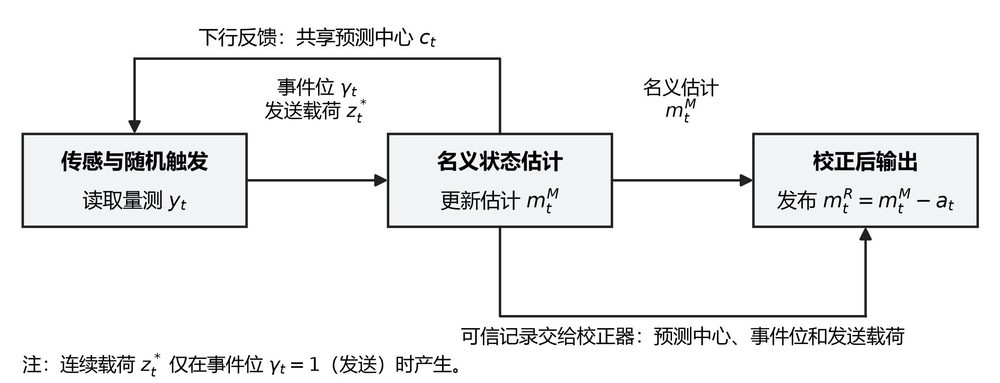
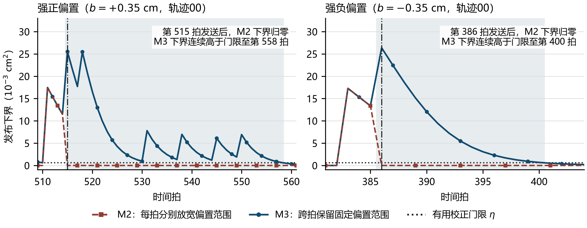
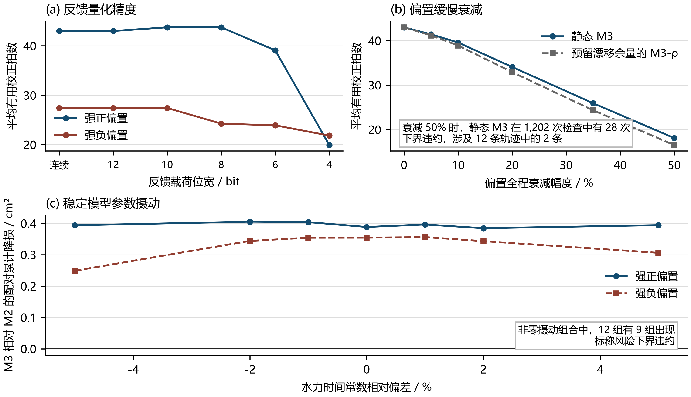

# 事件触发估计中持续偏置的风险约束校正

**摘　要**　针对随机触发后载荷遭持续偏置且起点、幅值未知的问题，提出基于可信记录的条件风险校正方法。逐起点保留相容幅值区间，并给出固定幅值传播在逐拍独立幅值下界失效时仍保持正风险下界的充分条件。双容液位92条主确认及24条过渡轨迹中，强正、负组平均有用时长由9.2/7.3增至34.9/28.4拍，逐轨增/平/减为15/5/0、14/6/0，配对降损增加0.326/0.362 cm²。V2 130条轨迹强早起点组由3.9拍增至97.1拍。M3降损0.380/0.509 cm²，低于健康标定M1的5.296/7.120 cm²，但无需健康样本标定，确认中无负条件改善。双容116轨快速复放决策一致，耗时29.75 ms/轨；量化、漂移和摄动试验揭示模型适用边界。

**关键词**　随机事件触发；远程状态估计；持续偏置；条件风险；区间传播；载荷校正

**中图分类号**　TP273　　　　　　　　　**文献标志码**　A

## 1　引言

随机事件触发估计在减少传输的同时保留发送与静默记录。Han等[1]给出了随机事件规则下的远程最小均方估计；Wu等[2]利用新息统计特性设计反馈量化并验证精度与带宽折衷。本文考察另一种接口：传感端按干净量测作出发送决定，之后连续载荷可能受到固定偏置。接收端可核验事件、中心和时间顺序，却不知道偏置的起点与幅值。

隐蔽攻击、偏置处理和量化传输已有不同研究路线。Wang、Li[3]在KL约束下优化欺诈攻击；陈等[4]结合水印辨识与残差检测；Friedland[5]讨论递归滤波中的固定偏置处理。量化通信研究涉及攻击辨识、状态补偿与传输调度[6–10]。概率集合融合估计[11]及节点残差交换[12]使用多节点信息，Howard等[13]则给出时间一致置信序列的统计基础。Shang等[14]、Guo等[15]及Song、Ye[16]研究随机事件估计中的隐蔽攻击，Xu等[17]考察时空信息下的完整性攻击；近期工作还讨论了多传感顺序随机触发估计[18]和量化新息事件触发估计[19]。上述研究的攻击权限、记录结构和性能目标各不相同。本文固定事件在载荷修改之前生成，并按同一条可信记录评价校正后的条件平方风险。对单传感器而言，多个起点和偏置幅值可与接收记录相容，因此按最可能单一参数补偿不能保证对其他相容解释安全。

研究集中于同一起点上的恒定幅值依赖。参数候选由事件---载荷联合密度筛选，再映射为估计偏差集合；逐起点保留幅值区间后，可计算方向支撑并给出风险下界。主要结果有三点：（1）推导随机发送/静默记录下的固定偏置响应；（2）给出固定幅值区间相对独立逐拍幅值放宽的严格分离条件；（3）以同记录配对实验和全量快速复放比较有用校正时长、降损及计算开销。

## 2　系统与校正接口

考虑线性系统

$$x_{t + 1} = Ax_{t} + Bu_{t} + w_{t},\quad\quad y_{t} = Cx_{t} + v_{t},$$

其中 $x_{t} \in \mathbb{R}^{n}$，$y_{t} \in \mathbb{R}$，$u_{t}$ 为两端已知控制输入。初态 $x_{0} \sim \mathcal{N}(m_{0},P_{0})$；$w_{t} \sim \mathcal{N}(0,Q)$、$v_{t} \sim \mathcal{N}(0,R)$ 时间上独立，相互独立，且独立于初态及触发随机数。设 $P_{0},Q \succcurlyeq 0$、$R > 0$、$W > 0$。本文两个数值对象均为可观系统。

接收端运行无校正监视器，先验均值、协方差分别记作 $m_{t}^{-},P_{t}^{-}$。双方在发送前共享中心 $c_{t} = Cm_{t}^{-} + r_{t}$，其中偏移 $r_{t}$ 已知。给定干净量测后，发送概率为

$$g(y_{t} - c_{t}) = 1 - \exp\lbrack - Z(y_{t} - c_{t})^{2}/2\rbrack,\quad\quad Z > 0.$$

设攻击起点 $k$ 和有符号偏置 $b$ 固定但未知，$|b| \leq b_{\max}$。发送位 $\gamma_{t}$ 产生后，接收载荷为 $z_{t} = y_{t} + b\mathbf{1}_{\{ t \geq k\}}$；静默时不产生载荷。事件位、中心、时序及记录顺序可信，攻击只作用于已经触发的连续载荷。

校正器读取同一历史 $\mathcal{H}_{t}$，另行发布 $m_{t}^{R} = m_{t}^{M} - a_{t}$。它不回写触发中心或主滤波状态，因此方法之间消费同一公开记录。该结构适用于显示、诊断或监督估计端；若校正输出驱动物理闭环，则须将相应控制与触发反馈纳入模型。

{width="6.299212598425197in" height="2.415in"}

**图1　随机事件与输出端校正的信息通路**\
**Fig. 1　Information paths for event generation and output correction**

## 3　事件条件均值与线性偏置响应

给定候选 $\theta = (k,b)$，令 $\xi_{t}^{\theta} = C(\mu_{t}^{\theta, -} - m_{t}^{-})$ 为候选与监视器的先验量测均值差，$\beta_{k,t} = b\mathbf{1}_{\{ t \geq k\}}$，并记 $S_{t} = CP_{t}^{-}C^{\mathsf{T}} + R$。在给定历史下，发送载荷相对监视器先验的联合次密度与静默概率为

$$\begin{aligned}
p_{\theta,t}(1,\nu_{t}) & = \phi_{S_{t}}(\nu_{t} - \beta_{k,t} - \xi_{t}^{\theta})g(\nu_{t} - \beta_{k,t} - r_{t}), \\
p_{\theta,t}(0) & = (1 + ZS_{t})^{- 1/2}\exp\left\lbrack - \frac{(\xi_{t}^{\theta} - r_{t})^{2}}{2(S_{t} + Z^{- 1})} \right\rbrack,
\end{aligned}\quad\quad(1)$$

其中 $\nu_{t} = z_{t} - Cm_{t}^{-}$ 仅在发送时定义，$\phi_{S}$ 是方差为 $S$ 的零均值高斯密度。第二式由静默权重与高斯密度直接积分得到。因此，静默等价于中心 $c_{t}$、量测噪声方差 $R + Z^{- 1}$ 的更新[1]。令 $R_{1} = R$、$R_{0} = R + Z^{- 1}$，发送/静默增益为

$$K_{\gamma,t} = P_{t}^{-}C^{\mathsf{T}}(CP_{t}^{-}C^{\mathsf{T}} + R_{\gamma})^{- 1},\quad\quad F_{t} = (I - K_{\gamma_{t},t}C)A.\quad\quad(2)$$

同一事件历史下候选与监视器共用协方差。记后验估计差 $\delta_{t}^{+} = m_{t}^{M} - \mu_{t}^{\theta}$，则由相同先验初始化和逐拍更新得

$$H_{k,t} = F_{t}H_{k,t - 1} + \gamma_{t}K_{1,t}\mathbf{1}_{\{ t \geq k\}},\quad H_{k, - 1} = 0,\quad\delta_{t}^{+} = bH_{k,t}.\quad\quad(3)$$

式（3）可由线性递推归纳验证，已知控制输入在两均值相减时抵消。该分解把固定幅值与起点单位响应分开。

## 4　认证接口与幅值区间传播

### 4.1　可信记录上的方向证书

在预设查询时刻，方向认证接口 $\texttt{CertifyDirection}$ 接收可信记录、方向 $d_{t}$、支撑门限 $\zeta_{t}$ 和错误预算 $\varepsilon$，返回与记录相容的候选集 $\mathcal{C}_{t}$ 及其方向支撑下界。其覆盖要求为

$$\Pr_{k,b}\{\exists t\in\mathcal{T}_{q}:(k,b)\notin\mathcal{C}_{t}\}\leq\varepsilon. $$

统计层用参考混合过程与Ville不等式控制候选集遗漏，连续偏置区间按触发似然零点分段，并以保守上界认证整段低支撑候选；尚不能排除的区间继续保留。参考过程采用时间一致置信序列的标准构造[13]。高精度版本以向外舍入核验数值边界，$\texttt{M3-Fast}$ 使用binary64分段凹优化复放决策；后者用于计时和一致性检查，不作为浮点形式化保证。该接口只发布其认证覆盖内的方向支撑下界。

### 4.2　由方向证书更新幅值区间

在证书时刻 $\tau$，对每个起点定义 $s_{k,\tau} = d_{\tau}^{\mathsf{T}}WH_{k,\tau}$。该起点保留的偏置幅值为

$$I_{k,\tau} = \{ b \in I_{k,\tau^{-}}:bs_{k,\tau} \geq \zeta_{\tau}\},\quad\quad I_{k,0} = \lbrack - b_{\max},b_{\max}\rbrack.\quad\quad(5)$$

若 $s_{k,\tau} > 0$，式（5）提高区间下端点；若小于零则降低上端点，投影为零时该起点不能满足正证书。系数有数值区间时，将所有可能满足约束的幅值取区间外包，以保留真参数。

给定后续方向 $d_{t}$，定义 $q_{k,t} = d_{t}^{\mathsf{T}}WH_{k,t}$，当前相容起点集合为 $\mathcal{K}_{t}$，区间端点为 $\lbrack\ell_{k,t},u_{k,t}\rbrack$。所有相容幅值上的方向支撑下界为

$${\underline{s}}_{t}(d_{t}) = \min_{k \in \mathcal{K}_{t}}\min\{\ell_{k,t}q_{k,t},u_{k,t}q_{k,t}\}.\quad\quad(6)$$

由于幅值是标量且方向响应线性，最小值取区间端点；若 $q_{k,t}$ 也由区间表示，则取幅值、响应的四种端点乘积中的最小值。

### 4.3　固定幅值传播的严格分离

考察同一历史、同一张第 $\tau$ 拍证书及其传播方向。令 $\Phi_{j,i} = F_{j}\cdots F_{i + 1}$，在比较区间假设 $F_{j}$ 可逆，取伴随方向满足 $d_{j}^{\mathsf{T}}W\Phi_{j,i} = d_{i}^{\mathsf{T}}W$，并令

$$h_{i} = \gamma_{i}d_{i}^{\mathsf{T}}WK_{1,i},\quad A_{\tau,t} = \sum_{i = \tau + 1}^{t}|h_{i}|,\quad G_{\tau,t} = \sum_{i = \tau + 1}^{t}h_{i}.\quad\quad(7)$$

$A_{\tau,t}$ 是逐拍独立幅值的最坏累计扣减，$G_{\tau,t}$ 是同一恒定幅值下的有符号累积。

**命题1**　设证书给出 $d_{\tau}^{\mathsf{T}}W\delta_{\tau}^{+} \geq \zeta_{\tau} > 0$，保留起点集非空且起点 $k$ 的响应投影为 $s_{k,\tau} \neq 0$。若

$$b_{\max}A_{\tau,t} \geq \zeta_{\tau},\quad\quad\rho_{\tau,t} = \min_{k \in \mathcal{K}_{\tau}}\left( 1 + \frac{G_{\tau,t}}{s_{k,\tau}} \right) > 0,\quad\quad(8)$$

则 M2 对后续各拍幅值独立放宽后的下界非正，M3 固定幅值区间的理想支撑至少为 $\zeta_{\tau}\rho_{\tau,t}$。若区间数值下界经发布审计后达到有用门限 $\eta$，则该拍两法出现有用校正分离。

**证明**　M2 对每次发送独立允许 $b_{i} \in \lbrack - b_{\max},b_{\max}\rbrack$，故其下界为 $\zeta_{\tau} - b_{\max}A_{\tau,t} \leq 0$。对M3，各 $k$ 的幅值不变，由式（3）、伴随恒等式得

$$d_{t}^{\mathsf{T}}W(bH_{k,t}) = b(s_{k,\tau} + G_{\tau,t}) \geq \zeta_{\tau}\left( 1 + \frac{G_{\tau,t}}{s_{k,\tau}} \right).$$

对保留起点取最小即得所述支撑界。证毕。

以两步标量例说明。取 $A = C = W = 1$、$R = 1$、$Q = 0.5$、$P_{0} = 1$，连续两拍均发送，故增益均为0.5。第一拍有 $H = 0.5$。若同一记录给出 $(d,\zeta) = (1,0.25)$，且 $b_{\max} = 1$，则由式（5）得 $b \in \lbrack 0.5,1\rbrack$。第二拍 $H = 0.75$，M2下界 $0.25 - 0.5 = - 0.25$，而M3方向支撑至少 $0.5 \times 0.75 = 0.375$。取校正幅度0.375，条件风险改善至少为 $0.140625$。

## 5　条件风险校正

给定历史和正确候选条件均值，监视器与校正输出的条件平方风险差为

$$D_{t}(a) = 2(\delta_{t}^{+})^{\mathsf{T}}Wa - a^{\mathsf{T}}Wa.\quad\quad(9)$$

若方向 $d_{t}$ 的保守支撑满足 ${\underline{s}}_{t} > 0$，取

$$a_{t} = \lambda d_{t},\quad\lambda = \min\left\{ \frac{{\underline{s}}_{t}}{d_{t}^{\mathsf{T}}Wd_{t}},\frac{1}{\parallel d_{t} \parallel_{1}} \right\}.$$

于是 $D_{t}(a_{t}) \geq 2\lambda{\underline{s}}_{t} - \lambda^{2}d_{t}^{\mathsf{T}}Wd_{t} \geq a_{t}^{\mathsf{T}}Wa_{t} > 0$，其中第二项为幅值上限下的向内缩放。实际发布下界另扣除状态浮点相减和发布舍入误差；有用门限 $\eta$ 以该下界判定。

**算法1　固定幅值区间输出校正** **Algorithm 1　Output correction using fixed-bias intervals**

1.  用可信事件及载荷更新监视器、协方差和各发送起点的单位偏置响应。
2.  在预设查询时刻提出方向并认证低支撑候选；未决时保留未排除解释及旧证书。
3.  新证书通过后，以式（5）更新各起点幅值区间。
4.  传播旧方向，按式（6）求风险支撑下界。
5.  向内限幅，复核实际发布风险下界；保留区间法或M2中下界较大的动作，无可用证书时输出零校正。
6.  将校正结果输出给使用者，未校正的监视器继续生成预测中心。

## 6　数值结果

### 6.1　双容液位主确认及补充轨迹

对象为二维双容液位线性模型，$A = \begin{bmatrix}
0.94 & 0.08 \\
0.03 & 0.91
\end{bmatrix}$，$B = \begin{bmatrix}
0.06 & 0.01 \\
0.02 & 0.05
\end{bmatrix}$，$C = \lbrack 1,0\rbrack$，$Q = 0.0025I$，$R = 0.02$，$Z = 2$，$P_{0} = 0.25I$，$W = I$。起始均值为零，控制输入为 $(0.15,0.05)^{\mathsf{T}}$ 或 $(0.08,0.05)^{\mathsf{T}}$，按120拍周期交替，每条轨迹608拍，评分窗为第50至561拍。查询时刻固定为127、255、383、511。攻击起点为50拍，强、弱偏置分别为 $\pm 0.35$ 与 $\pm 0.032$ cm，过渡偏置另取 $\pm 0.25$ cm。每次校正方向门限为 $0.025,0.05,0.10$ 倍 $\parallel d_{t} \parallel_{1}$，有用下界门限 $\eta = 0.000625$ cm²。

主确认含36条健康、强正负各20条、弱正负各8条，共92条；补充过渡正负各12条，单独登记，二者合计116条。每条轨迹为统计单位，512个时刻用于累计损失，未启动轨迹仍计零有用拍和零校正收益。

**表1　双容确认集的门限阶梯与配对校正结果**\
**Table 1　Gate ladder and paired correction results**

  ----------------------------------------------------------------------------------------------------------
  工况                           $n$   $h_{0}$   $q_{95}$       M1 M2→M3有用拍   M3−M2降损 \[95%区间\]/cm²
  ------------------------- -------- --------- ---------- -------- ------------- ---------------------------
  健康                            36    −1.874     −0.012        0 0→0           ---

  强正，$b = 0.35$ cm             20     5.269      4.863    5.296 9.2→34.9      0.326 \[0.179, 0.473\]

  强负，$b = - 0.35$ cm           20     8.287      7.234    7.120 7.3→28.4      0.362 \[0.211, 0.513\]

  过渡正，$b = 0.25$ cm           12     3.754      3.482    3.581 5.5→11.9      0.064 \[−0.019, 0.147\]

  过渡负，$b = - 0.25$ cm         12     2.511      1.879    1.879 0→0           0

  弱正，$b = 0.032$ cm             8    −1.374          0        0 0→0           0

  弱负，$b = - 0.032$ cm           8    −1.931          0        0 0→0           0
  ----------------------------------------------------------------------------------------------------------

M1点补偿使用200条独立健康开发轨迹标定。健康集内，$h_{0}$在36/36条有非零动作，$q_{95}$为3/36，M1、M2、M3均为0/36。强、过渡偏置共64条轨迹中，累计条件改善为负者：$h_{0}$和$q_{95}$各5条，M1为4条，M2与M3均为0条。该项是有限确认样本的描述，不代表对任意轨迹的零误动保证。强正组的M3−M2有用拍数逐轨增加/持平/减少为15/5/0，中位增量21拍；强负组为14/6/0，中位增量22拍。M3强正、强负组实际降损为0.380、0.509 cm²，M1为5.296、7.120 cm²。

强正、强负轨迹分别按编号从小到大检查，选取首条在证书后的无新查询发送中首次出现"M2下界归零、M3仍过门限"的轨迹；两组均为编号00。强正00的最近证书在第511拍；第515拍发送后，M2发布下界由0.01150归零，M3为0.02550 cm²，并连续44拍达有用门限。强负00第383拍获得证书，第386拍发送后M2由0.01336归零，M3为0.02635 cm²，并连续15拍达门限。单证书回放的方向和实际动作与冻结M3一致。全组中至少出现一次"发送使M2归零而M3仍有用"的轨迹分别为10/20、7/20。

{width="6.299212598425197in" height="2.450in"}

**图2　按轨迹编号选取的同源证书分离窗口**\
**Fig. 2　Same-certificate separation windows selected by trajectory ID**

### 6.2　另一对象的独立确认

V2为自治二维模型，$A = \begin{bmatrix}
1.02 & 0.10 \\
0 & 0.97
\end{bmatrix}$、$C = \lbrack 1,0\rbrack$、$Q = 0.05I$、$R = 0.20$、$Z = 2$、$P_{0} = 0.8I$，攻击幅值非负且不超过0.25。确认包含130条轨迹，其中强早起点56条，强晚起点10条，两个弱偏置起点工况各8条，健康48条。该组采用原V2的单侧模型，单独报告。

**表2　V2系统的固定幅值区间确认结果**\
**Table 2　Confirmation results for fixed-bias intervals in V2**

  -----------------------------------------------------------------------------------------------------------
  工况                                     $n$   M2有用拍   M3有用拍 M3−M2累计降损 \[95%区间\]     期末M3有用
  --------------------------------- ---------- ---------- ---------- --------------------------- ------------
  强偏置早起点，$b = 0.25,k = 50$           56        3.9       97.1 1.351 \[0.975, 1.726\]             33/56

  强偏置晚起点，$b = 0.25,k = 96$           10        2.7       89.2 1.078 \[0.480, 1.675\]              4/10

  弱偏置早/晚起点                           16          0          0 0                                   0/16

  健康                                      48          0          0 0                                   0/48
  -----------------------------------------------------------------------------------------------------------

V2强晚起点组M2、M3平均有用时长为2.7、89.2拍，期末M3在4/10条轨迹仍有用；两组弱偏置各8条均无有用动作。两系统的参数及事件记录不同，时长差异不能归因于单一动力学量。

### 6.3　快速实现的全量计时与一致性

M3-Fast对连续幅值似然按移动零点分段，在各段以凹函数极值和浮点保护量筛查候选；双容全量复放与二进制球区间复核用于区分工程实现与数值认证。表3计时针对全部116条、每条608拍的快速版复放；轨迹是计时统计单位。每轨4次查询属于同一记录，查询分位数仅作描述。V2具有不同模型与单侧偏置协议，本轮未将双容快速实现移植到V2。原型M3-Exact另按同机4条轨迹配对计时；早期归档值另列，不与全量Fast分位数直接比较。全量Fast用时各轨迹墙钟均值29.75 ms、中位23.10 ms、P95 65.45 ms、最大95.66 ms。已测四轨配对Exact均值41.21 s，早期Exact归档为19.99 s。

**表3　双容快速复放的全量时间与决策核对**\
**Table 3　Full replay timing and decision checks**

  ----------------------------------------------------------------------------------
  指标                         样本数   均值/一致率     中位数        P95     最大值
  ------------------------ ---------- ------------- ---------- ---------- ----------
  每轨608拍墙钟时间/ms            116         29.75      23.10      65.45      95.66

  每轨608拍CPU时间/ms             116         29.23      31.25      66.41      78.13

  单次查询时间/ms¹                464         1.079      0.089      6.763     20.921

  M2逐拍出手决策，全时域       70 528          100%        ---        ---        ---

  M3逐拍出手决策，全时域       70 528          100%        ---        ---        ---

  M2评分窗有用标志             59 392          100%        ---        ---        ---

  M3评分窗有用标志             59 392          100%        ---        ---        ---

  M3动作哈希逐位相同            116轨          75轨        ---        ---        ---
  ----------------------------------------------------------------------------------

¹ 每轨4次查询在同一记录中，查询分位数为描述性统计，不把464次查询当作独立轨迹样本。

464次查询中，方向及逐级签发与区间原型相同。M2和M3各70,528拍的出手决定、评分窗内各59,392拍的有用标志均一致。对10,789个非零动作作真实参数离线核验，在 $10^{- 10}$ cm²容差下未观察到下界违约；M3动作哈希逐位相同的轨迹为75/116。快速版保护量是经验浮点余量，数值区间版本另行核验；上述结果并不构成任意系统上的浮点形式化保证。

### 6.4　两项模型偏离的敏感性

量化扫描的运行前提是收发双方按量化后的公开历史同步更新预测中心。8、10、12 bit下强正偏置的平均有用校正拍数分别为43.75、43.75、43.00，强负偏置分别为24.25、27.42、27.42；该批12条健康轨迹均未产生有用动作，因而没有非零动作可用于风险核验。这里的风险检查是连续载荷参考下的代理审计，不等同于量化信息条件下的精确保证。仅替换发送载荷而固定原中心时，180次回放中只有2次满足输入约束。4 bit首次出现代理下界违约，强正、强负分别为75/2409和149/1447，健康组M3有动作3/12。

恒值0.35 cm正偏置逐步衰减50%时，静态M3的平均有用拍数由43.00降至18.08，M3相对M2的降损增量为0.0841 cm²，95%配对区间为[-0.0104,0.1786]。该档在全608拍中有90/1478次、评分窗内有28/1202次标称承诺下界违约，涉及12条轨迹中的2条，但评分窗内实际条件改善仍全部非负。加入下游漂移松弛项 $\rho\sum_{s>\tau}|s-\tau|\,|w_s|$ 后，违约降为0/1202，有用拍数由18.1降至16.5；上游变幅覆盖仍有待证明。

稳定水力时间常数扫描的7档中，每档每组12条轨迹，强正和强负的M3−M2平均降损均保持为正，但12个非零摄动与偏置符号组合中有9个出现标称下界违约。整矩阵缩放的+2%压力点使强正组增量变为−0.623 cm²（95%区间[-0.934,−0.312]），强负组为4.918 cm²（[2.943,6.894]）；+5%时谱半径为1.02505，属于失稳压力点，每组仅2条轨迹。上述结果刻画登记参数下的经验边界，不构成普遍失配阈值。

{width="6.299212598425197in" height="3.630in"}

**图3　量化、偏置衰减及模型摄动下的校正性能**\
**Fig. 3　Correction performance under quantization, bias decay, and model perturbation**

**表4　模型偏离下的关键边界汇总**\
**Table 4　Key boundaries under model mismatch**

  -----------------------------------------------------------------------------------------------
  检查项                         标称或同步条件                  失配压力点                         结果
  ---------------------------- ------------------------------ ---------------------------------- -----------------------------
  量化反馈                       收发双方同步更新量化中心       4 bit                            代理违约75/2409、149/1447

  偏置缓慢衰减                   恒值偏置                         总衰减50%                       静态M3违约28/1202；M3-$\rho$为0/1202

  稳定水力时间常数摄动           7档稳定扫描                     非零组合12组                     9组出现标称下界违约
  -----------------------------------------------------------------------------------------------

## 7　讨论与结论

固定幅值区间利用了同一偏置跨多次发送保持不变这一条件。在给定可信事件历史后，它可在逐拍幅值放宽的旧证书失效时继续导出正的校正风险下界。双容及V2确认支持强偏置下有用校正时间延长；弱偏置与部分过渡组则保持静默。与健康标定点补偿相比，区间法平均降损较低，换取不依赖健康轨迹标定的方向风险证书。

方法范围受单传感器标量量测、标称线性高斯参数、可信触发记录和恒定偏置假设限制。慢漂移可缩短证书有效期，偏置若进入触发前则须重新推导事件核。后续需在对应攻击模型下另证覆盖并验证部署接口。

## Risk-Constrained Correction of Persistent Bias in Event-Triggered Estimation

**Abstract**　This paper studies remote estimation when a fixed additive bias enters each payload after a trusted stochastic transmission decision. The onset and signed magnitude are unknown. For each possible onset, the receiver retains the interval of bias magnitudes compatible with the observed event and payload history. Endpoint calculations then yield a lower bound on the projection of the conditional-mean error. We derive a sufficient condition under which a new transmission removes the positive lower bound of a propagated half-space certificate, while the same certificate remains useful when the fixed-bias interval is retained. A two-step scalar example illustrates this separation. In a preregistered two-tank study, 92 primary trajectories and 24 separately registered transition trajectories were evaluated. Under strong positive and negative biases, mean useful correction duration increased from 9.2 and 7.3 to 34.9 and 28.4 steps, respectively. The paired increases in cumulative loss reduction were 0.326 and 0.362 cm². In a second system, useful duration increased from 3.9 to 97.1 steps under a strong early-onset bias. A point correction calibrated on healthy data achieved greater realized loss reduction, whereas the interval method required no healthy-data threshold calibration. A binary64 implementation replayed all 116 two-tank trajectories. Mean runtime was 29.75 ms per 608-step trajectory, with a 95th percentile of 65.45 ms. Under the tested 50% bias decay, 90 of 1,478 empirical risk-bound checks were violated, concentrated in 2 of 12 trajectories. The four scheduled queries within each trajectory were treated as repeated, dependent measurements. The guarantee applies to the stated nominal model and constant-bias family.

**Key words**　stochastic event triggering; remote state estimation; persistent bias; conditional risk; interval propagation; payload correction

## 参考文献

[1] HAN D, MO Y, WU J, et al. Stochastic event-triggered sensor schedule for remote state estimation[J]. IEEE Transactions on Automatic Control, 2015, 60(10): 2661--2675. DOI: 10.1109/TAC.2015.2406975.

[2] 吴寒, 丁文杰, 杨文. 基于新息的网络化系统高效量化编码通信方法[J]. 华东理工大学学报（自然科学版）, 2026, 52(4): 543--552. DOI: 10.14135/j.cnki.1006-3080.20251214001.

[3] 王彩云, 李芳菲. 基于KL散度检测器下的最优线性欺诈攻击[J]. 华东理工大学学报（自然科学版）, 2021, 47(5): 627--634. DOI: 10.14135/j.cnki.1006-3080.20200802001.

[4] 陈佳玲, 杨文. 基于水印的参数不确定性电力系统攻击检测方法[J]. 华东理工大学学报（自然科学版）, 2025, 51(5): 671--680. DOI: 10.14135/j.cnki.1006-3080.20241227001.

[5] FRIEDLAND B. Treatment of bias in recursive filtering[J]. IEEE Transactions on Automatic Control, 1969, 14(4): 359--367. DOI: 10.1109/TAC.1969.1099223.

[6] LI M, HU Y, GUO J. State estimation for linear discrete-time systems with binary-valued quantized innovations against data tampering attacks[J]. Journal of the Franklin Institute, 2024, 361(8): 106817. DOI: 10.1016/j.jfranklin.2024.106817.

[7] LI M, HU Y, GUO J. Fusion state estimation of CPS under quantized observations and tampering attacks[J]. IEEE Sensors Journal, 2024, 24(11): 18232--18243. DOI: 10.1109/JSEN.2024.3393725.

[8] LI M, HU Y, GUO J. Transmission scheduling for remote state estimation with quantized communication against tampering attacks[J]. Ad Hoc Networks, 2025, 178: 103997. DOI: 10.1016/j.adhoc.2025.103997.

[9] LI M, XUE W, ZHAO Y, et al. Remote state estimation with quantized communication against Markov tampering attack[J]. IEEE Transactions on Signal and Information Processing over Networks, 2026, 12: 452--463. DOI: 10.1109/TSIPN.2026.3672342.

[10] LIU J, LI M, GUO J. Remote estimation with binary-switching sensors under tampering attack: Identification-compensated method using quantized communication[J]. Ad Hoc Networks, 2026, 190: 104269. DOI: 10.1016/j.adhoc.2026.104269.

[11] CHEN K, SONG H, SHI P, et al. Probability-guaranteed distributed set-membership secure fusion estimation against nonlinear hybrid attacks[J]. IEEE Transactions on Automation Science and Engineering, 2025, 22: 5539--5550. DOI: 10.1109/TASE.2024.3424190.

[12] ZHANG X Y, YANG G H. Distributed secure state estimation for cyber-physical systems: A residual-exchanging approach under FDI attacks[J]. Journal of the Franklin Institute, 2026, 363(13): 108914. DOI: 10.1016/j.jfranklin.2026.108914.

[13] HOWARD S R, RAMDAS A, MCAULIFFE J, et al. Time-uniform, nonparametric, nonasymptotic confidence sequences[J]. The Annals of Statistics, 2021, 49(2): 1055--1080. DOI: 10.1214/20-AOS1991.

[14] SHANG J, YU H, CHEN T. Worst-case stealthy attacks on stochastic event-based state estimation[J]. IEEE Transactions on Automatic Control, 2022, 67(4): 2052--2059. DOI: 10.1109/TAC.2021.3071948.

[15] GUO Z, ZHOU J, CHEN T. Optimal stochastic event-triggered attack on remote state estimation[J]. Automatica, 2025, 179: 112463. DOI: 10.1016/j.automatica.2025.112463.

[16] SONG Y, YE D. Optimal stealthy attack against stochastic event-based scheduling for remote state estimation in cyber-physical systems[J]. International Journal of Robust and Nonlinear Control, 2022, 32(6): 3511--3526. DOI: 10.1002/rnc.5967.

[17] XU H, YANG Y, SHANG J, et al. Integrity attacks on remote estimation with spatial-temporal information sources[J]. Automatica, 2023, 155: 111172. DOI: 10.1016/j.automatica.2023.111172.

[18] HU Z, CHEN B, WANG R, et al. Multi-sensor state estimation with a sequential stochastic event-triggered mechanism[J]. IEEE Transactions on Signal and Information Processing over Networks, 2025, 11: 342--352. DOI: 10.1109/TSIPN.2025.3546477.

[19] SHEN Y, SHUI Y, HU Z, et al. Event-triggered nonlinear state estimation with quantized innovations[J]. Journal of the Franklin Institute, 2025, 362(1): 107339. DOI: 10.1016/j.jfranklin.2024.107339.
