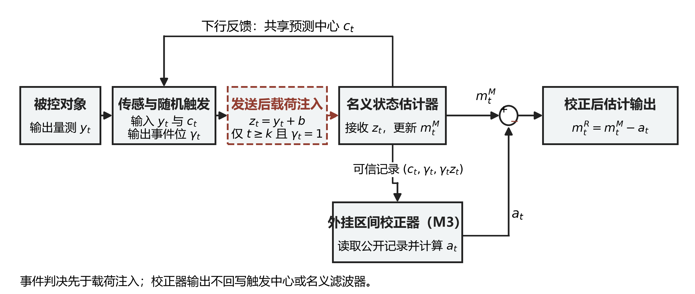
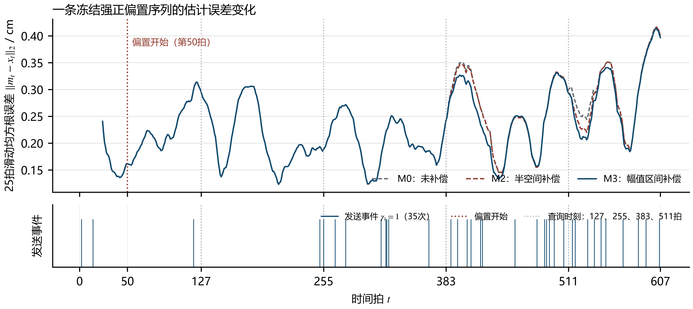
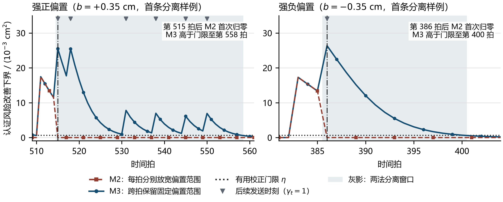
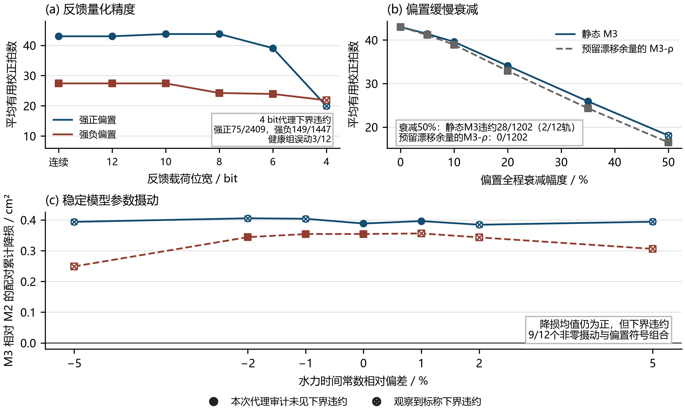

# 基于幅值区间的事件触发偏置补偿方法

**摘　要**　针对随机事件触发远程估计中量测载荷遭受未知起点、未知幅值的持续偏置，点估计补偿可能造成均方误差恶化的问题，提出基于可信事件记录的幅值区间补偿方法。该方法逐起点保留与事件及载荷记录相容的恒定偏置区间，并给出区间传播相较逐拍放宽偏置范围仍可保持正条件均方误差改善下界的充分条件。双容液位系统的92条基础测试和24条过渡偏置测试中，强正、负偏置的平均有效补偿步数由9.2、7.3增至34.9、28.4，配对累计降损增量分别为0.326、0.362 cm$^2$。另一弱不稳定系统130条测试中，强早起点工况由3.9步增至97.1步。区间补偿在强偏置下的实际降损低于健康数据标定的点补偿，但无需离线健康门限，64条攻击测试均未出现负的累计条件均方误差改善。双容116条冻结测试的快速浮点复放平均耗时29.75 ms/条，逐拍决策与高精度实现一致。偏置衰减和参数摄动测试表明，理论下界依赖恒定偏置及标称模型假设。

**关键词**　随机事件触发；远程状态估计；持续偏置攻击；幅值区间；均方误差；安全补偿

**中图分类号**　TP273　　　　　　　　　**文献标志码**　A

## 1　引言

随机事件触发估计利用发送与静默信息改善远程状态估计，并降低传感器通信负担。Han等[1]建立了随机事件机制下的最小均方估计，吴寒等[2]研究了基于新息的量化编码通信。开放上行链路中，传感器可先依据未受攻击的量测作出发送判决，载荷随后遭受未知起点和未知幅值的持续偏置。对单传感器系统，接收端缺少空间冗余，虽然能够核验事件位和已发送数据，却难以在有限时间内准确辨识攻击参数。只检测异常不能补偿已经形成的估计偏差，而依据单一参数估计直接补偿又可能因参数误判而使均方误差增大。

现有工作分别从隐蔽攻击、偏置滤波和量化通信等角度处理相关问题。王彩云、李芳菲[3]研究了基于KL散度的欺诈攻击，陈佳玲、杨文[4]将水印辨识与残差检测结合。Shang等[5]、Guo等[6]和Song、Ye[7]讨论了随机事件触发估计中的隐蔽攻击策略，Deng等[8]考虑了含非高斯成分的调度器攻击，Xu、Xiong[9]研究了面向事件调度器的虚假数据注入，Zhang等[10]分析了随机隐蔽攻击的短期优化与长期收敛，Shang等[11]则从单维加密角度提高事件触发估计的攻击辨识能力。Friedland[12]给出递归滤波中固定偏置处理的经典分析，Li等[13-16]和Liu等[17]研究量化篡改下的辨识、补偿及传输调度。Deghat等[18]、Xu等[19]、Khazraei和Pajić[20]以及Xu等[21]分别从分布式偏置攻击、时空完整性攻击、间歇认证和联合虚假数据注入角度研究安全估计。Chen等[22]和Zhang、Yang[23]进一步讨论概率保证的集合成员融合与残差交换。Howard等[24]提供时间一致置信序列的统计基础，华东理工大学学报及相关期刊关于事件触发控制和安全估计的研究见[25-29]。上述研究在攻击权限、可用记录和性能目标上与本文问题不同。

本文研究触发判决后连续载荷遭受常值偏置的外挂校正问题。候选攻击参数由事件与载荷的联合统计信息约束，再经线性响应映射为估计偏差集合。逐起点保留相容的固定幅值区间，可在后续发送时维持跨拍依赖信息。为对照，将每次新发送后独立放宽幅值范围的半空间传播记为M2，将逐起点保留固定幅值区间的方法记为M3。本文的主要结果包括：推导随机发送与静默记录下的偏置响应；给出M3相对M2维持正风险支撑的充分条件及限幅动作；以两个系统的冻结轨迹检验有用校正时长、累计降损和浮点复放一致性，并报告量化、漂移和参数摄动下的适用边界。

## 2　系统与校正接口

考虑线性系统

$$x_{t + 1} = Ax_{t} + Bu_{t} + w_{t},\quad\quad y_{t} = Cx_{t} + v_{t},$$

其中 $x_t\in\mathbb R^n$，$y_t\in\mathbb R$，$u_t$为收发两端已知的控制输入。

**假设1**　初态 $x_0\sim\mathcal N(m_0,P_0)$，过程噪声 $w_t\sim\mathcal N(0,Q)$，量测噪声 $v_t\sim\mathcal N(0,R)$。各噪声序列时间独立、相互独立，且独立于初态和触发随机数；$P_0,Q\succeq0$、$R>0$，加权矩阵 $W=W^{\mathsf T}>0$。本文两个测试对象均为可观系统。

接收端运行无校正监视器，先验均值、协方差分别记作 $m_{t}^{-},P_{t}^{-}$。双方在发送前共享中心 $c_{t} = Cm_{t}^{-}$。给定干净量测后，发送概率为

$$g(y_{t} - c_{t}) = 1 - \exp\lbrack - Z(y_{t} - c_{t})^{2}/2\rbrack,\quad\quad Z > 0.$$

**假设2**　共享中心 $c_t=Cm_t^-$ 和发送事件 $\gamma_t$ 由未受攻击的当前量测按式（触发概率）产生，随后攻击者才可修改已发送的连续量测载荷。事件位、中心、时序及记录顺序可信。攻击从未知时刻 $k$ 开始，向每个后续发送载荷加入相同的未知偏置 $b$，且 $|b|\leq b_{\max}$；静默拍不产生连续载荷。校正器使用的公开历史为 $\mathcal H_t=\{(c_j,\gamma_j,\gamma_jz_j)\}_{j=0}^{t}$。

校正器读取同一历史 $\mathcal H_t$，另行输出 $m_t^R=m_t^M-a_t$。它不回写触发中心或名义滤波状态，因此各方法使用相同的公开记录。\textbf{注1}　该外挂结构适用于显示、诊断或监督估计端；若补偿输出进入物理控制闭环，则应将控制器和触发反馈并入系统模型后重新分析。

{width="6.299212598425197in" height="2.415in"}

**图1　发送后偏置攻击及外挂区间补偿结构**\
**Fig. 1　Post-trigger bias attack and external interval compensator**

## 3　事件条件均值与线性偏置响应

**引理1**　在假设1、2下，固定候选攻击参数 $\theta=(k,b)$。令 $\xi_t^\theta=C(\mu_t^{\theta,-}-m_t^-)$ 为候选与监视器的先验量测均值差，$\beta_{k,t}=b\mathbf 1_{\{t\geq k\}}$，$S_t=CP_t^-C^{\mathsf T}+R$。给定公开历史 $\mathcal H_{t-1}$，发送载荷相对监视器先验的联合次密度及静默概率为

$$\begin{aligned}
p_{\theta,t}(1,\nu_{t}) &= \phi_{S_t}(\nu_t-\beta_{k,t}-\xi_t^\theta),\\
&\quad\times g(\nu_t-\beta_{k,t}),\\
p_{\theta,t}(0) &= (1+ZS_t)^{-1/2}
\exp\!\left[-\frac{(\xi_t^\theta)^2}{2(S_t+Z^{-1})}\right].
\end{aligned}\tag{1}$$

其中 $\nu_t=z_t-Cm_t^-$ 仅在发送时定义，$\phi_S$ 是方差为 $S$ 的零均值高斯密度。令 $R_1=R$、$R_0=R+Z^{-1}$，发送与静默增益及偏置响应递推分别为

$$\begin{aligned}
K_{\gamma,t} &= P_t^-C^{\mathsf T}(CP_t^-C^{\mathsf T}+R_{\gamma_t})^{-1},\\
F_t &= (I-K_{\gamma_t,t}C)A.
\end{aligned}\tag{2}$$

同一事件历史下，候选估计器与名义监视器使用同一事件对应的协方差更新。记后验估计差 $\delta_t^+=m_t^M-\mu_t^\theta$，则

$$\begin{aligned}
H_{k,t} &= F_tH_{k,t-1}+\gamma_tK_{1,t}\mathbf{1}_{\{t\geq k\}},\\
H_{k,-1}&=0,\qquad \delta_t^+=bH_{k,t}.
\end{aligned}\tag{3}$$

**证明**　静默次密度由静默权重与高斯预测密度直接积分得到，等价于在中心 $c_t$ 处使用量测方差 $R+Z^{-1}$ 更新[1]。同一公开事件记录使两个估计器的协方差递推相同；相减后控制输入抵消，发送载荷中多出的偏置项经Kalman更新变为 $\gamma_tK_{1,t}b\mathbf 1_{\{t\geq k\}}$，逐拍归纳即得式（3）。证毕。该递推将固定幅值与起点响应分离。

## 4　认证接口与幅值区间传播

### 4.1　可信记录上的方向证书

在预设查询时刻，方向认证程序接收可信记录、方向 $d_t$、误差投影门限 $\zeta_t$ 和候选集遗漏概率上界 $\varepsilon$，返回与记录相容的候选集 $\mathcal{C}_t$ 及其沿 $d_t$ 的误差投影下界。其覆盖要求为

对固定真参数 $(k,b)$，概率 $\Pr_{k,b}$ 取于该参数下的系统噪声和触发随机数。候选集满足

$$\Pr_{k,b}\!\left\{\exists t\in\mathcal{T}_{q}:(k,b)\notin\mathcal{C}_{t}\right\}\leq\varepsilon. $$

统计层调用已有的时间一致置信序列接口[24]，只使用其覆盖结论控制候选集遗漏。连续偏置区间按触发似然零点分段，并以保守上界排除整段投影低于门限的偏置候选；不能排除的区间继续保留。高精度实现用向外舍入作数值复核；快速浮点实现采用binary64分段凹优化复放决策，用于计算耗时和一致性检查，不作为浮点形式化保证。该程序只报告覆盖结论内的误差投影下界。

### 4.2　由方向证书更新幅值区间

在证书时刻 $\tau$，对每个起点定义单位响应投影 $s_{k,\tau}=d_\tau^{\mathsf T}WH_{k,\tau}$。该起点保留的偏置幅值区间记为 $[L_{k,\tau},U_{k,\tau}]$，初始区间为 $[-b_{\max},b_{\max}]$，并按下式更新

$$I_{k,\tau}=\{b\in I_{k,\tau^-}:bs_{k,\tau}\geq\zeta_\tau\},\qquad I_{k,0}=[-b_{\max},b_{\max}].\tag{4}$$

若 $s_{k,\tau}>0$，式（4）提高区间下端点；若 $s_{k,\tau}<0$ 则降低上端点，$s_{k,\tau}=0$ 时该起点不能满足正证书。系数以数值区间表示时，将所有可能满足约束的幅值取外包，以保留真实偏置。

给定后续方向 $d_t$，定义 $q_{k,t}=d_t^{\mathsf T}WH_{k,t}$，当前相容起点集合为 $\mathcal{K}_t$。逐起点幅值区间记为 $[L_{k,t},U_{k,t}]$，所有相容幅值上的误差投影下界记为 $\underline{\zeta}_t(d_t)$

$$\underline{\zeta}_t(d_t)=\min_{k\in\mathcal{K}_t}\min\{L_{k,t}q_{k,t},U_{k,t}q_{k,t}\}.\tag{5}$$

由于幅值是标量且方向响应线性，最小值取区间端点；若 $q_{k,t}$ 也由区间表示，则取幅值和响应的四种端点乘积中的最小值。误差投影下界统一记为 $\underline{\zeta}_t$，以区别于单位响应投影 $s_{k,\tau}$ 和认证门限 $\zeta_\tau$。

### 4.3　固定幅值传播的严格分离

考察同一历史、同一张第 $\tau$ 拍证书及其传播方向。令 $\Phi_{j,i} = F_{j}\cdots F_{i + 1}$，在比较区间假设 $F_{j}$ 可逆，取伴随方向满足 $d_{j}^{\mathsf{T}}W\Phi_{j,i} = d_{i}^{\mathsf{T}}W$，并令

$$\begin{aligned}
h_i &= \gamma_i d_i^{\mathsf T}WK_{1,i},\\
A_{\tau,t} &= \sum_{i=\tau+1}^{t}|h_i|,\qquad
G_{\tau,t}=\sum_{i=\tau+1}^{t}h_i.
\end{aligned}\tag{6}$$

$A_{\tau,t}$ 是逐拍独立幅值的最坏累计扣减，$G_{\tau,t}$ 是同一恒定幅值下的有符号累积。

**定理1**　设同一可信历史在时刻 $\tau$ 给出证书 $d_{\tau}^{\mathsf{T}}W\delta_{\tau}^{+} \geq \zeta_{\tau}>0$，保留的起点集合非空，且每个保留起点的响应投影 $s_{k,\tau}\ne0$。若

$$\begin{aligned}
b_{\max}A_{\tau,t}&\geq\zeta_\tau,\\
\rho_{\tau,t}&=\min_{k\in\mathcal{K}_\tau}\left(1+\frac{G_{\tau,t}}{s_{k,\tau}}\right)>0.
\end{aligned}\tag{7}$$

则M2在后续各拍逐次独立放宽偏置幅值后的半空间方向下界非正，而M3在同一方向上的误差投影下界至少为 $\zeta_{\tau}\rho_{\tau,t}>0$。因此该时刻的方向可分性被保留；将此投影下界代入式（8）—（9）得到条件均方误差改善下界。若输出数值核验后的改善下界达到 $\eta$，M3可认证有效补偿，而M2不能由该旧证书认证正改善。

**证明**　M2 对每次发送独立允许 $b_i\in[-b_{\max},b_{\max}]$，故其下界为 $\zeta_\tau-b_{\max}A_{\tau,t}\leq0$。对M3，保留起点满足 $k\leq\tau$，且每个起点的幅值跨发送时刻保持不变。将单位响应递推展开为

$$H_{k,t}=\Phi_{t,\tau}H_{k,\tau}+\sum_{i=\tau+1}^{t}\gamma_i\Phi_{t,i}K_{1,i},\qquad \Phi_{t,i}=F_t\cdots F_{i+1}.$$

左乘伴随方向并用 $d_t^{\mathsf T}W\Phi_{t,i}=d_i^{\mathsf T}W$，得

$$d_t^{\mathsf T}W(bH_{k,t})=b(s_{k,\tau}+G_{\tau,t})\geq\zeta_\tau\left(1+\frac{G_{\tau,t}}{s_{k,\tau}}\right).$$

对保留起点取最小即得所述方向误差投影下界。再由式（8）—（9）得到条件均方误差改善界。证毕。

以两步标量例说明。取 $A=C=W=1$、$R=1$、$Q=0.5$、$P_0=1$，连续两拍均发送，故两拍发送增益均为 $0.5$。首拍 $H_{0,0}=0.5$。设首拍证书方向 $d_0=1$、门限 $\zeta_0=0.25$，且 $b_{\max}=1$，则式（4）给出 $b\in[0.5,1]$。第二拍 $P_1^-=1$，故 $F_1=0.5$，$H_{0,1}=0.75$。按伴随关系取 $d_1=d_0/F_1=2$，新增发送投影为 $h_1=d_1K_{1,1}=1$。M2方向下界为 $0.25-1=-0.75$，M3方向误差投影下界为 $d_1bH_{0,1}\geq2\times0.5\times0.75=0.75$。取 $a_1=0.375$，即 $a_1=\lambda d_1$、$\lambda=0.1875$，满足 $a_{\max}=1$，则条件均方误差改善至少为 $2\lambda(0.75)-a_1^2=0.140625$。

24条强偏置轨迹的单方向消融结果与完整M3在12,288个评分拍上逐拍完全一致。消融记录中其他方向发布步数均为0，表明这批轨迹上的收益来自逐起点保留恒定幅值区间，而非并行方向候选。

## 5　均方误差非恶化补偿律

给定公开历史和真实候选条件均值，记监视器估计的条件均方误差减去补偿后估计的条件均方误差为 $\Delta_t(a_t)$。则

$$\Delta_t(a_t)=2(\delta_t^+)^{\mathsf T}Wa_t-a_t^{\mathsf T}Wa_t.\tag{8}$$

**定理2**　若方向 $d_t$ 上的保守误差投影下界满足 $\underline{\zeta}_t>0$，令

$$\begin{aligned}
a_t&=\lambda d_t,\\
\lambda&=\min\!\left\{\frac{\underline{\zeta}_t}{d_t^{\mathsf T}Wd_t},\frac{a_{\max}}{\|d_t\|_1}\right\},\qquad a_{\max}>0.
\end{aligned}\tag{9}$$

则

$$\begin{aligned}
\Delta_t(a_t)&\geq2\lambda\underline{\zeta}_t-\lambda^2d_t^{\mathsf T}Wd_t\\
&\geq a_t^{\mathsf T}Wa_t>0.
\end{aligned}$$

因此补偿后条件均方误差严格下降。实验统一取输出动作 $\ell_1$ 上限 $a_{\max}=1$（按各对象状态单位计），发布时再复核舍入后的误差改善下界，并按有效补偿门限 $\eta$ 判定。\textbf{证明} 由 $\lambda\leq\underline{\zeta}_t/(d_t^{\mathsf T}Wd_t)$，得 $2\lambda\underline{\zeta}_t-\lambda^2d_t^{\mathsf T}Wd_t\geq\lambda^2d_t^{\mathsf T}Wd_t=a_t^{\mathsf T}Wa_t$。证毕。

**算法1　固定幅值区间输出校正**\
**Algorithm 1　Output correction using fixed-bias intervals**

**输入**　可信公开记录、偏置上限 $b_{\max}$、候选集遗漏概率上界 $\varepsilon$、输出上限 $a_{\max}$。\
**输出**　校正估计 $m_t^R$。

1. 每个新时刻按可信记录更新监视器、协方差和各可能发送起点的单位偏置响应。
2. 到达预设查询时刻时调用方向认证接口。若结果未决，保留未排除解释及此前证书。
3. 取得新证书后，按式（4）更新各起点幅值区间，并按式（5）计算 $\underline{\zeta}_t$。
4. 若均方误差改善下界为正，则按式（9）生成限幅动作并复核实际输出的改善下界，否则令动作 $a_t=0$。
5. 在经审计的区间补偿动作和半空间补偿动作中选取条件均方误差改善下界较大的动作，避免区间外包舍入在临界时刻降低已验证的补偿保证。
6. 输出 $m_t^R=m_t^M-a_t$，且不回写监视器或触发中心。

## 6　数值结果

### 6.1　双容液位过程仿真

对象为二维双容液位线性模型，状态矩阵和输入矩阵分别为

$$A=\begin{bmatrix}0.94&0.08\\0.03&0.91\end{bmatrix},\qquad B=\begin{bmatrix}0.06&0.01\\0.02&0.05\end{bmatrix}.$$

量测矩阵 $C=[1,0]$，过程噪声协方差 $Q=0.0025I$，量测噪声方差 $R=0.02$，触发参数 $Z=2$，初始协方差 $P_0=0.25I$，加权误差矩阵 $W=I$。起始均值为零，控制输入为 $(0.15,0.05)^{\mathsf T}$ 或 $(0.08,0.05)^{\mathsf T}$，按120拍周期交替。每条测试序列608拍，评分窗为第50至561拍，查询时刻固定为127、255、383和511。攻击起点为50拍，强、弱偏置分别为 $\pm0.35$ 和 $\pm0.032$ cm，另设 $\pm0.25$ cm过渡档。方向提议按 $0.025$、$0.05$、$0.10$ 倍 $\|d_t\|_1$ 设门限，有效补偿门限为 $\eta=0.000625$ cm$^2$。

测试集包含36条健康序列、强偏置正负各20条、弱偏置正负各8条，共92条基础测试；过渡偏置正负各12条，共116条。每条测试序列为统计单位，评分窗内未启动补偿的序列计零有效补偿步数和零降损。实际降损定义为无补偿监视器M0的累计均方误差减去相应方法的累计均方误差。点补偿候选由同一参数网格的似然最大值确定。$h_0$不设拒绝门限；$q_{95}$按200条健康开发序列中每条四次查询的最高分数取第190顺序统计量作拒绝门限；$M1$取第199顺序统计量，两门限分别为4.116866和5.457584。表1点补偿降损按 $h_0/q_{95}/M1$ 顺序列出，单位为cm$^2$。$M2$为逐次发送后独立放宽偏置幅值的半空间补偿法，$M3$为按起点保留恒定偏置幅值区间的补偿法。

**表1　双容液位过程的补偿效果与配对比较**\
**Table 1　Compensation performance and paired comparison for the two-tank process**

| 工况 | 测试数 | 点补偿实际降损 $h_0/q_{95}/M1$ / cm$^2$ | M2有效补偿步数 | M3有效补偿步数 | M3−M2配对降损增量 [95%区间] / cm$^2$ |
|---|---:|---:|---:|---:|---:|
| 健康 | 36 | −1.874 / −0.012 / 0 | 0 | 0 | — |
| 强正偏置 | 20 | 5.269 / 4.863 / 5.296 | 9.2 | 34.9 | 0.326 [0.179, 0.473] |
| 强负偏置 | 20 | 8.287 / 7.234 / 7.120 | 7.3 | 28.4 | 0.362 [0.211, 0.513] |
| 过渡正偏置 | 12 | 3.754 / 3.482 / 3.581 | 5.5 | 11.9 | 0.064 [−0.019, 0.147] |
| 过渡负偏置 | 12 | 2.511 / 1.879 / 1.879 | 0 | 0 | 0 |
| 弱正偏置 | 8 | −1.374 / 0 / 0 | 0 | 0 | 0 |
| 弱负偏置 | 8 | −1.931 / 0 / 0 | 0 | 0 | 0 |

健康测试组内，$h_0$在36/36条序列有非零动作，$q_{95}$在3/36条有动作，$M1$、$M2$和$M3$均为0/36。强、过渡偏置共64条攻击序列中，累计条件均方误差改善为负的序列数分别为：$h_0$和$q_{95}$各5条，$M1$为4条，$M2$与$M3$均为0条。该结果限于当前测试样本，不构成普遍的零误补偿保证。强正组$M3-M2$有效补偿步数逐序列增加、持平、减少为15、5、0，中位增量21拍；强负组分别为14、6、0，中位增量22拍。$M3$强正、强负组实际降损为0.380、0.509 cm$^2$，$M1$为5.296、7.120 cm$^2$。

强正、强负测试序列分别按编号递增，选取首条满足“证书后无新查询的发送使M2均方误差改善下界首次归零、M3仍高于有效补偿门限”的序列，两组均为编号00。强正样本最近证书位于第511拍，第515拍发送后M2改善下界由0.01150归零，M3下界为0.02550 cm$^2$，并连续44拍超过门限。强负样本于第383拍获得证书，第386拍发送后M2下界由0.01336归零，M3下界为0.02635 cm$^2$，并连续15拍超过门限。单证书复算的方向与补偿量和冻结M3一致。全组中至少出现一次“M2下界归零、M3仍有效”的序列数分别为10/20和7/20。

为展示补偿作用发生的时域过程，图2绘出强正偏置典型测试序列中未补偿监视器、M2和M3的状态估计误差范数，以及同一序列的发送事件。测试序列按注册随机种子重建，重建的全部事件位与发送载荷和冻结公开记录逐项一致。上图使用25拍滑动均方根平滑，仅用于观察变化趋势；误差不以平滑值作统计，定量比较仍以表1中512拍累计均方误差和逐条配对结果为准。

{width="6.299212598425197in" height="2.850in"}

**图2　强正偏置测试序列的估计误差与发送事件**\
**Fig. 2　Estimation error and transmission events in a strong-positive-bias test**

注：灰、红、蓝三线分别表示未补偿监视器M0、半空间补偿M2和幅值区间补偿M3。下图蓝色竖线为发送事件，红色竖线为偏置开始，灰色竖线为查询时刻。上图为误差范数的25拍滑动均方根，仅用于图示。

{width="6.299212598425197in" height="2.450in"}

**图3　两种偏置补偿方法的均方误差改善下界比较**\
**Fig. 3　Comparison of mean-square-error improvement bounds for two bias-compensation methods**

注：强正、强负样本按编号递增，选取首条在证书后出现“M2下界归零而M3仍超过有效补偿门限”的测试序列。蓝色实线为逐起点保留偏置区间的M3，红色虚线为逐拍放宽偏置幅值的M2，点线表示有效补偿门限；三角标出后续发送拍，灰影表示M3仍能认证有效补偿的区间。

### 6.2　二维弱不稳定自治系统（系统II）的独立确认

系统II为自治二维弱不稳定模型，状态矩阵的谱半径为1.02，其状态矩阵为

$$A=\begin{bmatrix}
1.02 & 0.10 \\
0 & 0.97
\end{bmatrix}.$$

量测矩阵 $C=[1,0]$，$Q=0.05I$，$R=0.20$，$Z=2$，$P_0=0.8I$，偏置先验为 $0\leq b\leq0.25$。确认包含130条轨迹，其中强早起点56条、强晚起点10条、两个弱偏置起点工况各8条、健康48条。该系统沿用单侧偏置协议，与双容确认集分开报告。

**表2　二维弱不稳定系统（系统II）的偏置区间补偿结果**\
**Table 2　Bias-interval compensation in the weakly unstable System II**

  -----------------------------------------------------------------------------------------------------------
  工况                                     $n$   M2有效补偿步数   M3有效补偿步数 M3−M2累计降损 \[95%区间\]     期末M3达门限
  --------------------------------- ---------- ---------- ---------- --------------------------- ------------
  强偏置早起点，$b = 0.25,k = 50$           56        3.9       97.1 1.351 \[0.975, 1.726\]             33/56

  强偏置晚起点，$b = 0.25,k = 96$           10        2.7       89.2 1.078 \[0.480, 1.675\]              4/10

  弱偏置早/晚起点                           16          0          0 0                                   0/16

  健康                                      48          0          0 0                                   0/48
  -----------------------------------------------------------------------------------------------------------

系统II强晚起点组M2、M3平均有效补偿步数为2.7、89.2拍，期末M3在4/10条序列仍达到有效补偿门限；两组弱偏置各8条均未触发有效补偿。两个对象的参数和事件记录不同，补偿步数差异不能归因于单一动力学量。

### 6.3　快速实现的全量计时与一致性

快速浮点实现（M3-Fast）将连续幅值似然按移动零点分段，在各段利用凹性筛查候选；双容全量复放与二进制球区间复核分别用于工程计算和严格数值核验。表3计时覆盖全部116条、每条608拍的快速复放，单条序列为计时统计单位。每条序列4次查询来自同一记录，查询分位数仅作描述。系统II采用不同模型和单侧偏置协议，本次未将双容快速实现移植到该系统。高精度实现与快速浮点实现的同机配对比较另使用4条序列，不与116条快速版的分位数直接换算加速比。

**表3　双容快速复放的全量时间与决策核对**\
**Table 3　Full replay timing and decision checks**

  ----------------------------------------------------------------------------------
  指标                         样本数   均值/一致率     中位数        P95     最大值
  ------------------------ ---------- ------------- ---------- ---------- ----------
  每轨608拍计算时间/ms            116         29.75      23.10      65.45      95.66

  每轨608拍CPU时间/ms             116         29.23      31.25      66.41      78.13

  单次查询时间/ms                 464         1.079      0.089      6.763     20.921

  M2逐拍出手决策，全时域       70,528          100%        —           —          —

  M3逐拍出手决策，全时域       70,528          100%        —           —          —

  M2评分窗有效补偿标志         59,392          100%        —           —          —

  M3评分窗有效补偿标志         59,392          100%        —           —          —

  M3补偿序列逐位一致测试数        116条          75条        —           —          —
  ----------------------------------------------------------------------------------

464次查询中，方向及逐级签发与高精度区间实现相同。M2和M3各70,528个逐拍补偿决策、评分窗内各59,392个有效补偿标志完全一致。对10,789个非零补偿量按真实攻击参数离线核验，在 $10^{-10}$ cm$^2$ 容差下未观察到均方误差改善下界违约。M3逐轨补偿序列与归档值逐位相同的测试为75/116。其余41条测试经冻结精确版逐条复放，最大坐标绝对补偿差为 $2.22\times10^{-16}$，均低于 $10^{-10}$。快速实现的保护量为经验浮点余量，高精度区间实现另行核验；该结果限于本测试对象和参数，不构成任意系统上的浮点形式化保证。

### 6.4　模型失配下的敏感性分析

量化扫描的前提是收发双方按量化后的公开历史同步更新预测中心。8、10、12 bit下强正偏置的平均有效补偿步数分别为43.75、43.75、43.00，强负偏置分别为24.25、27.42、27.42；该批12条健康序列均未产生补偿动作，因此没有非零补偿量可用于下界核验。此处采用连续载荷参考模型作近似核验，不等同于量化信息条件下的精确保证。仅替换发送载荷而固定原中心时，180次回放仅2次满足输入约束。4 bit首次出现标称均方误差改善下界违约，强正、强负分别为75/2409和149/1447，健康组M3动作3/12。

恒值0.35 cm正偏置全程衰减50%时，静态M3平均有效补偿步数由43.00降至18.08，M3相对M2累计降损增量为0.0841 cm$^2$，95%配对区间为[−0.0104,0.1786]。全608拍中有90/1478次、评分窗内有28/1202次标称均方误差改善下界违约，涉及12条测试序列中的2条；评分窗内实际累计均方误差改善仍全部非负。加入下游漂移松弛项 $\rho\sum_{s>\tau}|s-\tau|\,|w_s|$ 后，观察到的违约降为0/1202，平均有效补偿步数由18.1降至16.5；该补偿尚无上游变幅覆盖证明。

稳定水力时间常数摄动包括7档，每档强正、强负偏置各12条测试序列。两组M3−M2平均降损均为正，但12个非零摄动与偏置符号组合中有9组出现标称均方误差改善下界违约。该结果说明实际平均降损为正并不保证模型摄动下仍满足标称下界。整矩阵缩放+2%时，强正组配对增量为−0.623 cm$^2$（95%区间[−0.934,−0.312]），强负组为4.918 cm$^2$（[2.943,6.894]）；+5%时谱半径为1.02505，系统已失稳且每组仅2条测试序列。上述结果刻画登记参数下的敏感性，不构成普遍失配阈值。

{width="6.299212598425197in" height="3.630in"}

**图4　量化、偏置衰减及模型摄动下的有效补偿步数与下界核验**\
**Fig. 4　Effective compensation steps and bound checks under quantization, bias decay, and model perturbation**

**表4　模型失配下的关键边界汇总**\
**Table 4　Key boundaries under model mismatch**

  -----------------------------------------------------------------------------------------------
  检查项                         标称或同步条件                  失配压力点                         结果
  ---------------------------- ------------------------------ ---------------------------------- -----------------------------
  量化反馈                       收发双方同步更新量化中心       4 bit                            强正代理违约75/2409；强负149/1447；健康误动3/12

  偏置缓慢衰减                   恒值偏置                         总衰减50%                       静态M3违约28/1202；M3-$\rho$为0/1202

  稳定水力时间常数摄动           7档（±1%、±2%、±5%）              12个非零符号组合                  9组出现标称下界违约
  -----------------------------------------------------------------------------------------------

## 7　讨论与结论

固定幅值区间利用同一攻击偏置跨多次发送保持不变这一物理条件。给定可信事件记录后，即使逐拍独立放宽偏置幅值的半空间补偿法无法继续给出正的均方误差改善下界，区间补偿仍可能保持正下界。双容液位和弱不稳定自治系统测试显示，强偏置下有效补偿步数增加；弱偏置与部分过渡工况则未达到有效补偿门限。与健康数据标定的点补偿相比，区间方法的实际降损较低，但补偿量受可信记录下的条件均方误差改善下界约束，无需健康样本门限。

方法适用于单传感器标量量测、标称线性高斯模型、可信触发记录和发送后恒定偏置。偏置慢漂移会缩短改善下界的有效时段，且其理论覆盖仍需进一步建立；若偏置进入触发判决前，则必须重建事件条件概率模型。后续工作可研究变幅偏置的覆盖证明及补偿器与闭环控制器的联合分析。

## Interval-Based Bias Compensation for Event-Triggered Estimation

**Abstract**　This paper studies single-sensor remote estimation with stochastic event triggering, where transmitted measurements may acquire a persistent bias with unknown onset and magnitude after the trigger decision. An interval-based compensation method is developed. For each possible onset, it retains the constant bias values compatible with the trusted event and payload history. A sufficient condition is derived under which this interval method preserves a positive lower bound on conditional mean-square-error improvement after the bound based on independently relaxed per-transmission amplitudes becomes nonpositive. In 92 base tests and 24 transition-bias tests of a two-tank process, the mean effective compensation duration under strong positive and negative biases increased from 9.2 and 7.3 to 34.9 and 28.4 steps. The paired increases in cumulative error reduction were 0.326 and 0.362 cm$^2$. In a weakly unstable two-dimensional system, the mean effective duration in the strong early-onset condition increased from 3.9 to 97.1 steps across 130 tests. The interval method achieved lower realized error reduction than the point compensator calibrated with healthy data, but required no offline healthy-data threshold. No negative cumulative conditional mean-square-error improvement occurred among the 64 attack tests. The binary64 implementation replayed all 116 frozen two-tank records in an average of 29.75 ms per record and reproduced the stepwise decisions. Tests with bias decay and model perturbations delineate the assumptions underlying the improvement bound.

**Key words**　stochastic event-triggered estimation; remote state estimation; persistent bias attack; magnitude interval; mean-square error; bias compensation

## 参考文献

[1] HAN D, MO Y, WU J, et al. Stochastic event-triggered sensor schedule for remote state estimation[J]. IEEE Transactions on Automatic Control, 2015, 60(10): 2661–2675. DOI: 10.1109/TAC.2015.2406975.

[2] 吴寒, 丁文杰, 杨文. 基于新息的网络化系统高效量化编码通信方法[J]. 华东理工大学学报（自然科学版）, 2026, 52(4): 543–552. DOI: 10.14135/j.cnki.1006-3080.20251214001.

[3] 王彩云, 李芳菲. 基于KL散度检测器下的最优线性欺诈攻击[J]. 华东理工大学学报（自然科学版）, 2021, 47(5): 627–634. DOI: 10.14135/j.cnki.1006-3080.20200802001.

[4] 陈佳玲, 杨文. 基于水印的参数不确定性电力系统攻击检测方法[J]. 华东理工大学学报（自然科学版）, 2025, 51(5): 671–680. DOI: 10.14135/j.cnki.1006-3080.20241227001.

[5] SHANG J, YU H, CHEN T. Worst-case stealthy attacks on stochastic event-based state estimation[J]. IEEE Transactions on Automatic Control, 2022, 67(4): 2052–2059. DOI: 10.1109/TAC.2021.3071948.

[6] GUO Z, ZHOU J, CHEN T. Optimal stochastic event-triggered attack on remote state estimation[J]. Automatica, 2025, 179: 112463. DOI: 10.1016/j.automatica.2025.112463.

[7] SONG Y, YE D. Optimal stealthy attack against stochastic event-based scheduling for remote state estimation in cyber-physical systems[J]. International Journal of Robust and Nonlinear Control, 2022, 32(6): 3511–3526. DOI: 10.1002/rnc.5967.

[8] DENG Y H, YU H, LI Y Z. Stealthy insider attack on stochastic event-triggered scheduler: Dealing with non-Gaussian components[J]. IEEE Transactions on Information Forensics and Security, 2024, 19: 6886–6895. DOI: 10.1109/TIFS.2024.3427005.

[9] XU Q, XIONG J. Scheduler-pointed false data injection attack for event-based remote state estimation[J]. Automatica, 2024, 162: 111523. DOI: 10.1016/j.automatica.2024.111523.

[10] ZHANG L B, SHANG J, WANG Z D, et al. Remote state estimation under stochastic stealthy attacks: Short-term optimization and long-term convergence analysis[J]. IEEE Transactions on Automatic Control, 2026, 71(8): 5382–5396. DOI: 10.1109/TAC.2026.3672354.

[11] SHANG J, ZHAO D, ZHANG H, et al. Single-dimensional encryption against stealthy attacks on stochastic event-based estimation[J]. IEEE/CAA Journal of Automatica Sinica, 2026, 13(1): 233–235. DOI: 10.1109/JAS.2025.125381.

[12] FRIEDLAND B. Treatment of bias in recursive filtering[J]. IEEE Transactions on Automatic Control, 1969, 14(4): 359–367. DOI: 10.1109/TAC.1969.1099223.

[13] LI M, HU Y, GUO J. State estimation for linear discrete-time systems with binary-valued quantized innovations against data tampering attacks[J]. Journal of the Franklin Institute, 2024, 361(8): 106817. DOI: 10.1016/j.jfranklin.2024.106817.

[14] LI M, HU Y, GUO J. Fusion state estimation of CPS under quantized observations and tampering attacks[J]. IEEE Sensors Journal, 2024, 24(11): 18232–18243. DOI: 10.1109/JSEN.2024.3393725.

[15] LI M, HU Y, GUO J. Transmission scheduling for remote state estimation with quantized communication against tampering attacks[J]. Ad Hoc Networks, 2025, 178: 103997. DOI: 10.1016/j.adhoc.2025.103997.

[16] LI M, XUE W, ZHAO Y, et al. Remote state estimation with quantized communication against Markov tampering attack[J]. IEEE Transactions on Signal and Information Processing over Networks, 2026, 12: 452–463. DOI: 10.1109/TSIPN.2026.3672342.

[17] LIU J, LI M, GUO J. Remote estimation with binary-switching sensors under tampering attack: Identification-compensated method using quantized communication[J]. Ad Hoc Networks, 2026, 190: 104269. DOI: 10.1016/j.adhoc.2026.104269.

[18] DEGHAT M, UGRINOVSKII V, SHAMES I, et al. Detection and mitigation of biasing attacks on distributed estimation networks[J]. Automatica, 2019, 99: 369–381. DOI: 10.1016/j.automatica.2018.10.052.

[19] XU H, YANG Y, SHANG J, et al. Integrity attacks on remote estimation with spatial-temporal information sources[J]. Automatica, 2023, 155: 111172. DOI: 10.1016/j.automatica.2023.111172.

[20] KHAZRAEI A, PAJIĆ M. Attack-resilient state estimation with intermittent data authentication[J]. Automatica, 2022, 138: 110035. DOI: 10.1016/j.automatica.2021.110035.

[21] XU W Y, WANG Z D, HU L, et al. State estimation under joint false data injection attacks: Dealing with constraints and insecurity[J]. IEEE Transactions on Automatic Control, 2022, 67(12): 6745–6753. DOI: 10.1109/TAC.2021.3131145.

[22] CHEN K, SONG H, SHI P, et al. Probability-guaranteed distributed set-membership secure fusion estimation against nonlinear hybrid attacks[J]. IEEE Transactions on Automation Science and Engineering, 2025, 22: 5539–5550. DOI: 10.1109/TASE.2024.3424190.

[23] ZHANG X Y, YANG G H. Distributed secure state estimation for cyber-physical systems: A residual-exchanging approach under FDI attacks[J]. Journal of the Franklin Institute, 2026, 363(13): 108914. DOI: 10.1016/j.jfranklin.2026.108914.

[24] HOWARD S R, RAMDAS A, MCAULIFFE J, et al. Time-uniform, nonparametric, nonasymptotic confidence sequences[J]. The Annals of Statistics, 2021, 49(2): 1055–1080. DOI: 10.1214/20-AOS1991.

[25] 余宏岩, 秦子佳, 余昭旭, 等. 混合攻击下随机MIMO非线性CPSs的事件触发自适应逆最优控制[J]. 华东理工大学学报（自然科学版）, 2026, 52(5): 705–712. DOI: 10.14135/j.cnki.1006-3080.20260203002.

[26] 张志祥, 王梦灵. 预定性能约束下非线性博弈系统的最优事件触发控制[J]. 华东理工大学学报（自然科学版）, 2026, 52(5): 686–694. DOI: 10.14135/j.cnki.1006-3080.20260126001.

[27] HU Z, CHEN B, WANG R, et al. Multi-sensor state estimation with a sequential stochastic event-triggered mechanism[J]. IEEE Transactions on Signal and Information Processing over Networks, 2025, 11: 342–352. DOI: 10.1109/TSIPN.2025.3546477.

[28] SHEN Y, SHUI Y, HU Z, et al. Event-triggered nonlinear state estimation with quantized innovations[J]. Journal of the Franklin Institute, 2025, 362(1): 107339. DOI: 10.1016/j.jfranklin.2024.107339.

[29] HU Z Y, CHEN B, WANG R S, et al. Remote state estimation with posterior-based stochastic event-triggered schedule[J]. IEEE Transactions on Automatic Control, 2024, 69(2): 1194–1201. DOI: 10.1109/TAC.2023.3278943.
