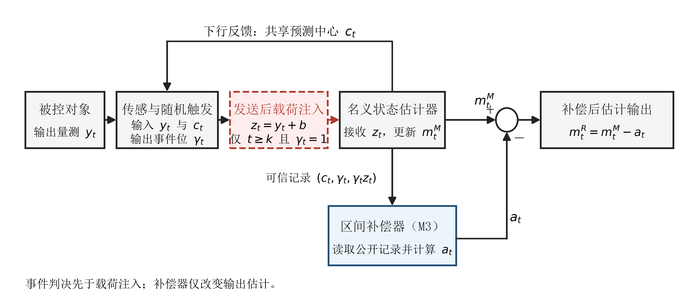
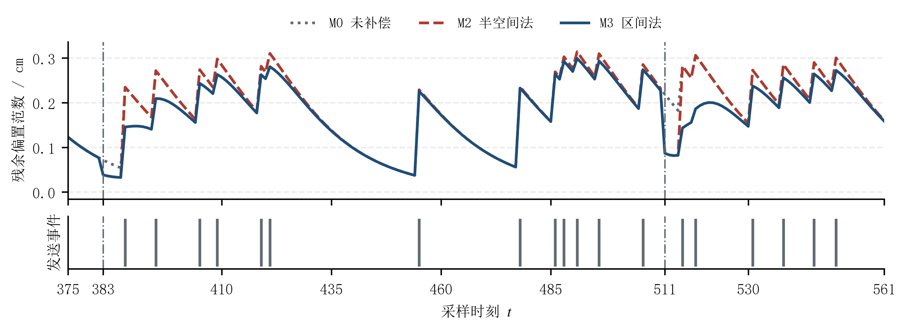
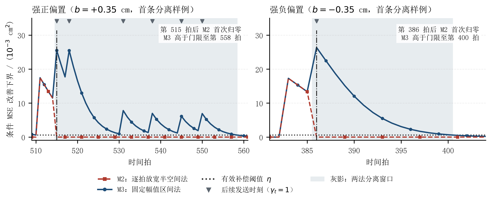
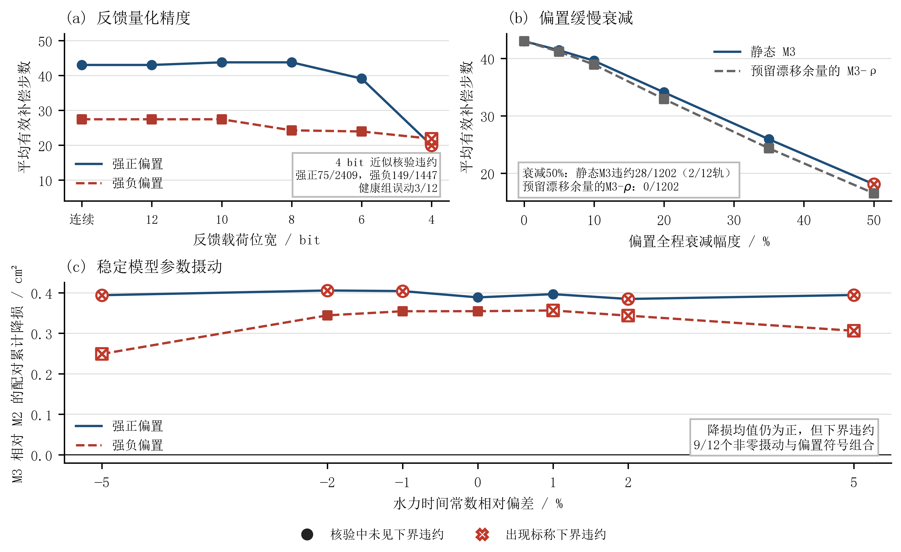

# 基于幅值区间的事件触发偏置补偿方法

**摘　要**　随机事件触发远程估计中，已发送量测若持续受到同一偏置影响，接收端在偏置起点和幅值尚未辨清时直接实施点补偿，可能增大估计误差。为此，提出一种输出端幅值区间补偿方法。对每个可能起点，将可信事件记录给出的估计偏差投影下界转化为幅值区间，后续发送沿用同一幅值约束。由此给出逐拍放宽幅值的半空间法失效后，区间法仍能保证条件均方误差下降的充分条件和限幅补偿律。在双容液位过程的116条样本中，强正、强负偏置组的平均有效补偿步数分别由9.2、7.3增至34.9、28.4，相对半空间法的累计平方误差平均减少0.326、0.362 cm$^2$。另一弱不稳定系统的强偏置早起点组由3.9步增至97.1步。区间法在强偏置下的实际降损小于经健康数据标定的点补偿，但无需离线标定，双容强偏置与过渡偏置样本的累计条件改善均非负。双精度实现每条608步记录平均耗时29.75 ms。偏置衰减和模型摄动可使标称改善下界失效。

**关键词**　随机事件触发；远程状态估计；持续偏置攻击；幅值区间；均方误差；安全补偿

**中图分类号**　TP273　　　　　　　　　**文献标志码**　A

## 1　引言

随机事件触发传感器仅在部分采样时刻发送量测。一次静默也携带量测相对于预测中心的信息，接收端可据此更新条件均值及协方差[1]。新息量化进一步降低了传输连续量测所需的通信量[2]。在采集与转发分离的系统中，采集端可根据本地量测决定是否发送，以认证帧头保护事件位和时间戳，而连续载荷仍需通过上行通道转发。若转发后的量测带有持续偏置，接收端能够确认何时发送过数据，却难以从单一传感器的短时记录中同时辨清偏置的起点和幅值。此时直接按某一估计幅值补偿，可能使输出偏离真实状态更远。

隐蔽攻击与异常检测研究说明了哪些偏差容易被观测记录掩盖。王彩云和李芳菲[3]讨论了散度约束下的攻击幅值选择，陈佳玲和杨文[4]利用水印和残差辨识异常。随机调度下的最坏攻击、发送策略和调度器完整性问题见文献[5–9]，短期误差与长期收敛、加密保护分别见文献[10–11]。检测给出异常证据后，接收端仍需决定补偿方向与大小。

固定偏置滤波可以将未知幅值与动态响应分离[12]。在量化新息、二值观测及马尔可夫篡改模型下，已有方法结合攻击辨识、状态补偿与传输调度[13–17]。点估计给出了可直接使用的补偿量，但与当前记录相容的其他幅值可能要求较小的动作，甚至相反的方向。本文关注这些候选参数上的共同改善下界。

分布式偏置抑制、时空信息源、间歇认证和联合注入条件下的安全估计分别利用不同的信息约束[18–21]。概率集合融合和残差交换可借助多节点信息限制误差[22–23]。本文可用的信息来自同一传感器历次发送和静默，由时间一致置信集控制跨时刻的参数遗漏概率[24]。相较于事件触发闭环控制[25–26]以及顺序多传感器、量化新息和后验触发估计[27–29]，这里保持原有触发及估计过程，只在输出端利用已经获得的偏置信息。

本文考察同一记录、同一时刻获得的方向约束在后续发送中能维持多久。主要工作如下。

（1）给出标量量测下的偏置响应及输出端补偿指标。每个可能起点对应一个可由事件记录递推的单位响应，偏置幅值与该响应之积决定名义估计的条件偏差。

（2）给出两种传播方式严格分离的充分条件。半空间法（M2）在每次发送后独立放宽幅值，区间法（M3）沿用同一恒定幅值。由区间端点计算误差投影下界，进而确定满足输出幅值约束的补偿量。

（3）在双容液位过程与弱不稳定系统上进行同记录配对比较，分别考察有效补偿步数、实际降损和计算时间，并用量化、偏置衰减及参数摄动试验检验标称下界的适用范围。

## 2　问题描述与系统建模

考虑线性系统

$$x_{t + 1} = Ax_{t} + Bu_{t} + w_{t},\quad\quad y_{t} = Cx_{t} + v_{t}.\tag{1}$$

其中 $x_t\in\mathbb R^n$，$y_t\in\mathbb R$，$u_t$为收发两端已知的控制输入。

**假设1**　初态 $x_0\sim\mathcal N(m_0,P_0)$，过程噪声 $w_t\sim\mathcal N(0,Q)$，量测噪声 $v_t\sim\mathcal N(0,R)$。各噪声序列时间独立、相互独立，且独立于初态和触发随机数；$P_0\succ0$、$Q\succeq0$、$R>0$，加权矩阵 $W=W^{\mathsf T}\succ0$。本文两个测试对象均为可观系统。

名义估计器的先验均值和协方差记为 $m_t^-$ 和 $P_t^-$。触发前，两端共享中心 $c_t=Cm_t^-+r_t$，其中 $r_t$ 为已知中心偏移。给定中心和当前量测，发送概率为

$$g(y_{t} - c_{t}) = 1 - \exp\lbrack - Z(y_{t} - c_{t})^{2}/2\rbrack,\quad\quad Z > 0.\tag{2}$$

**假设2**　给定共享中心，发送事件 $\gamma_t$ 由未受攻击的当前量测按式(2)产生，随后攻击者才可修改已发送的连续量测载荷。事件位、中心、时序及记录顺序可信。攻击从未知时刻 $k$ 开始，向每个后续发送载荷加入相同的未知偏置 $b$，且 $|b|\leq b_{\max}$；静默拍不产生连续载荷。补偿器使用的公开历史为 $\mathcal H_t=\{(c_j,\gamma_j,\gamma_jz_j)\}_{j=0}^{t}$。

补偿器读取同一历史 $\mathcal H_t$，另行输出 $m_t^R=m_t^M-a_t$。它不回写触发中心或名义滤波状态，因此各方法使用相同的公开记录。

**注1**　该非侵入式输出端补偿结构适用于显示、诊断或监督估计端；若补偿输出进入物理控制闭环，则应将控制器和触发反馈并入系统模型后重新分析。

给定真参数 $\theta=(k,b)$ 和公开历史 $\mathcal H_t$，令 $\mu_t^{\theta,+}$ 为状态后验均值，$\delta_t^+=m_t^M-\mu_t^{\theta,+}$ 为名义估计的条件偏差。两种输出使用同一记录，故条件加权均方误差中的协方差项相同。名义输出的误差减去补偿输出的误差，得到改善量
$$\Delta_t(a_t)=2(\delta_t^+)^{\mathsf T}Wa_t-a_t^{\mathsf T}Wa_t.\tag{3}$$

{width="6.299212598425197in"}

**图1　发送后偏置攻击及输出端区间补偿结构**\
**Fig. 1　Post-trigger bias attack and external interval compensator**

## 3　事件条件均值与线性偏置响应

**引理1**　在假设1、2下，固定候选攻击参数 $\theta=(k,b)$。令 $\xi_t^\theta=C(\mu_t^{\theta,-}-m_t^-)$ 为候选与监视器的先验量测均值差，$\beta_{k,t}=b\mathbf 1_{\{t\geq k\}}$，$S_t=CP_t^-C^{\mathsf T}+R$。给定公开历史 $\mathcal H_{t-1}$ 和当拍中心 $c_t$，发送载荷相对监视器先验的联合次密度及静默概率为

$$\begin{aligned}
p_{\theta,t}(1,\nu_{t}) &= \phi_{S_t}(\nu_t-\beta_{k,t}-\xi_t^\theta)\\
&\quad\times g(\nu_t-\beta_{k,t}-r_t),\\
p_{\theta,t}(0) &= (1+ZS_t)^{-1/2}
\exp\!\left[-\frac{(\xi_t^\theta-r_t)^2}{2(S_t+Z^{-1})}\right].
\end{aligned}\tag{4}$$

其中 $\nu_t=z_t-Cm_t^-$ 仅在发送时定义，$\phi_S$ 是方差为 $S$ 的零均值高斯密度。令 $R_1=R$、$R_0=R+Z^{-1}$，记 $S_{\gamma,t}=CP_t^-C^{\mathsf T}+R_\gamma$。发送与静默增益及偏置响应递推分别为

$$\begin{aligned}
K_{\gamma_t,t} &= P_t^-C^{\mathsf T}/S_{\gamma_t,t},\\
F_t &= (I-K_{\gamma_t,t}C)A.
\end{aligned}\tag{5}$$

两种估计基于相同事件更新后验协方差。由条件偏差的定义可得

$$\begin{aligned}
H_{k,t} &= F_tH_{k,t-1}+\gamma_tK_{1,t}\mathbf{1}_{\{t\geq k\}},\\
H_{k,-1}&=0,\qquad \delta_t^+=bH_{k,t}.
\end{aligned}\tag{6}$$

**证明**　静默次密度由静默权重与高斯预测密度直接积分得到，等价于在中心 $c_t$ 处使用量测方差 $R+Z^{-1}$ 更新[1]。同一公开事件记录使两个估计器的协方差递推相同；相减后控制输入抵消，发送载荷中多出的偏置项经Kalman更新变为 $\gamma_tK_{1,t}b\mathbf 1_{\{t\geq k\}}$，逐拍归纳即得式（6）。证毕。该递推将固定幅值与起点响应分离。

## 4　认证接口与幅值区间传播

### 4.1　可信记录上的方向证书

在周期认证时刻 $t\in\mathcal T_q$，利用发送载荷和静默事件的联合似然构造相容参数集 $\mathcal C_t$。对任意固定真参数 $(k,b)$，要求同时覆盖全部认证时刻，即

$$\Pr_{k,b}\!\left\{\exists t\in\mathcal{T}_{q}:(k,b)\notin\mathcal{C}_{t}\right\}\leq\varepsilon. $$

统计层调用已有的时间一致置信序列接口[24]，只使用其覆盖结论控制候选集遗漏。连续偏置区间按触发似然零点分段，并以保守上界排除整段投影低于门限的偏置候选；不能排除的区间继续保留。高精度实现用区间外包舍入作数值复核，双精度浮点实现仅用于计算耗时和一致性检查，不作为浮点形式化保证。该程序只报告覆盖结论内的误差投影下界。 只有所有保留候选均满足 $d_t^{\mathsf T}W bH_{k,t}\ge\zeta_t$ 时才接受该方向及阈值。此后关于真偏差的保证均在真参数被覆盖的事件上成立。

### 4.2　由方向证书更新幅值区间

在证书时刻 $\tau$，对每个起点定义单位响应投影 $s_{k,\tau}=d_\tau^{\mathsf T}WH_{k,\tau}$。令 $I_{k,\tau^-}=[L_{k,\tau-1},U_{k,\tau-1}]$ 表示认证更新前的相容区间，并定义更新后区间 $I_{k,\tau}=[L_{k,\tau},U_{k,\tau}]$。初始区间为 $[-b_{\max},b_{\max}]$，并按下式更新

$$I_{k,\tau}=\{b\in I_{k,\tau^-}:bs_{k,\tau}\geq\zeta_\tau\}.\tag{7}$$

若 $s_{k,\tau}>0$，式（7）提高区间下端点；若 $s_{k,\tau}<0$ 则降低上端点，$s_{k,\tau}=0$ 时该起点不能满足正证书。系数以数值区间表示时，将所有可能满足约束的幅值取外包，以保留真实偏置。

给定后续方向 $d_t$，定义 $q_{k,t}=d_t^{\mathsf T}WH_{k,t}$，当前相容起点集合为 $\mathcal{K}_t$。逐起点幅值区间记为 $[L_{k,t},U_{k,t}]$，所有相容幅值上的误差投影下界记为 $\underline{\zeta}_t(d_t)$

$$\underline{\zeta}_t(d_t)=\min_{k\in\mathcal{K}_t}\min\{L_{k,t}q_{k,t},U_{k,t}q_{k,t}\}.\tag{8}$$

由于幅值是标量且方向响应线性，最小值取区间端点；若 $q_{k,t}$ 也由区间表示，则取幅值和响应的四种端点乘积中的最小值。误差投影下界统一记为 $\underline{\zeta}_t$，以区别于单位响应投影 $s_{k,\tau}$ 和认证门限 $\zeta_\tau$。

### 4.3　固定幅值传播的严格分离

考察同一历史、同一张第 $\tau$ 拍证书及其传播方向。令 $\Phi_{j,i} = F_{j}\cdots F_{i + 1}$，约定空乘积为单位矩阵。在比较区间假设 $F_{j}$ 可逆，取伴随方向满足 $d_{j}^{\mathsf{T}}W\Phi_{j,i} = d_{i}^{\mathsf{T}}W$，并令

$$\begin{aligned}
h_i &= \gamma_i d_i^{\mathsf T}WK_{1,i},\\
A_{\tau,t} &= \sum_{i=\tau+1}^{t}|h_i|,\qquad
G_{\tau,t}=\sum_{i=\tau+1}^{t}h_i.
\end{aligned}\tag{9}$$

$A_{\tau,t}$ 是逐拍独立幅值的最坏累计扣减，$G_{\tau,t}$ 是同一恒定幅值下的有符号累积。

**定理1**　设同一可信历史在时刻 $\tau$ 给出证书 $d_{\tau}^{\mathsf{T}}W\delta_{\tau}^{+} \geq \zeta_{\tau}>0$，保留的起点集合非空，且每个保留起点的响应投影 $s_{k,\tau}\ne0$。若

$$\begin{aligned}
b_{\max}A_{\tau,t}&\geq\zeta_\tau,\\
\rho_{\tau,t}&=\min_{k\in\mathcal{K}_\tau}\left(1+\frac{G_{\tau,t}}{s_{k,\tau}}\right)>0.
\end{aligned}\tag{10}$$

则M2由该证书传播的方向下界非正，而M3在同一方向上保有不小于 $\zeta_\tau\rho_{\tau,t}$ 的正下界。按式（3），沿该方向取足够小的正步长即可得到正的条件改善。只有对实际补偿量核验所得的改善下界达到 $\eta$，才将该步计为有效补偿。

**证明**　M2 对每次发送独立允许 $b_i\in[-b_{\max},b_{\max}]$，故其下界为 $\zeta_\tau-b_{\max}A_{\tau,t}\leq0$。对M3，保留起点满足 $k\leq\tau$，且每个起点的幅值跨发送时刻保持不变。将单位响应递推展开为

$$H_{k,t}=\Phi_{t,\tau}H_{k,\tau}+\sum_{i=\tau+1}^{t}\gamma_i\Phi_{t,i}K_{1,i}.$

左乘伴随方向并用 $d_t^{\mathsf T}W\Phi_{t,i}=d_i^{\mathsf T}W$，得

$$d_t^{\mathsf T}W(bH_{k,t})=b(s_{k,\tau}+G_{\tau,t})\geq\zeta_\tau\left(1+\frac{G_{\tau,t}}{s_{k,\tau}}\right).$$

对全部保留起点取最小值，即得结论。证毕。

以两步标量例说明。取 $A=C=W=1$、$R=1$、$Q=0.5$、$P_0=1$，连续两拍均发送，故两拍发送增益均为 $0.5$。首拍 $H_{0,0}=0.5$。设首拍证书方向 $d_0=1$、门限 $\zeta_0=0.25$，且 $b_{\max}=1$，则式（7）给出 $b\in[0.5,1]$。第二拍 $P_1^-=1$，故 $F_1=0.5$，$H_{0,1}=0.75$。按伴随关系取 $d_1=d_0/F_1=2$，新增发送投影为 $h_1=d_1K_{1,1}=1$。M2方向下界为 $0.25-1=-0.75$，M3方向误差投影下界为 $d_1bH_{0,1}\geq2\times0.5\times0.75=0.75$。取 $a_1=0.375$，即 $a_1=\lambda d_1$、$\lambda=0.1875$，满足 $|a_1|=0.375\le a_{\max}=1$，则条件均方误差改善至少为 $2\lambda(0.75)-a_1^2=0.140625$。

## 5　均方误差非恶化补偿律

**定理2**　若方向 $d_t$ 上的保守误差投影下界满足 $\underline{\zeta}_t>0$，令

$$\begin{aligned}
a_t&=\lambda d_t,\\
\lambda&=\min\!\left\{\frac{\underline{\zeta}_t}{d_t^{\mathsf T}Wd_t},\frac{a_{\max}}{\|d_t\|_1}\right\},\qquad a_{\max}>0.
\end{aligned}\tag{11}$$

则

$$\begin{aligned}
\Delta_t(a_t)&\geq2\lambda\underline{\zeta}_t-\lambda^2d_t^{\mathsf T}Wd_t\\
&\geq a_t^{\mathsf T}Wa_t>0.
\end{aligned}$$

**证明**　由式（11）有 $\lambda d_t^{\mathsf T}Wd_t\le\underline{\zeta}_t$。代入式（3），即可得 $\Delta_t(a_t)\ge\lambda^2d_t^{\mathsf T}Wd_t>0$。证毕。

实际计算还需复核舍入后补偿量的改善下界。正下界用于判定能否补偿，阈值 $\eta$ 用于统计达到指定改善幅度的步数。

**算法1　固定幅值区间补偿**\
**Algorithm 1　Fixed-bias interval compensation**

**输入**　公开记录、偏置上限、覆盖误差预算及补偿幅值上限。

1. 对 $t=0,1,\ldots$，更新名义估计、协方差及各起点的单位响应（式（5）–（6））。
2. 对已有方向，按 $d_t^{\mathsf T}W=d_{t-1}^{\mathsf T}WF_t^{-1}$ 推进。若归一化方向，同步缩放对应下界。
3. 若 $t\in\mathcal T_q$，尝试认证新方向。认证成功时按式（7）更新区间并保留方向，其余时刻沿用已有区间。
4. 每一拍均按式（8）计算各保留方向的投影下界。对正下界按式（11）限幅，并复核式（3）的改善下界。
5. 比较区间法和半空间法当前可验证的补偿量，取改善下界较大者。没有正下界或区间集合为空时取零。
6. 输出 $m_t^R=m_t^M-a_t$，且不回写监视器或触发中心。

## 6　仿真实验与分析

### 6.1　双容液位过程仿真

对象为二维双容液位线性模型，状态矩阵和输入矩阵分别为

$$A=\begin{bmatrix}0.94&0.08\\0.03&0.91\end{bmatrix},\qquad B=\begin{bmatrix}0.06&0.01\\0.02&0.05\end{bmatrix}.$$

量测矩阵 $C=[1,0]$，过程噪声协方差 $Q=0.0025I$，量测噪声方差 $R=0.02$，触发参数 $Z=2$，认证遗漏概率预算 $\varepsilon=0.001$，初始协方差 $P_0=0.25I$，加权误差矩阵 $W=I$。起始均值为零，控制输入为 $(0.15,0.05)^{\mathsf T}$ 或 $(0.08,0.05)^{\mathsf T}$，每60拍切换，周期为120拍。每条测试序列608拍，性能评估窗口为第50至561拍，认证时刻固定为127、255、383和511。攻击起点为50拍，强、弱偏置分别为 $\pm0.35$ 和 $\pm0.032$ cm，另设 $\pm0.25$ cm过渡偏置工况。补偿量满足 $\|a_t\|_1\le1$ cm。认证时按 $0.025$、$0.05$、$0.10$ 倍 $\|d_t\|_1$ 由低到高尝试，取已通过的最高档位，有效补偿阈值为 $\eta=0.000625$ cm$^2$。 共享中心偏移在首拍为零，其后由独立随机相位给出，绝对值小于0.01163 cm。

测试集包含36条健康序列、强偏置正负各20条、弱偏置正负各8条，共92条基准样本；过渡偏置正负各12条，共116条。每条测试序列为统计单位，性能评估窗口内未启动补偿的序列计零有效补偿步数和零降损。单条样本的实际降损为M0与相应方法在评估窗口内的状态平方误差之和的差值。表中报告其样本均值，95%区间按同轨配对差的双侧 $t$ 区间计算。点补偿候选由同一参数网格的似然最大值确定。$h_0$不设拒绝门限；$q_{95}$按200条健康开发序列中每条四次认证的最高分数取第190顺序统计量作拒绝门限；$M1$取第199顺序统计量，两门限分别为4.116866和5.457584。表1中各降损指标的单位均为cm$^2$，点补偿按 $h_0/q_{95}/M1$ 顺序列出。$M2$为逐次发送后独立放宽偏置幅值的半空间补偿法，$M3$为按起点保留恒定偏置幅值区间的补偿法。

**表1　双容液位过程的补偿效果与配对比较**\
**Table 1　Compensation performance and paired comparison for the two-tank process**

| 工况 | 样本数 | 点补偿降损（$h_0/q_{95}/M1$） | M3降损 | M2步数 | M3步数 | 配对增量 [95%区间] |
|---|---:|---:|---:|---:|---:|---:|
| 健康 | 36 | −1.874 / −0.012 / 0 | 0 | 0 | 0 | — |
| 强正偏置 | 20 | 5.269 / 4.863 / 5.296 | 0.380 | 9.2 | 34.9 | 0.326 [0.179, 0.473] |
| 强负偏置 | 20 | 8.287 / 7.234 / 7.120 | 0.509 | 7.3 | 28.4 | 0.362 [0.211, 0.513] |
| 过渡正偏置 | 12 | 3.754 / 3.482 / 3.581 | 0.102 | 5.5 | 11.9 | 0.064 [−0.019, 0.147] |
| 过渡负偏置 | 12 | 2.511 / 1.879 / 1.879 | 0 | 0 | 0 | 0 |
| 弱正偏置 | 8 | −1.374 / 0 / 0 | 0 | 0 | 0 | 0 |
| 弱负偏置 | 8 | −1.931 / 0 / 0 | 0 | 0 | 0 | 0 |

健康测试组内，$h_0$在36/36条序列有非零动作，$q_{95}$在3/36条有动作，$M1$、$M2$和$M3$均为0/36。强、过渡偏置共64条攻击序列中，累计条件均方误差改善为负的序列数分别为：$h_0$和$q_{95}$各5条，$M1$为4条，$M2$与$M3$均为0条。该结果限于当前测试样本，不构成普遍的零误补偿保证。强正组$M3-M2$有效补偿步数逐序列增加、持平、减少为15、5、0，中位增量21拍；强负组分别为14、6、0，中位增量22拍。$M3$强正、强负组实际降损为0.380、0.509 cm$^2$，$M1$为5.296、7.120 cm$^2$。 健康组共发送870次，占21 888拍的3.97%。过渡偏置正、负组分别有6/12和0/12条样本达到阈值，正组配对降损增量的区间跨零。对同一轨迹作符号镜像后，对应损失最大差为 $1.42\times10^{-14}$。独立抽样和稀疏发送下的这种差异不足以判定偏置符号存在系统性影响。

24条强偏置样本另作单方向对照。在12 288个评估时刻，单方向实现与完整M3的决策逐步一致，其他候选方向均未产生额外补偿。该结果将本组的步数增量定位到固定幅值区间的传播。

图2选取强正偏置组第1条样本，展示后两次认证附近的响应。由条件均值的正交分解，加权条件均方误差等于 $\operatorname{tr}(WP_t^+)+\|\delta_t^+-a_t\|_W^2$。三种方法的第一项相同，故用第二项的平方根比较残余偏置。真偏置只用于离线作图。

{width="6.299212598425197in"}

**图2　强正偏置下的条件均值残余偏置与发送事件**\
**Fig. 2　Residual conditional bias and transmissions under a strong positive bias**

注：显示评估窗口内第375至561拍。点划线标出第383和511拍的周期认证，下方短线标出实际发送。

强正、强负测试序列分别按编号递增，选取首条满足“证书后无新认证的发送使M2均方误差改善下界首次归零、M3仍高于有效补偿阈值”的序列，两组均为各组第1条样本。强正样本最近证书位于第511拍，第515拍发送后M2改善下界由0.01150归零，M3下界为0.02550 cm$^2$，并连续44拍超过门限。强负样本于第383拍获得证书，第386拍发送后M2下界由0.01336归零，M3下界为0.02635 cm$^2$，并连续15拍超过门限。单证书复算的方向与补偿量和完整M3一致。全组中至少出现一次“M2下界归零、M3仍有效”的序列数分别为10/20和7/20。

{width="6.299212598425197in"}

**图3　两种偏置补偿方法的均方误差改善下界比较**\
**Fig. 3　Comparison of mean-square-error improvement bounds for two bias-compensation methods**

注：三角标记为发送时刻，阴影为同一证书下M2改善下界归零且M3达到有效阈值的连续区间。

### 6.2　二维弱不稳定自治系统（系统II）的独立确认

系统II为自治二维弱不稳定模型，状态矩阵的谱半径为1.02，其状态矩阵为

$$A=\begin{bmatrix}
1.02 & 0.10 \\
0 & 0.97
\end{bmatrix}.$$

量测矩阵 $C=[1,0]$，$Q=0.05I$，$R=0.20$，$Z=2$，$P_0=0.8I$，偏置先验为 $0\leq b\leq0.25$。共考察130条轨迹，其中强早起点56条、强晚起点10条、两个弱偏置起点工况各8条、健康48条。该系统沿用单侧偏置协议，与双容确认集分开报告。 系统II的状态为无量纲量，表2的降损按无量纲状态平方误差计。

**表2　二维弱不稳定系统（系统II）的偏置区间补偿结果**\
**Table 2　Bias-interval compensation in the weakly unstable System II**

| 工况 | 样本数 | M2步数 | M3步数 | 配对降损增量 [95%区间] | 期末M3有效 |
|---|---:|---:|---:|---:|---:|
| 强偏置，起点50 | 56 | 3.9 | 97.1 | 1.351 [0.975, 1.726] | 33/56 |
| 强偏置，起点96 | 10 | 2.7 | 89.2 | 1.078 [0.480, 1.675] | 4/10 |
| 弱偏置，两个起点 | 16 | 0 | 0 | 0 | 0/16 |
| 健康 | 48 | 0 | 0 | 0 | 0/48 |

系统II强晚起点组M2、M3平均有效补偿步数为2.7、89.2拍，期末M3在4/10条序列仍达到有效补偿阈值；两组弱偏置各8条均未触发有效补偿。两个对象的参数和事件记录不同，补偿步数差异不能归因于单一动力学量。

### 6.3　快速实现的全量计时与一致性

快速浮点实现（M3-Fast）将连续幅值似然按移动零点分段，在各段利用凹性筛查候选；双容全量复放与二进制球区间复核分别用于工程计算和严格数值核验。表3计时覆盖全部116条、每条608拍的快速复放，单条序列为计时统计单位。每条序列4次认证来自同一记录，认证分位数仅作描述。早期高精度原型在原计时批次中每条记录平均耗时19.99 s。系统II采用不同模型和单侧偏置协议，本次未将双容快速实现移植到该系统。另选四条强偏置样本在同机配对计时，高精度版和双精度版平均每条分别为41.21 s和69.1 ms。

**表3　双容快速复放的全量时间与决策核对**\
**Table 3　Full replay timing and decision checks**

| 指标 | 样本数 | 均值或一致率 | 中位数 | P95 | 最大值 |
|---|---:|---:|---:|---:|---:|
| 单轨总运行耗时 / ms | 116 | 29.75 | 23.10 | 65.45 | 95.66 |
| 单轨CPU耗时 / ms | 116 | 29.23 | 31.25 | 66.41 | 78.13 |
| 单次认证耗时 / ms | 464 | 1.079 | 0.089 | 6.763 | 20.921 |
| 逐步补偿决策（M2、M3各计） | 70 528 | 100% | — | — | — |
| 窗口内有效标志（各计） | 59 392 | 100% | — | — | — |
| M3与高精度版的坐标差 / cm | 116 | — | — | — | $2.22\times10^{-16}$ |

464次认证中，方向及逐级签发与高精度区间实现相同。M2和M3各70,528个逐拍补偿决策、性能评估窗口内各59,392个有效补偿标志完全一致。对10,789个非零补偿量按真实攻击参数离线核验，在 $10^{-10}$ cm$^2$ 容差下未观察到均方误差改善下界违约。M3逐轨补偿序列与归档值逐位相同的测试为75/116。其余41条测试经高精度版逐条复放，最大坐标绝对补偿差为 $2.22\times10^{-16}$，均低于 $10^{-10}$。快速实现的保护量为数值保护余量，高精度区间实现另行核验；该结果限于本测试对象和参数，不构成任意系统上的浮点形式化保证。

### 6.4　模型失配下的敏感性分析

敏感性试验取强正、强负和健康组各前12条样本。连续载荷下两个强偏置子组的平均有效补偿步数为43.00和27.42，表1则按每组20条统计。量化扫描的前提是收发双方按量化后的公开历史同步更新预测中心。8、10、12 bit下强正偏置的平均有效补偿步数分别为43.75、43.75、43.00，强负偏置分别为24.25、27.42、27.42；该批12条健康序列均未产生补偿动作，因此没有非零补偿量可用于下界核验。此处采用连续载荷参考模型作近似核验，不等同于量化信息条件下的精确保证。仅替换发送载荷而固定原中心时，180次回放仅2次满足输入约束。4 bit首次出现标称均方误差改善下界违约，强正、强负分别为75/2409和149/1447，健康组M3动作3/12。

恒值0.35 cm正偏置全程衰减50%时，静态M3平均有效补偿步数由43.00降至18.08，M3相对M2累计降损增量为0.0841 cm$^2$，95%配对区间为[−0.0104,0.1786]。全608拍中有90/1478次、性能评估窗口内有28/1202次标称均方误差改善下界违约，涉及12条测试序列中的2条；性能评估窗口内实际累计均方误差改善仍全部非负。加入下游漂移松弛项 $\rho\sum_{s=\tau+1}^{t}(s-\tau)\lvert h_s\rvert$（$\rho$ 为每步幅值变化上限，$h_s$ 为式（9）的发送投影） 后，观察到的违约降为0/1202，平均有效补偿步数由18.1降至16.5；该补偿尚无上游变幅覆盖证明。

稳定水力时间常数摄动包括7档，每档强正、强负偏置各12条测试序列。两组M3−M2平均降损均为正，但12个非零摄动与偏置符号组合中有9组出现标称均方误差改善下界违约。该结果说明实际平均降损为正并不保证模型摄动下仍满足标称下界。整矩阵缩放+2%时，强正组配对增量为−0.623 cm$^2$（95%区间[−0.934,−0.312]），强负组为4.918 cm$^2$（[2.943,6.894]）；+5%时谱半径为1.02505，系统已失稳且每组仅2条测试序列。上述结果刻画登记参数下的敏感性，不构成普遍失配阈值。

{width="6.299212598425197in"}

**图4　量化、偏置衰减及模型摄动下的有效补偿步数与下界核验**\
**Fig. 4　Effective compensation steps and bound checks under quantization, bias decay, and model perturbation**

**表4　模型失配下的关键边界汇总**\
**Table 4　Key boundaries under model mismatch**

| 检查项 | 变化条件 | 下界核验结果 |
|---|---|---|
| 同步量化 | 4 bit | 强正近似违约75/2409，强负149/1447，健康误动3/12 |
| 正偏置衰减 | 全程衰减50% | 静态M3违约28/1202，预留漂移余量后0/1202 |
| 水力时间常数 | 非零摄动与偏置符号共12种组合 | 9种组合出现标称下界违约 |

## 7　讨论与结论

（1）在真参数受相容集合覆盖时，固定幅值区间保存了历次发送之间的幅值约束。即使半空间法由同一证书得到的投影下界已非正，区间法仍可沿原方向给出使条件均方误差下降的补偿量。

（2）强偏置下，两组系统均观察到有效补偿步数增加。双容试验中，区间法以较小的实际降损换取无需健康样本标定的条件改善下界；双精度实现与验证版在全部116条样本上的补偿决策一致。

（3）偏置随时间衰减或模型参数发生偏移时，平均降损仍可为正，而逐步标称下界已出现违约。量化试验中的近似核验也只适用于相应的测试条件。

后续可将逐步漂移约束引入参数集覆盖证明，分析时变偏置下的有效补偿时长。对于先于触发判决的偏置或直接参与控制的补偿输出，还需联合建模触发器、估计器和闭环控制器。

## Interval-Based Bias Compensation for Event-Triggered Estimation

**Abstract**　A persistent bias introduced after a sensor decides to transmit can increase estimation error even after point compensation if its onset or magnitude is misidentified. We develop an output compensator that retains an interval of admissible bias magnitudes for each possible onset. A sufficient condition identifies when these intervals still certify a decrease in conditional mean-square error after a half-space bound has become nonpositive on the same record. In 116 two-tank trials, the mean number of effective compensation steps increased from 9.2 to 34.9 for strong positive biases and from 7.3 to 28.4 for strong negative biases. The corresponding paired reductions in cumulative squared error were 0.326 and 0.362 cm$^2$. In the early-onset strong-bias group of a second, weakly unstable system, the mean increased from 3.9 to 97.1 steps. The interval method achieved smaller realized error reductions than a point compensator calibrated on healthy data. At each certification time the new directional bound restricts the interval of each admissible onset. Between certification times the previous intervals remain available, including on steps without a transmission. The compensation is applied to the reported state only, so all methods operate on identical measurements and triggering histories. Comparisons use a trajectory as the statistical unit. The interval method required no such calibration, and cumulative conditional improvement was nonnegative in the strong- and transition-bias two-tank trials. In the two-tank experiment, double-precision replay reproduced the reference decisions in 29.75 ms on average per 608-step record. Bias decay and model perturbations produced violations of the nominal lower bound.

**Key words**　stochastic event-triggered estimation; remote state estimation; persistent bias attack; magnitude interval; mean-square error; bias compensation

## 参考文献

[1] HAN D, MO Y, WU J, et al. Stochastic event-triggered sensor schedule for remote state estimation[J]. IEEE Transactions on Automatic Control, 2015, 60(10): 2661–2675. DOI: 10.1109/TAC.2015.2406975.

[2] 吴寒, 丁文杰, 杨文. 基于新息的网络化系统高效量化编码通信方法[J]. 华东理工大学学报（自然科学版）, 2026, 52(4): 543–552. DOI: 10.14135/j.cnki.1006-3080.20251214001.

[3] 王彩云, 李芳菲. 基于KL散度检测器下的最优线性欺诈攻击[J]. 华东理工大学学报（自然科学版）, 2021, 47(5): 627–634. DOI: 10.14135/j.cnki.1006-3080.20200802001.

[4] 陈佳玲, 杨文. 基于水印的参数不确定性电力系统攻击检测方法[J]. 华东理工大学学报（自然科学版）, 2025, 51(5): 671–680. DOI: 10.14135/j.cnki.1006-3080.20241227001.

[5] SHANG J, YU H, CHEN T. Worst-case stealthy attacks on stochastic event-based state estimation[J]. IEEE Transactions on Automatic Control, 2022, 67(4): 2052–2059. DOI: 10.1109/TAC.2021.3071948.

[6] GUO Z, ZHOU J, CHEN T. Optimal stochastic event-triggered attack on remote state estimation[J]. Automatica, 2025, 179: 112463. DOI: 10.1016/j.automatica.2025.112463.

[7] SONG Y, YE D. Optimal stealthy attack against stochastic event-based scheduling for remote state estimation in cyber-physical systems[J]. International Journal of Robust and Nonlinear Control, 2022, 32(6): 3511–3526. DOI: 10.1002/rnc.5967.

[8] DENG Y H, YU H, LI Y Z. Stealthy insider attack on stochastic event-triggered scheduler: Dealing with non-Gaussian components[J]. IEEE Transactions on Information Forensics and Security, 2024, 19: 6886–6895. DOI: 10.1109/TIFS.2024.3427005.

[9] XU Q, XIONG J. Scheduler-pointed false data injection attack for event-based remote state estimation[J]. Automatica, 2024, 162: 111523. DOI: 10.1016/j.automatica.2024.111523.

[10] ZHANG L B, SHANG J, WANG Z D, et al. Remote state estimation under stochastic stealthy attacks: Short-term optimization and long-term convergence analysis[J]. IEEE Transactions on Automatic Control, 2026, 71(8): 5382–5396. DOI: 10.1109/TAC.2026.3672354.

[11] SHANG J, ZHAO D, ZHANG H, et al. Single-dimensional encryption against stealthy attacks on stochastic event-based estimation[J]. IEEE/CAA Journal of Automatica Sinica, 2026, 13(1): 233–235. DOI: 10.1109/JAS.2025.125381.

[12] FRIEDLAND B. Treatment of bias in recursive filtering[J]. IEEE Transactions on Automatic Control, 1969, 14(4): 359–367. DOI: 10.1109/TAC.1969.1099223.

[13] LI M, HU Y, GUO J. State estimation for linear discrete-time systems with binary-valued quantized innovations against data tampering attacks[J]. Journal of the Franklin Institute, 2024, 361(8): 106817. DOI: 10.1016/j.jfranklin.2024.106817.

[14] LI M, HU Y, GUO J. Fusion state estimation of CPS under quantized observations and tampering attacks[J]. IEEE Sensors Journal, 2024, 24(11): 18232–18243. DOI: 10.1109/JSEN.2024.3393725.

[15] LI M, HU Y, GUO J. Transmission scheduling for remote state estimation with quantized communication against tampering attacks[J]. Ad Hoc Networks, 2025, 178: 103997. DOI: 10.1016/j.adhoc.2025.103997.

[16] LI M, XUE W, ZHAO Y, et al. Remote state estimation with quantized communication against Markov tampering attack[J]. IEEE Transactions on Signal and Information Processing over Networks, 2026, 12: 452–463. DOI: 10.1109/TSIPN.2026.3672342.

[17] LIU J, LI M, GUO J. Remote estimation with binary-switching sensors under tampering attack: Identification-compensated method using quantized communication[J]. Ad Hoc Networks, 2026, 190: 104269. DOI: 10.1016/j.adhoc.2026.104269.

[18] DEGHAT M, UGRINOVSKII V, SHAMES I, et al. Detection and mitigation of biasing attacks on distributed estimation networks[J]. Automatica, 2019, 99: 369–381. DOI: 10.1016/j.automatica.2018.10.052.

[19] XU H, YANG Y, SHANG J, et al. Integrity attacks on remote estimation with spatial-temporal information sources[J]. Automatica, 2023, 155: 111172. DOI: 10.1016/j.automatica.2023.111172.

[20] KHAZRAEI A, PAJIĆ M. Attack-resilient state estimation with intermittent data authentication[J]. Automatica, 2022, 138: 110035. DOI: 10.1016/j.automatica.2021.110035.

[21] XU W Y, WANG Z D, HU L, et al. State estimation under joint false data injection attacks: Dealing with constraints and insecurity[J]. IEEE Transactions on Automatic Control, 2022, 67(12): 6745–6753. DOI: 10.1109/TAC.2021.3131145.

[22] CHEN K, SONG H, SHI P, et al. Probability-guaranteed distributed set-membership secure fusion estimation against nonlinear hybrid attacks[J]. IEEE Transactions on Automation Science and Engineering, 2025, 22: 5539–5550. DOI: 10.1109/TASE.2024.3424190.

[23] ZHANG X Y, YANG G H. Distributed secure state estimation for cyber-physical systems: A residual-exchanging approach under FDI attacks[J]. Journal of the Franklin Institute, 2026, 363(13): 108914. DOI: 10.1016/j.jfranklin.2026.108914.

[24] HOWARD S R, RAMDAS A, MCAULIFFE J, et al. Time-uniform, nonparametric, nonasymptotic confidence sequences[J]. The Annals of Statistics, 2021, 49(2): 1055–1080. DOI: 10.1214/20-AOS1991.

[25] 余宏岩, 秦子佳, 余昭旭, 等. 混合攻击下随机MIMO非线性CPSs的事件触发自适应逆最优控制[J]. 华东理工大学学报（自然科学版）, 2026, 52(5): 705–712. DOI: 10.14135/j.cnki.1006-3080.20260203002.

[26] 张志祥, 王梦灵. 预定性能约束下非线性博弈系统的最优事件触发控制[J]. 华东理工大学学报（自然科学版）, 2026, 52(5): 686–694. DOI: 10.14135/j.cnki.1006-3080.20260126001.

[27] HU Z, CHEN B, WANG R, et al. Multi-sensor state estimation with a sequential stochastic event-triggered mechanism[J]. IEEE Transactions on Signal and Information Processing over Networks, 2025, 11: 342–352. DOI: 10.1109/TSIPN.2025.3546477.

[28] SHEN Y, SHUI Y, HU Z, et al. Event-triggered nonlinear state estimation with quantized innovations[J]. Journal of the Franklin Institute, 2025, 362(1): 107339. DOI: 10.1016/j.jfranklin.2024.107339.

[29] HU Z Y, CHEN B, WANG R S, et al. Remote state estimation with posterior-based stochastic event-triggered schedule[J]. IEEE Transactions on Automatic Control, 2024, 69(2): 1194–1201. DOI: 10.1109/TAC.2023.3278943.
