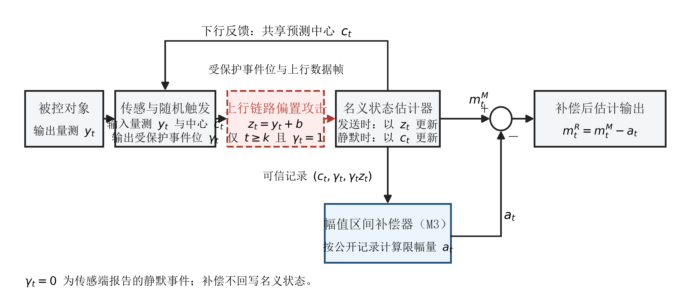
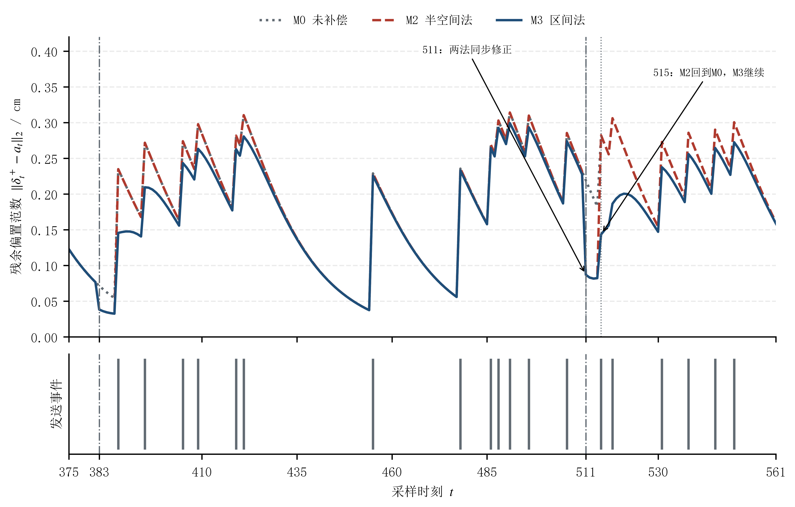
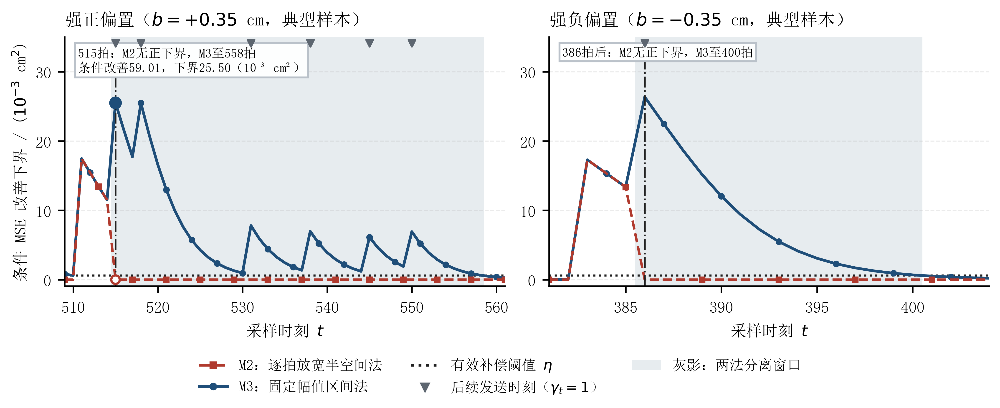
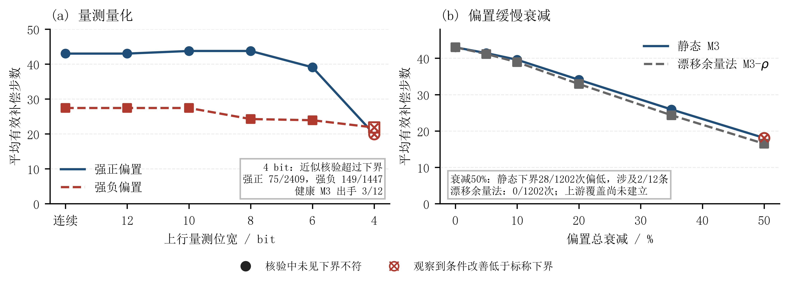

# 基于幅值区间的事件触发偏置补偿方法

**摘　要**　在单传感器随机事件触发远程估计中，发送判决形成后上行量测可能受到起点和幅值未知的恒定偏置。有限记录往往与多组攻击参数相容，按某个参数点补偿可能增大估计误差。本文利用发送事件、静默记录、共享预测中心和接收量测，为每个可能的偏置起点保留相容幅值区间，并据此构造输出端补偿量。在真参数被相容集合覆盖的条件下，给出了半空间传播的投影下界已非正、固定幅值区间传播仍可保证当拍条件均方误差下降的充分条件。在双容液位过程的116条轨迹中，强正、强负偏置组的平均有效补偿步数由9.2、7.3步增至34.9、28.4步；弱不稳定系统的强偏置早起点组由3.9步增至97.1步。点补偿在强偏置下的平均累计平方误差减小量更大，区间法则可为发布的补偿量提供条件改善下界，且无需以健康样本标定点补偿的拒绝阈值。双容过程的双精度实现处理每条608步记录平均耗时29.75 ms。量化和偏置缓慢衰减试验进一步检验了方法的适用条件。

**关键词**　随机事件触发；远程状态估计；恒定偏置；幅值区间；条件均方误差

**中图分类号**　TP273　　　　　　　　　**文献标志码**　A

## 1　引言

液位、压力等过程量在稳态附近往往变化缓慢。传感器若在每个采样时刻上传量测，通信量随采样频率增加，而相邻量测所含信息可能相近。随机事件触发传感器根据量测相对于共享预测中心的偏差决定是否发送。触发规则已知时，静默本身也包含量测位置信息，接收端据此更新状态估计[1]。新息量化从每次传输的数据量入手，在通信带宽与估计精度之间作出权衡[2]。本文考虑采集与转发分离的监控链路。传感端先由当前量测作出发送判决，事件位、时钟和共享中心由双方核验；已发出的连续量测在上行转发过程中仍可能带入恒定偏置。若偏置从两次发送之间的某一时刻开始，有限记录可能无法区分多个起点和幅值。单传感器缺少同时刻的空间冗余，接收端因而需要在参数尚不确定时判断输出是否可以修正，以及修正量应有多大。

关于数据异常的研究主要从攻击检测和偏置辨识展开。王彩云和李芳菲[3]讨论了散度检测约束下的欺诈攻击，陈佳玲和杨文[4]利用水印和残差识别参数不确定系统中的攻击。随机调度下的隐蔽攻击、攻击策略及其长期行为已有多方面研究[5–10]，单维加密也被用于提高事件触发估计的信息保护能力[11]。这些工作揭示了异常在何种条件下能够隐蔽，或如何提高检测能力。检测到异常之后，接收端仍需决定状态估计应沿哪个方向修正，以及允许施加多大的补偿。

固定偏置滤波为偏置与状态响应的分离提供了基础[12]。针对量化通信中的数据篡改，已有研究结合二值量测、攻击辨识、状态补偿和传输调度[13–17]。点估计能够给出直接的补偿值，但有限记录可能仍与不同幅值相容，点估计偏差会导致过补偿。分布式偏置抑制、时空信息源、间歇认证、联合注入条件下的安全估计以及概率集合融合，分别利用空间冗余、可信时段或集合约束限制估计误差[18–23]。单传感器场景可利用时间一致置信序列约束跨时参数遗漏概率[24]，但在起点和幅值尚有歧义时，仍须将这些统计约束转化为可执行且对相容参数一致有效的补偿动作。事件触发闭环控制、多传感器顺序调度、量化新息和后验触发估计具有不同的信息结构[25–29]。

本文关注恒定偏置跨发送保持同一幅值这一约束。对给定起点，估计偏差可分解为偏置幅值与单位响应的乘积。状态空间逐次放宽幅值半空间法（M2）在每次新发送后独立放宽偏置幅值，因而丢失跨发送的幅值相关性。区间法（M3）则按候选起点保留与可信记录相容的偏置区间。本文的主要工作如下。

（1）基于发送量测与静默记录的联合条件分布，推导线性偏置响应模型，并构造对全部指定集合更新时刻同时成立的相容参数集。

（2）将线性方向误差下界转化为逐起点偏置幅值区间，给出一般有符号幅值先验下的半空间传播公式及 M2、M3 的分离充分条件，并推导满足输出幅值约束的单步补偿律。

（3）在双容液位过程与弱不稳定二维系统上作配对仿真，比较有效补偿步数与累计平方误差减小量；利用量化和偏置缓慢衰减试验检查标称条件的适用范围，并报告双精度计算时间。

## 2　问题描述与系统建模

考虑线性离散系统
$$
x_{t+1}=Ax_t+Bu_t+w_t,\qquad y_t=Cx_t+v_t. \tag{1}
$$
其中 $x_t\in\mathbb R^n$、$y_t\in\mathbb R$，$u_t$ 为收发两端已知的控制输入。初态 $x_0\sim\mathcal N(m_0,P_0)$，过程噪声 $w_t\sim\mathcal N(0,Q)$，量测噪声 $v_t\sim\mathcal N(0,R)$；各噪声序列相互独立、时间独立，并独立于初态及触发随机数。本文两个系统的 $P_0\succ0$、$Q\succeq0$、$R>0$，且 $W=W^{\mathsf T}\succ0$。两种仿真对象均可观。

名义估计器依据可信事件记录计算先验均值 $m_t^-$ 与协方差 $P_t^-$。传感端在触发前取得共享中心
$$c_t=Cm_t^-+r_t,$$
其中 $r_t$ 为当拍已知的参考偏移，由预设参考值或独立抖动产生，并在发送判决前告知接收端。本文条件于其已实现数值进行分析。给定量测和中心，发送概率为
$$
g(y_t-c_t)=1-\exp\!\left[-Z(y_t-c_t)^2/2\right],\qquad Z>0. \tag{2}
$$
触发随机数独立于状态、过程噪声和量测噪声。

**假设2**　发送事件 $\gamma_t$ 在偏置注入前，由未受攻击的当前量测按式（2）产生。事件位、中心、时钟和记录顺序可由通信接口核验，发送数据帧可靠到达。丢包不在本文模型内。$\gamma_t=0$ 是传感端报告的可信静默事件，不由接收端将缺失数据包推断而来。攻击从未知采样时刻 $k$ 开始，仅在 $\gamma_t=1$ 时向上行连续载荷加入同一个未知偏置 $b\in[l,u]$，其中 $l\le0\le u$。本文不考虑触发判决前的量测修改。

补偿器读取公开历史
$$\mathcal H_t=\{(c_s,\gamma_s,\gamma_sz_s):0\le s\le t\},$$
并在输出端发布 $m_t^R=m_t^M-a_t$。补偿动作不回写触发中心、名义滤波状态或控制输入，故各方法处理同一记录。该结构用于显示、诊断或监督估计。若输出进入闭环控制，需将补偿引起的控制输入和后续触发变化纳入模型。

给定真参数 $\theta=(k,b)$ 和公开历史，令 $\mu_t^{\theta,+}$ 为条件状态均值，记 $\delta_t^+=m_t^M-\mu_t^{\theta,+}$。两估计具有相同的条件协方差。因此，名义估计相对补偿估计的当拍条件均方误差减小量为
$$
\Delta_t(a_t\mid\theta)
=2(\delta_t^+)^{\mathsf T}Wa_t-a_t^{\mathsf T}Wa_t. \tag{3}
$$

{width="6.299212598425197in"}

**图1　触发记录、上行偏置与输出端补偿的信息通路**\
**Fig. 1　Event record, uplink bias, and output compensation**

## 3　事件条件分布与估计偏差响应

**引理1**　在给定 $\mathcal H_{t-1}$ 和当拍参考偏移 $r_t$ 的条件下，固定候选参数 $\theta=(k,b)$。令 $\xi_t^\theta=C(\mu_t^{\theta,-}-m_t^-)$、$\beta_{k,t}=b\mathbf1_{\{t\ge k\}}$，并记
$$S_t=CP_t^-C^{\mathsf T}+R,\qquad \nu_t=z_t-Cm_t^-.$$
$\nu_t$ 仅在发送时定义。相对于“静默事件质量加发送载荷勒贝格测度”的观测分布，发送次密度和静默概率为
$$
\begin{aligned}
p_{\theta,t}(1,\nu_t)
 &=\phi_{S_t}(\nu_t-\beta_{k,t}-\xi_t^\theta)
   g(\nu_t-\beta_{k,t}-r_t),\\
p_{\theta,t}(0)
 &=(1+ZS_t)^{-1/2}
   \exp\!\left[-\frac{(\xi_t^\theta-r_t)^2}{2(S_t+Z^{-1})}\right].
\end{aligned}\tag{4}
$$
其中 $\phi_S$ 是方差为 $S$ 的零均值高斯密度。给定接收载荷、候选偏置和触发中心后，发送概率因子只依赖这些已知量，在发送分支贝叶斯后验的归一化中消去。由此，发送分支仍是方差为 $R$ 的高斯量测更新。

静默分支的积分可直接配方。令 $e=y_t-Cm_t^-$，则 $e\sim\mathcal N(\xi_t^\theta,S_t)$。记
$$
V_t=(S_t^{-1}+Z)^{-1},\qquad
\bar e_t=V_t\left(\frac{\xi_t^\theta}{S_t}+Zr_t\right).
$$
有
$$
\begin{aligned}
\frac{(e-\xi_t^\theta)^2}{S_t}+Z(e-r_t)^2
&=\frac{(e-\bar e_t)^2}{V_t}\\
&\quad+\frac{(\xi_t^\theta-r_t)^2}{S_t+Z^{-1}} .
\end{aligned}
$$
对第一项积分为1，归一化系数给出 $(1+ZS_t)^{-1/2}$，于是得到式（4）的静默概率。静默分支等价于在 $c_t$ 处以噪声方差 $R+Z^{-1}$ 作虚拟量测更新[1]。

记 $R_1=R$、$R_0=R+Z^{-1}$，并令
$$
\begin{aligned}
K_{\gamma_t,t}&=P_t^-C^{\mathsf T}
(CP_t^-C^{\mathsf T}+R_{\gamma_t})^{-1},\\
F_t&=(I-K_{\gamma_t,t}C)A .
\end{aligned}
\tag{5}
$$
发送时，名义估计用 $z_t$ 更新，候选估计用 $z_t-b\mathbf1_{\{t\ge k\}}$ 更新。静默时，两者均用同一 $c_t$ 及虚拟量测方差 $R_0$ 更新。两估计的已知控制输入 $Bu_{t-1}$ 相消，后验偏差因而满足
$$
\delta_t^+=F_t\delta_{t-1}^+
+\gamma_tK_{1,t}b\mathbf1_{\{t\ge k\}}.
$$
令单位响应 $H_{k,-1}=0$，则
$$
H_{k,t}=F_tH_{k,t-1}+\gamma_tK_{1,t}\mathbf1_{\{t\ge k\}},
\qquad \delta_t^+=bH_{k,t}. \tag{6}
$$
式（6）将偏置值与可递推的起点响应分开。

## 4　偏置相容参数集与幅值区间传播

### 4.1　联合似然构造的相容参数集

设参数空间为 $\Theta=\{0,1,\ldots\}\times[l,u]$。令 $p_{\theta,s}(O_s\mid\mathcal H_{s-1},r_s)$ 表示式（4）的观测核。无偏置模型作为参考 $p_{0,s}$，定义截至时刻 $t$ 的对数似然比
$$
\ell_t(\theta)=\sum_{s=0}^t
\ln\frac{p_{\theta,s}(O_s\mid\mathcal H_{s-1},r_s)}
        {p_{0,s}(O_s\mid\mathcal H_{s-1},r_s)} .
$$
设参考分量集合为 $\mathcal B_{\mathrm{ref}}=\{b_1,\ldots,b_J\}$，按 $1/J$ 等权混合。双容双侧偏置采用 $b_j\in\{\pm0.2b_{\max},\pm0.4b_{\max},\pm b_{\max}\}$；系统II单侧偏置采用 $b_j\in\{0.05,0.10,0.25\}$（按该系统偏置单位）。这些分量仅定义参考预测密度，不限制真实候选幅值。令 $\lambda_{j,t}$ 为第 $j$ 个参考预测器相对于无偏置模型的单步条件密度比。每个参考预测器按同一公开历史递推其均值，故在无偏置模型下 $\mathbb E_0[\lambda_{j,t}\mid\mathcal H_{t-1},r_t]=1$。每个时刻向各分量加入的 $w_t$ 是序贯检验的混合权重，不是攻击起点先验；其质量递推为：
$$
w_t=\frac1{(t+1)(t+2)},\qquad
M_{j,-1}=0,\qquad
M_{j,t}=(M_{j,t-1}+w_t)\lambda_{j,t}.
$$
记未启动起点的尾部权重为 $\alpha_t=1/(t+2)$。参考似然比为
$$
E_t=\frac1J\sum_{j=1}^J M_{j,t}+\alpha_t,\qquad E_{-1}=1.
$$
由 $\alpha_{t-1}-\alpha_t=w_t$ 及 $M_{j,-1}=0$ 可得 $\mathbb E_0[E_t\mid\mathcal H_{t-1},r_t]=E_{t-1}$，且 $E_{-1}=1$。因此 $\{E_t\}$ 是无偏置模型下均值为1的非负似然比鞅。相应的参考单步预测密度为
$$
q_t(O_t\mid\mathcal H_{t-1},r_t)
=p_{0,t}(O_t\mid\mathcal H_{t-1},r_t)\frac{E_t}{E_{t-1}}.
$$

将相容参数集定义为
$$
\mathcal C_t(\varepsilon)=\{\theta=(k,b):\ell_t(\theta)\ge \ln E_t+\ln\varepsilon\},\qquad \varepsilon=0.001.\tag{7}
$$
对每个固定真实参数，同时覆盖概率满足
$$
\Pr_\theta\{\exists t\in\mathcal T_q:
\theta\notin\mathcal C_t(\varepsilon)\}\le\varepsilon .
\tag{8}
$$
记 $p_\theta^{(t)}$ 和 $q^{(t)}$ 分别为真参数模型与参考预测规则对前缀记录的联合密度。由 $q_s=p_{0,s}E_s/E_{s-1}$ 逐项相乘可得 $q^{(t)}=p_0^{(t)}E_t$，因而
$$
\frac{p_\theta^{(t)}}{q^{(t)}}
=\frac{\exp\{\ell_t(\theta)\}}{E_t}.
$$
令 $A_t$ 表示在 $t\in\mathcal T_q$ 首次排除真参数的事件。由式（7），在 $A_t$ 上有 $p_\theta^{(t)}/q^{(t)}<\varepsilon$。将所有前缀事件延拓到同一有限终点后，$A_t$ 两两不相交，故
$$
\Pr_\theta\!\left(\bigcup_{t\in\mathcal T_q}A_t\right)
=\sum_t\int_{A_t}p_\theta^{(t)}
\le\varepsilon\sum_t\int_{A_t}q^{(t)}\le\varepsilon.
$$
这对任意有限查询序列成立；对无限序列取有限窗递增极限即得式（8）。由于所有时刻共用同一个相容集序列，后续从集合中自适应选择方向、多个阈值或不同起点的区间投影均不需另行分配显著性水平[24]。

**性质1（分段严格凹性）**　固定起点 $k$ 后，候选滤波均值和量测偏移对标量 $b$ 呈仿射关系，发送及静默高斯项的对数似然为凹二次函数。当 $k$ 后至少有一个发送时，每个受攻击发送时刻还增加触发项
$$\ln\left[1-\exp\left(-\frac Z2(\nu_s-r_s-b)^2\right)\right].$$
它在移动零点 $b=\nu_s-r_s$ 处趋于 $-\infty$。令 $\chi_s=Z(\nu_s-r_s-b)^2/2>0$，该项关于 $b$ 的二阶导数为
$$
Z\,\frac{e^{\chi_s}(1-2\chi_s)-1}{(e^{\chi_s}-1)^2}<0 .
$$
若该起点之后无发送，则记录似然与 $b$ 无关，且单位响应为零。否则，将连续幅值区间按各移动零点分段后，累计对数似然在每个开区间上严格凹。最大值可由区间端点和驻点确定；区间系数采用外包时，以分支区间上界排除低投影候选，未能排除的部分继续保留。方向计算在本稿中调用这一相容集求解模块。高精度区间实现用于校验集合更新边界，双精度分段一维搜索用于计算效率比较。

在给定方向 $d_t$ 与待验证投影阈值 $\zeta_t>0$ 时，定义低投影参数集合
$$
\mathcal B_t(d_t,\zeta_t)
=\{\theta\in\Theta:
d_t^{\mathsf T}WbH_{k,t}<\zeta_t\}.
$$
若其每个起点、每段幅值区间上的对数似然上界都严格小于 $\ln E_t+\ln\varepsilon$，且相容集合中存在已验证的候选见证，则低投影解释均不属于 $\mathcal C_t(\varepsilon)$。于是，在式（8）的共同覆盖事件上，
$$d_t^{\mathsf T}W\delta_t^+\ge\zeta_t.$$
相容集合还包括健康解释、尚未发生污染的未来起点。若求解预算内无法排除低投影解释，本拍不签发正的方向约束，先前取得的约束仍可继续使用。

### 4.2　由线性方向约束更新偏置幅值区间

在周期更新时刻 $\tau\in\mathcal T_q$，对每个已启动起点 $k$ 令
$$
\begin{aligned}
s_{k,\tau}&=d_\tau^{\mathsf T}WH_{k,\tau},\\
I_{k,\tau^-}&=[L_{k,\tau-1},U_{k,\tau-1}],\\
I_{k,\tau}&=[L_{k,\tau},U_{k,\tau}].
\end{aligned}
$$
初始区间为先验 $I_{k,0}=[l,u]$。若求解模块得到方向约束 $d_\tau^{\mathsf T}W\delta_\tau^+\ge\zeta_\tau$，则
$$
I_{k,\tau}=\{b\in I_{k,\tau^-}:bs_{k,\tau}\ge\zeta_\tau\}. \tag{9}
$$
当 $s_{k,\tau}>0$ 时该约束提高区间下端点；当 $s_{k,\tau}<0$ 时降低上端点；若 $s_{k,\tau}=0$，该起点与正方向约束不相容。只保留非空区间的起点集合 $\mathcal K_\tau$。系数存在数值区间时，将所有可能满足约束的幅值外包，因而不会错误排除真实幅值。

给定传播方向 $d_t$，令 $q_{k,t}=d_t^{\mathsf T}WH_{k,t}$。所有保留起点和幅值对应的偏差投影下界为
$$
\underline s_t(d_t)=
\min_{k\in\mathcal K_t}
\min\{L_{k,t}q_{k,t},U_{k,t}q_{k,t}\}. \tag{10}
$$
若 $q_{k,t}$ 本身以区间表示，则取两幅值端点与两响应端点所成的四个乘积的最小值。区间在每个集合更新时刻由新方向约束收紧；两次更新之间仍按已知系统转移传播，静默拍也据此计算可用的投影下界。

### 4.3　固定幅值区间与半空间传播的分离条件

比较同一可信记录、同一时刻取得的方向约束及沿用该约束的传播。令 $\Phi_{j,i}=F_j\cdots F_{i+1}$，$\Phi_{i,i}=I$。为向后传播伴随方向，假设比较区间内 $F_j$ 非奇异，并取未归一化方向
$$d_j=W^{-1}\Phi_{j,\tau}^{-\mathsf T}Wd_\tau,$$
从而 $d_j^{\mathsf T}W\Phi_{j,i}=d_i^{\mathsf T}W$。各拍发送对方向的投影和累计量定义为
$$
\begin{aligned}
h_i&=\gamma_i d_i^{\mathsf T}WK_{1,i},\\
A_{\tau,t}&=\sum_{i=\tau+1}^t|h_i|,\qquad
G_{\tau,t}=\sum_{i=\tau+1}^th_i .
\end{aligned}\tag{11}
$$
方向如按正数缩放，所有相应投影和下界必须同步缩放。

**定理1**　设在第 $\tau$ 拍，相容起点集合 $\mathcal K_\tau$ 非空，且全部区间内参数满足方向约束 $bs_{k,\tau}\ge\zeta_\tau>0$。给定幅值先验 $[l,u]$，若
$$
\zeta_\tau+\sum_{i=\tau+1}^t\min\{lh_i,uh_i\}\le0. \tag{12}
$$
且
$$
\rho_{\tau,t}=
\min_{k\in\mathcal K_\tau}
\left(1+\frac{G_{\tau,t}}{s_{k,\tau}}\right)>0. \tag{13}
$$
则旧约束下半空间法（M2）的可保证投影下界已非正，而固定幅值区间法（M3）的投影下界仍不小于 $\zeta_\tau\rho_{\tau,t}>0$。本结论比较同一旧方向约束的传播；新一轮集合更新可能使任一方法取得新的正向约束。

**证明**　M2在每次发送后独立选取 $b_i\in[l,u]$。在线性投影 $b_i h_i$ 上取最小值，逐次相加即得 $\zeta_\tau+\sum_i\min\{lh_i,uh_i\}$。因此，双容过程的双侧先验 $[-b_{\max},b_{\max}]$ 给出逐拍绝对值扣减，系统II的单侧先验 $[0,b_{\max}]$ 则只扣除 $h_i<0$ 的项。对M3，固定同一个 $b$，由式（6）沿伴随方向展开可得
$$
H_{k,t}=\Phi_{t,\tau}H_{k,\tau}
+\sum_{i=\tau+1}^t\gamma_i\Phi_{t,i}K_{1,i}.$$
左乘 $d_t^{\mathsf T}W$ 后，
$$
d_t^{\mathsf T}W(bH_{k,t})
=b(s_{k,\tau}+G_{\tau,t})
=(bs_{k,\tau})\left(1+\frac{G_{\tau,t}}{s_{k,\tau}}\right).
$$
由 $bs_{k,\tau}\ge\zeta_\tau$ 及正比例因子条件，取所有保留起点的最小值即得结论。证毕。

**注1（方向反向传播的条件）**　由矩阵行列式引理，
$$
\det(I-K_{\gamma_t,t}C)
=\frac{R_{\gamma_t}}{CP_t^-C^{\mathsf T}+R_{\gamma_t}}>0.
$$
因此 $F_t=(I-K_{\gamma_t,t}C)A$ 非奇异当且仅当 $A$ 非奇异。双容过程与系统II的状态矩阵行列式均非零，故对应计算满足该条件。单位响应 $H_{k,t}$ 仍由式（6）正向递推，不依赖矩阵求逆。

**推论1（同向发送）**　若截至 $t$ 的有符号累计投影 $G_{\tau,t}$ 与所有保留起点的 $s_{k,\tau}$ 同号，则 $\rho_{\tau,t}\ge1$，M3在该方向上的投影下界不小于 $\zeta_\tau$。若所有比值严格为正，投影下界严格增加。是否能形成更大的发布补偿量，还取决于方向尺度、状态权矩阵、动作幅值限制及当前方向下的可计算投影下界。

两步标量算例。取 $A=C=W=1$、$R=1$、$Q=0.5$、$P_0=1$，连续两拍发送，发送增益均为 $0.5$。第一拍响应 $H_{0,0}=0.5$。若已有方向约束 $d_0=1$、$\zeta_0=0.25$、幅值先验 $[-1,1]$，式（9）得到 $b\in[0.5,1]$。第二拍 $F_1=0.5$、$H_{0,1}=0.75$，伴随方向为 $d_1=2$，新增发送投影 $h_1=1$。此时M2的投影下界为 $-0.75$，M3的投影下界为 $0.75$。取 $a_1=0.375$（$\lambda=0.1875$），满足 $|a_1|\le1$，由式（3）得条件均方误差减小量至少为 $0.140625$。

## 5　单步条件均方误差补偿律

若在第 $t$ 拍存在方向 $d_t$，使全部相容参数均满足
$$d_t^{\mathsf T}W\delta_t^+\ge\underline s_t>0,$$
则沿 $a_t=\lambda d_t$ 修正。由式（3）和投影下界，
$$
\Delta_t(a_t\mid\theta)\ge
2\lambda\underline s_t-\lambda^2d_t^{\mathsf T}Wd_t.
$$
**定理2**　令
$$
D_t=d_t^{\mathsf T}Wd_t,\qquad
\lambda=\min\!\left\{
\frac{\underline s_t}{D_t},
\frac{a_{\max}}{\|d_t\|_1}
\right\},\quad a_{\max}>0. \tag{14}
$$
则 $\|a_t\|_1\le a_{\max}$，且在真参数受相容集合覆盖时，当拍条件均方误差下降。

**证明**　令 $\lambda^*=\underline s_t/D_t$，写作 $\lambda=\kappa\lambda^*$，其中 $0<\kappa\le1$。代入上述二次下界可得
$$
\begin{aligned}
\Delta_t(a_t\mid\theta)
&\ge(2\kappa-\kappa^2)\frac{\underline s_t^2}{D_t}\\
&\ge\kappa^2\frac{\underline s_t^2}{D_t}
=a_t^{\mathsf T}Wa_t>0.
\end{aligned}
$$
因为 $2\kappa(1-\kappa)\ge0$，第二个不等式成立。二次下界在 $[0,\lambda^*]$ 上单调增加，故向内 $\ell_1$ 限幅将动作保持在该区间内。证毕。

算法1给出逐拍计算顺序。相容参数集仅在指定集合更新时刻依据新记录收紧；单位响应、旧方向、区间投影及当拍补偿量则逐拍更新。

**算法1　固定幅值区间补偿**\
**输入**　可信公开记录、偏置先验区间、显著性水平 $\varepsilon$ 及输出幅值上限 $a_{\max}$。

1. 对 $t=0,1,\ldots$，按式（5）、（6）更新名义估计、协方差及各起点单位响应。
2. 对已保留方向逐拍按 $d_t^{\mathsf T}W=d_{t-1}^{\mathsf T}WF_t^{-1}$ 传播；正数归一化时同步缩放投影约束。
3. 若 $t\in\mathcal T_q$，检验新方向。仅当相容参数集内所有低投影解释均被排除时，收紧各起点区间并保留该方向。
4. 每拍按式（10）计算投影下界。若为正，则按式（14）生成限幅补偿并复核实际输出的改善量，否则取 $a_t=0$。
5. 比较区间法和半空间法的可行补偿量，选取条件改善下界较大者，输出 $m_t^R=m_t^M-a_t$，且不回写名义估计器、触发中心或物理控制器。

## 6　仿真实验与分析

### 6.1　双容液位过程

考虑工作点附近的双容液位偏差模型
$$
A=\begin{bmatrix}0.94&0.08\\0.03&0.91\end{bmatrix},
\qquad
B=\begin{bmatrix}0.06&0.01\\0.02&0.05\end{bmatrix}.
$$
状态 $x_1,x_2$ 分别为上、下水箱相对于工作液位的液位偏差，单位为 cm；量测 $C=[1,0]$。过程噪声协方差为 $Q=0.0025I$，量测噪声方差 $R=0.02$，$Z=2$，初始协方差 $P_0=0.25I$，$W=I$。控制输入每60拍切换一次，周期120拍。每条记录含608拍，性能评估窗口为第50至561拍，偏置起点为第50拍；偏置幅值分别为 $\pm0.35$ cm、$\pm0.032$ cm，另考察 $\pm0.25$ cm 的过渡工况。集合更新时刻为127、255、383和511拍。四次预设集合更新共同使用显著性水平 $\varepsilon=0.001$。每次从 $0.025、0.05、0.10$ 倍 $\|d_t\|_1$ 三个投影值按低到高检验，采用通过联合似然检查的最高值。补偿量满足 $\|a_t\|_1\le1$ cm，有效补偿阈值为 $\eta=0.000625$ cm$^2$。触发中心偏移 $r_0=0$，此后按独立均匀分布产生接收端可知的抖动，且 $|r_t|<0.01163$ cm。

蒙特卡洛样本包括36条健康记录、强偏置正负各20条、弱偏置正负各8条及过渡偏置正负各12条，共116条，其中92条为基准样本，24条为过渡样本。每条完整轨迹为统计单位；未出现有效补偿的轨迹以零步数和零条件改善计入。单条轨迹的累计平方误差减小量定义为
$$
G=\sum_{t=50}^{561}\left(
\|x_t-m_t^M\|_W^2-\|x_t-m_t^R\|_W^2
\right).
$$
表1报告组内均值。M3与M2的区间为逐轨迹配对差的双侧95% $t$ 区间。M1的有效数统计为评估窗内至少有一次动作，M2、M3则统计逐步实际改善下界达到 $\eta$ 的轨迹。点补偿按同一参数网格选择似然最大的解释；$h_0$不设置拒绝阈值，$q_{95}$和M1的拒绝阈值由200条健康开发轨迹的四次集合更新最大分数分别取第190和第199顺序统计量确定，数值为4.116866和5.457584。

**表1　双容液位过程的补偿效果与配对比较**\
**Table 1　Compensation results and paired comparison for the two-tank process**

| 工况 | n | 有效轨迹 M2/M3 | 有效步数 M2/M3 | 点补偿MSE减小量 $h_0/q_{95}/M1$ / cm$^2$ | M3 MSE减小量 / cm$^2$ | M3−M2配对MSE改善差 [95%区间] / cm$^2$ |
|---|---:|---:|---:|---:|---:|---:|
| 健康 | 36 | 0/0 | 0/0 | −1.874/−0.012/0 | 0 | 0 |
| 强正偏置 | 20 | 17/17 | 9.2/34.9 | 5.269/4.863/5.296 | 0.380 | 0.326 [0.179, 0.473] |
| 强负偏置 | 20 | 18/18 | 7.3/28.4 | 8.287/7.234/7.120 | 0.509 | 0.362 [0.211, 0.513] |
| 过渡正偏置 | 12 | 6/6 | 5.5/11.9 | 3.754/3.482/3.581 | 0.102 | 0.064 [−0.019, 0.147] |
| 过渡负偏置 | 12 | 0/0 | 0/0 | 2.511/1.879/1.879 | 0 | 0 |
| 弱正偏置 | 8 | 0/0 | 0/0 | −1.374/0/0 | 0 | 0 |
| 弱负偏置 | 8 | 0/0 | 0/0 | −1.931/0/0 | 0 | 0 |

在36条健康轨迹中，$h_0$均有动作，$q_{95}$在3条轨迹上动作，M1、M2和M3均未动作。强偏置与过渡偏置共64条轨迹中，M1有4条累计条件改善为负，M2、M3均无此情况。M1在64条受攻击轨迹上均有动作；M2和M3分别在31条和41条轨迹上至少有一次逐步改善下界达到有效补偿阈值。累计条件改善为负的轨迹数在 $h_0,q_{95},M1$ 下分别为5、5、4，M2和M3均为0。实际累计平方误差减小量为负的轨迹数在 $h_0,q_{95},M1,M2,M3$ 下分别为8、9、8、9、1。实际结果与条件保证是不同的统计量，表1中M1/M3列报告前者。

强正、强负两组中，M2与M3达到有效阈值的轨迹数相同。区间法的步数增量因此主要表现为已启动后的持续时间增加，而非增加启动轨迹。24条强偏置轨迹的单方向对照在12 288个评估时刻与完整M3逐步一致；该组未观察到其他方向产生额外补偿。过渡正、负组的有效轨迹数为6/12和0/12。对同一轨迹同时反号量测、状态和偏置后，对应损失最大差为 $1.42\times10^{-14}$，没有发现计算实现造成的正负不对称。两组为独立生成的有限样本，现有试验不能把启动差异单独归因于偏置符号或发送率。双精度实现逐步处理全部116条、每条608步的记录。70 528个逐步补偿决策与高精度版本一致，最大补偿坐标差为 $2.22\times10^{-16}$ cm。单轨平均计算耗时29.75 ms，P95为65.45 ms；每次集合更新平均耗时1.079 ms。该计时来自Windows 11 x64计算环境、四个工作进程并行处理；它反映已测对象上的数值效率，不构成目标硬件上的实时截止期保证。

每条记录平均发送率随工况变化。健康组发送870次，占全部21 888个采样机会的3.97%；强正、强负组分别为5.22%和5.31%。过渡偏置组处于较稀疏发送的范围，有限记录中正、负组出现不同启动数，与首个有效更新所需信息量有关。此处报告该试验观察，不据此作发送率对启动的因果推断。

为对应理论条件，图2采用 strong_positive-00 的同一公开记录，显示名义估计、M2和M3的残余条件偏置范数 $\|\delta_t^+-a_t\|_2$。该量由真实偏置只作离线评价；运行中补偿器不读取隐藏状态。第511拍集合更新后，M2和M3获得相同的新方向约束。第515拍出现下一次发送，M2沿旧半空间约束计算的投影下界不再为正，而M3保留同一幅值区间得到 $0.025502$ cm$^2$ 的改善下界。由图2残余偏置范数平方差计算的真参数条件MSE改善为 $0.059010$ cm$^2$。从第515至558拍，M3连续44拍达到有效阈值。

{width="6.299212598425197in"}

**图2　同一发送记录下的残余条件偏差与补偿过程**\
**Fig. 2　Residual conditional bias and compensation on the same transmission record**

注：仅显示第375至561拍。上图中的残余偏置利用真参数离线计算，竖点线标示集合更新时刻，箭头标出第511拍更新和第515拍发送；下图短线为发送事件。第515拍M0、M2和M3残余偏置范数分别为0.282038、0.282038和0.143303 cm；真参数下的条件MSE改善为0.059010 cm$^2$，方向约束给出的改善下界为0.025502 cm$^2$。

图3将第515拍及强负偏置典型样本的下界传播过程并列。强正样本第515拍M2旧方向约束已无正下界，M3仍为0.025502 cm$^2$；强负样本第386拍M2旧方向约束也无正下界，M3仍为0.026354 cm$^2$，随后15拍保持高于阈值。按同一判据，20条强正轨迹中有10条、20条强负轨迹中有7条至少出现一次这样的分离时段。这里比较的是同一旧方向约束的传播；新集合更新可以为两种方法带来新的方向约束。

{width="6.299212598425197in"}

**图3　半空间传播与固定幅值区间传播的条件均方误差下界**\
**Fig. 3　Conditional mean-square-error bounds under half-space and fixed-amplitude interval propagation**

注：实线和虚线分别为M3、M2下界，圆点和方点标示两条界，水平点线为有效补偿阈值；三角形表示后续发送。强正样本的标注比较第515拍条件改善与同拍方向约束下界。

### 6.2　弱不稳定二维系统

系统II为自治二维系统，
$$
A=\begin{bmatrix}1.02&0.10\\0&0.97\end{bmatrix},
\qquad \rho(A)=1.02,\qquad C=[1,0].
$$
其 $Q=0.05I$、$R=0.20$、$Z=2$、$P_0=0.8I$，偏置先验为 $[0,0.25]$，状态量及平方误差为无量纲量。共模拟130条轨迹，包括强偏置早起点56条、强偏置晚起点10条、弱偏置早晚起点各8条和健康48条。与双容过程不同，该组先验为单侧区间，M2基线按已知符号计算，不将负偏置作为可选的逐拍最坏值。表2中有效轨迹数统计达到有效阈值的M2/M3轨迹，步数均值将未达到者计为零；配对差按同一轨迹的累计平方误差减小量计算，括号内为双侧95% $t$ 区间。

**表2　弱不稳定系统中的区间补偿结果**\
**Table 2　Interval compensation results for the weakly unstable system**

| 工况 | n | 有效轨迹 M2/M3 | 有效步数 M2/M3 | M3−M2配对MSE改善差 [95%区间] | 期末有效轨迹 M3/n |
|---|---:|---:|---:|---:|---:|
| 强偏置，起点50 | 56 | 43/43 | 3.9/97.1 | 1.351 [0.975,1.726] | 33/56 |
| 强偏置，起点96 | 10 | 7/7 | 2.7/89.2 | 1.078 [0.480,1.675] | 4/10 |
| 弱偏置，起点50 | 8 | 0/0 | 0/0 | 0 | 0/8 |
| 弱偏置，起点96 | 8 | 0/0 | 0/0 | 0 | 0/8 |
| 健康 | 48 | 0/0 | 0/0 | 0 | 0/48 |

在强偏置早起点组，M2和M3各在43/56条轨迹上达到有效阈值，成功轨迹的首次动作中位数均为333拍。M1在56条轨迹上均有非零动作，首次动作中位数为77拍；M3相对M1的配对累计平方误差减小量差为 $-6.932$，95%区间为 $[-7.859,-6.005]$。该结果显示，M3延长了达到有效阈值的补偿时段，但点补偿在该组取得更大的实际累计误差减小量。弱起点组没有轨迹达到M2或M3的有效阈值。该对象的单侧幅值先验和单位均与双容模型不同，二者步数不作跨系统因果比较。系统II健康组与强早起点组发送率分别为26.61%和27.84%，高于双容过程健康组的3.97%；较大的谱半径与较多有效发送在本对象中同时出现，现有试验未单独识别二者对步数的因果作用。

### 6.3　量测量化与偏置衰减

非理想条件只保留预先登记的量测量化及偏置衰减试验。每组取强正、强负和健康轨迹各12条，连续量测基准下两强偏置组的平均有效步数分别为43.00和27.42；该组的均值与表1所列强偏置20条确认样本不同，是由于本节子集仅取每组前12条。图4(a)给出量测量化结果。收发双方按量化后的公开量测同步更新后续中心时，8、10、12 bit 下强正偏置平均有效补偿步数分别为43.75、43.75、43.00，强负偏置分别为24.25、27.42、27.42，接近连续量测基准，该子集的健康轨迹未触发补偿。连续参考模型的近似核验在4 bit时出现75/2409次强正、149/1447次强负的包络超出，健康组有3/12条出现M3动作。固定原中心、仅量化发送载荷的180次试验中，只有2次满足规定的输入条件。这些数值是已登记近似核验结果，不构成量化观测条件下的同时覆盖保证。

图4(b)考察正偏置幅值在511步内线性衰减50%。该12条子集中，静态M3的平均有效步数由43.00降至18.08步，配对累计平方误差减小量为0.0841 cm$^2$，95%区间为[−0.0104,0.1786] cm$^2$。评估窗口内出现28/1202次条件改善小于标称逐步下界，涉及2/12条轨迹；累计条件改善在12条轨迹上均非负，但1条轨迹的实际累计平方误差减小量为负。加入下游漂移余量 $\rho\sum_{s=\tau+1}^{t}(s-\tau)|h_s|$ 后，评估窗口内小于调整后下界的检查为0/1202，平均有效步数为16.5。该调整直接作用于补偿下界，尚未纳入上游相容参数集的同时覆盖推导。

{width="6.299212598425197in"}

**图4　量测量化及偏置衰减条件下的补偿表现**\
**Fig. 4　Compensation results under measurement quantization and bias decay**

注：实心标记表示核验中未发现下界不符，空心红叉表示观察到标称下界不符。量测量化面板使用连续载荷参考模型作近似核验；漂移余量法的上游参数覆盖尚未证明。
## 7　结论

（1）对发送判决形成后注入的恒定偏置，名义估计的条件偏差可分解为偏置值与单位响应之积。由同一张方向约束收紧的起点区间保留了逐次发送独立放宽时舍弃的跨时幅值关系。

（2）在真参数由相容集合同时覆盖的条件下，本文给出了半空间传播下界非正而固定幅值区间传播投影仍为正的充分条件，并据此构造有输出幅值限制的单步补偿。双容过程与弱不稳定系统的强偏置试验中，区间法增加了达到有效阈值的步数；点补偿则取得了较大的平均实际累计平方误差减小量。

（3）双精度实现对116条双容轨迹的补偿决策与高精度版本一致。量测量化和偏置衰减试验显示，偏离标称条件后，平均误差改善与逐步条件改善下界的有效性需分别考察。

后续将研究有变化速率约束的偏置参数集及其同时覆盖条件，并分析触发判决前攻击与闭环补偿对事件生成和状态估计的共同影响。

## Interval-Based Compensation for Constant Bias in Stochastic Event-Triggered Remote Estimation

**Abstract**　A constant bias may be added to an uplink measurement after a sensor has made its stochastic transmission decision. A finite record can then be consistent with several bias magnitudes and onset times, so compensation based on a single parameter estimate may increase estimation error. We use transmission events, silent observations, shared trigger centers, and received measurements to retain an admissible interval of bias magnitudes for each possible onset. The interval endpoints provide a lower bound on the projected estimation error and determine a bounded output correction. Under simultaneous coverage of the true parameter by the admissible set, we derive a sufficient condition under which fixed-interval propagation guarantees a decrease in the conditional mean-square error after the lower bound from half-space propagation has become nonpositive. The trajectory was the statistical unit, including runs with no effective correction. In the two-tank tests, both methods reached the effective threshold in 17 of 20 strong-positive trials and 18 of 20 strong-negative trials. The mean number of effective correction steps increased from 9.2 to 34.9 under strong positive bias and from 7.3 to 28.4 under strong negative bias. Paired increases in cumulative squared-error reduction were 0.326 cm$^2$ (95% CI: 0.179–0.473) and 0.362 cm$^2$ (0.211–0.513), respectively. In a second, weakly unstable system, the corresponding mean increased from 3.9 to 97.1 steps in the strong-bias early-onset group. Point compensation produced larger average reductions in cumulative squared error under strong bias. The interval method provides a conditional improvement bound for each applied correction without a rejection threshold calibrated on healthy samples.

**Key words**　stochastic event triggering; remote state estimation; constant bias; magnitude interval; conditional mean-square error

## 参考文献

[1] HAN D, MO Y, WU J, et al. Stochastic event-triggered sensor schedule for remote state estimation[J]. IEEE Transactions on Automatic Control, 2015, 60(10): 2661–2675. DOI: 10.1109/TAC.2015.2406975.

[2] 吴寒, 丁文杰, 杨文. 基于新息的网络化系统高效量化编码通信方法[J]. 华东理工大学学报（自然科学版）, 2026, 52(4): 543–552. DOI: 10.14135/j.cnki.1006-3080.20251214001.

[3] 王彩云, 李芳菲. 基于KL散度检测器下的最优线性欺诈攻击[J]. 华东理工大学学报（自然科学版）, 2021, 47(5): 627–634. DOI: 10.14135/j.cnki.1006-3080.20200802001.

[4] 陈佳玲, 杨文. 基于水印的参数不确定性电力系统攻击检测方法[J]. 华东理工大学学报（自然科学版）, 2025, 51(5): 671–680. DOI: 10.14135/j.cnki.1006-3080.20241227001.

[5] SHANG J, YU H, CHEN T. Worst-case stealthy attacks on stochastic event-based state estimation[J]. IEEE Transactions on Automatic Control, 2022, 67(4): 2052–2059. DOI: 10.1109/TAC.2021.3071948.

[6] GUO Z, ZHOU J, CHEN T. Optimal stochastic event-triggered attack on remote state estimation[J]. Automatica, 2025, 179: 112463. DOI: 10.1016/j.automatica.2025.112463.

[7] SONG Y, YE D. Optimal stealthy attack against stochastic event-based scheduling for remote state estimation in cyber-physical systems[J]. International Journal of Robust and Nonlinear Control, 2022, 32(6): 3511–3526. DOI: 10.1002/rnc.5967.

[8] DENG Y H, YU H, LI Y Z. Stealthy insider attack on stochastic event-triggered scheduler: Dealing with non-Gaussian components[J]. IEEE Transactions on Information Forensics and Security, 2024, 19: 6886–6895. DOI: 10.1109/TIFS.2024.3427005.

[9] XU Q, XIONG J. Scheduler-pointed false data injection attack for event-based remote state estimation[J]. Automatica, 2024, 162: 111523. DOI: 10.1016/j.automatica.2024.111523.

[10] ZHANG L B, SHANG J, WANG Z D, et al. Remote state estimation under stochastic stealthy attacks: Short-term optimization and long-term convergence analysis[J]. IEEE Transactions on Automatic Control, 2026, 71(8): 5382–5396. DOI: 10.1109/TAC.2026.3672354.

[11] SHANG J, ZHAO D, ZHANG H, et al. Single-dimensional encryption against stealthy attacks on stochastic event-based estimation[J]. IEEE/CAA Journal of Automatica Sinica, 2026, 13(1): 233–235. DOI: 10.1109/JAS.2025.125381.

[12] FRIEDLAND B. Treatment of bias in recursive filtering[J]. IEEE Transactions on Automatic Control, 1969, 14(4): 359–367. DOI: 10.1109/TAC.1969.1099223.

[13] LI M, HU Y, GUO J. State estimation for linear discrete-time systems with binary-valued quantized innovations against data tampering attacks[J]. Journal of the Franklin Institute, 2024, 361(8): 106817. DOI: 10.1016/j.jfranklin.2024.106817.

[14] LI M, HU Y, GUO J. Fusion state estimation of CPS under quantized observations and tampering attacks[J]. IEEE Sensors Journal, 2024, 24(11): 18232–18243. DOI: 10.1109/JSEN.2024.3393725.

[15] LI M, HU Y, GUO J. Transmission scheduling for remote state estimation with quantized communication against tampering attacks[J]. Ad Hoc Networks, 2025, 178: 103997. DOI: 10.1016/j.adhoc.2025.103997.

[16] LI M, XUE W, ZHAO Y, et al. Remote state estimation with quantized communication against Markov tampering attack[J]. IEEE Transactions on Signal and Information Processing over Networks, 2026, 12: 452–463. DOI: 10.1109/TSIPN.2026.3672342.

[17] LIU J, LI M, GUO J. Remote estimation with binary-switching sensors under tampering attack: Identification-compensated method using quantized communication[J]. Ad Hoc Networks, 2026, 190: 104269. DOI: 10.1016/j.adhoc.2026.104269.

[18] DEGHAT M, UGRINOVSKII V, SHAMES I, et al. Detection and mitigation of biasing attacks on distributed estimation networks[J]. Automatica, 2019, 99: 369–381. DOI: 10.1016/j.automatica.2018.10.052.

[19] XU H, YANG Y, SHANG J, et al. Integrity attacks on remote estimation with spatial-temporal information sources[J]. Automatica, 2023, 155: 111172. DOI: 10.1016/j.automatica.2023.111172.

[20] KHAZRAEI A, PAJIĆ M. Attack-resilient state estimation with intermittent data authentication[J]. Automatica, 2022, 138: 110035. DOI: 10.1016/j.automatica.2021.110035.

[21] XU W Y, WANG Z D, HU L, et al. State estimation under joint false data injection attacks: Dealing with constraints and insecurity[J]. IEEE Transactions on Automatic Control, 2022, 67(12): 6745–6753. DOI: 10.1109/TAC.2021.3131145.

[22] CHEN K, SONG H, SHI P, et al. Probability-guaranteed distributed set-membership secure fusion estimation against nonlinear hybrid attacks[J]. IEEE Transactions on Automation Science and Engineering, 2025, 22: 5539–5550. DOI: 10.1109/TASE.2024.3424190.

[23] ZHANG X Y, YANG G H. Distributed secure state estimation for cyber-physical systems: A residual-exchanging approach under FDI attacks[J]. Journal of the Franklin Institute, 2026, 363(13): 108914. DOI: 10.1016/j.jfranklin.2026.108914.

[24] HOWARD S R, RAMDAS A, MCAULIFFE J, et al. Time-uniform, nonparametric, nonasymptotic confidence sequences[J]. The Annals of Statistics, 2021, 49(2): 1055–1080. DOI: 10.1214/20-AOS1991.

[25] 余宏岩, 秦子佳, 余昭旭, 等. 混合攻击下随机MIMO非线性CPSs的事件触发自适应逆最优控制[J]. 华东理工大学学报（自然科学版）, 2026, 52(5): 705–712. DOI: 10.14135/j.cnki.1006-3080.20260203002.

[26] 张志祥, 王梦灵. 预定性能约束下非线性博弈系统的最优事件触发控制[J]. 华东理工大学学报（自然科学版）, 2026, 52(5): 686–694. DOI: 10.14135/j.cnki.1006-3080.20260126001.

[27] HU Z, CHEN B, WANG R, et al. Multi-sensor state estimation with a sequential stochastic event-triggered mechanism[J]. IEEE Transactions on Signal and Information Processing over Networks, 2025, 11: 342–352. DOI: 10.1109/TSIPN.2025.3546477.

[28] SHEN Y, SHUI Y, HU Z, et al. Event-triggered nonlinear state estimation with quantized innovations[J]. Journal of the Franklin Institute, 2025, 362(1): 107339. DOI: 10.1016/j.jfranklin.2024.107339.

[29] HU Z Y, CHEN B, WANG R S, et al. Remote state estimation with posterior-based stochastic event-triggered schedule[J]. IEEE Transactions on Automatic Control, 2024, 69(2): 1194–1201. DOI: 10.1109/TAC.2023.3278943.
