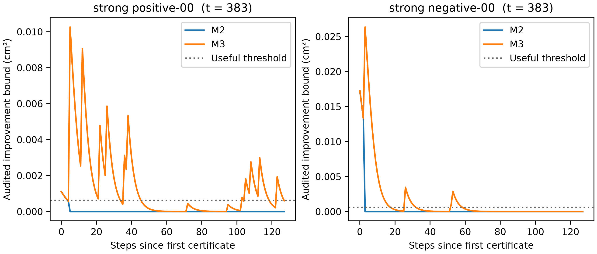
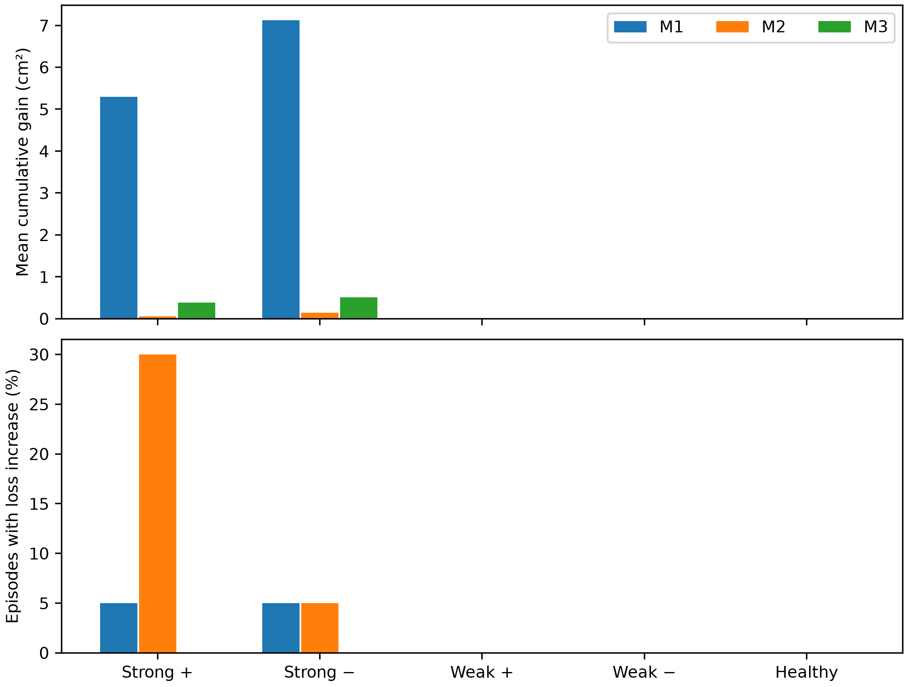

# 双容液位单节点确认实验

完成 92 条、每条 608 拍，窗口为 50–561 拍。强档 ±0.35 cm，弱档 ±0.032 cm。M1 门限 5.457584，取 200 条独立健康开发轨迹的第 199 顺序统计量。两种认证法共享证据。下表降损为每条轨迹相对 M0 的 512 拍累计平方误差减少量（cm²）。

| 工况 | 算法 | 平均降损 | 份额 | 拍数 | 期末 | 首动延迟 | 负降损 | 负条件改善 |
|---|---|---|---|---|---|---|---|---|
| 强正 | M1 | 5.2961 | 61.8% | 371.0 | 20/20 | 77 | 1/20 | 1/20 |
| 强正 | M2 | 0.0546 | 1.2% | 9.2 | 0/20 | 333 | 6/20 | 0/20 |
| 强正 | M3 | 0.3804 | 4.2% | 34.9 | 2/20 | 333 | 0/20 | 0/20 |
| 强负 | M1 | 7.1201 | 67.2% | 383.8 | 20/20 | 77 | 1/20 | 1/20 |
| 强负 | M2 | 0.1470 | 1.0% | 7.3 | 0/20 | 333 | 1/20 | 0/20 |
| 强负 | M3 | 0.5086 | 3.5% | 28.4 | 3/20 | 333 | 0/20 | 0/20 |
| 弱正 | M1 | 0.0000 | 0.0% | 0.0 | 0/8 | — | 0/8 | 0/8 |
| 弱正 | M2 | 0.0000 | 0.0% | 0.0 | 0/8 | — | 0/8 | 0/8 |
| 弱正 | M3 | 0.0000 | 0.0% | 0.0 | 0/8 | — | 0/8 | 0/8 |
| 弱负 | M1 | 0.0000 | 0.0% | 0.0 | 0/8 | — | 0/8 | 0/8 |
| 弱负 | M2 | 0.0000 | 0.0% | 0.0 | 0/8 | — | 0/8 | 0/8 |
| 弱负 | M3 | 0.0000 | 0.0% | 0.0 | 0/8 | — | 0/8 | 0/8 |
| 健康 | M1 | 0.0000 | — | 0.0 | 0/36 | — | 0/36 | 0/36 |
| 健康 | M2 | 0.0000 | — | 0.0 | 0/36 | — | 0/36 | 0/36 |
| 健康 | M3 | 0.0000 | — | 0.0 | 0/36 | — | 0/36 | 0/36 |

份额为组内离线条件改善之和除以 Oracle 机会量之和。健康组分母为零。M1 计非零出手，M2/M3 计实际发布下界至少 0.000625 cm² 的拍数。首动延迟仅在窗口内成功者中取中位数，期末比例和平均时长包含全部轨迹。

| 工况 | M3 相对 M2 平均增量 [配对 95% t 区间] | M3 相对 M1 平均增量 [配对 95% t 区间] |
|---|---:|---:|
| 强正 | 0.3258 [0.1786, 0.4730] | -4.9157 [-6.9141, -2.9174] |
| 强负 | 0.3616 [0.2105, 0.5126] | -6.6116 [-8.7605, -4.4626] |
| 弱正 | 0.0000 [0.0000, 0.0000] | 0.0000 [0.0000, 0.0000] |
| 弱负 | 0.0000 [0.0000, 0.0000] | 0.0000 [0.0000, 0.0000] |
| 健康 | 0.0000 [0.0000, 0.0000] | 0.0000 [0.0000, 0.0000] |

| 单独在线回放 | 秒/608 拍 | 查询 P50 秒 | 查询 P95 秒 |
|---|---:|---:|---:|
| M1 | 7.2562 | 0.0175 | 0.0349 |
| M3 | 19.9856 | 1.1385 | 4.4908 |

四条强档记录各符号两条，四个工作进程，各方法独立回放相同前缀；所有逐拍发布位移的哈希均与配对运行一致。每个方法 4 条轨迹、16 个查询。耗时受计算机与进程调度影响。

覆盖未命中 0/55936 拍。真参数保留且非零发布的 9413 个 M2/M3 动作中，条件改善低于认证下界超过 1e-10 的次数为 0。上限违反 0 次。直接滤波与 bH 最大绝对差 8.6e-16。该统计只针对本批轨迹。

健康组 608 拍内任意非零出手为 M1/M2/M3 各 0/0/0 条（各 36 条）。零次事件对应的双侧 95% Clopper–Pearson 上限为 9.74%。

开发强度阶梯的有用启动数（正/负各 4 条）为 0.08 cm 0/0、0.16 cm 0/0、0.25 cm 2/2、0.35 cm 4/4。测量噪声标准差为 0.141 cm，弱/强的标准化幅值为 0.23/2.47。原 V2 对应约 0.22/0.56；双容强档为满足开发启动标准采用了更高的相对幅值。该差异限定跨对象比较。

有效开发记录用时 0.557 核时，确认 0.398 核时，独立计时回放 0.030 核时。早期排错运行另计，未计入实验样本。

[预注册](../registration.json) · [逐轨迹配对数据](paired_trajectories.csv) · [三线表](tables/performance.tex) · [计时表](tables/timing.tex)
