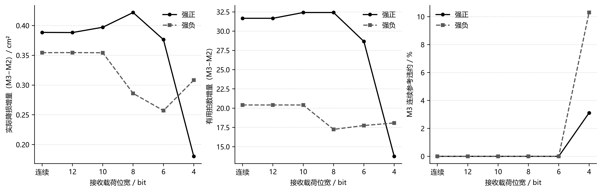
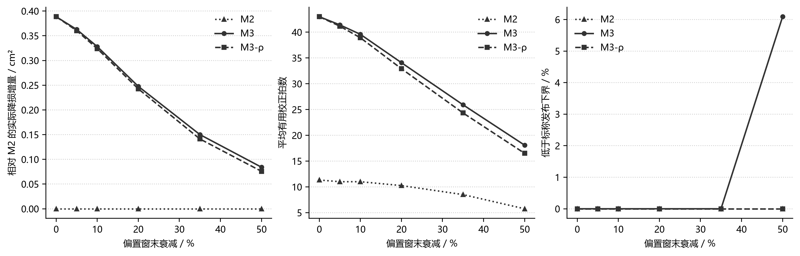
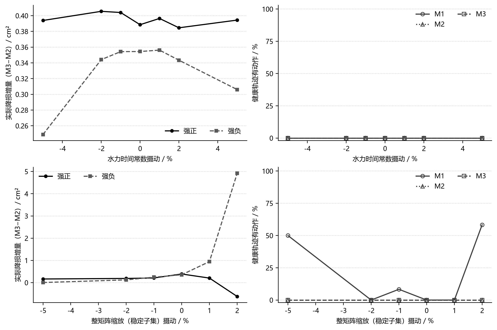

# 双容液位模型边界与失配稳健性探索

## 核心增量

在标称模型上，M3 相对 M2 延长了同一份方向证书可用于校正的时间。两者共用同拍、同方向、同等级和同一上游搜索。表中正值表示在同一条轨迹、同一 512 拍窗口内，前一方法的累计平方误差更低。区间按轨迹配对求双侧 95% t 区间，各档为描述性比较。每组只有两条的失稳压力点及其负向对照仅给点值。

| 标称工况 | 轨迹数 | M3−M2 实际降损 / cm² | M3−M2 有用拍数 | M3−M1 实际降损 / cm² |
|---|---|---|---|---|
| 强正 | 12 | 0.3885 [0.1867, 0.5904] | 31.6667 [12.5530, 50.7803] | -4.0805 [-6.9957, -1.1652] |
| 强负 | 12 | 0.3544 [0.1353, 0.5736] | 20.4167 [9.6871, 31.1462] | -6.2112 [-9.6422, -2.7803] |

**增量归因。** M3 同时改变了幅值记忆与方向记忆。补充消融对同一公开前缀沿 M2 实际选中的方向保留逐起点区间；旧半空间正支撑消失后，沿伴随递推继续保留最后方向。每次 M2 换向时绑定新方向。单方向版本和完整 M3 共用上游证书、限幅与发布保底。这个顺序分解可以逐轨迹相加，结果依赖所选的单方向对照。

| 工况 | 依次加入的处理 | 配对实际降损 [95%] | 配对离线改善 | 有用拍增量 |
|---|---|---|---|---|
| 强正 | 单方向幅值区间−M2 | 0.3885 [0.1867, 0.5904] | 0.3693 | 31.67 |
| 强正 | 历史方向择优−单方向 | 0.0000 [0.0000, 0.0000] | 0.0000 | 0.00 |
| 强正 | 合计 M3−M2 | 0.3885 [0.1867, 0.5904] | 0.3693 | 31.67 |
| 强负 | 单方向幅值区间−M2 | 0.3544 [0.1353, 0.5736] | 0.2759 | 20.42 |
| 强负 | 历史方向择优−单方向 | 0.0000 [0.0000, 0.0000] | 0.0000 | 0.00 |
| 强负 | 合计 M3−M2 | 0.3544 [0.1353, 0.5736] | 0.2759 | 20.42 |

在这 24 条强偏置轨迹的 12,288 个评分拍，单方向版本与完整 M3 有 0 拍发布位移不同。由此可将本组实际降损与有用拍数的全部增量定位到单方向下的起点—幅值区间传播；多方向择优在这些记录上未额外改变动作。这个结果仅覆盖此次消融的两组标称记录。

M1 的校准门限更早允许点补偿，标称强正、强负两组均获得较大的实际降损。M3 的论文贡献可落在固定幅值区间记忆相对旧传播的增益，以及正确模型和覆盖事件上的条件风险约束。下面的失配结果限定了这两项主张可以外推的范围。

## 对象、时序和计量口径

A=[[0.94,0.08],[0.03,0.91]]，B=[[0.06,0.01],[0.02,0.05]]，C=[1,0]，Q=0.0025I，R=0.02，P₀=0.25I，m₀=0，W=I，Z=2。控制和中心重构沿用冻结的双泵指令及中心抖动。传感器先用干净量测与已共享中心抽取事件，发送拍才加入持续偏置。所有部署方法读取同一份公共记录。发布动作只改变输出。

起点 k=50，强偏置 ±0.35 cm，绝对查询拍为 127、255、383、511，64 节点预算，覆盖预算 0.001，L1 动作上限 1。h0=0，q95=4.1168663291401967334975040667096925990958527758017，M1=5.4575843864474839580272229276002610049268878740485。查询时仅得分严格大于门限才出手。独立物理、触发、中心抖动子流由 SeedSequence([202611252822, 原组号, 轨迹编号]).spawn(3) 给出。健康、强正、强负组号依次为 4、0、1。常规各取编号 0–11。跨档复用外生噪声，事件与中心可随接收反馈发生分叉。本轮探索没有增加原确认集的独立样本数。

实际降损 G 为窗口 [50,561] 两项真实状态损失之差。条件改善 C 为同一窗口内逐拍 2δᵀWa−aᵀWa 的和，a 取实际 binary64 发布位移。误动作频率按健康轨迹全 608 拍至少一次非零位移计。有用拍数及期末存活按发布下界 ≥0.000625 cm² 计，M1/h0/q95 无证书，仅计非零位移。失配时达到标称门槛的拍数仍可观测，实际风险需另审。风险检查的主分母为全 608 拍内有正发布下界的动作数，容差 1e−10；0/0 表示无动作可审。单一档健康组 0/12 的双侧 95% 精确二项上限约为 26.46%。同一轨迹的各拍相关，违约拍率不能当作独立轨迹的失效概率。

## 1　有限位宽

发送时将载荷裁至 [−5,5] cm，在包含两端的 2ᴮ 个等距电平上取最近码，步长 10/(2ᴮ−1)，平局按偶数码。传感端和接收端用量化后的历史推进共同中心。指标 1A 的实际降损直接与模拟的物理状态比较。指标 1B 的真值滤波器在同一事件和中心历史下额外取得量化前连续载荷，是比接收端更丰富的信息集；其均值给出连续参考代理审计。以量化信息为条件的精确风险需要逐胞元积分。

| 位宽 | 强偏置 | 1A M3−M2 降损 [95%] | 相比连续档的增量变化 | 有用拍数差 | M3 期末存活 | 1B M3 代理改善 | M3 代理违约/检查 |
|---|---|---|---|---|---|---|---|
| continuous | 强正 | 0.3885 [0.1867, 0.5904] | 0.0000 | 31.67 | 2/12 | 0.5352 | 0/2603 |
| continuous | 强负 | 0.3544 [0.1353, 0.5736] | 0.0000 | 20.42 | 2/12 | 0.3825 | 0/2378 |
| 12bit | 强正 | 0.3883 [0.1866, 0.5900] | -0.0002 | 31.67 | 2/12 | 0.5351 | 0/2603 |
| 12bit | 强负 | 0.3546 [0.1353, 0.5739] | 0.0001 | 20.42 | 2/12 | 0.3827 | 0/2378 |
| 10bit | 强正 | 0.3972 [0.1842, 0.6102] | 0.0087 | 32.42 | 2/12 | 0.5433 | 0/2603 |
| 10bit | 强负 | 0.3543 [0.1350, 0.5737] | -0.0001 | 20.42 | 2/12 | 0.3824 | 0/2378 |
| 8bit | 强正 | 0.4220 [0.2178, 0.6261] | 0.0334 | 32.42 | 2/12 | 0.5477 | 0/2475 |
| 8bit | 强负 | 0.2861 [0.1271, 0.4451] | -0.0683 | 17.25 | 2/12 | 0.3239 | 0/2506 |
| 6bit | 强正 | 0.3765 [0.1617, 0.5912] | -0.0121 | 28.67 | 2/12 | 0.4669 | 0/2409 |
| 6bit | 强负 | 0.2571 [0.0979, 0.4163] | -0.0974 | 17.75 | 1/12 | 0.3397 | 0/2250 |
| 4bit | 强正 | 0.1802 [0.0426, 0.3179] | -0.2083 | 13.75 | 0/12 | 0.2452 | 75/2409 |
| 4bit | 强负 | 0.3083 [0.0736, 0.5429] | -0.0462 | 18.08 | 1/12 | 0.3494 | 149/1447 |

**固定发送前缀诊断。** 对原始 36 条记录保持物理状态、事件和中心逐拍相同，仅改变接收载荷。冻结的 VectorRecord.append 要求 |中心−接收端先验预测量测|≤0.011628232298833967 cm。量化使下一拍接收端预测移动；原发送中心可能因此落在合法区间以外。触发仍然干净，固定前缀却可能不再满足冻结算法的输入合同。下表报告各组完整走完 608 拍的轨迹数，以及这些成功者中 M3−M2 的平均实际降损。失败行保留拒绝时刻与偏移量，整轨损失和风险指标记为缺失。成功者是选择后的子集。

| 位宽 | 健康可执行 | 强正可执行 | 强负可执行 | 强正成功者增量 | 强负成功者增量 |
|---|---|---|---|---|---|
| 12bit | 1/12 | 1/12 | 0/12 | 0.0000 | — |
| 10bit | 0/12 | 0/12 | 0/12 | — | — |
| 8bit | 0/12 | 0/12 | 0/12 | — | — |
| 6bit | 0/12 | 0/12 | 0/12 | — | — |
| 4bit | 0/12 | 0/12 | 0/12 | — | — |

固定前缀在 180 个工况×轨迹回放中仅 2 个走完；12 bit 健康和强正各一条，强负零条，其他位宽各组均为零条。存活者不能支持跨位宽总体降损比较。位宽曲线的结论适用于收发双方基于量化后公开记录同步推进中心的运行合同。

12、10 bit 的两种偏置均保留标称续航优势，本批无代理违约。没有预设等效容差，故仅报告配对变化。8 bit 起强负收益下降，6 bit 下仍有正增量。4 bit 首次在所扫位宽中出现代理违约，强正 75/2409、强负 149/1447；健康组 M1 有动作 12/12、M3 有动作 3/12。即使窗口总改善仍为正，也可能有单拍下界过高。

## 2　有界漂移

对于已知确定偏置日程，发送时可由公开连续载荷恢复干净观测，静默给出以 cₜ 为中心、测量噪声 R+1/Z 的等效观测。固定了干净观测后的触发因子与状态无关，因此条件后验仍是高斯。两滤波器的增益相同，作差得到 δₜ=Fₜδₜ₋₁+γₜKₜbₜ，Fₜ=(I−KₜC)A。直接滤波与这条递推在全部 72 条衰减记录、43,776 个拍次上用有理运算逐拍核对；另以真实发布向量逐拍复算增益和违约计数。

对数值合同需区分两层。旧批次以生成 binary64 数的十进制回读值及精确有理系数计算名义与真参数滤波器之差，阈值比较使用有理数。计算过程在此回读模型内精确。物理模拟、监视器和发布为 binary64。因而“精确”适用于所述观测合同的解析递推和有理阈值比较；真实状态降损及表中均值是数值统计。补充稳定扫描直接以 binary64 值的精确分数计算观测和已发布监视器到真值均值的差。

令 wₛ=γₛ dᵀWΦₜ,ₛKₛ。若锚点 τ 的区间确实外包 bτ，偏置漂移对支撑的影响满足 |Σwₛ(bₛ−bτ)|≤ρΣ|s−τ|·|wₛ|。这是对每个 bₛ−bτ 单独放宽后得到的上界。相邻增量受共同约束时可以更紧。例如 τ=0 且 w₁=1、w₂=−1，原残差为 b₁−b₂，幅值最多 ρ，而逐项界为 3ρ。精确计算这个上界与证明它是所有 Lipschitz 路径的紧上界是两件事。

实现中按起点从静态支撑减去上述界，并与已审计的 M2 动作比较。W=I 时，方向按 Fₜ⁻ᵀ 推进并归一化，旧脉冲的方向投影只需除以同一归一化因子。独立审计改用各脉冲直接前推后与方向相乘，并重算发布量。多次获证时原型把恒定模型相交区间作为最近证书时刻的锚；先前时刻的区间并未按漂移映射到新锚，所以上游覆盖和锚区间覆盖均未获变幅定理。若 ρ 增大，固定证据、固定记录上的各方向支撑只能降低；L1 限幅、离散方向择优、门槛与旧动作保底会造成平台和跳变。M2 为保底参照，ρ→∞ 实际能否退回 M2 还取决于漂移项是否严格为正。

| 总衰减 | ρ / (cm/拍) | M3−M2 降损 [95%] | M3-ρ−M3 降损 [95%] | 有效拍 M3 / M3-ρ | 608 拍违约/检查（两法） | 512 拍窗内违约/检查（两法） | 窗内负改善拍（两法） |
|---|---|---|---|---|---|---|---|
| 00% | 0 | 0.3885 [0.1867, 0.5904] | 0.0000 [0.0000, 0.0000] | 43.0 / 43.0 | 0/2603 · 0/2603 | 0/2097 · 0/2097 | 0 / 0 |
| 05% | 1/29200 | 0.3627 [0.1582, 0.5673] | -0.0024 [-0.0039, -0.0009] | 41.4 / 41.2 | 0/2603 · 0/2603 | 0/2097 · 0/2097 | 0 / 0 |
| 10% | 1/14600 | 0.3281 [0.1499, 0.5063] | -0.0042 [-0.0072, -0.0011] | 39.6 / 38.9 | 0/2603 · 0/2603 | 0/2097 · 0/2097 | 0 / 0 |
| 20% | 1/7300 | 0.2476 [0.0970, 0.3983] | -0.0050 [-0.0090, -0.0011] | 34.1 / 32.9 | 0/2122 · 0/2122 | 0/1662 · 0/1662 | 0 / 0 |
| 35% | 7/29200 | 0.1501 [0.0281, 0.2721] | -0.0088 [-0.0161, -0.0016] | 25.9 / 24.3 | 0/1897 · 0/1897 | 0/1483 · 0/1483 | 0 / 0 |
| 50% | 1/2920 | 0.0841 [-0.0104, 0.1786] | -0.0083 [-0.0176, 0.0009] | 18.1 / 16.5 | 90/1478 · 0/1440 | 28/1202 · 0/1202 | 0 / 0 |

ρ=0 时两法重合。0–35% 的已测衰减档未见 M3 容差违约；50% 是第一个出现违约的测试档，不能据此插值得到通用安全半径。50% 时，主评分窗内静态 M3 的单拍条件改善全部非负，但有 28/1202 次低于承诺下界，全 608 拍累计 90/1478 次，集中在 2/12 条轨迹。扣除漂移余量后，同一评分窗内为 0/1202，全程为 0/1440，有用拍数由 18.1 降至 16.5。扣减改变了支撑、发布动作及宣称的下界。50% 档中代价为平均少 1.6 个有用拍，实际降损变化 −0.0083 cm²，配对区间跨零。增强方向从 +0.35 cm 出发按题设裁剪后恒为 +0.35 cm；其 60 条引用只列 M0–M3 和门限支路。2B 只比较衰减。

## 3　动力学参数

给定 Aₚ 时，真值滤波器按 Aₚ、Q 推进自己的均值与协方差，发送拍读取去除真偏置的载荷，静默拍读取同一公开中心。设 εₜ⁺ 表示标称监视器减去真实滤波器的后验均值，则下拍先验差为 Aₙεₜ⁺+(Aₙ−Aₚ)μₜ⁺。即使没有载荷攻击也存在模型误差项。更新时还会出现两套 Kalman 增益之差乘创新。误差方向可能与载荷偏置污染相抵或相加，直接以 bH 代替总污染会漏项。原发布下界以标称模型认证，失配条件改善使用真实模型审计。

线性缩放 Aₚ=(1+ε)Aₙ 在 +5% 时谱半径 1.02504649，违反稳定对象前提。保留为失稳压力案例。为完整考察稳定对象，另用 Aₚ=I+(Aₙ−I)/(1+ε) 表示双容内部水力弛豫时间的标定偏差，泵指令增益保持冻结值。该定义作用于每拍内部液位增量，各特征值变为 1+(λᵢ−1)/(1+ε)。七档均验证谱半径小于 1。两套 ε 表示不同物理量，分别作配对比较。

### 水力时间常数，在稳定域内完整扫描

| ε | 谱半径 | 每组 n | 健康有动作 M1 · M3 | 健康条件改善 M1 / M3 | 强正 M3−M2 降损 [95%] | 强负 M3−M2 降损 [95%] | 强正 · 强负 M3 违约/检查 |
|---|---|---|---|---|---|---|---|
| -5% | 0.974984 | 12 | 0/12 · 0/12 | 0.0000 / 0.0000 | 0.3939 [0.1730, 0.6148] | 0.2490 [0.1044, 0.3935] | 185/2378 · 23/2409 |
| -2% | 0.975750 | 12 | 0/12 · 0/12 | 0.0000 / 0.0000 | 0.4055 [0.1874, 0.6237] | 0.3442 [0.1422, 0.5461] | 193/2475 · 0/2506 |
| -1% | 0.975995 | 12 | 0/12 · 0/12 | 0.0000 / 0.0000 | 0.4040 [0.1864, 0.6217] | 0.3543 [0.1358, 0.5728] | 134/2475 · 0/2378 |
| +0% | 0.976235 | 12 | 0/12 · 0/12 | 0.0000 / 0.0000 | 0.3885 [0.1867, 0.5904] | 0.3544 [0.1353, 0.5736] | 0/2603 · 0/2378 |
| +1% | 0.976470 | 12 | 0/12 · 0/12 | 0.0000 / 0.0000 | 0.3965 [0.1879, 0.6051] | 0.3562 [0.1358, 0.5766] | 0/2603 · 217/2378 |
| +2% | 0.976701 | 12 | 0/12 · 0/12 | 0.0000 / 0.0000 | 0.3846 [0.1825, 0.5867] | 0.3434 [0.1156, 0.5712] | 13/2603 · 285/2378 |
| +5% | 0.977366 | 12 | 0/12 · 0/12 | 0.0000 / 0.0000 | 0.3944 [0.1868, 0.6020] | 0.3061 [0.0739, 0.5383] | 53/2987 · 355/1994 |

### 整矩阵缩放，含失稳压力点

| ε | 谱半径 | 每组 n | 健康有动作 M1 · M3 | 健康条件改善 M1 / M3 | 强正 M3−M2 降损 [95%] | 强负 M3−M2 降损 [95%] | 强正 · 强负 M3 违约/检查 |
|---|---|---|---|---|---|---|---|
| -5.00% | 0.927423 | 2 | 1/2 · 0/2 | -1.0948 / 0.0000 | 0.1637 | 0.0049 | 0/97 · 43/97 |
| -2.00% | 0.956710 | 12 | 0/12 · 0/12 | 0.0000 / 0.0000 | 0.1883 [-0.0256, 0.4023] | 0.1238 [0.0403, 0.2072] | 22/1288 · 554/1897 |
| -1.00% | 0.966472 | 12 | 1/12 · 0/12 | -0.2073 / 0.0000 | 0.2106 [0.0503, 0.3708] | 0.2458 [0.1205, 0.3712] | 5/2122 · 641/2506 |
| +0.00% | 0.976235 | 12 | 0/12 · 0/12 | 0.0000 / 0.0000 | 0.3885 [0.1867, 0.5904] | 0.3544 [0.1353, 0.5736] | 0/2603 · 0/2378 |
| +1.00% | 0.985997 | 12 | 0/12 · 0/12 | 0.0000 / 0.0000 | 0.2046 [0.0367, 0.3725] | 0.9458 [0.3101, 1.5814] | 1628/2956 · 40/2762 |
| +2.00% | 0.995759 | 12 | 7/12 · 0/12 | -9.0526 / 0.0000 | -0.6227 [-0.9335, -0.3119] | 4.9185 [2.9430, 6.8940] | 3887/4236 · 0/4364 |
| +5.00% | 1.025046 | 2 | 2/2 · 2/2 | -920634.8220 / -188127.3460 | -119322.1882 | -245162.5745 | 819/834 · 834/834 |

整矩阵缩放 +1% 时，强正组 M3 相对 M2 仍有平均降损增量，但 M3 的标称发布下界已出现 1628/2956 次违约。+2% 时对象仍稳定，强正组的增量转负，强负组仍为正；健康组 M1 在 7/12 条上误动并恶化平均条件风险，M2/M3 都未出手。向负方向扫，−1% 健康组 M1 有 1/12 次轨迹误动，−2% 又为零；数据不支持单调阈值。失稳 +5% 极端档健康组 M1、M3 均出手且平均条件风险均恶化，每组 n=2。

在稳定水力时间常数扫描中，强正 M3−M2 的各档均值范围为 0.3846 至 0.4055 cm²，强负为 0.2490 至 0.3562 cm²。在非零摄动的 12 个符号×档位组合中，9 个组合出现标称下界违约。收益能延续与下界仍然可靠需分别判定。

## 逐方法数据表

每行分母为该工况全部轨迹。G、C 是 512 拍累计量的组内均值，负 C 轨迹按窗口累计 C<0 计，负 C 拍按单拍 C<0 计。旧版原始 JSON 中的 loss 字段存了降损的相反数，本报告只取约定的 actual_gain 和独立复算的配对差。出手为全程出现非零动作的轨迹数。仅在健康工况称为误动。有用与期末对点方法按活动动作计，对证书方法按发布下界计。全部方法对照和相对连续/零失配档的配对增量变化分别见 trajectory_metrics.csv 和 incremental_comparisons.csv。

### 量化（中心反馈）

| 场景 | 组 | 方法 | n | G | C | 负 C 轨迹 | 负 C 拍 | 平均有用拍 | 期末/总数 | 出手/总数 | 下界违约/正界检查 |
|---|---|---|---|---|---|---|---|---|---|---|---|
| continuous | 健康 | M0 | 12 | 0.0000 | 0.0000 | 0 | 0 | 0.0 | 0/12 | 0/12 | — |
| continuous | 健康 | M1 | 12 | 0.0000 | 0.0000 | 0 | 0 | 0.0 | 0/12 | 0/12 | — |
| continuous | 健康 | M2 | 12 | 0.0000 | 0.0000 | 0 | 0 | 0.0 | 0/12 | 0/12 | 0/0 |
| continuous | 健康 | M3 | 12 | 0.0000 | 0.0000 | 0 | 0 | 0.0 | 0/12 | 0/12 | 0/0 |
| continuous | 健康 | M1_h0 | 12 | -1.9266 | -1.9359 | 12 | 5220 | 435.0 | 12/12 | 12/12 | — |
| continuous | 健康 | M1_q95 | 12 | -0.0531 | -0.1562 | 1 | 128 | 10.7 | 0/12 | 1/12 | — |
| continuous | 强正 | M0 | 12 | 0.0000 | 0.0000 | 0 | 0 | 0.0 | 0/12 | 0/12 | — |
| continuous | 强正 | M1 | 12 | 4.5266 | 6.3851 | 1 | 128 | 371.0 | 12/12 | 12/12 | — |
| continuous | 强正 | M2 | 12 | 0.0576 | 0.1660 | 0 | 0 | 11.3 | 0/12 | 11/12 | 0/522 |
| continuous | 强正 | M3 | 12 | 0.4462 | 0.5352 | 0 | 0 | 43.0 | 2/12 | 11/12 | 0/2603 |
| continuous | 强正 | M1_h0 | 12 | 3.6734 | 5.5252 | 2 | 512 | 435.0 | 12/12 | 12/12 | — |
| continuous | 强正 | M1_q95 | 12 | 3.8053 | 5.7131 | 2 | 256 | 392.3 | 12/12 | 12/12 | — |
| continuous | 强负 | M0 | 12 | 0.0000 | 0.0000 | 0 | 0 | 0.0 | 0/12 | 0/12 | — |
| continuous | 强负 | M1 | 12 | 6.7106 | 6.8470 | 1 | 256 | 381.7 | 12/12 | 12/12 | — |
| continuous | 强负 | M2 | 12 | 0.1450 | 0.1066 | 0 | 0 | 7.0 | 0/12 | 10/12 | 0/444 |
| continuous | 强负 | M3 | 12 | 0.4994 | 0.3825 | 0 | 0 | 27.4 | 2/12 | 10/12 | 0/2378 |
| continuous | 强负 | M1_h0 | 12 | 7.9345 | 7.9559 | 1 | 384 | 435.0 | 12/12 | 12/12 | — |
| continuous | 强负 | M1_q95 | 12 | 6.9004 | 7.0883 | 1 | 256 | 392.3 | 12/12 | 12/12 | — |
| 12bit | 健康 | M0 | 12 | 0.0000 | 0.0000 | 0 | 0 | 0.0 | 0/12 | 0/12 | — |
| 12bit | 健康 | M1 | 12 | 0.0000 | 0.0000 | 0 | 0 | 0.0 | 0/12 | 0/12 | — |
| 12bit | 健康 | M2 | 12 | 0.0000 | 0.0000 | 0 | 0 | 0.0 | 0/12 | 0/12 | 0/0 |
| 12bit | 健康 | M3 | 12 | 0.0000 | 0.0000 | 0 | 0 | 0.0 | 0/12 | 0/12 | 0/0 |
| 12bit | 健康 | M1_h0 | 12 | -1.9269 | -1.9361 | 12 | 5220 | 435.0 | 12/12 | 12/12 | — |
| 12bit | 健康 | M1_q95 | 12 | -0.0533 | -0.1563 | 1 | 128 | 10.7 | 0/12 | 1/12 | — |
| 12bit | 强正 | M0 | 12 | 0.0000 | 0.0000 | 0 | 0 | 0.0 | 0/12 | 0/12 | — |
| 12bit | 强正 | M1 | 12 | 4.5272 | 6.3855 | 1 | 128 | 371.0 | 12/12 | 12/12 | — |
| 12bit | 强正 | M2 | 12 | 0.0577 | 0.1660 | 0 | 0 | 11.3 | 0/12 | 11/12 | 0/522 |
| 12bit | 强正 | M3 | 12 | 0.4460 | 0.5351 | 0 | 0 | 43.0 | 2/12 | 11/12 | 0/2603 |
| 12bit | 强正 | M1_h0 | 12 | 3.6725 | 5.5245 | 2 | 512 | 435.0 | 12/12 | 12/12 | — |
| 12bit | 强正 | M1_q95 | 12 | 3.8045 | 5.7125 | 2 | 256 | 392.3 | 12/12 | 12/12 | — |
| 12bit | 强负 | M0 | 12 | 0.0000 | 0.0000 | 0 | 0 | 0.0 | 0/12 | 0/12 | — |
| 12bit | 强负 | M1 | 12 | 6.7121 | 6.8481 | 1 | 256 | 381.7 | 12/12 | 12/12 | — |
| 12bit | 强负 | M2 | 12 | 0.1451 | 0.1067 | 0 | 0 | 7.0 | 0/12 | 10/12 | 0/444 |
| 12bit | 强负 | M3 | 12 | 0.4997 | 0.3827 | 0 | 0 | 27.4 | 2/12 | 10/12 | 0/2378 |
| 12bit | 强负 | M1_h0 | 12 | 7.9357 | 7.9569 | 1 | 384 | 435.0 | 12/12 | 12/12 | — |
| 12bit | 强负 | M1_q95 | 12 | 6.9016 | 7.0892 | 1 | 256 | 392.3 | 12/12 | 12/12 | — |
| 10bit | 健康 | M0 | 12 | 0.0000 | 0.0000 | 0 | 0 | 0.0 | 0/12 | 0/12 | — |
| 10bit | 健康 | M1 | 12 | 0.0000 | 0.0000 | 0 | 0 | 0.0 | 0/12 | 0/12 | — |
| 10bit | 健康 | M2 | 12 | 0.0000 | 0.0000 | 0 | 0 | 0.0 | 0/12 | 0/12 | 0/0 |
| 10bit | 健康 | M3 | 12 | 0.0000 | 0.0000 | 0 | 0 | 0.0 | 0/12 | 0/12 | 0/0 |
| 10bit | 健康 | M1_h0 | 12 | -1.9453 | -1.9401 | 12 | 5220 | 435.0 | 12/12 | 12/12 | — |
| 10bit | 健康 | M1_q95 | 12 | -0.0554 | -0.1578 | 1 | 128 | 10.7 | 0/12 | 1/12 | — |
| 10bit | 强正 | M0 | 12 | 0.0000 | 0.0000 | 0 | 0 | 0.0 | 0/12 | 0/12 | — |
| 10bit | 强正 | M1 | 12 | 4.6650 | 6.4499 | 1 | 128 | 371.0 | 12/12 | 12/12 | — |
| 10bit | 强正 | M2 | 12 | 0.0575 | 0.1657 | 0 | 0 | 11.3 | 0/12 | 11/12 | 0/522 |
| 10bit | 强正 | M3 | 12 | 0.4547 | 0.5433 | 0 | 0 | 43.8 | 2/12 | 11/12 | 0/2603 |
| 10bit | 强正 | M1_h0 | 12 | 3.8164 | 5.5933 | 2 | 512 | 435.0 | 12/12 | 12/12 | — |
| 10bit | 强正 | M1_q95 | 12 | 3.9449 | 5.7788 | 2 | 256 | 392.3 | 12/12 | 12/12 | — |
| 10bit | 强负 | M0 | 12 | 0.0000 | 0.0000 | 0 | 0 | 0.0 | 0/12 | 0/12 | — |
| 10bit | 强负 | M1 | 12 | 6.5191 | 6.4344 | 1 | 256 | 371.0 | 12/12 | 12/12 | — |
| 10bit | 强负 | M2 | 12 | 0.1451 | 0.1066 | 0 | 0 | 7.0 | 0/12 | 10/12 | 0/444 |
| 10bit | 强负 | M3 | 12 | 0.4994 | 0.3824 | 0 | 0 | 27.4 | 2/12 | 10/12 | 0/2378 |
| 10bit | 强负 | M1_h0 | 12 | 7.9425 | 7.9399 | 1 | 384 | 435.0 | 12/12 | 12/12 | — |
| 10bit | 强负 | M1_q95 | 12 | 6.9116 | 7.0746 | 1 | 256 | 392.3 | 12/12 | 12/12 | — |
| 8bit | 健康 | M0 | 12 | 0.0000 | 0.0000 | 0 | 0 | 0.0 | 0/12 | 0/12 | — |
| 8bit | 健康 | M1 | 12 | 0.0000 | 0.0000 | 0 | 0 | 0.0 | 0/12 | 0/12 | — |
| 8bit | 健康 | M2 | 12 | 0.0000 | 0.0000 | 0 | 0 | 0.0 | 0/12 | 0/12 | 0/0 |
| 8bit | 健康 | M3 | 12 | 0.0000 | 0.0000 | 0 | 0 | 0.0 | 0/12 | 0/12 | 0/0 |
| 8bit | 健康 | M1_h0 | 12 | -2.3727 | -2.3042 | 12 | 5220 | 435.0 | 12/12 | 12/12 | — |
| 8bit | 健康 | M1_q95 | 12 | -0.0626 | -0.1633 | 1 | 128 | 10.7 | 0/12 | 1/12 | — |
| 8bit | 强正 | M0 | 12 | 0.0000 | 0.0000 | 0 | 0 | 0.0 | 0/12 | 0/12 | — |
| 8bit | 强正 | M1 | 12 | 4.6076 | 6.4735 | 1 | 128 | 371.0 | 12/12 | 12/12 | — |
| 8bit | 强正 | M2 | 12 | 0.0647 | 0.1672 | 0 | 0 | 11.3 | 0/12 | 11/12 | 0/433 |
| 8bit | 强正 | M3 | 12 | 0.4867 | 0.5477 | 0 | 0 | 43.8 | 2/12 | 11/12 | 0/2475 |
| 8bit | 强正 | M1_h0 | 12 | 3.7679 | 5.6247 | 2 | 512 | 435.0 | 12/12 | 12/12 | — |
| 8bit | 强正 | M1_q95 | 12 | 3.8919 | 5.8060 | 2 | 256 | 392.3 | 12/12 | 12/12 | — |
| 8bit | 强负 | M0 | 12 | 0.0000 | 0.0000 | 0 | 0 | 0.0 | 0/12 | 0/12 | — |
| 8bit | 强负 | M1 | 12 | 7.4582 | 7.0429 | 0 | 128 | 371.0 | 12/12 | 12/12 | — |
| 8bit | 强负 | M2 | 12 | 0.1323 | 0.1023 | 0 | 0 | 7.0 | 0/12 | 10/12 | 0/479 |
| 8bit | 强负 | M3 | 12 | 0.4184 | 0.3239 | 0 | 0 | 24.2 | 2/12 | 10/12 | 0/2506 |
| 8bit | 强负 | M1_h0 | 12 | 8.7614 | 8.5483 | 0 | 256 | 435.0 | 12/12 | 12/12 | — |
| 8bit | 强负 | M1_q95 | 12 | 8.1558 | 7.7249 | 0 | 128 | 392.3 | 12/12 | 12/12 | — |
| 6bit | 健康 | M0 | 12 | 0.0000 | 0.0000 | 0 | 0 | 0.0 | 0/12 | 0/12 | — |
| 6bit | 健康 | M1 | 12 | 0.0000 | 0.0000 | 0 | 0 | 0.0 | 0/12 | 0/12 | — |
| 6bit | 健康 | M2 | 12 | 0.0000 | 0.0000 | 0 | 0 | 0.0 | 0/12 | 0/12 | 0/0 |
| 6bit | 健康 | M3 | 12 | 0.0000 | 0.0000 | 0 | 0 | 0.0 | 0/12 | 0/12 | 0/0 |
| 6bit | 健康 | M1_h0 | 12 | -1.2498 | -2.0602 | 12 | 4568 | 424.3 | 12/12 | 12/12 | — |
| 6bit | 健康 | M1_q95 | 12 | 0.0000 | 0.0000 | 0 | 0 | 0.0 | 0/12 | 0/12 | — |
| 6bit | 强正 | M0 | 12 | 0.0000 | 0.0000 | 0 | 0 | 0.0 | 0/12 | 0/12 | — |
| 6bit | 强正 | M1 | 12 | 2.4120 | 3.7644 | 2 | 384 | 339.0 | 12/12 | 12/12 | — |
| 6bit | 强正 | M2 | 12 | 0.0391 | 0.1462 | 0 | 0 | 10.4 | 0/12 | 9/12 | 0/468 |
| 6bit | 强正 | M3 | 12 | 0.4155 | 0.4669 | 0 | 0 | 39.1 | 2/12 | 9/12 | 0/2409 |
| 6bit | 强正 | M1_h0 | 12 | 1.8134 | 3.4704 | 3 | 640 | 435.0 | 12/12 | 12/12 | — |
| 6bit | 强正 | M1_q95 | 12 | 1.6088 | 2.8937 | 3 | 512 | 349.7 | 12/12 | 12/12 | — |
| 6bit | 强负 | M0 | 12 | 0.0000 | 0.0000 | 0 | 0 | 0.0 | 0/12 | 0/12 | — |
| 6bit | 强负 | M1 | 12 | 6.3543 | 6.2993 | 1 | 128 | 360.3 | 12/12 | 12/12 | — |
| 6bit | 强负 | M2 | 12 | 0.1237 | 0.1056 | 0 | 0 | 6.2 | 0/12 | 10/12 | 0/355 |
| 6bit | 强负 | M3 | 12 | 0.3808 | 0.3397 | 0 | 0 | 23.9 | 1/12 | 10/12 | 0/2250 |
| 6bit | 强负 | M1_h0 | 12 | 5.9720 | 6.3469 | 2 | 512 | 435.0 | 12/12 | 12/12 | — |
| 6bit | 强负 | M1_q95 | 12 | 6.3543 | 6.2993 | 1 | 128 | 360.3 | 12/12 | 12/12 | — |
| 4bit | 健康 | M0 | 12 | 0.0000 | 0.0000 | 0 | 0 | 0.0 | 0/12 | 0/12 | — |
| 4bit | 健康 | M1 | 12 | -2.2145 | -3.2607 | 12 | 2785 | 339.0 | 12/12 | 12/12 | — |
| 4bit | 健康 | M2 | 12 | 0.0194 | 0.0042 | 1 | 63 | 1.0 | 0/12 | 3/12 | 63/125 |
| 4bit | 健康 | M3 | 12 | 0.0268 | 0.0072 | 1 | 180 | 1.5 | 0/12 | 3/12 | 212/547 |
| 4bit | 健康 | M1_h0 | 12 | -2.6363 | -3.8679 | 12 | 3675 | 435.0 | 12/12 | 12/12 | — |
| 4bit | 健康 | M1_q95 | 12 | -2.1957 | -3.2696 | 12 | 2885 | 349.7 | 12/12 | 12/12 | — |
| 4bit | 强正 | M0 | 12 | 0.0000 | 0.0000 | 0 | 0 | 0.0 | 0/12 | 0/12 | — |
| 4bit | 强正 | M1 | 12 | 3.4825 | 4.2609 | 3 | 702 | 349.7 | 12/12 | 12/12 | — |
| 4bit | 强正 | M2 | 12 | 0.0453 | 0.0737 | 0 | 0 | 6.2 | 0/12 | 9/12 | 0/430 |
| 4bit | 强正 | M3 | 12 | 0.2256 | 0.2452 | 0 | 0 | 19.9 | 0/12 | 9/12 | 75/2409 |
| 4bit | 强正 | M1_h0 | 12 | 3.8729 | 5.0176 | 3 | 848 | 435.0 | 12/12 | 12/12 | — |
| 4bit | 强正 | M1_q95 | 12 | 3.4045 | 4.5306 | 2 | 702 | 371.0 | 12/12 | 12/12 | — |
| 4bit | 强负 | M0 | 12 | 0.0000 | 0.0000 | 0 | 0 | 0.0 | 0/12 | 0/12 | — |
| 4bit | 强负 | M1 | 12 | 6.3560 | 5.9023 | 2 | 1053 | 349.7 | 12/12 | 12/12 | — |
| 4bit | 强负 | M2 | 12 | 0.1243 | 0.0921 | 0 | 0 | 3.8 | 0/12 | 7/12 | 0/85 |
| 4bit | 强负 | M3 | 12 | 0.4326 | 0.3494 | 0 | 2 | 21.8 | 1/12 | 7/12 | 149/1447 |
| 4bit | 强负 | M1_h0 | 12 | 6.7937 | 6.3239 | 1 | 1471 | 435.0 | 12/12 | 12/12 | — |
| 4bit | 强负 | M1_q95 | 12 | 6.3560 | 5.9023 | 2 | 1053 | 349.7 | 12/12 | 12/12 | — |

### 漂移

| 场景 | 组 | 方法 | n | G | C | 负 C 轨迹 | 负 C 拍 | 平均有用拍 | 期末/总数 | 出手/总数 | 下界违约/正界检查 |
|---|---|---|---|---|---|---|---|---|---|---|---|
| decay_00 | 强正 | M0 | 12 | 0.0000 | 0.0000 | 0 | 0 | 0.0 | 0/12 | 0/12 | — |
| decay_00 | 强正 | M1 | 12 | 4.5266 | 6.3851 | 1 | 128 | 371.0 | 12/12 | 12/12 | — |
| decay_00 | 强正 | M2 | 12 | 0.0576 | 0.1660 | 0 | 0 | 11.3 | 0/12 | 11/12 | 0/522 |
| decay_00 | 强正 | M3 | 12 | 0.4462 | 0.5352 | 0 | 0 | 43.0 | 2/12 | 11/12 | 0/2603 |
| decay_00 | 强正 | M1_h0 | 12 | 3.6734 | 5.5252 | 2 | 512 | 435.0 | 12/12 | 12/12 | — |
| decay_00 | 强正 | M1_q95 | 12 | 3.8053 | 5.7131 | 2 | 256 | 392.3 | 12/12 | 12/12 | — |
| decay_00 | 强正 | M3_rho | 12 | 0.4462 | 0.5352 | 0 | 0 | 43.0 | 2/12 | 11/12 | 0/2603 |
| decay_05 | 强正 | M0 | 12 | 0.0000 | 0.0000 | 0 | 0 | 0.0 | 0/12 | 0/12 | — |
| decay_05 | 强正 | M1 | 12 | 3.8956 | 5.7808 | 1 | 128 | 371.0 | 12/12 | 12/12 | — |
| decay_05 | 强正 | M2 | 12 | 0.0374 | 0.1494 | 0 | 0 | 11.0 | 0/12 | 11/12 | 0/513 |
| decay_05 | 强正 | M3 | 12 | 0.4002 | 0.4774 | 0 | 0 | 41.4 | 2/12 | 11/12 | 0/2603 |
| decay_05 | 强正 | M1_h0 | 12 | 3.1771 | 5.0563 | 2 | 512 | 435.0 | 12/12 | 12/12 | — |
| decay_05 | 强正 | M1_q95 | 12 | 3.3102 | 5.2448 | 2 | 256 | 392.3 | 12/12 | 12/12 | — |
| decay_05 | 强正 | M3_rho | 12 | 0.3978 | 0.4759 | 0 | 0 | 41.2 | 2/12 | 11/12 | 0/2603 |
| decay_10 | 强正 | M0 | 12 | 0.0000 | 0.0000 | 0 | 0 | 0.0 | 0/12 | 0/12 | — |
| decay_10 | 强正 | M1 | 12 | 4.7206 | 6.3665 | 0 | 0 | 371.0 | 12/12 | 12/12 | — |
| decay_10 | 强正 | M2 | 12 | 0.0153 | 0.1355 | 0 | 0 | 11.0 | 0/12 | 11/12 | 0/513 |
| decay_10 | 强正 | M3 | 12 | 0.3434 | 0.4271 | 0 | 0 | 39.6 | 2/12 | 11/12 | 0/2603 |
| decay_10 | 强正 | M1_h0 | 12 | 4.0123 | 5.6493 | 1 | 384 | 435.0 | 12/12 | 12/12 | — |
| decay_10 | 强正 | M1_q95 | 12 | 4.1466 | 5.8386 | 1 | 128 | 392.3 | 12/12 | 12/12 | — |
| decay_10 | 强正 | M3_rho | 12 | 0.3392 | 0.4248 | 0 | 0 | 38.9 | 2/12 | 11/12 | 0/2603 |
| decay_20 | 强正 | M0 | 12 | 0.0000 | 0.0000 | 0 | 0 | 0.0 | 0/12 | 0/12 | — |
| decay_20 | 强正 | M1 | 12 | 4.0006 | 5.3454 | 0 | 0 | 371.0 | 12/12 | 12/12 | — |
| decay_20 | 强正 | M2 | 12 | -0.0100 | 0.1041 | 0 | 0 | 10.2 | 0/12 | 10/12 | 0/381 |
| decay_20 | 强正 | M3 | 12 | 0.2376 | 0.3318 | 0 | 0 | 34.1 | 1/12 | 10/12 | 0/2122 |
| decay_20 | 强正 | M1_h0 | 12 | 3.3099 | 4.6350 | 1 | 384 | 435.0 | 12/12 | 12/12 | — |
| decay_20 | 强正 | M1_q95 | 12 | 3.4468 | 4.8256 | 1 | 128 | 392.3 | 12/12 | 12/12 | — |
| decay_20 | 强正 | M3_rho | 12 | 0.2326 | 0.3283 | 0 | 0 | 32.9 | 1/12 | 10/12 | 0/2122 |
| decay_35 | 强正 | M0 | 12 | 0.0000 | 0.0000 | 0 | 0 | 0.0 | 0/12 | 0/12 | — |
| decay_35 | 强正 | M1 | 12 | 2.1108 | 3.7166 | 1 | 128 | 381.7 | 12/12 | 12/12 | — |
| decay_35 | 强正 | M2 | 12 | -0.0416 | 0.0801 | 0 | 0 | 8.5 | 0/12 | 9/12 | 0/474 |
| decay_35 | 强正 | M3 | 12 | 0.1085 | 0.2169 | 0 | 0 | 25.9 | 1/12 | 9/12 | 0/1897 |
| decay_35 | 强正 | M1_h0 | 12 | 2.0086 | 3.6790 | 2 | 384 | 435.0 | 12/12 | 12/12 | — |
| decay_35 | 强正 | M1_q95 | 12 | 2.1492 | 3.8717 | 1 | 128 | 392.3 | 12/12 | 12/12 | — |
| decay_35 | 强正 | M3_rho | 12 | 0.0997 | 0.2124 | 0 | 0 | 24.3 | 1/12 | 9/12 | 0/1897 |
| decay_50 | 强正 | M0 | 12 | 0.0000 | 0.0000 | 0 | 0 | 0.0 | 0/12 | 0/12 | — |
| decay_50 | 强正 | M1 | 12 | 1.3922 | 2.7198 | 1 | 128 | 381.7 | 12/12 | 12/12 | — |
| decay_50 | 强正 | M2 | 12 | -0.0449 | 0.0546 | 0 | 0 | 5.8 | 0/12 | 6/12 | 0/314 |
| decay_50 | 强正 | M3 | 12 | 0.0392 | 0.1382 | 0 | 0 | 18.1 | 0/12 | 6/12 | 90/1478 |
| decay_50 | 强正 | M1_h0 | 12 | 1.3400 | 2.6672 | 2 | 384 | 435.0 | 12/12 | 12/12 | — |
| decay_50 | 强正 | M1_q95 | 12 | 1.4164 | 2.8634 | 1 | 128 | 392.3 | 12/12 | 12/12 | — |
| decay_50 | 强正 | M3_rho | 12 | 0.0309 | 0.1341 | 0 | 0 | 16.5 | 0/12 | 6/12 | 0/1440 |
| enhance_05 | 强正 | M0 | 12 | 0.0000 | 0.0000 | 0 | 0 | 0.0 | 0/12 | 0/12 | — |
| enhance_05 | 强正 | M1 | 12 | 4.5266 | 6.3851 | 1 | 128 | 371.0 | 12/12 | 12/12 | — |
| enhance_05 | 强正 | M2 | 12 | 0.0576 | 0.1660 | 0 | 0 | 11.3 | 0/12 | 11/12 | 0/522 |
| enhance_05 | 强正 | M3 | 12 | 0.4462 | 0.5352 | 0 | 0 | 43.0 | 2/12 | 11/12 | 0/2603 |
| enhance_05 | 强正 | M1_h0 | 12 | 3.6734 | 5.5252 | 2 | 512 | 435.0 | 12/12 | 12/12 | — |
| enhance_05 | 强正 | M1_q95 | 12 | 3.8053 | 5.7131 | 2 | 256 | 392.3 | 12/12 | 12/12 | — |
| enhance_10 | 强正 | M0 | 12 | 0.0000 | 0.0000 | 0 | 0 | 0.0 | 0/12 | 0/12 | — |
| enhance_10 | 强正 | M1 | 12 | 4.5266 | 6.3851 | 1 | 128 | 371.0 | 12/12 | 12/12 | — |
| enhance_10 | 强正 | M2 | 12 | 0.0576 | 0.1660 | 0 | 0 | 11.3 | 0/12 | 11/12 | 0/522 |
| enhance_10 | 强正 | M3 | 12 | 0.4462 | 0.5352 | 0 | 0 | 43.0 | 2/12 | 11/12 | 0/2603 |
| enhance_10 | 强正 | M1_h0 | 12 | 3.6734 | 5.5252 | 2 | 512 | 435.0 | 12/12 | 12/12 | — |
| enhance_10 | 强正 | M1_q95 | 12 | 3.8053 | 5.7131 | 2 | 256 | 392.3 | 12/12 | 12/12 | — |
| enhance_20 | 强正 | M0 | 12 | 0.0000 | 0.0000 | 0 | 0 | 0.0 | 0/12 | 0/12 | — |
| enhance_20 | 强正 | M1 | 12 | 4.5266 | 6.3851 | 1 | 128 | 371.0 | 12/12 | 12/12 | — |
| enhance_20 | 强正 | M2 | 12 | 0.0576 | 0.1660 | 0 | 0 | 11.3 | 0/12 | 11/12 | 0/522 |
| enhance_20 | 强正 | M3 | 12 | 0.4462 | 0.5352 | 0 | 0 | 43.0 | 2/12 | 11/12 | 0/2603 |
| enhance_20 | 强正 | M1_h0 | 12 | 3.6734 | 5.5252 | 2 | 512 | 435.0 | 12/12 | 12/12 | — |
| enhance_20 | 强正 | M1_q95 | 12 | 3.8053 | 5.7131 | 2 | 256 | 392.3 | 12/12 | 12/12 | — |
| enhance_35 | 强正 | M0 | 12 | 0.0000 | 0.0000 | 0 | 0 | 0.0 | 0/12 | 0/12 | — |
| enhance_35 | 强正 | M1 | 12 | 4.5266 | 6.3851 | 1 | 128 | 371.0 | 12/12 | 12/12 | — |
| enhance_35 | 强正 | M2 | 12 | 0.0576 | 0.1660 | 0 | 0 | 11.3 | 0/12 | 11/12 | 0/522 |
| enhance_35 | 强正 | M3 | 12 | 0.4462 | 0.5352 | 0 | 0 | 43.0 | 2/12 | 11/12 | 0/2603 |
| enhance_35 | 强正 | M1_h0 | 12 | 3.6734 | 5.5252 | 2 | 512 | 435.0 | 12/12 | 12/12 | — |
| enhance_35 | 强正 | M1_q95 | 12 | 3.8053 | 5.7131 | 2 | 256 | 392.3 | 12/12 | 12/12 | — |
| enhance_50 | 强正 | M0 | 12 | 0.0000 | 0.0000 | 0 | 0 | 0.0 | 0/12 | 0/12 | — |
| enhance_50 | 强正 | M1 | 12 | 4.5266 | 6.3851 | 1 | 128 | 371.0 | 12/12 | 12/12 | — |
| enhance_50 | 强正 | M2 | 12 | 0.0576 | 0.1660 | 0 | 0 | 11.3 | 0/12 | 11/12 | 0/522 |
| enhance_50 | 强正 | M3 | 12 | 0.4462 | 0.5352 | 0 | 0 | 43.0 | 2/12 | 11/12 | 0/2603 |
| enhance_50 | 强正 | M1_h0 | 12 | 3.6734 | 5.5252 | 2 | 512 | 435.0 | 12/12 | 12/12 | — |
| enhance_50 | 强正 | M1_q95 | 12 | 3.8053 | 5.7131 | 2 | 256 | 392.3 | 12/12 | 12/12 | — |

### 稳定水力参数

| 场景 | 组 | 方法 | n | G | C | 负 C 轨迹 | 负 C 拍 | 平均有用拍 | 期末/总数 | 出手/总数 | 下界违约/正界检查 |
|---|---|---|---|---|---|---|---|---|---|---|---|
| tau_-5% | 健康 | M0 | 12 | 0.0000 | 0.0000 | 0 | 0 | 0.0 | 0/12 | 0/12 | — |
| tau_-5% | 健康 | M1 | 12 | 0.0000 | 0.0000 | 0 | 0 | 0.0 | 0/12 | 0/12 | — |
| tau_-5% | 健康 | M2 | 12 | 0.0000 | 0.0000 | 0 | 0 | 0.0 | 0/12 | 0/12 | 0/0 |
| tau_-5% | 健康 | M3 | 12 | 0.0000 | 0.0000 | 0 | 0 | 0.0 | 0/12 | 0/12 | 0/0 |
| tau_-5% | 健康 | M1_h0 | 12 | -2.0089 | -1.8912 | 12 | 4400 | 424.3 | 12/12 | 12/12 | — |
| tau_-5% | 健康 | M1_q95 | 12 | -0.1013 | -0.1765 | 1 | 179 | 14.9 | 1/12 | 1/12 | — |
| tau_-5% | 强正 | M0 | 12 | 0.0000 | 0.0000 | 0 | 0 | 0.0 | 0/12 | 0/12 | — |
| tau_-5% | 强正 | M1 | 12 | 5.0578 | 6.7999 | 1 | 256 | 381.7 | 12/12 | 12/12 | — |
| tau_-5% | 强正 | M2 | 12 | 0.0836 | 0.1810 | 0 | 4 | 12.1 | 0/12 | 10/12 | 5/374 |
| tau_-5% | 强正 | M3 | 12 | 0.4775 | 0.5818 | 0 | 89 | 46.3 | 2/12 | 10/12 | 185/2378 |
| tau_-5% | 强正 | M1_h0 | 12 | 4.3771 | 6.1628 | 2 | 512 | 435.0 | 12/12 | 12/12 | — |
| tau_-5% | 强正 | M1_q95 | 12 | 4.3210 | 6.1141 | 2 | 384 | 403.0 | 12/12 | 12/12 | — |
| tau_-5% | 强负 | M0 | 12 | 0.0000 | 0.0000 | 0 | 0 | 0.0 | 0/12 | 0/12 | — |
| tau_-5% | 强负 | M1 | 12 | 6.2563 | 6.1408 | 1 | 1076 | 381.7 | 12/12 | 12/12 | — |
| tau_-5% | 强负 | M2 | 12 | 0.1344 | 0.1106 | 0 | 8 | 8.8 | 0/12 | 9/12 | 23/484 |
| tau_-5% | 强负 | M3 | 12 | 0.3834 | 0.3245 | 0 | 8 | 25.9 | 1/12 | 9/12 | 23/2409 |
| tau_-5% | 强负 | M1_h0 | 12 | 7.5460 | 7.5008 | 1 | 1134 | 435.0 | 12/12 | 12/12 | — |
| tau_-5% | 强负 | M1_q95 | 12 | 6.2563 | 6.1408 | 1 | 1076 | 381.7 | 12/12 | 12/12 | — |
| tau_-2% | 健康 | M0 | 12 | 0.0000 | 0.0000 | 0 | 0 | 0.0 | 0/12 | 0/12 | — |
| tau_-2% | 健康 | M1 | 12 | 0.0000 | 0.0000 | 0 | 0 | 0.0 | 0/12 | 0/12 | — |
| tau_-2% | 健康 | M2 | 12 | 0.0000 | 0.0000 | 0 | 0 | 0.0 | 0/12 | 0/12 | 0/0 |
| tau_-2% | 健康 | M3 | 12 | 0.0000 | 0.0000 | 0 | 0 | 0.0 | 0/12 | 0/12 | 0/0 |
| tau_-2% | 健康 | M1_h0 | 12 | -2.1582 | -1.9208 | 12 | 4799 | 435.0 | 12/12 | 12/12 | — |
| tau_-2% | 健康 | M1_q95 | 12 | -0.0567 | -0.1581 | 1 | 128 | 10.7 | 0/12 | 1/12 | — |
| tau_-2% | 强正 | M0 | 12 | 0.0000 | 0.0000 | 0 | 0 | 0.0 | 0/12 | 0/12 | — |
| tau_-2% | 强正 | M1 | 12 | 4.8159 | 6.4116 | 1 | 256 | 381.7 | 12/12 | 12/12 | — |
| tau_-2% | 强正 | M2 | 12 | 0.0702 | 0.1748 | 0 | 5 | 12.1 | 0/12 | 11/12 | 74/519 |
| tau_-2% | 强正 | M3 | 12 | 0.4757 | 0.5515 | 0 | 98 | 44.1 | 2/12 | 11/12 | 193/2475 |
| tau_-2% | 强正 | M1_h0 | 12 | 4.1637 | 5.7768 | 2 | 512 | 435.0 | 12/12 | 12/12 | — |
| tau_-2% | 强正 | M1_q95 | 12 | 4.0884 | 5.7342 | 2 | 384 | 403.0 | 12/12 | 12/12 | — |
| tau_-2% | 强负 | M0 | 12 | 0.0000 | 0.0000 | 0 | 0 | 0.0 | 0/12 | 0/12 | — |
| tau_-2% | 强负 | M1 | 12 | 6.6852 | 6.7527 | 1 | 850 | 381.7 | 12/12 | 12/12 | — |
| tau_-2% | 强负 | M2 | 12 | 0.1493 | 0.1197 | 0 | 0 | 8.3 | 0/12 | 10/12 | 0/485 |
| tau_-2% | 强负 | M3 | 12 | 0.4934 | 0.3854 | 0 | 0 | 28.6 | 2/12 | 10/12 | 0/2506 |
| tau_-2% | 强负 | M1_h0 | 12 | 7.8412 | 7.7697 | 1 | 1009 | 435.0 | 12/12 | 12/12 | — |
| tau_-2% | 强负 | M1_q95 | 12 | 6.8737 | 6.9502 | 1 | 874 | 392.3 | 12/12 | 12/12 | — |
| tau_-1% | 健康 | M0 | 12 | 0.0000 | 0.0000 | 0 | 0 | 0.0 | 0/12 | 0/12 | — |
| tau_-1% | 健康 | M1 | 12 | 0.0000 | 0.0000 | 0 | 0 | 0.0 | 0/12 | 0/12 | — |
| tau_-1% | 健康 | M2 | 12 | 0.0000 | 0.0000 | 0 | 0 | 0.0 | 0/12 | 0/12 | 0/0 |
| tau_-1% | 健康 | M3 | 12 | 0.0000 | 0.0000 | 0 | 0 | 0.0 | 0/12 | 0/12 | 0/0 |
| tau_-1% | 健康 | M1_h0 | 12 | -2.0969 | -1.9033 | 12 | 4933 | 435.0 | 12/12 | 12/12 | — |
| tau_-1% | 健康 | M1_q95 | 12 | -0.0549 | -0.1572 | 1 | 128 | 10.7 | 0/12 | 1/12 | — |
| tau_-1% | 强正 | M0 | 12 | 0.0000 | 0.0000 | 0 | 0 | 0.0 | 0/12 | 0/12 | — |
| tau_-1% | 强正 | M1 | 12 | 4.9528 | 6.6141 | 1 | 128 | 371.0 | 12/12 | 12/12 | — |
| tau_-1% | 强正 | M2 | 12 | 0.0673 | 0.1733 | 0 | 0 | 12.1 | 0/12 | 11/12 | 62/519 |
| tau_-1% | 强正 | M3 | 12 | 0.4713 | 0.5493 | 0 | 66 | 44.1 | 2/12 | 11/12 | 134/2475 |
| tau_-1% | 强正 | M1_h0 | 12 | 4.0254 | 5.6420 | 2 | 512 | 435.0 | 12/12 | 12/12 | — |
| tau_-1% | 强正 | M1_q95 | 12 | 3.9529 | 5.6014 | 2 | 384 | 403.0 | 12/12 | 12/12 | — |
| tau_-1% | 强负 | M0 | 12 | 0.0000 | 0.0000 | 0 | 0 | 0.0 | 0/12 | 0/12 | — |
| tau_-1% | 强负 | M1 | 12 | 6.8226 | 6.8286 | 1 | 703 | 381.7 | 12/12 | 12/12 | — |
| tau_-1% | 强负 | M2 | 12 | 0.1437 | 0.1058 | 0 | 0 | 7.0 | 0/12 | 10/12 | 0/444 |
| tau_-1% | 强负 | M3 | 12 | 0.4980 | 0.3812 | 0 | 0 | 27.4 | 2/12 | 10/12 | 0/2378 |
| tau_-1% | 强负 | M1_h0 | 12 | 8.0306 | 7.9263 | 1 | 831 | 435.0 | 12/12 | 12/12 | — |
| tau_-1% | 强负 | M1_q95 | 12 | 7.0081 | 7.0671 | 1 | 703 | 392.3 | 12/12 | 12/12 | — |
| tau_+0% | 健康 | M0 | 12 | 0.0000 | 0.0000 | 0 | 0 | 0.0 | 0/12 | 0/12 | — |
| tau_+0% | 健康 | M1 | 12 | 0.0000 | 0.0000 | 0 | 0 | 0.0 | 0/12 | 0/12 | — |
| tau_+0% | 健康 | M2 | 12 | 0.0000 | 0.0000 | 0 | 0 | 0.0 | 0/12 | 0/12 | 0/0 |
| tau_+0% | 健康 | M3 | 12 | 0.0000 | 0.0000 | 0 | 0 | 0.0 | 0/12 | 0/12 | 0/0 |
| tau_+0% | 健康 | M1_h0 | 12 | -1.9266 | -1.9359 | 12 | 5220 | 435.0 | 12/12 | 12/12 | — |
| tau_+0% | 健康 | M1_q95 | 12 | -0.0531 | -0.1562 | 1 | 128 | 10.7 | 0/12 | 1/12 | — |
| tau_+0% | 强正 | M0 | 12 | 0.0000 | 0.0000 | 0 | 0 | 0.0 | 0/12 | 0/12 | — |
| tau_+0% | 强正 | M1 | 12 | 4.5266 | 6.3851 | 1 | 128 | 371.0 | 12/12 | 12/12 | — |
| tau_+0% | 强正 | M2 | 12 | 0.0576 | 0.1660 | 0 | 0 | 11.3 | 0/12 | 11/12 | 0/522 |
| tau_+0% | 强正 | M3 | 12 | 0.4462 | 0.5352 | 0 | 0 | 43.0 | 2/12 | 11/12 | 0/2603 |
| tau_+0% | 强正 | M1_h0 | 12 | 3.6734 | 5.5252 | 2 | 512 | 435.0 | 12/12 | 12/12 | — |
| tau_+0% | 强正 | M1_q95 | 12 | 3.8053 | 5.7131 | 2 | 256 | 392.3 | 12/12 | 12/12 | — |
| tau_+0% | 强负 | M0 | 12 | 0.0000 | 0.0000 | 0 | 0 | 0.0 | 0/12 | 0/12 | — |
| tau_+0% | 强负 | M1 | 12 | 6.7106 | 6.8470 | 1 | 256 | 381.7 | 12/12 | 12/12 | — |
| tau_+0% | 强负 | M2 | 12 | 0.1450 | 0.1066 | 0 | 0 | 7.0 | 0/12 | 10/12 | 0/444 |
| tau_+0% | 强负 | M3 | 12 | 0.4994 | 0.3825 | 0 | 0 | 27.4 | 2/12 | 10/12 | 0/2378 |
| tau_+0% | 强负 | M1_h0 | 12 | 7.9345 | 7.9559 | 1 | 384 | 435.0 | 12/12 | 12/12 | — |
| tau_+0% | 强负 | M1_q95 | 12 | 6.9004 | 7.0883 | 1 | 256 | 392.3 | 12/12 | 12/12 | — |
| tau_+1% | 健康 | M0 | 12 | 0.0000 | 0.0000 | 0 | 0 | 0.0 | 0/12 | 0/12 | — |
| tau_+1% | 健康 | M1 | 12 | 0.0000 | 0.0000 | 0 | 0 | 0.0 | 0/12 | 0/12 | — |
| tau_+1% | 健康 | M2 | 12 | 0.0000 | 0.0000 | 0 | 0 | 0.0 | 0/12 | 0/12 | 0/0 |
| tau_+1% | 健康 | M3 | 12 | 0.0000 | 0.0000 | 0 | 0 | 0.0 | 0/12 | 0/12 | 0/0 |
| tau_+1% | 健康 | M1_h0 | 12 | -1.9730 | -1.9328 | 12 | 4859 | 435.0 | 12/12 | 12/12 | — |
| tau_+1% | 健康 | M1_q95 | 12 | -0.0513 | -0.1552 | 1 | 128 | 10.7 | 0/12 | 1/12 | — |
| tau_+1% | 强正 | M0 | 12 | 0.0000 | 0.0000 | 0 | 0 | 0.0 | 0/12 | 0/12 | — |
| tau_+1% | 强正 | M1 | 12 | 4.4390 | 6.2044 | 1 | 396 | 371.0 | 12/12 | 12/12 | — |
| tau_+1% | 强正 | M2 | 12 | 0.0547 | 0.1589 | 0 | 0 | 11.8 | 0/12 | 11/12 | 0/522 |
| tau_+1% | 强正 | M3 | 12 | 0.4512 | 0.5320 | 0 | 0 | 44.3 | 2/12 | 11/12 | 0/2603 |
| tau_+1% | 强正 | M1_h0 | 12 | 3.5875 | 5.3459 | 2 | 839 | 435.0 | 12/12 | 12/12 | — |
| tau_+1% | 强正 | M1_q95 | 12 | 4.5130 | 6.3944 | 1 | 396 | 381.7 | 12/12 | 12/12 | — |
| tau_+1% | 强负 | M0 | 12 | 0.0000 | 0.0000 | 0 | 0 | 0.0 | 0/12 | 0/12 | — |
| tau_+1% | 强负 | M1 | 12 | 6.8053 | 6.9106 | 1 | 256 | 381.7 | 12/12 | 12/12 | — |
| tau_+1% | 强负 | M2 | 12 | 0.1463 | 0.1075 | 0 | 2 | 7.0 | 0/12 | 10/12 | 63/444 |
| tau_+1% | 强负 | M3 | 12 | 0.5026 | 0.3845 | 0 | 191 | 27.4 | 2/12 | 10/12 | 217/2378 |
| tau_+1% | 强负 | M1_h0 | 12 | 8.0450 | 8.0308 | 1 | 384 | 435.0 | 12/12 | 12/12 | — |
| tau_+1% | 强负 | M1_q95 | 12 | 6.9994 | 7.1546 | 1 | 256 | 392.3 | 12/12 | 12/12 | — |
| tau_+2% | 健康 | M0 | 12 | 0.0000 | 0.0000 | 0 | 0 | 0.0 | 0/12 | 0/12 | — |
| tau_+2% | 健康 | M1 | 12 | 0.0000 | 0.0000 | 0 | 0 | 0.0 | 0/12 | 0/12 | — |
| tau_+2% | 健康 | M2 | 12 | 0.0000 | 0.0000 | 0 | 0 | 0.0 | 0/12 | 0/12 | 0/0 |
| tau_+2% | 健康 | M3 | 12 | 0.0000 | 0.0000 | 0 | 0 | 0.0 | 0/12 | 0/12 | 0/0 |
| tau_+2% | 健康 | M1_h0 | 12 | -1.9872 | -1.9251 | 12 | 4702 | 435.0 | 12/12 | 12/12 | — |
| tau_+2% | 健康 | M1_q95 | 12 | -0.0495 | -0.1542 | 1 | 128 | 10.7 | 0/12 | 1/12 | — |
| tau_+2% | 强正 | M0 | 12 | 0.0000 | 0.0000 | 0 | 0 | 0.0 | 0/12 | 0/12 | — |
| tau_+2% | 强正 | M1 | 12 | 4.2315 | 5.9900 | 1 | 589 | 371.0 | 12/12 | 12/12 | — |
| tau_+2% | 强正 | M2 | 12 | 0.0433 | 0.1431 | 0 | 0 | 11.4 | 0/12 | 11/12 | 13/500 |
| tau_+2% | 强正 | M3 | 12 | 0.4279 | 0.4996 | 0 | 0 | 42.5 | 2/12 | 11/12 | 13/2603 |
| tau_+2% | 强正 | M1_h0 | 12 | 3.3817 | 5.1329 | 2 | 1046 | 435.0 | 12/12 | 12/12 | — |
| tau_+2% | 强正 | M1_q95 | 12 | 4.3042 | 6.1793 | 1 | 594 | 381.7 | 12/12 | 12/12 | — |
| tau_+2% | 强负 | M0 | 12 | 0.0000 | 0.0000 | 0 | 0 | 0.0 | 0/12 | 0/12 | — |
| tau_+2% | 强负 | M1 | 12 | 6.9107 | 6.9635 | 1 | 256 | 381.7 | 12/12 | 12/12 | — |
| tau_+2% | 强负 | M2 | 12 | 0.1482 | 0.1068 | 0 | 6 | 6.7 | 0/12 | 10/12 | 77/438 |
| tau_+2% | 强负 | M3 | 12 | 0.4916 | 0.3709 | 0 | 223 | 25.8 | 2/12 | 10/12 | 285/2378 |
| tau_+2% | 强负 | M1_h0 | 12 | 8.1662 | 8.0948 | 1 | 384 | 435.0 | 12/12 | 12/12 | — |
| tau_+2% | 强负 | M1_q95 | 12 | 7.1090 | 7.2103 | 1 | 256 | 392.3 | 12/12 | 12/12 | — |
| tau_+5% | 健康 | M0 | 12 | 0.0000 | 0.0000 | 0 | 0 | 0.0 | 0/12 | 0/12 | — |
| tau_+5% | 健康 | M1 | 12 | 0.0000 | 0.0000 | 0 | 0 | 0.0 | 0/12 | 0/12 | — |
| tau_+5% | 健康 | M2 | 12 | 0.0000 | 0.0000 | 0 | 0 | 0.0 | 0/12 | 0/12 | 0/0 |
| tau_+5% | 健康 | M3 | 12 | 0.0000 | 0.0000 | 0 | 0 | 0.0 | 0/12 | 0/12 | 0/0 |
| tau_+5% | 健康 | M1_h0 | 12 | -2.5028 | -1.7603 | 12 | 4445 | 435.0 | 12/12 | 12/12 | — |
| tau_+5% | 健康 | M1_q95 | 12 | -0.0439 | -0.1511 | 1 | 128 | 10.7 | 0/12 | 1/12 | — |
| tau_+5% | 强正 | M0 | 12 | 0.0000 | 0.0000 | 0 | 0 | 0.0 | 0/12 | 0/12 | — |
| tau_+5% | 强正 | M1 | 12 | 3.9790 | 5.8088 | 1 | 967 | 371.0 | 12/12 | 12/12 | — |
| tau_+5% | 强正 | M2 | 12 | 0.0414 | 0.1472 | 0 | 26 | 11.8 | 0/12 | 11/12 | 53/565 |
| tau_+5% | 强正 | M3 | 12 | 0.4358 | 0.5100 | 0 | 26 | 42.9 | 2/12 | 11/12 | 53/2987 |
| tau_+5% | 强正 | M1_h0 | 12 | 3.2586 | 5.0829 | 2 | 1418 | 435.0 | 12/12 | 12/12 | — |
| tau_+5% | 强正 | M1_q95 | 12 | 4.0478 | 5.9958 | 1 | 985 | 381.7 | 12/12 | 12/12 | — |
| tau_+5% | 强负 | M0 | 12 | 0.0000 | 0.0000 | 0 | 0 | 0.0 | 0/12 | 0/12 | — |
| tau_+5% | 强负 | M1 | 12 | 8.1675 | 8.1294 | 0 | 128 | 381.7 | 12/12 | 12/12 | — |
| tau_+5% | 强负 | M2 | 12 | 0.1344 | 0.1109 | 0 | 20 | 6.8 | 0/12 | 10/12 | 102/412 |
| tau_+5% | 强负 | M3 | 12 | 0.4404 | 0.3469 | 0 | 176 | 22.8 | 2/12 | 10/12 | 355/1994 |
| tau_+5% | 强负 | M1_h0 | 12 | 9.5409 | 9.3806 | 0 | 256 | 435.0 | 12/12 | 12/12 | — |
| tau_+5% | 强负 | M1_q95 | 12 | 8.3785 | 8.3844 | 0 | 128 | 392.3 | 12/12 | 12/12 | — |

### 整矩阵缩放

| 场景 | 组 | 方法 | n | G | C | 负 C 轨迹 | 负 C 拍 | 平均有用拍 | 期末/总数 | 出手/总数 | 下界违约/正界检查 |
|---|---|---|---|---|---|---|---|---|---|---|---|
| eps_-5.00% | 健康 | M0 | 2 | 0.0000 | 0.0000 | 0 | 0 | 0.0 | 0/2 | 0/2 | — |
| eps_-5.00% | 健康 | M1 | 2 | -1.4166 | -1.0948 | 1 | 128 | 64.0 | 0/2 | 1/2 | — |
| eps_-5.00% | 健康 | M2 | 2 | 0.0000 | 0.0000 | 0 | 0 | 0.0 | 0/2 | 0/2 | 0/0 |
| eps_-5.00% | 健康 | M3 | 2 | 0.0000 | 0.0000 | 0 | 0 | 0.0 | 0/2 | 0/2 | 0/0 |
| eps_-5.00% | 健康 | M1_h0 | 2 | -4.2893 | -4.1852 | 2 | 736 | 435.0 | 2/2 | 2/2 | — |
| eps_-5.00% | 健康 | M1_q95 | 2 | -2.9810 | -3.3191 | 2 | 375 | 192.0 | 0/2 | 2/2 | — |
| eps_-5.00% | 强正 | M0 | 2 | 0.0000 | 0.0000 | 0 | 0 | 0.0 | 0/2 | 0/2 | — |
| eps_-5.00% | 强正 | M1 | 2 | -4.8994 | -7.7819 | 2 | 256 | 307.0 | 2/2 | 2/2 | — |
| eps_-5.00% | 强正 | M2 | 2 | 0.0568 | 0.0213 | 0 | 0 | 2.0 | 0/2 | 1/2 | 0/4 |
| eps_-5.00% | 强正 | M3 | 2 | 0.2206 | 0.2189 | 0 | 0 | 22.0 | 0/2 | 1/2 | 0/97 |
| eps_-5.00% | 强正 | M1_h0 | 2 | -5.0562 | -8.1502 | 2 | 384 | 435.0 | 2/2 | 2/2 | — |
| eps_-5.00% | 强正 | M1_q95 | 2 | -3.6708 | -6.2636 | 2 | 256 | 371.0 | 2/2 | 2/2 | — |
| eps_-5.00% | 强负 | M0 | 2 | 0.0000 | 0.0000 | 0 | 0 | 0.0 | 0/2 | 0/2 | — |
| eps_-5.00% | 强负 | M1 | 2 | 3.2622 | 1.7600 | 1 | 385 | 307.0 | 2/2 | 2/2 | — |
| eps_-5.00% | 强负 | M2 | 2 | -0.0497 | -0.0339 | 1 | 43 | 2.0 | 0/2 | 1/2 | 43/43 |
| eps_-5.00% | 强负 | M3 | 2 | -0.0448 | -0.0317 | 1 | 43 | 2.0 | 0/2 | 1/2 | 43/97 |
| eps_-5.00% | 强负 | M1_h0 | 2 | 4.0183 | 2.0220 | 0 | 552 | 435.0 | 2/2 | 2/2 | — |
| eps_-5.00% | 强负 | M1_q95 | 2 | 3.2622 | 1.7600 | 1 | 385 | 307.0 | 2/2 | 2/2 | — |
| eps_-2.00% | 健康 | M0 | 12 | 0.0000 | 0.0000 | 0 | 0 | 0.0 | 0/12 | 0/12 | — |
| eps_-2.00% | 健康 | M1 | 12 | 0.0000 | 0.0000 | 0 | 0 | 0.0 | 0/12 | 0/12 | — |
| eps_-2.00% | 健康 | M2 | 12 | 0.0000 | 0.0000 | 0 | 0 | 0.0 | 0/12 | 0/12 | 0/0 |
| eps_-2.00% | 健康 | M3 | 12 | 0.0000 | 0.0000 | 0 | 0 | 0.0 | 0/12 | 0/12 | 0/0 |
| eps_-2.00% | 健康 | M1_h0 | 12 | -2.6393 | -2.5620 | 12 | 3754 | 435.0 | 12/12 | 12/12 | — |
| eps_-2.00% | 健康 | M1_q95 | 12 | -0.7600 | -0.8143 | 3 | 512 | 42.7 | 0/12 | 3/12 | — |
| eps_-2.00% | 强正 | M0 | 12 | 0.0000 | 0.0000 | 0 | 0 | 0.0 | 0/12 | 0/12 | — |
| eps_-2.00% | 强正 | M1 | 12 | 8.6413 | 10.1396 | 2 | 256 | 392.3 | 12/12 | 12/12 | — |
| eps_-2.00% | 强正 | M2 | 12 | 0.0763 | 0.1306 | 0 | 32 | 6.5 | 0/12 | 8/12 | 18/355 |
| eps_-2.00% | 强正 | M3 | 12 | 0.2647 | 0.3156 | 0 | 37 | 21.7 | 0/12 | 8/12 | 22/1288 |
| eps_-2.00% | 强正 | M1_h0 | 12 | 7.4965 | 9.0965 | 3 | 512 | 435.0 | 12/12 | 12/12 | — |
| eps_-2.00% | 强正 | M1_q95 | 12 | 8.7364 | 10.2698 | 2 | 256 | 403.0 | 12/12 | 12/12 | — |
| eps_-2.00% | 强负 | M0 | 12 | 0.0000 | 0.0000 | 0 | 0 | 0.0 | 0/12 | 0/12 | — |
| eps_-2.00% | 强负 | M1 | 12 | 3.8766 | 3.7133 | 0 | 2188 | 360.3 | 12/12 | 12/12 | — |
| eps_-2.00% | 强负 | M2 | 12 | 0.0748 | 0.0438 | 3 | 238 | 9.3 | 0/12 | 9/12 | 288/409 |
| eps_-2.00% | 强负 | M3 | 12 | 0.1986 | 0.1502 | 1 | 387 | 21.8 | 2/12 | 9/12 | 554/1897 |
| eps_-2.00% | 强负 | M1_h0 | 12 | 4.6610 | 4.4200 | 0 | 2671 | 435.0 | 12/12 | 12/12 | — |
| eps_-2.00% | 强负 | M1_q95 | 12 | 3.8889 | 3.7222 | 0 | 2295 | 371.0 | 12/12 | 12/12 | — |
| eps_-1.00% | 健康 | M0 | 12 | 0.0000 | 0.0000 | 0 | 0 | 0.0 | 0/12 | 0/12 | — |
| eps_-1.00% | 健康 | M1 | 12 | -0.4272 | -0.2073 | 1 | 128 | 10.7 | 0/12 | 1/12 | — |
| eps_-1.00% | 健康 | M2 | 12 | 0.0000 | 0.0000 | 0 | 0 | 0.0 | 0/12 | 0/12 | 0/0 |
| eps_-1.00% | 健康 | M3 | 12 | 0.0000 | 0.0000 | 0 | 0 | 0.0 | 0/12 | 0/12 | 0/0 |
| eps_-1.00% | 健康 | M1_h0 | 12 | -2.4160 | -2.6071 | 12 | 4190 | 435.0 | 12/12 | 12/12 | — |
| eps_-1.00% | 健康 | M1_q95 | 12 | -0.4355 | -0.2951 | 2 | 256 | 21.3 | 0/12 | 2/12 | — |
| eps_-1.00% | 强正 | M0 | 12 | 0.0000 | 0.0000 | 0 | 0 | 0.0 | 0/12 | 0/12 | — |
| eps_-1.00% | 强正 | M1 | 12 | 7.5672 | 9.3274 | 2 | 256 | 413.7 | 12/12 | 12/12 | — |
| eps_-1.00% | 强正 | M2 | 12 | 0.1059 | 0.1975 | 0 | 0 | 9.3 | 0/12 | 10/12 | 0/395 |
| eps_-1.00% | 强正 | M3 | 12 | 0.3165 | 0.4540 | 0 | 7 | 28.2 | 0/12 | 10/12 | 5/2122 |
| eps_-1.00% | 强正 | M1_h0 | 12 | 7.4401 | 9.3452 | 2 | 384 | 435.0 | 12/12 | 12/12 | — |
| eps_-1.00% | 强正 | M1_q95 | 12 | 7.5672 | 9.3274 | 2 | 256 | 413.7 | 12/12 | 12/12 | — |
| eps_-1.00% | 强负 | M0 | 12 | 0.0000 | 0.0000 | 0 | 0 | 0.0 | 0/12 | 0/12 | — |
| eps_-1.00% | 强负 | M1 | 12 | 4.5192 | 4.1979 | 1 | 1835 | 349.7 | 12/12 | 12/12 | — |
| eps_-1.00% | 强负 | M2 | 12 | 0.1791 | 0.1081 | 1 | 250 | 11.7 | 0/12 | 10/12 | 328/552 |
| eps_-1.00% | 强负 | M3 | 12 | 0.4250 | 0.3028 | 0 | 439 | 29.9 | 3/12 | 10/12 | 641/2506 |
| eps_-1.00% | 强负 | M1_h0 | 12 | 5.4731 | 5.2644 | 1 | 2292 | 435.0 | 12/12 | 12/12 | — |
| eps_-1.00% | 强负 | M1_q95 | 12 | 4.7755 | 4.4265 | 1 | 1960 | 371.0 | 12/12 | 12/12 | — |
| eps_+0.00% | 健康 | M0 | 12 | 0.0000 | 0.0000 | 0 | 0 | 0.0 | 0/12 | 0/12 | — |
| eps_+0.00% | 健康 | M1 | 12 | 0.0000 | 0.0000 | 0 | 0 | 0.0 | 0/12 | 0/12 | — |
| eps_+0.00% | 健康 | M2 | 12 | 0.0000 | 0.0000 | 0 | 0 | 0.0 | 0/12 | 0/12 | 0/0 |
| eps_+0.00% | 健康 | M3 | 12 | 0.0000 | 0.0000 | 0 | 0 | 0.0 | 0/12 | 0/12 | 0/0 |
| eps_+0.00% | 健康 | M1_h0 | 12 | -1.9266 | -1.9359 | 12 | 5220 | 435.0 | 12/12 | 12/12 | — |
| eps_+0.00% | 健康 | M1_q95 | 12 | -0.0531 | -0.1562 | 1 | 128 | 10.7 | 0/12 | 1/12 | — |
| eps_+0.00% | 强正 | M0 | 12 | 0.0000 | 0.0000 | 0 | 0 | 0.0 | 0/12 | 0/12 | — |
| eps_+0.00% | 强正 | M1 | 12 | 4.5266 | 6.3851 | 1 | 128 | 371.0 | 12/12 | 12/12 | — |
| eps_+0.00% | 强正 | M2 | 12 | 0.0576 | 0.1660 | 0 | 0 | 11.3 | 0/12 | 11/12 | 0/522 |
| eps_+0.00% | 强正 | M3 | 12 | 0.4462 | 0.5352 | 0 | 0 | 43.0 | 2/12 | 11/12 | 0/2603 |
| eps_+0.00% | 强正 | M1_h0 | 12 | 3.6734 | 5.5252 | 2 | 512 | 435.0 | 12/12 | 12/12 | — |
| eps_+0.00% | 强正 | M1_q95 | 12 | 3.8053 | 5.7131 | 2 | 256 | 392.3 | 12/12 | 12/12 | — |
| eps_+0.00% | 强负 | M0 | 12 | 0.0000 | 0.0000 | 0 | 0 | 0.0 | 0/12 | 0/12 | — |
| eps_+0.00% | 强负 | M1 | 12 | 6.7106 | 6.8470 | 1 | 256 | 381.7 | 12/12 | 12/12 | — |
| eps_+0.00% | 强负 | M2 | 12 | 0.1450 | 0.1066 | 0 | 0 | 7.0 | 0/12 | 10/12 | 0/444 |
| eps_+0.00% | 强负 | M3 | 12 | 0.4994 | 0.3825 | 0 | 0 | 27.4 | 2/12 | 10/12 | 0/2378 |
| eps_+0.00% | 强负 | M1_h0 | 12 | 7.9345 | 7.9559 | 1 | 384 | 435.0 | 12/12 | 12/12 | — |
| eps_+0.00% | 强负 | M1_q95 | 12 | 6.9004 | 7.0883 | 1 | 256 | 392.3 | 12/12 | 12/12 | — |
| eps_+1.00% | 健康 | M0 | 12 | 0.0000 | 0.0000 | 0 | 0 | 0.0 | 0/12 | 0/12 | — |
| eps_+1.00% | 健康 | M1 | 12 | 0.0000 | 0.0000 | 0 | 0 | 0.0 | 0/12 | 0/12 | — |
| eps_+1.00% | 健康 | M2 | 12 | 0.0000 | 0.0000 | 0 | 0 | 0.0 | 0/12 | 0/12 | 0/0 |
| eps_+1.00% | 健康 | M3 | 12 | 0.0000 | 0.0000 | 0 | 0 | 0.0 | 0/12 | 0/12 | 0/0 |
| eps_+1.00% | 健康 | M1_h0 | 12 | -1.8199 | -2.0263 | 7 | 2630 | 435.0 | 12/12 | 12/12 | — |
| eps_+1.00% | 健康 | M1_q95 | 12 | 0.1534 | -0.0177 | 1 | 58 | 14.9 | 1/12 | 2/12 | — |
| eps_+1.00% | 强正 | M0 | 12 | 0.0000 | 0.0000 | 0 | 0 | 0.0 | 0/12 | 0/12 | — |
| eps_+1.00% | 强正 | M1 | 12 | -0.9363 | 1.3864 | 4 | 2912 | 371.0 | 12/12 | 12/12 | — |
| eps_+1.00% | 强正 | M2 | 12 | -0.0686 | 0.0836 | 3 | 377 | 14.3 | 0/12 | 12/12 | 401/503 |
| eps_+1.00% | 强正 | M3 | 12 | 0.1360 | 0.3471 | 1 | 1245 | 44.5 | 2/12 | 12/12 | 1628/2956 |
| eps_+1.00% | 强正 | M1_h0 | 12 | -1.0420 | 1.5041 | 4 | 3371 | 435.0 | 12/12 | 12/12 | — |
| eps_+1.00% | 强正 | M1_q95 | 12 | -0.8686 | 1.6058 | 3 | 3046 | 392.3 | 12/12 | 12/12 | — |
| eps_+1.00% | 强负 | M0 | 12 | 0.0000 | 0.0000 | 0 | 0 | 0.0 | 0/12 | 0/12 | — |
| eps_+1.00% | 强负 | M1 | 12 | 16.5721 | 18.0101 | 0 | 51 | 360.3 | 12/12 | 12/12 | — |
| eps_+1.00% | 强负 | M2 | 12 | 0.4110 | 0.3685 | 0 | 0 | 13.2 | 0/12 | 10/12 | 0/331 |
| eps_+1.00% | 强负 | M3 | 12 | 1.3567 | 1.2613 | 0 | 33 | 68.7 | 2/12 | 10/12 | 40/2762 |
| eps_+1.00% | 强负 | M1_h0 | 12 | 19.5820 | 20.8526 | 0 | 307 | 435.0 | 12/12 | 12/12 | — |
| eps_+1.00% | 强负 | M1_q95 | 12 | 19.2659 | 20.3831 | 0 | 51 | 392.3 | 12/12 | 12/12 | — |
| eps_+2.00% | 健康 | M0 | 12 | 0.0000 | 0.0000 | 0 | 0 | 0.0 | 0/12 | 0/12 | — |
| eps_+2.00% | 健康 | M1 | 12 | -9.3795 | -9.0526 | 7 | 1253 | 104.4 | 7/12 | 7/12 | — |
| eps_+2.00% | 健康 | M2 | 12 | 0.0000 | 0.0000 | 0 | 0 | 0.0 | 0/12 | 0/12 | 0/0 |
| eps_+2.00% | 健康 | M3 | 12 | 0.0000 | 0.0000 | 0 | 0 | 0.0 | 0/12 | 0/12 | 0/0 |
| eps_+2.00% | 健康 | M1_h0 | 12 | -24.9636 | -25.3462 | 12 | 4732 | 435.0 | 12/12 | 12/12 | — |
| eps_+2.00% | 健康 | M1_q95 | 12 | -14.1579 | -13.9146 | 8 | 2021 | 168.4 | 7/12 | 8/12 | — |
| eps_+2.00% | 强正 | M0 | 12 | 0.0000 | 0.0000 | 0 | 0 | 0.0 | 0/12 | 0/12 | — |
| eps_+2.00% | 强正 | M1 | 12 | -34.5629 | -31.2774 | 12 | 4578 | 392.3 | 12/12 | 12/12 | — |
| eps_+2.00% | 强正 | M2 | 12 | -0.6236 | -0.5050 | 12 | 303 | 20.2 | 0/12 | 12/12 | 308/314 |
| eps_+2.00% | 强正 | M3 | 12 | -1.2463 | -1.0854 | 12 | 3016 | 125.4 | 6/12 | 12/12 | 3887/4236 |
| eps_+2.00% | 强正 | M1_h0 | 12 | -35.1596 | -32.0183 | 12 | 4941 | 435.0 | 12/12 | 12/12 | — |
| eps_+2.00% | 强正 | M1_q95 | 12 | -34.9533 | -31.9251 | 12 | 4817 | 413.7 | 12/12 | 12/12 | — |
| eps_+2.00% | 强负 | M0 | 12 | 0.0000 | 0.0000 | 0 | 0 | 0.0 | 0/12 | 0/12 | — |
| eps_+2.00% | 强负 | M1 | 12 | 58.5238 | 59.0140 | 0 | 3 | 403.0 | 12/12 | 12/12 | — |
| eps_+2.00% | 强负 | M2 | 12 | 0.8633 | 0.8538 | 0 | 0 | 16.2 | 0/12 | 12/12 | 0/235 |
| eps_+2.00% | 强负 | M3 | 12 | 5.7818 | 5.6682 | 0 | 0 | 195.4 | 10/12 | 12/12 | 0/4364 |
| eps_+2.00% | 强负 | M1_h0 | 12 | 60.5861 | 61.5122 | 0 | 3 | 435.0 | 12/12 | 12/12 | — |
| eps_+2.00% | 强负 | M1_q95 | 12 | 58.8798 | 59.6596 | 0 | 3 | 413.7 | 12/12 | 12/12 | — |
| eps_+5.00% | 健康 | M0 | 2 | 0.0000 | 0.0000 | 0 | 0 | 0.0 | 0/2 | 0/2 | — |
| eps_+5.00% | 健康 | M1 | 2 | -920629.6745 | -920634.8220 | 2 | 870 | 435.0 | 2/2 | 2/2 | — |
| eps_+5.00% | 健康 | M2 | 2 | -2496.2887 | -2496.3206 | 2 | 7 | 3.5 | 0/2 | 2/2 | 7/7 |
| eps_+5.00% | 健康 | M3 | 2 | -188126.2021 | -188127.3460 | 2 | 742 | 371.0 | 2/2 | 2/2 | 834/834 |
| eps_+5.00% | 健康 | M1_h0 | 2 | -920629.6745 | -920634.8220 | 2 | 870 | 435.0 | 2/2 | 2/2 | — |
| eps_+5.00% | 健康 | M1_q95 | 2 | -920629.6745 | -920634.8220 | 2 | 870 | 435.0 | 2/2 | 2/2 | — |
| eps_+5.00% | 强正 | M0 | 2 | 0.0000 | 0.0000 | 0 | 0 | 0.0 | 0/2 | 0/2 | — |
| eps_+5.00% | 强正 | M1 | 2 | -545357.5118 | -545359.1309 | 2 | 732 | 435.0 | 2/2 | 2/2 | — |
| eps_+5.00% | 强正 | M2 | 2 | -1478.9237 | -1478.9146 | 2 | 8 | 7.5 | 0/2 | 2/2 | 8/15 |
| eps_+5.00% | 强正 | M3 | 2 | -120801.1119 | -120800.4111 | 2 | 724 | 348.0 | 2/2 | 2/2 | 819/834 |
| eps_+5.00% | 强正 | M1_h0 | 2 | -545357.5118 | -545359.1309 | 2 | 732 | 435.0 | 2/2 | 2/2 | — |
| eps_+5.00% | 强正 | M1_q95 | 2 | -545357.5118 | -545359.1309 | 2 | 732 | 435.0 | 2/2 | 2/2 | — |
| eps_+5.00% | 强负 | M0 | 2 | 0.0000 | 0.0000 | 0 | 0 | 0.0 | 0/2 | 0/2 | — |
| eps_+5.00% | 强负 | M1 | 2 | -1242233.3901 | -1242230.5409 | 2 | 870 | 435.0 | 2/2 | 2/2 | — |
| eps_+5.00% | 强负 | M2 | 2 | -3368.0047 | -3368.0086 | 2 | 7 | 3.5 | 0/2 | 2/2 | 7/7 |
| eps_+5.00% | 强负 | M3 | 2 | -248530.5791 | -248531.2876 | 2 | 742 | 371.0 | 2/2 | 2/2 | 834/834 |
| eps_+5.00% | 强负 | M1_h0 | 2 | -1242233.3901 | -1242230.5409 | 2 | 870 | 435.0 | 2/2 | 2/2 | — |
| eps_+5.00% | 强负 | M1_q95 | 2 | -1242233.3901 | -1242230.5409 | 2 | 870 | 435.0 | 2/2 | 2/2 | — |

## 算力、版本与复核

| 归档批次 | 实际计时记录（去别名） | 有效计算核时 |
|---|---|---|
| data/quantization | 216 | 5.4780 |
| data_v2/drift | 72 | 2.2374 |
| data_v3/model_mismatch | 180 | 18.4511 |
| data_v4/model_mismatch | 12 | 2.2762 |
| stable_data | 219 | 1.1287 |

纳入的成功计算共 29.5713 核时，含稳定扫描中单独核对的三条零档轨迹。已保存的排错、替换版本及未纳入记录另有 3.0594 核时。固定前缀诊断 0.0431 核时，独立漂移逐拍复核 0.8327 核时，四版本抽样重放 0.1513 核时，单方向消融 0.1864 核时。以上有记录的用量小计 33.8442 核时。中断的工作进程、重复运行、未落盘先导及重建耗时缺少完整计量，全项目实际总用量只能给出下界。每条成功轨迹取自身 CPU 计时；恢复日志里重复读取旧轨迹的计时不重复累加。

原整矩阵缩放批次按 6 条分批保留 64 节点。最慢的已记录 6 条批次为 eps_+2.00% / strong_negative / 6–11，墙钟 31.62 分钟，超过 25 分钟。+5% 第一版 Decimal 指数溢出，重跑时扩展指数范围；极端 ±5% 缩样后每组 2 条。标准档、稳定扫与非零衰减均各组 12 条。可选正弦未运行。

四个历史计算器按各自登记 Git 提交获取。source_layout.json 指定还原登记时混合换行所需的行号，恢复后对原始字节验证登记 SHA-256。抽样重放逐条匹配公开前缀 SHA-256、整数计数及实数指标（绝对容差 1e−10，相对容差 1e−12）。登记表没有回填。稳定扫另外绑定源码和种子，零摄动时独立核对三条轨迹。完整重算和仅重建统计的命令见 README.md。
