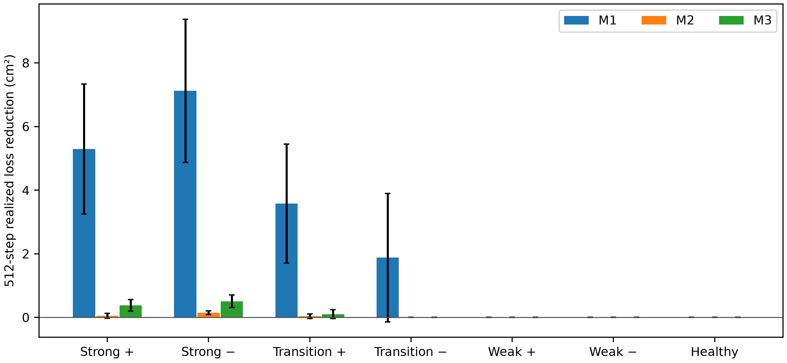
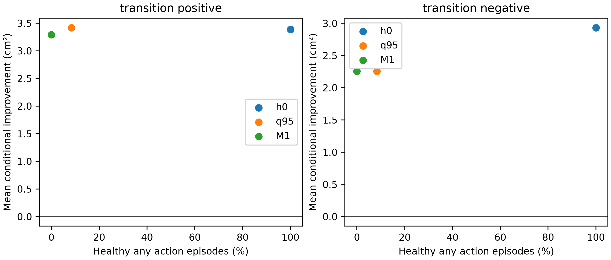

# 双容液位补充实验

新增 ±0.25 cm 各 12 条、起点 50 的过渡偏置轨迹。原 92 条与新 24 条分别登记。共 116 条公共前缀的门限回放使用同一组已冻结健康开发门限，全部 M1 动作哈希与原记录一致。

h0/q95/M1 门限分别为 0、4.116866、5.457584。q95 采用原 200 条开发路径第 190 秩。确认参数仍为 Z=2、先验幅值 ±0.35 cm、四个固定查询时刻。

| 工况 | 方法 | n | 平均降损 | 条件改善均值 | 启动/全部 | 平均有效拍 | 期末 | 负条件改善 |
|---|---|---:|---:|---:|---:|---:|---:|---:|
| 强正 | h0 | 20 | 5.2688 | 6.6270 | 20/20 | 428.6 | 20/20 | 2/20 |
| 强正 | q95 | 20 | 4.8633 | 6.3927 | 20/20 | 383.8 | 20/20 | 2/20 |
| 强正 | M1 | 20 | 5.2961 | 6.7959 | 20/20 | 371.0 | 20/20 | 1/20 |
| 强正 | M2 | 20 | 0.0546 | 0.1353 | 17/20 | 9.2 | 0/20 | 0/20 |
| 强正 | M3 | 20 | 0.3804 | 0.4571 | 17/20 | 34.9 | 2/20 | 0/20 |
| 强负 | h0 | 20 | 8.2867 | 8.6381 | 20/20 | 435.0 | 20/20 | 1/20 |
| 强负 | q95 | 20 | 7.2340 | 7.6864 | 20/20 | 390.2 | 20/20 | 1/20 |
| 强负 | M1 | 20 | 7.1201 | 7.5416 | 20/20 | 383.8 | 20/20 | 1/20 |
| 强负 | M2 | 20 | 0.1470 | 0.1090 | 18/20 | 7.3 | 0/20 | 0/20 |
| 强负 | M3 | 20 | 0.5086 | 0.3874 | 18/20 | 28.4 | 3/20 | 0/20 |
| 过渡正 | h0 | 12 | 3.7535 | 3.3872 | 12/12 | 435.0 | 12/12 | 0/12 |
| 过渡正 | q95 | 12 | 3.4824 | 3.4178 | 12/12 | 349.7 | 12/12 | 0/12 |
| 过渡正 | M1 | 12 | 3.5806 | 3.2904 | 12/12 | 339.0 | 12/12 | 0/12 |
| 过渡正 | M2 | 12 | 0.0380 | 0.0547 | 6/12 | 5.5 | 0/12 | 0/12 |
| 过渡正 | M3 | 12 | 0.1021 | 0.1159 | 6/12 | 11.9 | 0/12 | 0/12 |
| 过渡负 | h0 | 12 | 2.5110 | 2.9312 | 12/12 | 435.0 | 12/12 | 2/12 |
| 过渡负 | q95 | 12 | 1.8791 | 2.2549 | 12/12 | 349.7 | 12/12 | 2/12 |
| 过渡负 | M1 | 12 | 1.8791 | 2.2549 | 12/12 | 349.7 | 12/12 | 2/12 |
| 过渡负 | M2 | 12 | 0.0000 | 0.0000 | 0/12 | 0.0 | 0/12 | 0/12 |
| 过渡负 | M3 | 12 | 0.0000 | 0.0000 | 0/12 | 0.0 | 0/12 | 0/12 |
| 弱正 | h0 | 8 | -1.3741 | -0.8943 | 8/8 | 435.0 | 8/8 | 8/8 |
| 弱正 | q95 | 8 | 0.0000 | 0.0000 | 0/8 | 0.0 | 0/8 | 0/8 |
| 弱正 | M1 | 8 | 0.0000 | 0.0000 | 0/8 | 0.0 | 0/8 | 0/8 |
| 弱正 | M2 | 8 | 0.0000 | 0.0000 | 0/8 | 0.0 | 0/8 | 0/8 |
| 弱正 | M3 | 8 | 0.0000 | 0.0000 | 0/8 | 0.0 | 0/8 | 0/8 |
| 弱负 | h0 | 8 | -1.9308 | -1.9129 | 8/8 | 428.6 | 7/8 | 8/8 |
| 弱负 | q95 | 8 | 0.0000 | 0.0000 | 0/8 | 0.0 | 0/8 | 0/8 |
| 弱负 | M1 | 8 | 0.0000 | 0.0000 | 0/8 | 0.0 | 0/8 | 0/8 |
| 弱负 | M2 | 8 | 0.0000 | 0.0000 | 0/8 | 0.0 | 0/8 | 0/8 |
| 弱负 | M3 | 8 | 0.0000 | 0.0000 | 0/8 | 0.0 | 0/8 | 0/8 |
| 健康 | h0 | 36 | -1.8738 | -1.8142 | 36/36 | 431.4 | 36/36 | 36/36 |
| 健康 | q95 | 36 | -0.0121 | -0.0769 | 3/36 | 8.5 | 1/36 | 3/36 |
| 健康 | M1 | 36 | 0.0000 | 0.0000 | 0/36 | 0.0 | 0/36 | 0/36 |
| 健康 | M2 | 36 | 0.0000 | 0.0000 | 0/36 | 0.0 | 0/36 | 0/36 |
| 健康 | M3 | 36 | 0.0000 | 0.0000 | 0/36 | 0.0 | 0/36 | 0/36 |

h0/q95/M1 计非零动作，M2/M3 计实际发布下界至少 0.000625 的动作。实际负降损与离线负条件改善分别计数，完整字段见 CSV。首动中位延迟只针对窗内成功轨迹。

| 过渡组 | M3-M2 配对差 [描述性95%区间] | M3-M1 配对差 [描述性95%区间] |
|---|---:|---:|
| 过渡正 | 0.0641 [-0.0186, 0.1468] | -3.4785 [-5.3793, -1.5776] |
| 过渡负 | 0.0000 [0.0000, 0.0000] | -1.8791 [-3.9005, 0.1423] |

| 健康门限 | 全608拍任意动作 | 平均条件改善 |
|---|---:|---:|
| h0 | 36/36 | -1.8142 |
| q95 | 3/36 | -0.0769 |
| M1 | 0/36 | 0.0000 |
| M2 | 0/36 | 0.0000 |
| M3 | 0/36 | 0.0000 |

0/36 对应的双侧 95% 精确上限为 9.74%。

| 发送率口径 | Z | n | 总发送/总拍数 | 发送率 |
|---|---:|---:|---:|---:|
| health | 2 | 36 | 870/21888 | 3.97% |
| health-diagnostic | 2 | 12 | 311/7296 | 4.26% |
| health-diagnostic | 20 | 12 | 1571/7296 | 21.53% |

Z=20 的独立健康诊断未达到建议的 35%–60% 范围。诊断只改变触发参数，其结果用于说明原协议的稀疏通信边界。确认结果按原 Z=2 归档。

新增覆盖遗漏 0/14592 拍；1376 个真参数保留的非零有证动作中，风险下界违反 0 次（容差 1e-10），上限违反 0 次。最大直接滤波差 7.91e-16。新增试验与门限回放分别耗费 0.084、0.332 核时。

[逐轨迹数据](paired_trajectories.csv) · [完整指标](method_summary.csv) · [发送率](transmission_rate.csv)
