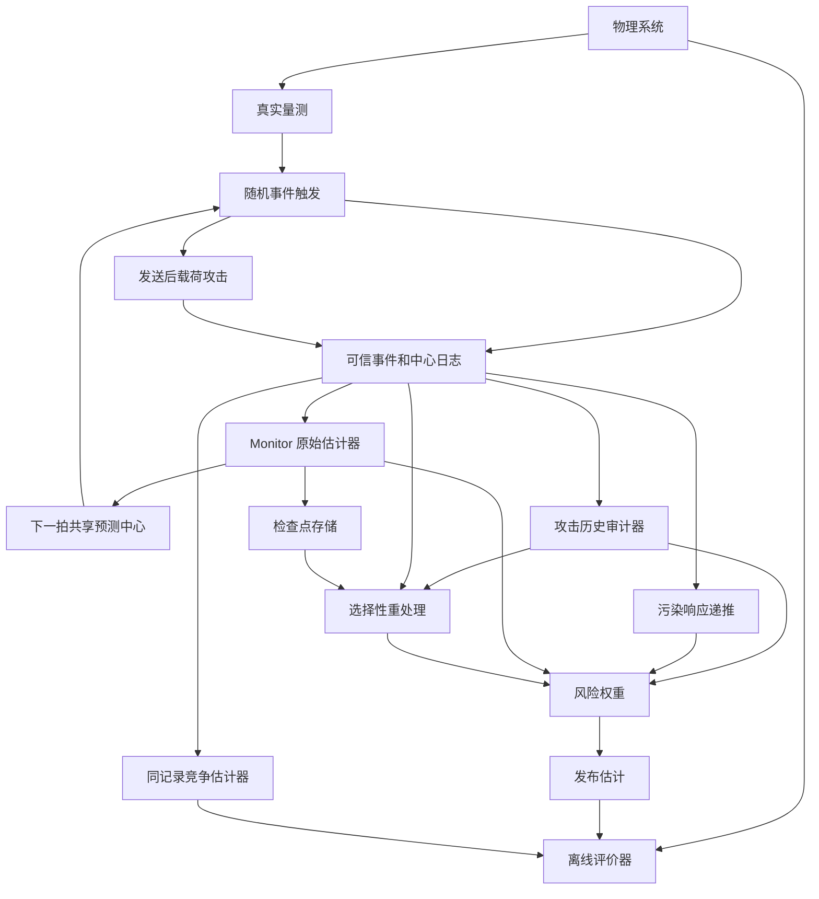

# TRSR 完整系统架构与算法接口 v0.2

日期：2026-11-24。基准分支 paper2-trsr-design-20261124，父提交 7deb6bc0046dfa6d671977b4d393ac577237dc80。状态 DESIGN_ONLY；本文件细化 v0.1，不改旧 S11，不代表任何算法已实现或通过实验。与任务书冲突的操作口径以本文件为准；原参数保持不变，正式确认协议另行冻结。

## 1. 论文目标与系统边界

研究随机触发远程估计在有限时段 FDI 后的恢复。核心是同一份完整可信通信历史下，选择性重放生成恢复方向，结合攻击污染约束选择一维恢复权重。工程目标是降低停止后64拍累计平方损失、控制正常情况下错误恢复代价、降低复杂认证的实际计算量。不是设计量化编码器，不声称有限比特上行，不声称分布式算法。

复用 Stage6/model.json：A=[[1.02,.10],[0,.97]], C=[1,0], Q=.05I, R=.20, P0=.8I, Z=2, W=I, delta=.011628232298833967。物理初始 x0~N(0,P0)，monitor 初始先验均值零。独立过程噪声、测量噪声、触发随机数、相位随机数。c_t=C m^-_t+r_t，r_0=0，之后 r_t~Uniform[-delta,delta)，为已有理想共享量化预测反馈偏移模型。事件先生成，gamma=1 的概率 g(y-c)=1-exp(-Z(y-c)^2/2)，然后仅对发送载荷加 b*1_[k0,k1)(t)。不允许篡改事件、中心、日志或上游。范围 b∈[-.25,.25]，D∈{1,...,60}；健康解释单列。主攻击真值 k0=80,D=20/60,b=±.10,±.25。所有在线方法只读实际记录的前缀。研究假定外生物理动力学，不涉及输出反馈控制闭环。

## 2. 总体数据流

所有方法共用原始 Monitor 生成的中心、事件、载荷记录。竞争估计器可递推自己的内部状态和工作协方差，但不得改变共享记录。这个协议评价同记录条件下的恢复能力，不代表各方法独立闭环改变事件机制的效果。真值、未发送量测、真实攻击参数永不传给在线接口。

## 3. 模块与接口

目录 code/（规划，尚未实现）：
- model_and_record.py: ModelConfig, MonitorState, Observation, TruthStep；physical_step 独立生成物理真值，make_observation 先触发再攻击，monitor_step 处理观测。仿真器与接收端接口物理隔离。
- checkpoint.py: CheckpointStore，保存后验 (t,m,P,model_id,prefix_id)，周期10，初始 checkpoint -1 是 x0 的先验；禁止对初始先验再预测一次。
- pollution.py: ResponseBank，append(F,K,gamma)，response(k0,k1)，support(h,window_boxes)。包含有限窗口、停止后传播。
- audit.py: HistoryAuditor，update(Observation,MonitorPrior,ResponseBank)->AuditSnapshot。R1-R4 使用独立 oracle adapter；R5 实现 online 有限库与后续连续盒。禁止用真值生成生产 AuditSnapshot。
- replay.py: ReplayEngine，build(snapshot,record_prefix,checkpoints)->ReplayProposal；extend 同一窗口增量推进；窗口变更则从合法 checkpoint 重放。
- risk_weight.py: choose_weight(monitor,replay,boxes,responses,W)，输出 lambda、candidate_support、gain、status。真实动作复核后才允许 certified 字样。
- estimator.py: TRSREstimator.step(record,monitor_snapshot,audit_snapshot)->EstimateOutput；无动作不改变 Monitor。
- baselines.py: monitor, nis_reject, cusum_reject, huber_clip, ml_compensation, hard_replay, fixed_fusion, direct_direction_correction, full_projection（选做）, oracle。实现共享接口；禁止调用 truth。
- run_oracle_pilot.py / run_audit_pilot.py: 分别运行 R4 和 R5；明确 oracle 与 online 命名空间。
- evaluate.py: episode 配对统计、健康误恢复、条件风险、覆盖率、运行时间。
- tests/: deterministic dynamics, replay, weight, audit likelihood, no-lookahead, paired-record, numerical status。
- results/: 独立 run_id，协议与源代码 hash、种子、软件版本、每轨迹指标、失败原因；不改既有结果。

接口字段（数组采用固定二维 shape，标量量测）：
Observation=(t,gamma,center,payload_or_none,model_id,prefix_id)。MonitorSnapshot=(t,prior_mean,prior_cov,post_mean,post_cov,K,F,center_offset,innovation_or_none)。Checkpoint=(t,mean,cov,prefix_id,kind)。WindowBox=(k0,k1,b_lo,b_hi)，半开攻击区间，幅值闭区间。AuditSnapshot=(t,prefix_id,alarm_latched,log_reference,boxes,health_or_future_possible,mode,valid,status,stop_diagnostic)；mode ∈ oracle/finite_grid/continuous_outer。ReplayProposal=(t,window,checkpoint_t,mean,working_cov,number_replayed,number_erased,valid)。EstimateOutput=(t,mean,lambda,lower_gain_or_none,decision,scope,elapsed)。scope=oracle/empirical_grid/certified_outer/none；网格结果不标连续认证。
所有共享数组只读或拷贝，时间/模型/记录前缀不匹配返回 monitor。异常、空集合、不确定数值、超预算均保守处理，不默认删除候选。

## 4. 每拍时序与递推

t=0 使用初始先验；之后 m^-=Am_prev,P^-=AP_prev A^T+Q。先由 Monitor 生成中心，真实量测产生事件，发送后注入，提交 Observation；Monitor 使用发送量测或静默中心更新。R_gamma=R+ (1-gamma)/Z，K=P^- C^T/(CP^-C^T+R_gamma)。P^+=(I-KC)P^-，数值实现对称化或 Joseph 形式，校验与标签一致。
记录后验并更新污染响应 F=(I-KC)A。H_t(k)=F_t H_{t-1}(k)+gamma K1 1[t>=k]。未来起点 H=0；t=0 旧响应零。d_t(theta)=b(H_t(k0)-H_t(k1))。在健康/固定候选的精确连续载荷模型中，同一完整记录后验均值=monitor-d。
日志提交后更新 audit；随后重放与风险决策；最后发布估计。恢复输出绝不参与下一拍中心。评估在发布后才获得 truth。在线不使用真实停止时间。

## 5. 审计模块：简单可执行版本

R5a：有限字典候选，覆盖 k0=0..t、D=1..60、幅值网格（先 0.025 间距含零）、健康/未来等价类。研究可先限制较短时域做算时诊断，不能静默裁掉早起点。参考模板 D=20/60,b=±.10,±.25，onset prior w_k=1/((k+1)(k+2))，未来质量 1/(t+2)。参考是正规物理模型混合；logsumexp 计算。精确似然在共同记录下：
u=payload-C m^-，r=center-C m^-，S=CP^-C^T+R，V=S+1/Z，eta=C A H_{t-1}(k0,k1)，I=1[k0<=t<k1]。
send: delta log L = b(I-eta)u/S - b^2(I-eta)^2/(2S) + log g(u-r-bI)-log g(u-r)。
silent: delta log L = -b eta r/V - b^2 eta^2/(2V)。
log g(x)=log(-expm1(-Z*x*x/2))；真/健康发送零密度点需明确处理，不用随意加 epsilon 把概率模型改掉。浮点未决保守回退。连续模型零点是测度零，理论绝对连续性在合法记录上成立。
报警阈值 R>=100（alpha=.01），状态 alarm_latched 保持；置信集 L>=.01 R（epsilon=.01）。可以累计保留历次未被可靠排除候选（同一固定真参数覆盖事件），新出现 onset 必须继承未来类此前的保留状态。若未来类未排除，当前存在零污染解释，风险权重应为零；若健康被排除则未来类也可被同样证据排除，不能无条件永久加入零解释。候选集为空或参考失败返回 UNRESOLVED。ML 估计在完整候选域求最大似然，不要求位于累计存活集内。
R5b（仅 R5a 有收益才做）：连续幅值按固定窗口的区间盒。累积 log L 是 A*b-.5*B*b^2 + sum log g(v_i-b) - sum log g(v_i)（最后两项仅攻击期发送）。A,B 由前述增量累计，B>=0；对于区间，可用二次函数最大值加各 log g 项端点最大值构造保守上界（每项因 |v-b| 最大值在端点而成立）。只在可靠上界低于 log(epsilon)+可靠参考下界时删除整个盒；固定粗网格区间已足够作为首版，不能保证足够紧；必要时再细分。保留未决盒、端点取线性支撑最小，不需要高斯混合或通用优化器。旧 interval_arithmetic 可选复用以兑现严格算术保证；未验证数值外包前只能称 empirical。若真候选在网格外，R5a 的覆盖不成立。
复杂度：未剪枝逐拍有限字典约 O(t*Dmax*Nb) 个候选，全时域约 O(T^2*Dmax*Nb)。响应可共享起点向量；审计耗时单独测量，不把闭式权重的 O(1) 误称为全算法 O(1)。不设未经论证的历史截断。冻结运行预算前先量实际成本。

## 6. 选择性重放与决策

从已启动的存活非零攻击候选取 l=min k0,u=max k1；保守隔离 [l,u)。若没有已启动候选、零污染解释存在或 g 不可能为正，可不运行 replay 并回退。若健康未来解释排除且所有已启动候选 k1<=t，才标记 stop confirmed（概率覆盖意义，非独立攻击结束探测器）。
选择 s<l 最新 checkpoint；只在一次攻击模型覆盖事件上可称其未受本次攻击污染。初始 checkpoint -1 特殊处理。恢复支路沿实际历史中心：静默用虚拟测量；区间内发送只预测；区间外发送正常更新。P^R 只是工作协方差。窗口不变时每拍增量推进；变化时重放到当前，禁止拼接不一致状态。攻击未确认结束时允许有证据的输出校正，真正 post-stop 指标只由评价器计算；禁止将 stop 诊断作为偷读真实标签的开关。
h=m^M-m^R,q=h^T W h,g=min_theta h^T W d_theta。每个幅值盒仅取 b 两端最小；候选健康/未来时支撑额外包含0。lambda=clip(g/q,0,1)（q=0时0）；gain=2lambda g-lambda^2 q。发布实际 a=m^M-m^F 后复核 min_theta 2a^T W d_theta-a^T W a。未通过则回退。精确数学条件下 gain>=0，若 g>0 且 q>0 且动作非零则严格正。设置浮点容差只能作实验数值检查，不等同严格认证。
状态：MONITOR_ONLY（未报警）→ AUDIT_ACTIVE（报警锁存）→ REPLAY_READY（合法范围/检查点）→ PARTIAL_RECOVERY/FULL_RECOVERY（lambda>0）或 REJECTED；UNRESOLVED 独立原因。每拍可回退，状态不保证单调。STOP_UNCONFIRMED/CONFIRMED 是并行标志，非必经状态。
理论 T1 有限窗口响应/停止后衰减；T2 同记录条件风险差与闭式权重、方向效率；T3 覆盖事件上真实条件风险不增（健康真值包括在覆盖合同内）。不承诺样本损失、整体 MSE 或无条件风险下降。直接任意向量投影的可行域更大，故其理论最优收益>=线段最优；这是重要竞争基准而非弱化处理。

## 7. 竞争算法：外部文献、内部基线与消融

完整对照协议见 BASELINE_PROTOCOL.md。至少三类现有机制：残差检测-预测替换、CUSUM/GLR-在线参数补偿、Huber创新限幅；加入同记录直接污染校正（仓库 Stage6/9）。华理 IEQ/REFQ 只作论文贡献参照，不复现。所有文献适配版必须明确标注 adapted，不能假称原文复现。对比拆为同报警/同候选的恢复对照和独立检测的端到端对照。每组共享物理记录，独立支路可自行预测；仅评价已见前缀。

## 8. 试验与停止规则

R1-R3 确定性测试（见任务书）通过后才跑 R4。R4 8攻击cell ×200，加每cell匹配健康；延迟0/5/20/60/128；主 stop 后[0,64)，补充[0,512)。延迟>=64的主窗口不产生动作，作为预期零收益对照；同时单独报告激活后短窗口，不能移动主评价窗掩盖延迟。真实窗口/参数 Oracle 只评价可恢复潜力；下一步人工含真范围只作压力测试。报告累计实际损失差、条件风险收益、方向效率（能量加权 sum gain/sum ||d||^2）、非零/拒绝比例、健康代价、审计/重放/决策分别耗时、端到端成本。
R4 门槛沿用：至少预指定强幅值60拍cell有正平均实际收益且捕获理想直接校正条件风险能量>=20%；若20拍延迟后收益近零或人工窄范围无法行动，则不开发昂贵连续审计。R5 首选有限网格、接入同记录现有方法与消融；仅在直接校正竞争下存在实用增量才考虑论文主张。正式确认另冻结独立样本/种子、误报预算和最小效应，使用按轨迹配对的置信区间。所有失败样本保留。

## 9. 证据与来源

Stage6 model.json blob 09ae4ac05011e106c474220c1aeaf68dd02ed1d6；vector_record.py blob 7d36af1ea991a57f9f8fb71a3f6ef7ec805e5e25；Stage9 paired_recovery.py blob 3be01e31797601462ccb49f74585c28b0e7aa404；Stage9 02_results.md blob 4f33aad8686a74b7538b8d5f62e83224f770aaa7，均来自基准3fc87105。其持续攻击、连续载荷、非负幅值实验不直接证明本方案有限时段效果。旧研究不改。当前未写实现、未运行随机实验、未通过投稿查新。