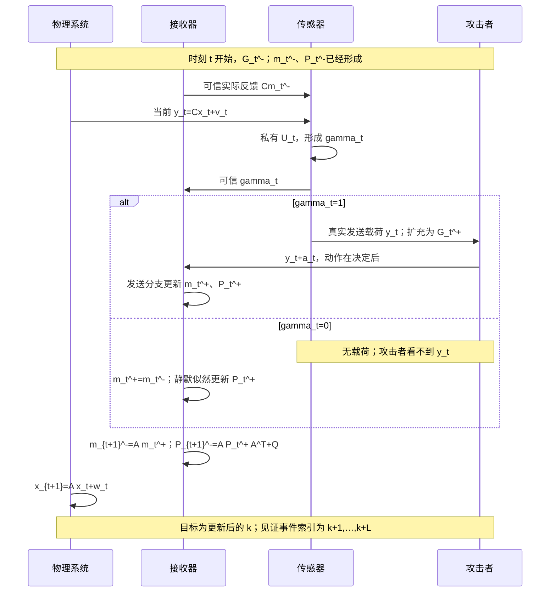

# 核心定理独立数学审计

日期：2026-11-12。对象：第一轮《可达攻击方向与多拍静默损伤界》式(1)–(7)。先独立推导本报告第1–9节及反例，再进行文献审查；不以旧稿或文献的正确性作为本证明前提。正式稿未修改。

## 0. 审计结论与标签

**CONDITIONAL：候选上界在下列完整协议、固定有限时域、固定逐路径峰值和逐事件历史受限可见性条件下成立。** 第2–6节给出独立证明；其中数学推论标为 PROVED，原候选作为附带协议假设的结论标为 CONDITIONAL。没有发现满足全部条件的反例。

**DISPROVED：把该秩条件称为安全性必要条件，或认为条件失败必定存在合法的零TV正损伤攻击。** 第7节给出与原480项模型一致的反例：条件失败，但仍存在对全部合法策略成立的有限线性TV上界。不能从离线、逐路径线性可达性跳到共同因果策略可实现性。

**DISPROVED：把接收端报告的协方差直接当成攻击下接收日志的真实条件协方差。** 第8.3节给出合法非线性攻击，二者分别为0.0833333和0.1091266。扩充真实历史下的高斯性仍成立，这个例子不推翻本上界。

**OPEN：一般部分观测条件下的必要充分刻画、尖锐常数、匹配损伤下界，以及不枚举历史的证书。** 本轮没有将这些研究目标写成成果。

## 1. 从原始随机系统重新定义问题

### 1.1 原始概率空间与系统

固定有限维数 n,m≥1，确定矩阵 A∈R^{n×n}、C∈R^{m×n}，

\[
x_{t+1}=Ax_t+w_t,\qquad y_t=Cx_t+v_t,\quad t=0,1,\ldots. \tag{A1}
\]

假设 x_0∼N(m_0,P_0)，w_t∼N(0,Q)，v_t∼N(0,R)，U_t∼Uniform[0,1]；P_0≻0，Q⪰0，R≻0。初值、全部过程噪声、全部量测噪声、全部触发随机数彼此独立，各噪声序列在时间上独立。攻击私有种子S独立于它们；S可编码全部私有随机化。固定Z≻0。

不假设A可逆、C满列秩或(A,C)可观。允许Q退化；因此若A奇异，后续P_t可以仅半正定。以下仅求逆CPCᵀ+R_i和V+Z̄^{-1}，它们均正定；不得沿用需要P_t^{-1}的写法而不检查退化性。初值均值与接收初值一致，(m_0^-,P_0^-)=(m_0,P_0)。物理状态不受估计值的控制反馈。

固定目标k≥0和未来窗L≥1，二者为有限整数。有限时刻结论不要求A稳定。

### 1.2 触发、名义接收器及准确索引

接收端在时刻t量测前已形成实际预测m_t^-，可信及时反馈Cm_t^-到传感器。传感器独立抽U_t：

\[
\gamma_t=0\iff U_t\le \exp[-(y_t-Cm_t^-)^TZ(y_t-Cm_t^-)/2]. \tag{A2}
\]

γ=0静默，γ=1发送。攻击只能在γ_t已经确定且为1之后，将当前真实载荷y_t替换为y_t+a_t；γ_t=0时a_t=0。事件位与反馈不可伪造，无自然丢包、延时或乱序。反馈的值可以含过去攻击影响，“可信”指忠实反馈接收器的实际预测，并非健康预测。

定义R_1=R，R_0=R+Z^{-1}，

\[
K_i(P)=PC^T(CPC^T+R_i)^{-1},\quad M_i(P)=I-K_i(P)C,
\quad F_i(P)=P-PC^T(CPC^T+R_i)^{-1}CP. \tag{A3}
\]

接收器执行

\[
\begin{aligned}
m_t^+&=m_t^-+\gamma_tK_1(P_t^-)(\widetilde y_t-Cm_t^-),\\
P_t^+&=F_{\gamma_t}(P_t^-),\\
m_{t+1}^-&=Am_t^+,\qquad P_{t+1}^-=AP_t^+A^T+Q.
\end{aligned}\tag{A4}
\]

静默分支接收均值不移动，但报告协方差仍更新。它相当于以Cm_t^-为虚拟量测、R_0为噪声的高斯似然更新。

### 1.3 三方信息及分析用扩充信息

设Y_t^{true}=y_t（γ_t=1时），否则为⊥。本报告中Y_t^{true}与后面的全静默位Y_L是不同对象。

| 主体 | 时刻t可用信息 | 不能据此额外授予的权限 |
|---|---|---|
| 传感器 | 本地y_{0:t}、自身触发随机数U_{0:t}、可信反馈、过去发送决定 | 协议固定按(A2)，本轮不重设计触发器 |
| 接收端 | 过去接收日志、当前可信γ_t、发送时的篡改后载荷ỹ_t、算法P与m | 无真实y_t的并行副本，无S |
| 攻击者，决定a_t前 | S、γ_{0:t}、真实已发送Y_{0:t}^{true}、由此可重建的动作及实际反馈 | 无静默时y、x、U及未来噪声；不能先改载荷再影响本拍决定 |
| 远端记录评估者 | 指定的(P_k^+,Y_L)，或更丰富的可信日志 | 不自动拥有分析者的真实历史 |

严格地定义

\[
\mathcal G_t^-=\sigma(S,\gamma_{0:t-1},Y_{0:t-1}^{true}),\qquad
\mathcal G_t^+=\mathcal G_t^-\vee\sigma(\gamma_t,Y_t^{true}). \tag{A5}
\]

固定策略π后，a_t为G_t^+可测，接收均值、实际反馈及已实施动作均可由上述历史重建。扩充G用于条件分布证明，不是接收器的实际信息。接收日志的σ域H_t是G_t^+的子域。

所有策略使用同一独立原始随机源模型，允许任意非线性和随机化，满足逐路径约束||a_t||≤b≤b_ref<∞。开始/结束时间可以未知、随机并适应历史；无需固定攻击时段或每拍攻击。目标前只涉及0,…,k的有限动作。即使未来仍允许攻击，全静默事件上没有载荷可改，所以后续动作不改变第4节公式。没有累计能量或次数限制；若另有限制，只缩小策略集合。

### 1.4 信息流图

```mermaid
flowchart LR
    X[物理状态 x_t] --> Y[本地量测 y_t]
    V[私有量测噪声 v_t] --> Y
    U[私有独立 U_t] --> T[以实际 Cm_t^- 随机触发]
    Y --> T
    R[接收器预测 m_t^-] -->|可信及时反馈 Cm_t^-| T
    T -->|可信事件位 gamma_t| RCV[接收更新 m_t^+ 和 P_t^+]
    T -->|只在真实发送后暴露 y_t| ATK[因果攻击 a_t]
    S[独立种子 S 和过去已发送历史] --> ATK
    ATK -->|载荷 y_t+a_t| RCV
    RCV --> NEXT[预测 m_{t+1}^-=A m_t^+]
    NEXT --> EVAL[未来 L 拍真实事件]
    RCV -->|精确 P_k^+| LOG[记录评估者]
    EVAL -->|全静默指示 Y_L| LOG
```



健康协议π=0与攻击协议使用各自实际预测生成事件。可以用相同原始噪声作耦合以实现仿真，但不强迫两条事件轨迹相同；定理比较的是各自边缘分布的期望，不是固定健康触发序列上的攻击误差。

## 2. 条件高斯性：独立归纳证明（PROVED）

令μ_t^±=E_π[x_t|G_t^±]。断言Cov_π(x_t|G_t^±)=P_t^±，条件分布高斯（包括退化高斯）。

**起点。** S与x_0独立，故给定G_0^-后仍为N(m_0,P_0)。【使用：初值高斯、S独立。】

**发送分支。** 假设先验为N(μ,P)，给定当前真实已发送y后，联合似然为

\[
\phi_R(y-Cx)\{1-g(y-Cm^-)\}.
\]

m^-在G^-下已知，花括号给定y后不再依赖x，归一化时消去。标准高斯条件公式得到μ^+=μ+K_1(P)(y-Cμ)，协方差F_1(P)。【使用：事件在篡改前形成、真实y在G^+中、U独立；工具：Bayes与高斯配方。】

不能说“发送条件下y本身仍高斯”：其密度被1-g倾斜，一般不是高斯。这里说的是进一步给定真实y后的x。

**静默分支。** 静默时不条件于未发送y。积分v得

\[
\Pr(\gamma=0|x,G^-)
=\det(I+RZ)^{-1/2}\exp[-(Cx-Cm^-)^T(R+Z^{-1})^{-1}(Cx-Cm^-)/2]. \tag{A6}
\]

此为中心Cm^-的高斯似然，故μ^+=μ+K_0(P)(Cm^--Cμ)，协方差F_0(P)。【使用：R,Z正定；工具：高斯指数积分。】

**预测。** w_t独立于G_t^+，得μ_{t+1}^-=Aμ_t^+，P_{t+1}^-=AP_t^+Aᵀ+Q。【使用：无控制反馈、噪声独立。】

动作可以依赖当前已发送y，甚至非线性；在给定S与真实发送历史后，a_t是已知数。它改变实际接收中心和将来的事件，但不再额外筛选x。因此本归纳不要求攻击与y独立。

## 3. 偏差、真实协方差与MSE（PROVED）

令d_t=μ_t^--m_t^-，D_t=μ_t^+-m_t^+。由(A3)–(A6)，

\[
D_t=M_{\gamma_t}(P_t^-)d_t-\gamma_tK_1(P_t^-)a_t,
\qquad d_{t+1}=AD_t,\quad d_0=0. \tag{A7}
\]

由于D_k为G_k^+可测，

\[
E_\pi[(x_k-\mu_k^+)^TD_k]
=E_\pi\{D_k^TE_\pi[x_k-\mu_k^+|G_k^+]\}=0. \tag{A8}
\]

健康协议下D≡0。因此定义真实损伤

\[
J_k(\pi)=E_\pi\|x_k-m_k^+\|^2-E_0\|x_k-m_k^+\|^2
=E_\pi\|D_k\|^2+E_\pi\operatorname{tr}P_k^+-E_0\operatorname{tr}P_k^+. \tag{A9}
\]

【工具：条件期望正交性、平方展开；不是攻击/误差无条件独立。】若用健康接收误差与攻击动作直接展开平方，交叉项一般不能消去；若锁定健康事件轨迹，则连比较对象都改变。J_k可以负，不能改写为|J_k|或不加说明地取正部等号。上界也控制J_k的正部，因为右侧非负。

三种对象必须区分：

| 对象 | 本协议中的准确关系 |
|---|---|
| 算法报告协方差P_k^+ | 只由事件串确定的名义量 |
| Cov(x_k|G_k^+) | 在第1节权限下恰好等于P_k^+ |
| Cov(x_k|H_k)（实际接收日志） | P_k^++Cov(μ_k^+|H_k)，一般不等于P_k^+ |
| E[(x_k-m_k^+)(x_k-m_k^+)ᵀ] | E P_k^+ + E D_kD_kᵀ；还包含均值偏差，不能简称报告协方差 |

第三行使用H_k⊂G_k^+和P_k^+的H_k可测性；一般不是高斯。即使真实接收条件均值与m不同，本证明也不宣称接收器在受攻时仍MMSE。

## 4. 完整历史与可达线性外包（PROVED）

本命题h=γ_{0:k}∈{0,1}^{k+1}，是离散事件串，不含连续载荷。全部信息G_k^+还含真实发送数值及S，故是更细的历史。固定事件串后，所有P与K确定，但D仍随数值和S变化。

令T_t(h)=M_{γ_t}(P_t^-(h))A，Φ_{k,t}=T_k⋯T_{t+1}，Φ_{k,k}=I。按发送时刻拼接矩阵

\[
B_h=[\,-\Phi_{k,t}(h)K_1(P_t^-(h)):\gamma_t=1\,],
\quad \mathcal R_{k,h}=\operatorname{range}B_h. \tag{A10}
\]

由(A7)展开，D_k=B_h col(a_t:γ_t=1)，所以实际D_k总在R_{k,h}内。

R不是峰值约束下的实际可达集合，也不宣称某个向量可以由同一因果策略在每个分支同时实现。给定h，矩阵B_h乘有界输入盒产生有界集合；允许策略在不同事件分叉之前必须选择相同动作。独立逐历史选输入忽略这个约束。第7节显示此区别会改变必要性判断。

固定b_ref，定义

\[
B_* =b_{ref}\max_h\sum_{t:\gamma_t=1}\|\Phi_{k,t}K_1(P_t^-(h))\|_2. \tag{A11}
\]

由三角不等式，所有合法策略、所有实现均满足||D_k||≤B_*。有限事件串使最大值有限。这不是关于k→∞的稳定性或统一界。

## 5. 全静默概率与记录分布（PROVED）

定义E_L={γ_{k+1}=⋯=γ_{k+L}=0}，Y_L=1_{E_L}。P_k^+为更新后完整、未经量化的可信算法协方差矩阵标签。待比较记录为R_L=(P_k^+,Y_L)，不是全部未来事件串，也不是完整接收载荷日志。

在E_L分支接收均值只按A推进。给定G_k^+，将未来物理输出相对于这条假定全静默中心堆叠，有

\[
r_{1:L}=G_LD_k+\eta_L,\quad G_L=\operatorname{col}(CA,\ldots,CA^L),\quad
\eta_L\sim N(0,V_L(P_k^+)), \tag{A12}
\]

\[
[V_L(P)]_{ij}=C\left(A^iP(A^j)^T+
\sum_{r=1}^{\min(i,j)}A^{i-r}Q(A^{j-r})^T\right)C^T+R1_{i=j}. \tag{A13}
\]

η是给定目标历史后、尚未按未来事件筛选的高斯输出噪声；不是声称“给定未来全静默后r仍有(A12)的原协方差”。对固定未来物理量，独立U给出全静默概率∏g(r_i)，再对(A12)积分：

\[
\begin{aligned}
\bar Z&=I_L\otimes Z,\\
s_L(P)&=\det(I+V_L(P)\bar Z)^{-1/2}>0,\\
H_L(P)&=\tfrac12G_L^T[V_L(P)+\bar Z^{-1}]^{-1}G_L,\\
\Pr_\pi(E_L|G_k^+)&=s_L(P_k^+)e^{-D_k^TH_L(P_k^+)D_k}. 
\end{aligned}\tag{A14}
\]

【工具：独立触发随机数、全静默路径的中心确定性、高斯二次指数积分；使用R,Z≻0保证相关逆存在。】若自然丢包混入“未接收”事件，或传感器使用不受接收实际预测影响的独立中心，本式不能直接照搬。

从条件分布到整体记录分布，逐P标签p：

\[
\begin{aligned}
\Pr_\pi(P=p,Y_L=1)&=s_L(p)E_\pi[1_{P=p}e^{-D_k^TH_L(p)D_k}],\\
\Pr_\pi(P=p,Y_L=0)&=\Pr_\pi(P=p)-\Pr_\pi(P=p,Y_L=1),\\
\Pr_0(P=p,Y_L=1)&=s_L(p)\Pr_0(P=p).
\end{aligned}\tag{A15}
\]

这些等式允许π改变历史概率，允许多个历史产生同一个p。无需P标签一一编码事件串。

## 6. 完整上界及每一步证明

### 6.1 全称量词与假设（CONDITIONAL）

**固定**第1节全部矩阵、独立随机源模型、k,L、b_ref>0。对每个h，要求

\[
\ker G_L\cap\mathcal R_{k,h}=\{0\}. \tag{A16}
\]

则存在一个仅依赖这些固定对象的有限C_*，**对所有**0≤b≤b_ref、**所有**满足(A5)和逐路径峰值约束的共同因果策略π（包括量测依赖非线性与私有随机混合），有

\[
J_k(\pi)\le C_*\,\Delta_L(\pi),\qquad
\Delta_L=\operatorname{TV}(\mathcal L_\pi(P_k^+,Y_L),\mathcal L_0(P_k^+,Y_L)). \tag{A17}
\]

TV约定为sup_E|μ(E)-ν(E)|，离散标签情形等于原子质量绝对差之和的一半。常数不依赖π、实际b、私有种子、数值历史或实现；它依赖A,C,P_0,Q,R,Z,n,m,k,L,b_ref。m_0通过平移不变性不进入以下常数。没有跨系统、跨k或跨L的统一断言。

### 6.2 正常数从何而来（PROVED）

W(P)=[V_L(P)+Z̄^{-1}]^{-1}≻0，所以kerH_L(P)=kerG_L。为每个非零R_h选正交基U_h。由(A16)，

\[
h_* =\min_{h:\mathcal R_h\ne0}\lambda_{min}(U_h^TH_L(P(h))U_h)>0. \tag{A18}
\]

【工具：有限维正定二次型、有限集合最小值。】这里**确实需要统一下界**，不是仅逐h为正就能对无限历史取正下确界。在本协议有限k下共有2^{k+1}条事件串，故自动得到；若反馈增益依赖连续载荷、Z自适应或k无界，必须重新证明统一性。

等价的秩证书为rank(G_LB_h)=rank(B_h)。若需要谱值，可用

\[
\lambda_{min}(U_h^TH_L(P(h))U_h)
\ge \frac{\sigma_{min}(G_LU_h)^2}{2\lambda_{max}(V_L(P(h))+\bar Z^{-1})}. \tag{A19}
\]

接近不可观时右侧可趋0；定性秩相同不保证数值常数可用。

定义

\[
q_*={1-e^{-h_*B_*^2}\over B_*^2},\quad
M_* =\max_hs_L(P(h))^{-1},\quad
\Omega_k=\max_h\operatorname{tr}P(h)-\min_h\operatorname{tr}P(h),
\quad C_*={M_*\over q_*}+\Omega_k. \tag{A20}
\]

若全部R_h={0}，则D_k≡0，直接取C_*=Ω_k；不把空集最小值代入(A20)。其余情形B_*>0。B_*有限、s_L(P)>0及有限标签集保证(A20)有限。

### 6.3 偏差能量与可观察见证（PROVED）

对0≤x≤B_*²，凹函数1-e^{-h_*x}在区间上大于端点割线。故对每个实现，

\[
q_*\|D_k\|^2\le1-e^{-D_k^TH_L(P)D_k}. \tag{A21}
\]

【使用：统一受限谱界、统一逐路径峰值；工具：凹函数割线。】只有E||D||²有界不能替代逐路径界，见第8.4节。

取同一个可观察函数f(P,Y)=Y/s_L(P)，0≤f≤M_*。由(A14)和塔式期望，

\[
E_0 f=1,\qquad E_\pi f=E_\pi e^{-D_k^TH_L(P)D_k}.
\]

所以

\[
q_*E_\pi\|D_k\|^2\le E_0f-E_\pi f\le M_*\Delta_L. \tag{A22}
\]

【工具：塔式期望、有界函数取值跨度的TV界。】因为TV用sup_E定义且f∈[0,M_*]，系数为M_*，不是2M_*。不是将条件TV的平均误当整体TV：先构造一个共同的有界记录函数，再直接对整体记录分布应用TV。

同一个P标签下h虽可混合，归一化后每个攻击偏差都只降低e^{-DᵀHD}，不能用相反均值的混合抵消该非负缺口。跨标签的正常概率差可由f归一化消除。

### 6.4 协方差变化项（PROVED）

P是记录的一个分量，故

\[
\left|E_\pi\operatorname{tr}P-E_0\operatorname{tr}P\right|
\le\Omega_k\operatorname{TV}(\mathcal L_\pi(P),\mathcal L_0(P))
\le\Omega_k\Delta_L. \tag{A23}
\]

【工具：取值跨度TV界、投影的数据处理不等式。】将(A22)和(A23)代入(A9)，即得(A17)。未假定协方差分布在攻击下保持不变，也未假定其变化非负。

结论只约束固定目标总体MSE增量；不能推出条件逐样本损伤上界、长期均方稳定、检测延迟、有限样本报警率或实际防御性能。

## 7. 可达条件的充分性、非必要性及合法策略问题

### 7.1 对“逐路径线性外包强制性”的必要充分性（PROVED）

在给定h的线性空间R_h上，存在c_h>0使DᵀH(P(h))D≥c_h||D||²对全部D∈R_h成立，当且仅当(A16)成立。这只是二次型在线性空间上的标准结论。

它不等价于：对全部共同因果攻击的**期望**能量存在强制性；也不等价于：记录TV=0只允许无损伤。以下给出严格区分。

### 7.2 条件失效却仍有线性TV上界的具体模型（PROVED）

采用原筛查中的相关先验模型：

\[
A=\operatorname{diag}(.9,.95),\quad C=[1,0],\quad
P_0=\begin{bmatrix}.5&.1\\.1&.4\end{bmatrix},\quad
Q=.02I,\quad R=.1,\quad Z=2,\quad k=L=1,\quad b_{ref}=1. \tag{A24}
\]

h=11时rankB_h=2，而G=CA=[.9,0]的秩为1，故(A16)失效。离线可取两个输入使最终可见分量抵消，留下第二坐标；但a_0选择时还不知道γ_1。

以下证明**所有合法共同因果策略**仍满足有限期望能量界。a_0在γ_0=0时为0，a_1在γ_1=0时为0，二者为标量。记K=K_1(P_0)，v=AK，

\[
u_i=M_i(P_1^-(\gamma_0=1))v,\quad
D_1=-u_{\gamma_1}a_0-K_1(P_1^-(\gamma_0))a_1. \tag{A25}
\]

若γ_0=0则第一项为0。令z=GD_1，c_0=|Gu_0|=.5890909，c_1=|Gu_1|=.36，

\[
d_{min}=\min_{g_0\in\{0,1\}}|GK_1(P_1^-(g_0))|=.42>0.
\]

给定G_0^+且γ_0=1，下一静默概率由(A14)的单拍版本、|a_0|≤1得到

\[
\Pr(\gamma_1=0|G_0^+)\ge
p_{min}=s\exp[-(Cv)^2/(2(\Sigma+Z^{-1}))]\approx.56647758>0,\tag{A26}
\]

其中Σ=C P_1^-(1) Cᵀ+R=.1875，s=(1+2Σ)^{-1/2}。a_0是G_0^+可测，γ_1=0分支上z²=c_0²a_0²。因此

\[
E a_0^2\le {E z^2\over p_{min}c_0^2}. \tag{A27}
\]

发送分支由(A25)解出a_1；静默分支a_1=0。用(a+b)²≤2a²+2b²，得

\[
E a_1^2\le {2\over d_{min}^2}(E z^2+c_1^2E a_0^2). \tag{A28}
\]

令u_max=max_i||u_i||，K_max=max_{g_0}||K_1(P_1^-(g_0))||，则

\[
E\|D_1\|^2\le C_{causal}E z^2,\qquad
C_{causal}={2u_{max}^2\over p_{min}c_0^2}
+{4K_{max}^2\over d_{min}^2}\left(1+{c_1^2\over p_{min}c_0^2}\right)
\approx24.05938. \tag{A29}
\]

这一步只使用因果可测性、随机静默概率的统一正下界及有限维代数；允许a_1依赖当前y_1，允许私有随机化。

由于G为单行，H(P)=β(P)GᵀG，β(P)=1/[2(CAPAᵀCᵀ+CQ Cᵀ+R+Z^{-1})]>0。有限标签和逐路径偏差界给出β_min>0与|z|≤z_max<∞，故q_z=(1-e^{-β_min z_max²})/z_max²>0。再用(A22)的归一化见证，

\[
E z^2\le (M_*/q_z)\Delta_1,\qquad
J_1\le(C_{causal}M_*/q_z+\Omega_1)\Delta_1. \tag{A30}
\]

本轮补算(A30)的保守系数约54.76851；该数字为浮点评估，数学结论只需它有限。四条具体历史的P与B、全部中间常数保存在[因果几何结果](artifacts/run_20261112_02/causal_geometry/result.json)。

这严格反驳“(A16)是有限线性TV上界的必要条件”。特别地Δ_1=0⇒J_1≤0，无法在该模型构造零标记TV、正损伤的合法攻击。这个反例分析属于本轮必要性审计，**不是一般必要充分定理，也不是已确认的独立论文创新**。

### 7.3 条件失败什么时候确实会有隐蔽有损攻击？

第8.1节给出的奇异A例子可以做到，但只能逐模型证明。一般从v∈kerG∩rangeB_h推得一串离线输入，再指定“只在最终h发生时攻击”，会使用攻击当时尚未知的未来事件，是非法策略。不能这样补出必要性证明。

## 8. 主动反例与边界审查

所有新代码见[独立核验入口](code/audit_round2.py)，最终结果见[运行目录](artifacts/run_20261112_02/run_manifest.json)。初版01运行也保留，02只增加非必要性例子的完整常数和具体历史，并删去一个未使用变量。每例均保留参数、权限与计算类型。

### 8.1 当前误差方向被A擦除（PROVED；删除可见性假设的版本DISPROVED）

A=diag(0,.95)，C=I，P_0=diag(.5,.4)，Q=.02I，R=.1I，Z=2I，k=0，b=.25。真实发送后以独立等概率符号注入a_0=±b e_1，之后不攻击。K_1 e_1=(5/6)e_1，D_0≠0但AD_0=0。

J_0=(1−1/√(2.2·2))·(5b/6)²≈.0227113153>0，任意L≥1均有标记记录TV=0。攻击合法，违反(A16)，所以不推翻附带(A16)的候选。这里**不**宣称完整当前接收载荷日志TV=0。

### 8.2 接近不可观方向（PROVED阶数；浮点数值为证据）

单输出嵌入模型A=diag(ε,.95)，C=[1,0]，对角P_0、Q，攻击首坐标。ε>0时受限秩条件成立，首拍J_0≈.01414063不依赖ε，而未来标记TV=Θ(ε²)。ε=.1,.01,.001,.0001时J/TV分别约138.38、13808.36、1.3808×10^6、1.3808×10^8。

因此不存在跨这些系统的统一C_*。原定理允许常数依赖系统，未被反驳；但“秩通过即可获得实用证书”的主张不受支持。

### 8.3 依赖已发送量测的合法非线性攻击（PROVED结构；数值积分核验）

标量A=.9，C=1，P_0=.5，Q=.02，R=.1，Z=2，b=.25，k=0。仅在γ_0=1且|y_0|≤b时令a_0=-y_0，否则0。这是逐路径有界、仅使用真实发送y的合法策略。

接收事件{γ_0=1,ỹ_0=0}具有正概率≈.0051048382。该事件内真实y仍变化，故x的接收条件分布是高斯位置混合。算法P_send=1/12≈.0833333，真实接收条件方差≈.109126624，四阶累积量≈−.001200486≠0，证明非高斯。

独立自适应积分得J≈1.31670575×10^-4，TV≈6.55515781×10^-5，候选右侧≈1.88247563×10^-4；该合法攻击未违反上界。积分报告误差约5.7×10^-17，不是严格区间误差证书。

### 8.4 随机化与稀有高幅值攻击（PROVED；无固定峰值版本DISPROVED）

独立私有概率p_B=.1/B²启用发送后±B攻击（B≥1）。同一固定标量系统下

\[
J_0=(1-s_0)p_BK^2B^2>0\text{ 为常数},\quad
\Delta_1=(1-s_0)p_Bs_1(1-e^{-HK^2B^2})\to0.
\]

故不能用统一二阶矩预算替代固定逐路径峰值而保留有限线性TV系数。每个有限B对其自己的b_ref合法，B>1对固定b_ref=1非法；不能把这类跨峰值序列当原候选反例。固定幅值时改变启用概率，J与TV同比缩放，原证明可覆盖。

### 8.5 同标签不同历史与混合抵消（PROVED结构；数值积分核验）

A=C=1，Q=0，P_0=.5，R=.1，Z=2，k=L=1。精度相加给出P(01)=P(10)=3/41，标签不能区分历史。采用合法非线性a_0=b tanh(y_0)、a_1=−(b/2)tanh(y_1−m_1^-)（仅各自发送时），b=.25。

二维原始量测联合高斯积分，合并碰撞标签后为6个记录原子。104阶结果：J≈.006107995419，偏差平方≈.006241750530，协方差变化≈−.000133755111，TV≈.007754353561。真实物理MSE积分与(A9)差在显示精度内为0；归一化见证等式误差约1.2×10^-16。72到104阶TV变化约8.55×10^-13。

结果不支持“同一P标签必定产生抵消”。(A15)与(A22)才是排除抵消的数学理由。若丢掉P或对P粗量化，s(P)未必可由记录恢复，原证书失去依据；旧稿已有未加权事件边缘抵消例，不把它算成本轮新反例。

对同幅相反符号的随机混合，一阶偏差均值可以抵消，但DᵀHD不抵消。代码另保存符号概率0,.1,.5,.9,1的闭式概率。

## 9. 对上一轮实验的审计与复现

### 9.1 原结果保留

新程序运行前后逐文件核对三个旧结果目录的SHA-256，见[preserved_assets.json](artifacts/run_20261112_02/preserved_assets.json)。原20阶积分未过10^-9门槛的运行、32阶重算、16例结果均未改写。复跑使用新目录。

### 9.2 480项究竟证明了什么？

4模型×4个k×4个L，每个k有2^{k+1}条历史，合计4·4·(2+4+8+16)=480项。它们不是480条物理轨迹或统计重复。

矩阵见[原计划](../simulation/reachable_silence_plan_20261112.json)。每项有具体h、rankB_h、rank(G_LB_h)、P(h)、常数，见[新复跑逐历史表](artifacts/run_20261112_02/rank480/replay/history_ranks.csv)。有理数消元精确验证给定矩阵的秩；奇异值、概率和常数仍用浮点数。P与B的完整矩阵由原计划和给定h唯一重建；逐历史CSV列出概率/常数而未逐项重复完整矩阵，新非必要性例子另保存了四条历史的具体矩阵。

| 模型 | A与C | P_0 | k=0最短通过L；k=1,2,3 |
|---|---|---|---|
| 动态耦合 | A=[[.9,.2],[0,.95]]，C=[1,0] | [[.5,.1],[.1,.4]] | 1；2,2,2 |
| 攻击限于可见坐标 | A=diag(.9,.95)，C=[1,0] | diag(.5,.4) | 1；1,1,1 |
| 相关先验不可观 | 同上 | [[.5,.1],[.1,.4]] | 1；L≤4全部失败 |
| 擦除方向 | A=diag(0,.95)，C=I | diag(.5,.4) | 所有已测k,L均失败 |

共同Q=.02I，R=.1I_m，Z=2I_m。480条秩/历史标记与旧表逐项一致。随机输入线性组合只是检验二次型计算一致性，**没有证明它们是一项合法共同因果攻击**；不得给这些检查贴攻击实验证据标签。

批量闭式与静默递推最大差2.22×10^-16。直接Gauss–Hermite积分只覆盖指定P、偏差和L=1,2，非全部480项；32阶最大差1.94×10^-12。20阶最大差1.59×10^-8的失败保留，不从报告中删除。480项中有140项不满足该充分秩条件，8个直接积分点中有4个20阶误差超过原10^-9门槛，逐项见[失败与边界清单](artifacts/failed_and_boundary_cases.json)；秩失败不自动代表存在合法隐蔽攻击。

### 9.3 16例究竟证明了什么？

4模型×4窗口，全部k=0，攻击为发送后独立±.25v，之后不攻击；只依赖独立符号与当前事件，权限合法。目标协方差分布不变，J由偏差平方给出。每模型两种P标签与一个二元Y产生4原子（如标签相同需合并；本组不同），TV由高斯闭式原子概率计算，非Monte Carlo估计。

16行与旧表完全一致，质量误差≤1.11×10^-16；数学上是闭式，机器实现仍非精确实数/区间算术。未覆盖历史自适应、多次载荷攻击、接收后验非高斯；本轮第8节补了这些针对性检查。它们不构成上界一般性证明或匹配下界。

### 9.4 独立运行方式

```powershell
.\.venv\Scripts\python.exe -X utf8 reviews\code\audit_round2.py --case rank480 --output reviews\artifacts\my_rank_run
.\.venv\Scripts\python.exe -X utf8 reviews\code\audit_round2.py --case atoms16 --output reviews\artifacts\my_atom_run
.\.venv\Scripts\python.exe -X utf8 reviews\code\audit_round2.py --case collision --output reviews\artifacts\my_collision_run
```

同样可运行erased、near_null、nonlinear、rare、mixture、causal_geometry，每项不依赖另一项新运行。rank480和atoms16明确以保留的原脚本/计划为审计输入，并非新实现的独立证明。其余案例有单独数学计算。输出目录必须不存在，防止覆盖。依赖Python、NumPy、SciPy，版本与脚本哈希见[运行清单](artifacts/run_20261112_02/run_manifest.json)。

九项还分别启动了独立进程运行，全部正常退出，命令和输出入口见[独立调用清单](artifacts/independent_cli/invocations.json)。这项检查证明入口可单独运行，不把同一案例的重复执行计成新的研究样本。

### 9.5 证据等级

| 类型 | 本轮实例 | 不能据此声称 |
|---|---|---|
| 代码/单元一致性 | 480行复跑比对、旧文件哈希 | 核心定理已由计算证明 |
| 精确有限模型代数 | Fraction秩与标签3/41 | 所有系统满足条件 |
| 闭式数值评估 | 16例、擦除方向、稀有攻击 | 浮点误差已严格认证 |
| 确定性数值积分 | 非线性、碰撞标签 | Monte Carlo置信度或分布无关保证 |
| 数学证明 | 第2–7节 | 文献原创性已成立 |

## 10. 尚未被证明的事情

- OPEN：一般共同因果策略下的尖锐必要充分条件；本轮只用反向例子排除了某个过强必要性说法。
- OPEN：一般部分观测情形的匹配阶数/下界及完整联合载荷日志预算的构造；不能从上界自动得到。
- OPEN：不枚举2^{k+1}历史且不过度保守的证书、P标签粗量化保证、统一无限时域常数。
- UNVERIFIED：该条件推广具有足够独立论文贡献；数学正确性不能代替文献和旧稿排重。
- DISPROVED：直接把上述条件失败解释成可实现的完全隐蔽有损攻击；第7节已给反证。

本报告没有为保住原结论添加新的协议假设。第1节是对第一轮文字中已存在权限的完整展开；半正定P的处理是对原“全都正定”误述的技术修正。第7节的期望能量论证仅用于反驳必要性，不替换或悄悄放宽候选定理。
